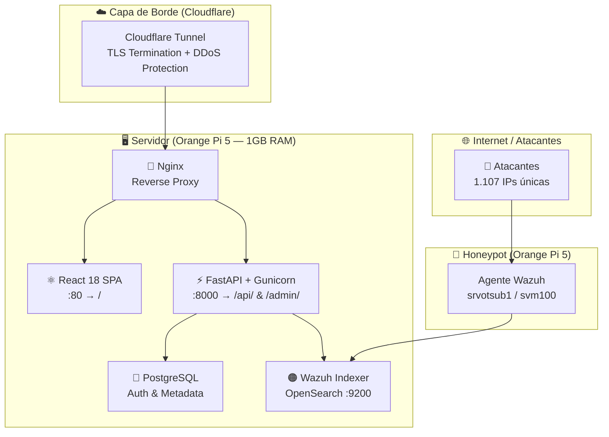
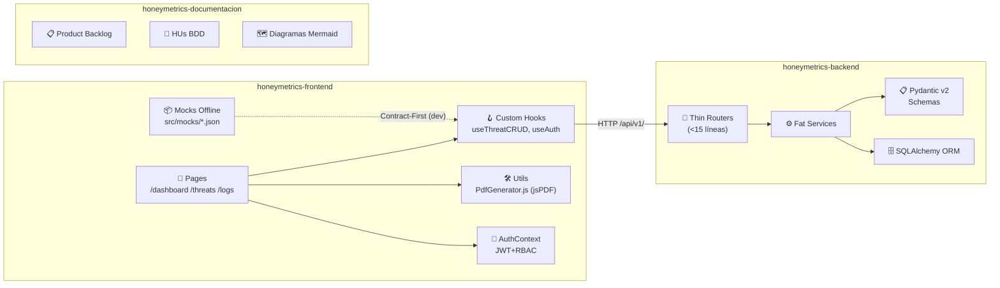
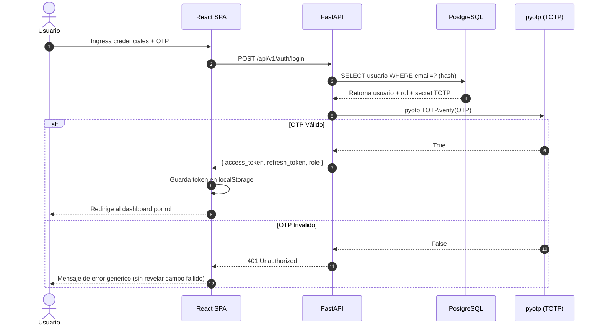
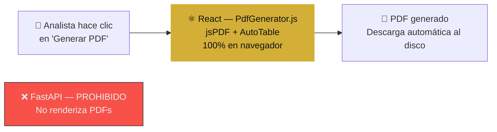
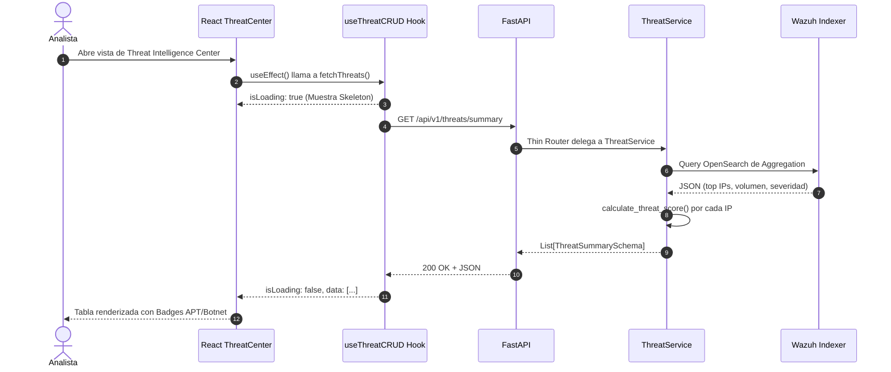

# 🏗️ Diseño del Sistema — Arquitectura Polyrepo

> **Principio rector:** Separación estricta de responsabilidades. Ningún repositorio mezcla capas de otro.
> **Stack de decisión:** FastAPI (asíncrono nativo) + React 18 SPA. Django descartado por su naturaleza monolítica.
> **Fuente de datos:** 165.247 eventos reales de Wazuh Indexer | 5 meses | Abril — Agosto 2026

## 1. Visión General del Ecosistema

## 2. Diagrama de Componentes Internos

## 3. Flujo de Autenticación JWT + 2FA

## 4. Regla de Oro: Offloading de PDF (Protección de RAM)

El servidor Orange Pi 5 opera con **1GB de RAM compartida** entre Nginx, FastAPI con Gunicorn (workers), y el Wazuh Indexer. La generación de PDFs grandes en el servidor causaría OOM (Out of Memory) en producción. Esta es una **decisión arquitectónica irrevocable**.

| Estrategia | Dónde se procesa | RAM del servidor consumida | Estado |
|---|---|---|---|
| PDF Client-Side (jsPDF) | Navegador del cliente | 0 MB adicional | ✅ Obligatorio |
| PDF Server-Side | FastAPI / Gunicorn | 200-500 MB por solicitud | 🚫 Prohibido |

## 5. Flujo de Datos: Threat Intelligence Center

## 6. Entornos de Despliegue

| Entorno | Archivo Docker Compose | Características Clave | Notas de Seguridad |
|---|---|---|---|
| **Desarrollo** | `docker-compose.override.yml` | Live Reload (Vite/Uvicorn), Mocks habilitados | Puertos internos expuestos para debug (`8000`, `5173`) |
| **Staging** | `docker-compose.yml` | Cloudflare Tunnel, datos reales limitados | Sin puertos expuestos al host público |
| **Producción** | `docker-compose.prod.yml` | Multi-Stage builds, Gunicorn con Uvicorn workers | Non-root users, TLS termination en CF |

> [!CAUTION]
> **Regla de seguridad explícita:** Las bases de datos (PostgreSQL, Wazuh Indexer) **JAMÁS** exponen puertos al host en `docker-compose.prod.yml`. El mapeo `5432:5432` o `9200:9200` está explícitamente prohibido. Solo Nginx expone los puertos necesarios internamente (o al host si CF Tunnel no lo absorbe).
