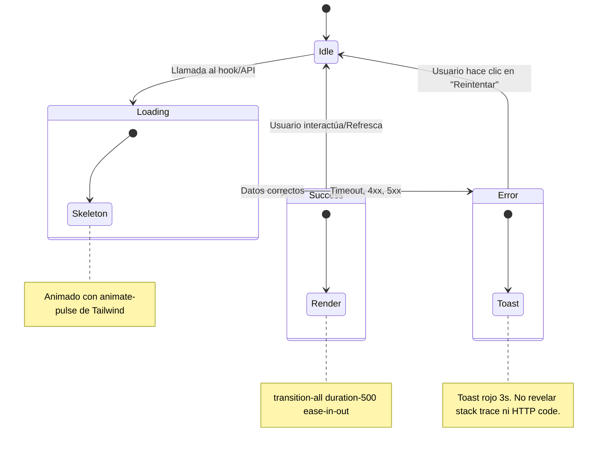
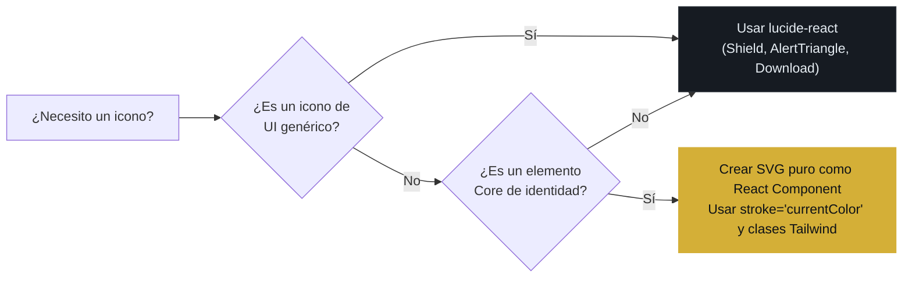
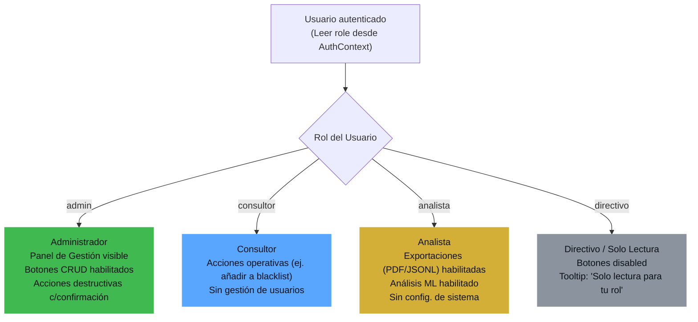

# 🎨 Design System UI/UX — Dark CTI Premium Theme

> **Identidad Visual:** Dark CTI Premium. Inspirado en interfaces SIEM enterprise (Darktrace, CrowdStrike Falcon).
> **Regla fundamental:** Ningún componente usa CSS inline. Todo se controla con clases Tailwind y variables CSS.

## 1. Tokens de Diseño (Paleta Corporativa)

| Token (Clase Tailwind) | Valor Hexadecimal | Uso Semántico |
|---|---|---|
| `hm-bg` | `#0d1117` | Background global de la aplicación. |
| `hm-card` | `#161b22` | Superficie de tarjetas y paneles. |
| `hm-border` | `#30363d` | Bordes sutiles entre elementos. |
| `hm-text` | `#e6edf3` | Texto principal de alta legibilidad. |
| `hm-muted` | `#8b949e` | Texto secundario, metadatos, fechas. |
| `hm-gold` | `#d4af37` | Acento principal, botones primarios, bordes de énfasis. |
| `hm-gold-dim` | `#a07d20` | Estado hover del dorado. |
| `hm-red` | `#f85149` | Alertas críticas, errores, amenazas altas. |
| `hm-orange` | `#e3b341` | Alertas medias, botnets, warnings. |
| `hm-green` | `#3fb950` | Estado OK, compliance aprobado, score positivo. |
| `hm-blue` | `#58a6ff` | Información, links, IPs neutrales. |

```javascript
// tailwind.config.js — Fragmento de extend.colors
module.exports = {
  theme: {
    extend: {
      colors: {
        'hm-bg':       '#0d1117',
        'hm-card':     '#161b22',
        'hm-border':   '#30363d',
        'hm-text':     '#e6edf3',
        'hm-muted':    '#8b949e',
        'hm-gold':     '#d4af37',
        'hm-gold-dim': '#a07d20',
        'hm-red':      '#f85149',
        'hm-orange':   '#e3b341',
        'hm-green':    '#3fb950',
        'hm-blue':     '#58a6ff',
      }
    }
  }
}
```

## 2. Sistema de Glassmorfismo

> [!IMPORTANT]
> Todo contenedor de datos (tarjetas, modales, drawers, tooltips) DEBE usar `.glass-card` o `.glass-modal`. Está prohibido usar fondos sólidos opacos.

```css
/* src/index.css */

/* Tarjetas y Paneles Estándar */
.glass-card {
  background: rgba(22, 27, 34, 0.75);
  backdrop-filter: blur(12px);
  -webkit-backdrop-filter: blur(12px);
  border: 1px solid rgba(48, 54, 61, 0.6);
  box-shadow: 0 8px 32px rgba(0, 0, 0, 0.4);
  border-radius: 12px;
}

/* Modales Premium / Destacados */
.glass-modal {
  background: rgba(13, 17, 23, 0.85);
  backdrop-filter: blur(20px);
  -webkit-backdrop-filter: blur(20px);
  border: 1px solid rgba(212, 175, 55, 0.2); /* borde dorado sutil */
  box-shadow: 0 25px 50px rgba(0, 0, 0, 0.7);
  border-radius: 12px;
}
```

## 3. Máquina de Estados de UI (UX States)



## 4. Tabla de Micro-interacciones Obligatorias

| Elemento UI | Clase Tailwind de transición obligatoria | Descripción del comportamiento |
|---|---|---|
| Botón CTA (Dorado) | `transition-all duration-300 ease-in-out hover:bg-hm-gold-dim` | Cambio suave de color en hover. |
| Panel Lateral / Drawer | `transition-all duration-500 ease-in-out translate-x-0` | Deslizamiento lateral fluido. |
| Tarjeta de Datos | `hover:border-hm-gold/30 hover:shadow-lg transition-all duration-300` | Borde dorado sutil al hacer hover. |
| Tooltip | `transition-opacity duration-200 opacity-0 hover:opacity-100` | Aparición suave por opacidad. |
| Modal | `transition-all duration-300 scale-95 opacity-0 hover:scale-100 hover:opacity-100` | Efecto pop-in (zoom in suave). |
| Pestañas / Iconos SVG | `transition-all duration-500 ease-in-out` | Prohibido el cambio brusco de color/icono. |

## 5. Árbol de Decisión de Iconografía



**Ejemplo SVG Core Custom:**
```jsx
// src/common/icons/HoneyMetricsLogo.jsx
export const HoneyMetricsLogo = ({ className = "w-8 h-8 text-hm-gold" }) => (
  <svg className={className} viewBox="0 0 24 24" fill="none"
       stroke="currentColor" strokeWidth={1.5} strokeLinecap="round">
    <path d="M12 2 L20 6.5 V15.5 L12 20 L4 15.5 V6.5 Z" />
    <circle cx="12" cy="11" r="2.5" />
  </svg>
);
```

## 6. Integración de Plotly.js en Dark Mode (Regla Obligatoria)

Plotly.js por defecto usa fondo blanco. En HoneyMetrics, TODOS los gráficos deben tener fondo transparente para integrarse con el glassmorfismo del contenedor `.glass-card`.

```jsx
// Configuración Obligatoria para componentes Plotly
<Plot
  data={chartData}
  layout={{
    paper_bgcolor: 'transparent', // OBLIGATORIO
    plot_bgcolor: 'transparent',  // OBLIGATORIO
    font: { color: '#e6edf3', family: 'Inter, sans-serif' },
    xaxis: { gridcolor: '#30363d', zerolinecolor: '#30363d' },
    yaxis: { gridcolor: '#30363d', zerolinecolor: '#30363d' },
    margin: { t: 30, r: 10, b: 40, l: 50 },
  }}
  config={{ displayModeBar: false, responsive: true }}
  useResizeHandler={true} // OBLIGATORIO para responsive
  style={{ width: '100%', height: '100%' }}
  className="w-full"
/>
```

## 7. RBAC Visual: Árbol de Decisión por Rol



**Ejemplo de componente RoleGuard:**
```jsx
// src/layout/RoleGuard.jsx
import { useContext } from 'react';
import { AuthContext } from '@/context/AuthContext';

export const RoleGuard = ({ allowedRoles, children, fallback = null }) => {
  const { user } = useContext(AuthContext);
  if (!user || !allowedRoles.includes(user.role)) return fallback;
  return children;
};
```
