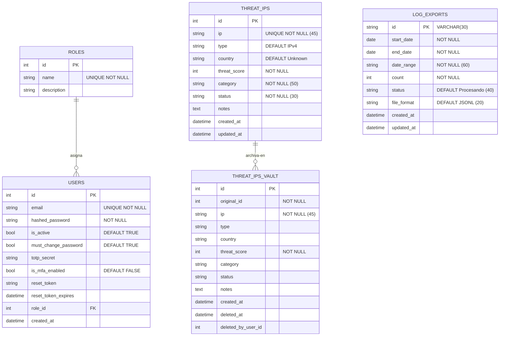

# Diccionario de Datos — HoneyMetrics v2.0

Este documento establece el mapa relacional y el diccionario de datos de la infraestructura de tablas del sistema HoneyMetrics v2.0. Cubre las especificaciones físicas exactas de cada columna, sus restricciones, valores por defecto y la justificación de las decisiones de diseño no evidentes, modeladas bajo SQLAlchemy para PostgreSQL.

> **Ver también:**
> - [manual-tecnico.md](./manual-tecnico.md) — Diagramas de secuencia que ilustran cómo estas tablas participan en los flujos de negocio (Login MFA, CTI, descarga de logs).
> - [matriz-cambios.md](./matriz-cambios.md) — Ruta exacta de los archivos `.py` donde se declaran cada uno de estos modelos ORM.
> - [guia-despliegue.md](./guia-despliegue.md) — Flujo de inicialización y seeding de datos (`seed_admin.py`) en un servidor nuevo.

---

## Índice

- [1. Modelo Entidad-Relación (MER)](#1-modelo-entidad-relación-mer)
- [2. Diccionario de Datos](#2-diccionario-de-datos)
  - [Tabla: users](#tabla-users)
  - [Tabla: roles](#tabla-roles)
  - [Tabla: threat\_ips](#tabla-threat_ips)
  - [Tabla: threat\_ips\_vault](#tabla-threat_ips_vault)
  - [Tabla: log\_exports](#tabla-log_exports)
- [3. Control de Acceso Basado en Roles (RoleEnum)](#3-control-de-acceso-basado-en-roles-roleenum)
- [4. Índices y Constraints Críticos](#4-índices-y-constraints-críticos)
- [5. Operaciones de Seeding e Inicialización](#5-operaciones-de-seeding-e-inicialización)

---

## 1. Modelo Entidad-Relación (MER)

El sistema HoneyMetrics v2.0 está organizado en torno a **5 tablas operativas** distribuidas en 3 dominios funcionales: Identidad y Control de Acceso, Inteligencia de Amenazas (CTI), y Trazabilidad Forense de Logs.

> [!NOTE]
> **Decisión de Diseño — Polyrepo sin FK entre dominios:** La tabla `log_exports` no almacena una FK hacia `users`. Esta fue una decisión deliberada: el analista que solicita la descarga es identificado por el token JWT activo en la sesión, no por una columna en la tabla. Esto simplifica el modelo y evita dependencias cíclicas entre el módulo de Logs y el módulo de Identidad. La trazabilidad del solicitante se garantiza a través del log de auditoría de la API (FastAPI middleware), no de la base de datos relacional.

---

## 2. Diccionario de Datos

Las tablas operativas que sostienen toda la arquitectura de negocio del sistema se describen con exactitud bajo sus especificaciones físicas, sus restricciones de integridad y la justificación de las decisiones de modelado.

---

### Tabla: `users`

**Propósito de la tabla:** Tabla central del sistema de identidades. Almacena las credenciales de acceso, el estado de activación, la configuración de autenticación de doble factor (TOTP) y el control de ciclo de vida de la contraseña de cada cuenta autorizada en la plataforma HoneyMetrics.

**Archivo ORM:** [`app/models/user.py`](../README.md) — Clase `User`.

| Nombre del Campo | Tipo de Dato | Restricción | Obligatorio | Descripción detallada |
| :--- | :--- | :--- | :---: | :--- |
| `id` | `INTEGER` | `PK`, `AUTOINCREMENT`, `INDEX` | ✅ | Identificador único de cada cuenta. Referenciado como llave foránea desde la tabla `roles`. Generado automáticamente por la base de datos. |
| `email` | `VARCHAR` | `UNIQUE`, `NOT NULL`, `INDEX` | ✅ | Correo electrónico que actúa como nombre de usuario para el inicio de sesión. Se aplica unicidad estricta a nivel de base de datos para impedir cuentas duplicadas. |
| `hashed_password` | `VARCHAR` | `NOT NULL` | ✅ | Contraseña cifrada mediante el algoritmo **Bcrypt** con factor de trabajo 12. El sistema nunca almacena contraseñas en texto plano en ninguna capa. |
| `is_active` | `BOOLEAN` | `DEFAULT TRUE` | ✅ | Indicador de estado de la cuenta. Cuando se establece en `FALSE`, el usuario es rechazado en el proceso de autenticación sin eliminar su registro histórico. Esto implementa el patrón de **Borrado Lógico (Soft Delete)**, preservando la trazabilidad de acciones pasadas. |
| `must_change_password` | `BOOLEAN` | `DEFAULT TRUE` | ✅ | Flag de forzado de cambio de contraseña. Cuando el administrador crea un usuario, este campo se inicializa en `TRUE`, obligando al usuario a establecer su propia contraseña en el primer acceso. Una vez cambiada, se revierte a `FALSE`. |
| `totp_secret` | `VARCHAR` | `NULLABLE` | ❌ | Semilla secreta compartida con la aplicación de autenticación (Google Authenticator, Authy). Codificada en Base32. Este campo permanece `NULL` hasta que el usuario completa el flujo de configuración del doble factor desde su perfil. |
| `is_mfa_enabled` | `BOOLEAN` | `DEFAULT FALSE` | ✅ | Interruptor de activación del segundo factor. Cuando es `TRUE`, el backend exige el código OTP de 6 dígitos como paso adicional obligatorio después de validar la contraseña. Este campo solo pasa a `TRUE` cuando el usuario verifica exitosamente el código TOTP por primera vez, confirmando que su dispositivo está correctamente sincronizado. |
| `reset_token` | `VARCHAR` | `NULLABLE`, `INDEX` | ❌ | Token criptográfico de un solo uso generado durante el flujo de recuperación de contraseña. Una vez consumido o expirado, se revierte a `NULL`. El índice acelera la búsqueda por token en el endpoint de reset. |
| `reset_token_expires` | `DATETIME` | `NULLABLE` | ❌ | Marca de tiempo de expiración del `reset_token`. El backend valida que este timestamp sea posterior al momento de la solicitud antes de permitir el cambio de contraseña. |
| `role_id` | `INTEGER` | `FK (roles.id)`, `NOT NULL` | ✅ | Llave foránea al rol asignado al usuario. Determina el conjunto de endpoints y capacidades disponibles para esta cuenta según el motor de RBAC (`RoleChecker`). |
| `created_at` | `DATETIME` | `NULLABLE` | ❌ | Marca de tiempo de creación del registro. Se establece en el momento en que el administrador crea la cuenta. Permite auditar la antigüedad de las cuentas en el sistema. |

> [!IMPORTANT]
> **Decisión de Diseño — `must_change_password`:** Este campo implementa el principio de seguridad de "credenciales temporales de primer uso". Cuando el administrador crea un usuario desde el panel de administración, le asigna una contraseña temporal. Si el sistema no forzara el cambio, las contraseñas temporales podrían reutilizarse indefinidamente (contrariando el principio de menor exposición). El frontend detecta este flag en el JWT y redirige al usuario al formulario de cambio antes de permitirle acceder a cualquier otra pantalla.

> [!WARNING]
> **`totp_secret` no está cifrado en reposo en la versión actual.** La Fase 2 Enterprise contempla cifrar este valor con Fernet AES-256 (idéntico al patrón implementado en HoneyMetrics v1) para cumplir con requerimientos de seguridad de grado corporativo.

---

### Tabla: `roles`

**Propósito de la tabla:** Catálogo de roles del sistema de control de acceso (RBAC). Cada registro define un perfil jerárquico con un conjunto determinado de capacidades dentro de la plataforma. Los roles son gestionados mediante la enumeración `RoleEnum` en `app/core/constants.py` para garantizar consistencia tipada.

**Archivo ORM:** [`app/models/role.py`](../README.md) — Clase `Role`.

| Nombre del Campo | Tipo de Dato | Restricción | Obligatorio | Descripción detallada |
| :--- | :--- | :--- | :---: | :--- |
| `id` | `INTEGER` | `PK`, `AUTOINCREMENT`, `INDEX` | ✅ | Identificador numérico único del rol. Referenciado como FK desde la tabla `users`. |
| `name` | `VARCHAR` | `UNIQUE`, `NOT NULL`, `INDEX` | ✅ | Nombre canónico del rol. **Debe coincidir exactamente** con los valores declarados en `RoleEnum` (sensible a mayúsculas, minúsculas y caracteres especiales). El motor de RBAC compara este campo directamente con el rol del JWT para tomar decisiones de acceso. Ver [Sección 3](#3-control-de-acceso-basado-en-roles-roleenum) para los valores canónicos. |
| `description` | `VARCHAR` | `NULLABLE` | ❌ | Descripción funcional del rol orientada a la comprensión del administrador, no del sistema. Explica en lenguaje natural las capacidades y responsabilidades del perfil. |

> [!CAUTION]
> **Modificar el campo `name` de un rol existente en producción es una operación crítica.** Si el valor en la base de datos deja de coincidir con el valor correspondiente en `RoleEnum`, **todos los usuarios asignados a ese rol serán rechazados con error 403** en todos los endpoints protegidos. Cualquier renombramiento debe ejecutarse como una migración atómica que actualice simultáneamente la tabla `roles` y el enum en `constants.py`.

---

### Tabla: `threat_ips`

**Propósito de la tabla:** Centro de Inteligencia de Amenazas (CTI). Almacena el registro activo de todas las direcciones IP identificadas como maliciosas por el sistema de honeypots y analistas. Es la tabla sobre la que opera el **Threat Center** del Dashboard y sobre la cual el motor de RBAC restringe el acceso por rol (solo Administrador y Analista pueden crear/modificar).

**Archivo ORM:** [`app/models/threat.py`](../README.md) — Clase `ThreatIP`.

| Nombre del Campo | Tipo de Dato | Restricción | Obligatorio | Descripción detallada |
| :--- | :--- | :--- | :---: | :--- |
| `id` | `INTEGER` | `PK`, `AUTOINCREMENT`, `INDEX` | ✅ | Identificador secuencial de cada amenaza registrada. Al ser archivada en `threat_ips_vault`, este ID se preserva en el campo `original_id` de esa tabla. |
| `ip` | `VARCHAR(45)` | `UNIQUE`, `NOT NULL`, `INDEX` | ✅ | Dirección IP de la amenaza. El tamaño de **45 caracteres** es intencional: soporta tanto direcciones **IPv4** (`15 chars`) como **IPv6 expandida** (`39 chars`) y **IPv6 comprimida mapeada a IPv4** (`45 chars`). La restricción `UNIQUE` impide el registro duplicado de la misma IP; el servicio lanza `409 Conflict` si se intenta insertar una IP ya existente. |
| `type` | `VARCHAR(20)` | `DEFAULT 'IPv4'`, `NOT NULL` | ✅ | Versión del protocolo de red de la dirección IP. Valores posibles: `"IPv4"` o `"IPv6"`. El servicio lo infiere automáticamente desde el formato de la IP al momento de la creación. |
| `country` | `VARCHAR(100)` | `DEFAULT 'Unknown'`, `NOT NULL` | ✅ | País de procedencia de la amenaza según geolocalización IP. Se infiere al crear el registro. El valor `"Unknown"` se asigna cuando la consulta de geolocalización falla o la IP es de una red privada (RFC 1918). |
| `threat_score` | `INTEGER` | `NOT NULL` | ✅ | Puntuación de riesgo calculada heurísticamente por `ThreatService.calculate_threat_score()`. Escala de 0 a 100. La puntuación pondera la frecuencia de eventos, el tipo de ataque, la persistencia y el origen geográfico. Un score ≥ 80 activa notificaciones automáticas. |
| `category` | `VARCHAR(50)` | `NOT NULL` | ✅ | Clasificación del vector de ataque principal. Ejemplos: `"SSH Brute Force"`, `"Port Scan"`, `"Web Exploit"`, `"Credential Stuffing"`. El campo es libre pero se espera vocabulario controlado del equipo de seguridad. |
| `status` | `VARCHAR(30)` | `NOT NULL` | ✅ | Estado operativo de la amenaza en el sistema. Valores actuales: `"Activo"` (bloqueado en el firewall), `"En Observación"` (detectado pero sin bloqueo confirmado), `"Archivado"` (movido a la bóveda). El status lo gestiona `ThreatCRUDService`. |
| `notes` | `TEXT` | `NULLABLE` | ❌ | Campo de texto libre para notas del analista. Permite documentar hallazgos forenses, contexto de campañas de ataque o decisiones de clasificación que no caben en los campos estructurados. |
| `created_at` | `DATETIME` | `DEFAULT NOW()`, `NOT NULL` | ✅ | Timestamp de la primera detección. Usado para calcular la antigüedad de la amenaza, filtrar por rango temporal en el Dashboard y en los reportes ejecutivos. |
| `updated_at` | `DATETIME` | `DEFAULT NOW()`, `ON UPDATE NOW()`, `NOT NULL` | ✅ | Timestamp de la última modificación del registro. Se actualiza automáticamente por SQLAlchemy cada vez que el objeto es modificado y guardado. Permite detectar amenazas que han sido revisadas recientemente. |

> [!NOTE]
> **Decisión de Diseño — `VARCHAR(45)` para `ip`:** RFC 5952 define que la representación textual máxima de una dirección IPv6 es de 39 caracteres. Sin embargo, las notaciones de "IPv4 mapeada a IPv6" (ej. `::ffff:192.168.1.1`) pueden alcanzar los 45 caracteres. Usar `VARCHAR(45)` como estándar garantiza compatibilidad con cualquier representación de dirección IP presente o futura sin necesidad de migraciones de esquema.

> [!TIP]
> **Integración con MISP y OpenCTI:** Cuando una IP es registrada con `status = "Activo"`, el servicio `MispPublisherService` puede publicar automáticamente el Indicador de Compromiso (IoC) en la plataforma MISP del equipo. El servicio `OpenCTICacheService` enriquece el contexto de la amenaza con datos de campañas conocidas antes de guardarlo. Esto forma el pipeline completo de Threat Intelligence Sharing.

---

### Tabla: `threat_ips_vault`

**Propósito de la tabla:** Bóveda forense de tipo **Append-Only** que preserva copias íntegras de las amenazas eliminadas del registro activo. Su estructura garantiza la **trazabilidad forense** y el principio de **No Repudio**: una vez archivado un registro, no puede modificarse. Responde al requerimiento de Cadena de Custodia en investigaciones de incidentes.

**Archivo ORM:** [`app/models/threat.py`](../README.md) — Clase `ThreatIPVault`.

| Nombre del Campo | Tipo de Dato | Restricción | Obligatorio | Descripción detallada |
| :--- | :--- | :--- | :---: | :--- |
| `id` | `INTEGER` | `PK`, `AUTOINCREMENT`, `INDEX` | ✅ | Identificador único del registro en la bóveda. Es **independiente** del ID original de la amenaza para evitar colisiones y garantizar la secuencia propia de la tabla de auditoría. |
| `original_id` | `INTEGER` | `NOT NULL` | ✅ | ID que tenía la amenaza en la tabla `threat_ips` antes de ser archivada. Permite cruzar referencias entre el registro activo y su historial forense. |
| `ip` | `VARCHAR(45)` | `NOT NULL` | ✅ | Dirección IP archivada. Se copia literalmente desde `threat_ips.ip` en el momento del archivado para garantizar inmutabilidad del dato forense. |
| `type` | `VARCHAR(20)` | `DEFAULT 'IPv4'` | ❌ | Versión del protocolo. Copia del valor que tenía el registro en el momento de ser archivado. |
| `country` | `VARCHAR(100)` | `DEFAULT 'Unknown'` | ❌ | País de origen. Copia del valor en el momento del archivado. |
| `threat_score` | `INTEGER` | `NOT NULL` | ✅ | Puntuación de riesgo en el momento del archivado. Refleja el nivel de amenaza que tenía la IP cuando fue retirada del registro activo. |
| `category` | `VARCHAR(50)` | — | ❌ | Categoría del ataque en el momento del archivado. |
| `status` | `VARCHAR(30)` | — | ❌ | Estado que tenía la amenaza en el momento de su retiro del registro activo (generalmente `"Archivado"`). |
| `notes` | `TEXT` | `NULLABLE` | ❌ | Notas del analista preservadas integralmente desde el registro original. |
| `created_at` | `DATETIME` | `NOT NULL` | ✅ | Fecha de primera detección de la amenaza, copiada del registro original. Permite calcular cuánto tiempo estuvo activa la amenaza en el sistema. |
| `deleted_at` | `DATETIME` | `DEFAULT NOW()`, `NOT NULL` | ✅ | Marca de tiempo legal del archivado. Es el campo principal de auditoría que certifica cuándo se tomó la decisión de retirar la amenaza del registro activo. |
| `deleted_by_user_id` | `INTEGER` | `NULLABLE` | ❌ | ID del usuario que ejecutó el archivado. Establece la cadena de custodia sobre la acción destructiva. Es `NULLABLE` para manejar el caso de borrado automatizado por el sistema. |

> [!IMPORTANT]
> **Diseño Append-Only — No se implementan `UPDATE` ni `DELETE` en esta tabla.** El servicio `ThreatCRUDService` solo ejecuta `INSERT` hacia `threat_ips_vault`. No existe ningún endpoint de la API que permita modificar o eliminar registros de esta tabla. Este diseño es equivalente a la tabla `blacklist_audit_vault` de HoneyMetrics v1, que también usaba esta filosofía de inmutabilidad para cumplir con requerimientos forenses.

---

### Tabla: `log_exports`

**Propósito de la tabla:** Registra y controla el ciclo de vida completo de cada solicitud de extracción masiva de eventos de Wazuh. Gestiona el flujo de aprobación Human-in-the-Loop (HITL) vía Telegram para extracciones que superan los 7 días de rango, y sirve como historial de trazabilidad para auditorías de acceso a datos sensibles.

**Archivo ORM:** [`app/models/log_export.py`](../README.md) — Clase `LogExport`.

| Nombre del Campo | Tipo de Dato | Restricción | Obligatorio | Descripción detallada |
| :--- | :--- | :--- | :---: | :--- |
| `id` | `VARCHAR(30)` | `PK`, `INDEX` | ✅ | Identificador único de la solicitud. Se genera como un **ID legible por humanos** en el servicio (ej. `"LOG-20261004-0042"`), no como un UUID opaco. Esto facilita la referenciación en comunicaciones de Telegram y en la interfaz. |
| `start_date` | `DATE` | `NOT NULL` | ✅ | Límite inferior del rango temporal para la consulta al indexador de Wazuh (`wazuh-archives-*`). El servicio valida que `start_date` sea anterior a `end_date`. |
| `end_date` | `DATE` | `NOT NULL` | ✅ | Límite superior del rango temporal. Si `end_date - start_date > 7 días`, el sistema activa el flujo de aprobación HITL enviando la solicitud al administrador vía Telegram antes de ejecutar la extracción. |
| `date_range` | `VARCHAR(60)` | `NOT NULL` | ✅ | Representación textual del rango de fechas pre-calculada (ej. `"2026-09-01 al 2026-09-30"`). Se usa en los mensajes de Telegram y en la interfaz para mejorar la legibilidad sin necesidad de reformatear las fechas en cada consulta. |
| `count` | `INTEGER` | `NOT NULL` | ✅ | Volumen de eventos de Wazuh contenidos en el rango de fechas solicitado. Se calcula con una consulta de conteo preliminar a Wazuh antes de iniciar la extracción completa. |
| `status` | `VARCHAR(40)` | `DEFAULT 'Procesando'`, `NOT NULL` | ✅ | Estado actual del ciclo de vida de la solicitud. Máquina de estados: `"Procesando"` → `"Pendiente de Aprobación"` → `"Aprobado"` / `"Rechazado"` → `"Completado"` / `"Error"`. |
| `file_format` | `VARCHAR(20)` | `DEFAULT 'JSONL'`, `NOT NULL` | ✅ | Formato del archivo de salida generado. El valor actual y único es `"JSONL"` (JSON Lines), óptimo para streaming y procesamiento de grandes volúmenes sin cargar el archivo completo en memoria. |
| `created_at` | `DATETIME` | `DEFAULT NOW()`, `NOT NULL` | ✅ | Fecha y hora exacta de creación de la solicitud. Permite calcular tiempos de respuesta del sistema y tiempos de aprobación del administrador. |
| `updated_at` | `DATETIME` | `DEFAULT NOW()`, `ON UPDATE NOW()`, `NOT NULL` | ✅ | Timestamp de la última transición de estado. Junto con `created_at`, permite medir el tiempo total del proceso de extracción. |

> [!NOTE]
> **Decisión de Diseño — `id` como `VARCHAR(30)` legible vs UUID:** La elección de un ID legible por humanos (en lugar de un UUID v4 como `"f47ac10b-58cc-4372-a567-0e02b2c3d479"`) es intencional. Los mensajes de callback de Telegram que el administrador recibe incluyen el ID de la solicitud en los botones de "Aprobar" y "Rechazar". Un ID como `"LOG-20261004-0042"` es mucho más amigable en ese contexto que un UUID. El `VARCHAR(30)` es suficiente para el esquema `LOG-YYYYMMDD-NNNN` con hasta 9.999 solicitudes por día.

> [!NOTE]
> **Decisión de Diseño — Formato JSONL sobre CSV o JSON:** JSONL (JSON Lines) asigna un objeto JSON por línea del archivo. Esto permite procesar archivos de millones de eventos con un simple iterador `for line in file` sin cargar el dataset completo en RAM, lo que es crítico en el Nodo Central cuya memoria es compartida con el indexador de Wazuh y PostgreSQL.

---

## 3. Control de Acceso Basado en Roles (RoleEnum)

El sistema de autorización de HoneyMetrics es de tipo **RBAC (Role-Based Access Control)** y está gobernado por una enumeración estricta en Python que actúa como única fuente de verdad (Single Source of Truth) para los nombres de roles.

**Archivo:** [`app/core/constants.py`](../README.md) — Clase `RoleEnum`.

| Constante `RoleEnum` | Valor en BD (`roles.name`) | Capacidades Principales |
| :--- | :--- | :--- |
| `RoleEnum.ADMINISTRADOR` | `"Administrador"` | Acceso total al sistema: gestión de usuarios, roles, aprobación de bloqueos por Telegram, acceso al Admin Hub, y todas las operaciones del Threat Center. |
| `RoleEnum.ANALISTA` | `"Analista de datos"` | Lectura y escritura en el Threat Center. Solicitud y descarga de logs forenses (JSONL). Visualización del Dashboard completo. |
| `RoleEnum.CONSULTOR` | `"Consultor de Ciberseguridad"` | Acceso de solo lectura al Threat Center y al Dashboard. Exportación del reporte ejecutivo en PDF. No puede crear ni modificar amenazas. |
| `RoleEnum.DIRECTIVO` | `"Directivo de T.I."` | Acceso exclusivo al Dashboard Ejecutivo de alto nivel para reportes gerenciales. No tiene acceso al Threat Center ni a logs crudos. |

> [!CAUTION]
> **Por qué `RoleEnum` y no strings directos:** Antes de la refactorización de seguridad de octubre 2026, el sistema usaba strings literales en los endpoints, como `RoleChecker(["Analista de datos", "Administrador"])`. Esta práctica es una vulnerabilidad de lógica de negocio: un error tipográfico (`"Analista de Datos"` con mayúscula en "Datos") deniega silenciosamente el acceso sin ningún error en tiempo de compilación. La adopción de `RoleEnum` garantiza que cualquier discrepancia sea detectada por el intérprete de Python antes de llegar a producción.

---

## 4. Índices y Constraints Críticos

La siguiente tabla resume los índices no-triviales implementados y la justificación de su existencia desde el punto de vista del rendimiento y la integridad.

| Tabla | Campo | Tipo de Índice / Constraint | Justificación de Rendimiento o Integridad |
| :--- | :--- | :--- | :--- |
| `users` | `email` | `UNIQUE`, `INDEX` | La autenticación realiza un `WHERE email = ?` en cada login. Sin índice, esto sería un Full Table Scan. La unicidad garantiza identidades irrepetibles. |
| `users` | `reset_token` | `INDEX` | El endpoint de reset de contraseña busca por token. El índice convierte esa búsqueda de O(n) a O(log n). |
| `roles` | `name` | `UNIQUE`, `INDEX` | El motor RBAC realiza búsquedas frecuentes por nombre de rol. La unicidad previene roles duplicados con nombres idénticos. |
| `threat_ips` | `ip` | `UNIQUE`, `INDEX` | El Threat Center busca IPs por valor exacto en cada operación de creación (para detectar duplicados) y en el flujo de enriquecimiento con OpenCTI. La unicidad implementa la regla de negocio de que una IP solo puede tener un registro activo. |
| `log_exports` | `id` | `INDEX` | Las callbacks de Telegram referencian el ID de la solicitud para ejecutar la transición de estado. El índice asegura que esa búsqueda puntual sea instantánea incluso con miles de registros históricos. |

---

## 5. Operaciones de Seeding e Inicialización

Los procedimientos de poblamiento de datos iniciales son operaciones de despliegue, no de esquema. Se delegan a la guía de despliegue para mantener este documento enfocado en la especificación de datos.

Para los flujos de inicialización de la base de datos con comandos exactos, consultar:

- 📄 **[guia-despliegue.md → Sección 3: Inicialización de Datos Semilla](./guia-despliegue.md#3-inicialización-de-datos-semilla-dba-friendly)** — Cómo ejecutar `seed_admin.py` para crear los roles canónicos y el primer usuario administrador.
- 📄 **[matriz-cambios.md → Scripts de Inicialización](./matriz-cambios.md#scripts-de-inicialización)** — Ruta exacta de `scripts/seed_admin.py` y `scripts/seed_demo_data.py` en el repositorio del backend.
