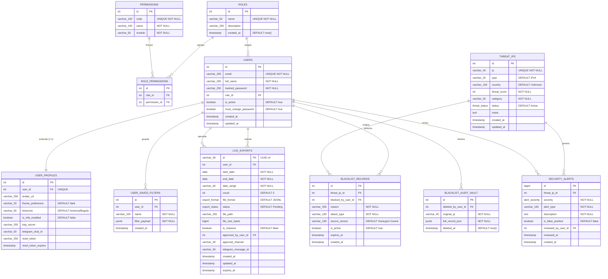

# Diccionario de Datos — HoneyMetrics v2.0

Este documento establece el mapa relacional y el diccionario de datos de la infraestructura de tablas del sistema HoneyMetrics v2.0. Cubre las especificaciones físicas exactas de cada columna, sus restricciones, valores por defecto, políticas de borrado en relaciones FK y la justificación de las decisiones de diseño no evidentes. El modelo está definido bajo el esquema Code-First de SQLAlchemy para PostgreSQL y fue aprobado en el artefacto DBML canónico (`dbdiagram-mer-review.txt`).

> **Ver también:**
> - [manual-tecnico.md](./manual-tecnico.md) — Diagramas de secuencia que ilustran cómo estas tablas participan en los flujos de autenticación, CTI y descarga de logs.
> - [matriz-cambios.md](./matriz-cambios.md) — Ruta exacta de los archivos `.py` donde se declaran cada uno de estos modelos ORM.
> - [guia-despliegue.md](./guia-despliegue.md) — Flujo de inicialización y seeding de datos (`seed_admin.py`) en un servidor nuevo.

---

## Índice

- [1. Modelo Entidad-Relación (MER)](#1-modelo-entidad-relación-mer)
- [2. Enumeraciones del Sistema (Enums)](#2-enumeraciones-del-sistema-enums)
- [3. Módulo 1 — Seguridad, Autenticación y Control de Acceso](#3-módulo-1--seguridad-autenticación-y-control-de-acceso)
  - [Tabla: roles](#tabla-roles)
  - [Tabla: permissions](#tabla-permissions)
  - [Tabla: role\_permissions](#tabla-role_permissions)
  - [Tabla: users](#tabla-users)
  - [Tabla: user\_profiles](#tabla-user_profiles)
- [4. Módulo 2 — Threat Intelligence Center y Listas Negras](#4-módulo-2--threat-intelligence-center-y-listas-negras)
  - [Tabla: threat\_ips](#tabla-threat_ips)
  - [Tabla: blacklist\_records](#tabla-blacklist_records)
  - [Tabla: blacklist\_audit\_vault](#tabla-blacklist_audit_vault)
  - [Tabla: user\_saved\_filters](#tabla-user_saved_filters)
- [5. Módulo 3 — Descargas de Logs, Aprobaciones y Telegram](#5-módulo-3--descargas-de-logs-aprobaciones-y-telegram)
  - [Tabla: log\_exports](#tabla-log_exports)
- [6. Módulo 4 — Telemetría y Alertas](#6-módulo-4--telemetría-y-alertas)
  - [Tabla: security\_alerts](#tabla-security_alerts)
- [7. Relaciones FK y Políticas de Integridad Referencial](#7-relaciones-fk-y-políticas-de-integridad-referencial)
- [8. Índices y Constraints Críticos](#8-índices-y-constraints-críticos)
- [9. Operaciones de Seeding e Inicialización](#9-operaciones-de-seeding-e-inicialización)

---

## 1. Modelo Entidad-Relación (MER)

El sistema HoneyMetrics v2.0 está organizado en **11 tablas operativas** distribuidas en 4 módulos funcionales.

> [!NOTE]
> El Módulo 4 define también la tabla `ml_model_registry`, correspondiente al roadmap de Fase 2 (analítica avanzada) que está fuera del alcance de la entrega académica actual. Se excluye de este diccionario.

---

## 2. Enumeraciones del Sistema (Enums)

Las enumeraciones centralizan los valores permitidos en los campos de estado, garantizando que solo se inserten valores válidos y documentados. En PostgreSQL se implementan como tipos `ENUM` nativos; en SQLAlchemy como `sa.Enum(...)`.

### `threat_status` — Estado del Indicador de Compromiso (IoC)

| Valor | Significado Operativo |
| :--- | :--- |
| `Active` | La IP está confirmada como amenaza y activa en la lista negra. El firewall puede estar bloqueándola. |
| `Monitored` | La IP está en observación. Se detectó actividad sospechosa pero no se ha confirmado como amenaza definitiva. No está bloqueada. |
| `Whitelisted` | La IP fue revisada y se determinó que es legítima. Se excluye de futuras alertas automáticas. |

### `alert_severity` — Severidad de Alertas de Seguridad

| Valor | Umbral de Respuesta |
| :--- | :--- |
| `Low` | Actividad anómala de bajo impacto. Requiere registro pero no intervención inmediata. |
| `Medium` | Actividad sospechosa que puede escalar. Revisión recomendada en las próximas 24 horas. |
| `High` | Ataque activo o intrusión parcial. Requiere intervención en las próximas 4 horas. |
| `Critical` | Compromiso grave o exfiltración potencial de datos. Respuesta inmediata requerida. |

### `export_status` — Ciclo de Vida de Solicitudes de Exportación de Logs

| Valor | Descripción del Estado |
| :--- | :--- |
| `Pending` | La solicitud fue recibida y está en cola. Para solicitudes masivas (>7 días), espera aprobación por Telegram. |
| `Processing` | La extracción de logs desde Wazuh está en curso. |
| `Completed` | El archivo JSONL fue generado exitosamente y está disponible para descarga. |
| `Rejected` | Un administrador rechazó la solicitud desde el callback de Telegram. |
| `Failed` | La extracción falló por un error técnico (timeout de Wazuh, falta de espacio en disco, etc.). |
| `Expired` | El archivo generado superó su tiempo de vida (`expires_at`) y fue purgado del servidor. |

### `export_format` — Formato del Archivo de Exportación

| Valor | Descripción |
| :--- | :--- |
| `JSONL` | JSON Lines (un objeto JSON por línea). Óptimo para streaming y procesamiento de grandes volúmenes. |
| `CSV` | Valores separados por comas. Preparado para análisis en hojas de cálculo (Excel, Google Sheets). |

---

## 3. Módulo 1 — Seguridad, Autenticación y Control de Acceso

Este módulo gestiona el directorio de usuarios, los roles y los permisos granulares que rigen el acceso a cada capacidad del sistema.

---

### Tabla: `roles`

**Propósito de la tabla:** Catálogo de roles del sistema de control de acceso (RBAC). Cada registro define un perfil jerárquico con un conjunto determinado de capacidades. Los roles son gestionados mediante la enumeración `RoleEnum` en `app/core/constants.py` para garantizar consistencia tipada en todo el backend.

**Archivo ORM:** `app/models/role.py` — Clase `Role`.

| Nombre del Campo | Tipo de Dato | Restricción | Obligatorio | Descripción detallada |
| :--- | :--- | :--- | :---: | :--- |
| `id` | `INTEGER` | `PK`, `AUTOINCREMENT`, `INDEX` | ✅ | Identificador único del rol. Referenciado como FK desde las tablas `users` y `role_permissions`. |
| `name` | `VARCHAR(50)` | `UNIQUE`, `NOT NULL`, `INDEX` | ✅ | Nombre canónico del rol. **Debe coincidir exactamente** (mayúsculas, minúsculas, tildes) con los valores de `RoleEnum`. El motor de autorización compara este campo directamente con el claim del JWT. Valores válidos: `"Administrador"`, `"Analista de datos"`, `"Consultor de Ciberseguridad"`, `"Directivo de T.I."`. |
| `description` | `VARCHAR(255)` | `NULLABLE` | ❌ | Descripción funcional del rol orientada al administrador. Explica en lenguaje natural las responsabilidades del perfil. |
| `created_at` | `TIMESTAMP` | `NOT NULL`, `DEFAULT now()` | ✅ | Marca de tiempo de creación del rol. Todos los roles canónicos son insertados por `seed_admin.py` en el momento del despliegue inicial. |

> [!CAUTION]
> **Modificar el campo `name` de un rol en producción es una operación crítica.** Si el valor deja de coincidir con el `RoleEnum` correspondiente en el código, **todos los usuarios de ese rol recibirán error 403** en todos los endpoints protegidos. Cualquier renombramiento debe ejecutarse como migración atómica que actualice simultáneamente la base de datos y el enum.

---

### Tabla: `permissions`

**Propósito de la tabla:** Catálogo de permisos atómicos del sistema. Define acciones granulares (ej. `threats:delete`, `logs:export`) que pueden asignarse a roles mediante la tabla pivote `role_permissions`. Permite una gestión de acceso más fina que el RBAC puro por roles.

**Archivo ORM:** `app/models/permission.py` — Clase `Permission`.

| Nombre del Campo | Tipo de Dato | Restricción | Obligatorio | Descripción detallada |
| :--- | :--- | :--- | :---: | :--- |
| `id` | `INTEGER` | `PK`, `AUTOINCREMENT` | ✅ | Identificador único del permiso granular. |
| `code` | `VARCHAR(100)` | `UNIQUE`, `NOT NULL` | ✅ | Código técnico del permiso en formato `módulo:acción`. Ejemplos: `users:create`, `threats:delete`, `logs:export`, `metrics:view`. El backend usa este código para validar accesos en los decoradores de endpoint. |
| `name` | `VARCHAR(150)` | `NOT NULL` | ✅ | Nombre descriptivo del permiso, legible por humanos. Ej.: `"Eliminar Amenazas del Threat Center"`. |
| `module` | `VARCHAR(50)` | `NOT NULL` | ✅ | Módulo funcional al que pertenece el permiso. Valores predefinidos: `AUTH`, `THREATS`, `LOGS`, `METRICS`, `SETTINGS`. Permite agrupar y filtrar permisos por subsistema. |

---

### Tabla: `role_permissions`

**Propósito de la tabla:** Tabla pivote que implementa la relación muchos a muchos entre roles y permisos. Permite construir una matriz de control de acceso flexible: un mismo permiso puede asignarse a múltiples roles, y un rol puede tener múltiples permisos. El índice compuesto único en `(role_id, permission_id)` previene asignaciones duplicadas.

**Archivo ORM:** `app/models/role_permission.py` — Clase `RolePermission`.

| Nombre del Campo | Tipo de Dato | Restricción | Obligatorio | Descripción detallada |
| :--- | :--- | :--- | :---: | :--- |
| `id` | `INTEGER` | `PK`, `AUTOINCREMENT` | ✅ | Identificador de la asignación en la tabla pivote. |
| `role_id` | `INTEGER` | `FK (roles.id)`, `NOT NULL` | ✅ | Referencia al rol que recibe el permiso. `ON DELETE CASCADE`: si se elimina el rol, se eliminan automáticamente todas sus asignaciones de permisos. |
| `permission_id` | `INTEGER` | `FK (permissions.id)`, `NOT NULL` | ✅ | Referencia al permiso granular que se asigna al rol. `ON DELETE CASCADE`: si se elimina un permiso del catálogo, se elimina de todos los roles que lo tenían asignado. |

> [!NOTE]
> **Índice compuesto único en `(role_id, permission_id)`:** La restricción de unicidad compuesta garantiza que no puede existir la misma combinación rol-permiso dos veces en la tabla. Esto evita que un rol acumule el mismo permiso redundantemente y simplifica las consultas de verificación de acceso.

---

### Tabla: `users`

**Propósito de la tabla:** Directorio central de cuentas de acceso a la plataforma. Almacena las credenciales de autenticación y el estado operativo de cada usuario. Los datos de preferencias, configuración de MFA y notificaciones se segregan en `user_profiles` para mantener esta tabla enfocada exclusivamente en identidad y estado.

**Archivo ORM:** `app/models/user.py` — Clase `User`.

| Nombre del Campo | Tipo de Dato | Restricción | Obligatorio | Descripción detallada |
| :--- | :--- | :--- | :---: | :--- |
| `id` | `INTEGER` | `PK`, `AUTOINCREMENT`, `INDEX` | ✅ | Identificador único de cada cuenta. Referenciado como FK desde múltiples tablas del sistema (`user_profiles`, `blacklist_records`, `log_exports`, etc.). |
| `email` | `VARCHAR(255)` | `UNIQUE`, `NOT NULL`, `INDEX` | ✅ | Correo electrónico institucional que actúa como nombre de usuario para el inicio de sesión. La unicidad se aplica a nivel de base de datos para impedir cuentas duplicadas. |
| `full_name` | `VARCHAR(255)` | `NOT NULL` | ✅ | Nombre completo del analista o directivo. Se usa para personalizar la interfaz y para identificar al responsable en los registros de auditoría. |
| `hashed_password` | `VARCHAR(255)` | `NOT NULL` | ✅ | Contraseña cifrada mediante el algoritmo **Bcrypt** con factor de trabajo 12. El sistema nunca almacena contraseñas en texto plano en ninguna capa. |
| `role_id` | `INTEGER` | `FK (roles.id)`, `NOT NULL` | ✅ | Llave foránea al rol asignado. Determina el conjunto de endpoints y capacidades disponibles según el motor de RBAC (`RoleChecker`). `ON DELETE RESTRICT`: impide eliminar un rol si tiene usuarios asignados. |
| `is_active` | `BOOLEAN` | `DEFAULT true`, `NOT NULL` | ✅ | Estado de la cuenta. En `FALSE`, el usuario es rechazado en autenticación sin eliminar su registro histórico (**Borrado Lógico / Soft Delete**). Preserva la trazabilidad de acciones pasadas. |
| `must_change_password` | `BOOLEAN` | `DEFAULT true`, `NOT NULL` | ✅ | Flag de forzado de cambio de contraseña en el primer acceso. Cuando el administrador crea un usuario con contraseña temporal, este flag se inicializa en `TRUE`. El frontend detecta el flag en el JWT y bloquea el acceso a cualquier pantalla hasta que el usuario establezca su propia clave. |
| `created_at` | `TIMESTAMP` | `DEFAULT now()` | ❌ | Marca de tiempo de creación de la cuenta. |
| `updated_at` | `TIMESTAMP` | `DEFAULT now()` | ❌ | Timestamp de la última modificación del registro (cambio de rol, desactivación, etc.). |

> [!IMPORTANT]
> **Separación `users` / `user_profiles`:** Esta decisión de diseño sigue el patrón de extensión de perfil, donde `users` contiene solo lo imprescindible para la autenticación (credenciales y estado), mientras que `user_profiles` almacena las preferencias de experiencia de usuario (tema, zona horaria, MFA, Telegram). Esto facilita cachear los datos de identidad de forma segura sin exponer accidentalmente los secretos TOTP o los tokens de recuperación.

---

### Tabla: `user_profiles`

**Propósito de la tabla:** Extensión de perfil en relación uno a uno con `users`. Almacena las preferencias visuales del analista (tema, zona horaria), la configuración del segundo factor de autenticación (TOTP), el Chat ID de Telegram para recibir alertas operativas y el token de recuperación de contraseña.

**Archivo ORM:** `app/models/user_profile.py` — Clase `UserProfile`.

| Nombre del Campo | Tipo de Dato | Restricción | Obligatorio | Descripción detallada |
| :--- | :--- | :--- | :---: | :--- |
| `id` | `INTEGER` | `PK`, `AUTOINCREMENT` | ✅ | Identificador del perfil extendido. |
| `user_id` | `INTEGER` | `FK (users.id)`, `UNIQUE`, `NOT NULL` | ✅ | Referencia al usuario en `users`. La restricción `UNIQUE` garantiza que cada cuenta tenga exactamente un perfil (relación 1:1 estricta). `ON DELETE CASCADE`: si se elimina la cuenta de usuario, su perfil se elimina automáticamente. |
| `avatar_url` | `VARCHAR(255)` | `NULLABLE` | ❌ | Ruta o URL de la foto de perfil del analista. Puede ser una ruta relativa en el servidor o una URL de un servicio CDN externo. |
| `theme_preference` | `VARCHAR(20)` | `DEFAULT 'dark'`, `NOT NULL` | ✅ | Preferencia visual del usuario. Valores posibles: `'dark'` (modo oscuro Dark CTI, por defecto) o `'light'`. Persiste entre sesiones y es leída por el frontend para aplicar el tema en el primer render. |
| `timezone` | `VARCHAR(50)` | `DEFAULT 'America/Bogota'`, `NOT NULL` | ✅ | Zona horaria del analista en formato IANA (ej. `America/Bogota`, `America/New_York`). El frontend la usa para convertir todos los timestamps UTC almacenados en la base de datos a la hora local del usuario. |
| `is_mfa_enabled` | `BOOLEAN` | `DEFAULT false`, `NOT NULL` | ✅ | Interruptor de activación del segundo factor. Cuando es `TRUE`, el backend exige el código OTP de 6 dígitos como paso adicional después de validar la contraseña. Solo pasa a `TRUE` cuando el usuario verifica exitosamente el primer código TOTP. |
| `totp_secret` | `VARCHAR(255)` | `NULLABLE` | ❌ | Semilla secreta compartida con la aplicación de autenticación (Google Authenticator, Authy). Codificada en Base32. Permanece `NULL` hasta que el usuario activa el MFA. |
| `telegram_chat_id` | `VARCHAR(50)` | `NULLABLE` | ❌ | Identificador del chat privado del usuario con el bot de HoneyMetrics en Telegram. El bot usa este campo para enviar alertas operativas personalizadas, notificaciones de aprobación de logs y mensajes de cambio de contraseña a cada analista específicamente. |
| `reset_token` | `VARCHAR(255)` | `NULLABLE` | ❌ | Token criptográfico de un solo uso generado durante el flujo de recuperación de contraseña. Se invalida automáticamente (se pone a `NULL`) una vez consumido o cuando expira el `reset_token_expires`. |
| `reset_token_expires` | `TIMESTAMP` | `NULLABLE` | ❌ | Marca de tiempo de expiración del token de recuperación. El backend valida que `now() < reset_token_expires` antes de permitir el restablecimiento de contraseña. |

> [!WARNING]
> **`totp_secret` no está cifrado en reposo en la implementación inicial.** El campo almacena la semilla TOTP en texto plano en la base de datos. La Fase 2 Enterprise contempla cifrar este valor con Fernet AES-256, idéntico al patrón de HoneyMetrics v1 (`mfa_secret` cifrada en `users_profile`), para cumplir requerimientos de seguridad corporativa.

---

## 4. Módulo 2 — Threat Intelligence Center y Listas Negras

Este módulo gestiona el ciclo de vida completo de los Indicadores de Compromiso (IoCs): detección, clasificación, bloqueo activo, trazabilidad forense y filtros personalizados de analistas.

---

### Tabla: `threat_ips`

**Propósito de la tabla:** Centro de Inteligencia de Amenazas (CTI). Almacena el catálogo activo de todas las direcciones IP identificadas como maliciosas por los honeypots y por los analistas. Es la tabla principal sobre la que operan el Threat Center del Dashboard y el pipeline de Threat Intelligence Sharing (MISP, OpenCTI).

**Archivo ORM:** `app/models/threat.py` — Clase `ThreatIP`.

| Nombre del Campo | Tipo de Dato | Restricción | Obligatorio | Descripción detallada |
| :--- | :--- | :--- | :---: | :--- |
| `id` | `INTEGER` | `PK`, `AUTOINCREMENT`, `INDEX` | ✅ | Identificador secuencial del IoC. Referenciado como FK desde `blacklist_records` y `security_alerts`. |
| `ip` | `VARCHAR(45)` | `UNIQUE`, `NOT NULL`, `INDEX` | ✅ | Dirección IP de la amenaza. El tamaño de 45 caracteres soporta IPv4 (15 chars), IPv6 expandida (39 chars) y notaciones IPv4-mapeadas-a-IPv6 (hasta 45 chars). La restricción `UNIQUE` impide el registro duplicado; el servicio lanza `409 Conflict` si se intenta insertar una IP ya existente. |
| `type` | `VARCHAR(20)` | `DEFAULT 'IPv4'`, `NOT NULL` | ✅ | Versión del protocolo de red: `"IPv4"` o `"IPv6"`. Se infiere automáticamente desde el formato de la dirección al momento de la creación. |
| `country` | `VARCHAR(100)` | `DEFAULT 'Unknown'`, `NOT NULL` | ✅ | País de procedencia según geolocalización IP. Se asigna `"Unknown"` cuando la consulta falla o la IP es de red privada (RFC 1918). |
| `threat_score` | `INTEGER` | `NOT NULL` | ✅ | Puntuación de riesgo (0-100) calculada por `ThreatService.calculate_threat_score()`. Pondera frecuencia de eventos, tipo de ataque, persistencia y origen geográfico. Score ≥ 80 activa notificaciones automáticas. |
| `category` | `VARCHAR(50)` | `NOT NULL`, `INDEX` | ✅ | Clasificación del vector de ataque. Ejemplos: `"APT"`, `"Botnet"`, `"BruteForce"`, `"Scanner"`, `"Web Exploit"`, `"Credential Stuffing"`. |
| `status` | `threat_status` | `DEFAULT 'Active'`, `NOT NULL` | ✅ | Estado operativo del IoC. Ver Sección 2 para los valores del Enum `threat_status`. |
| `notes` | `TEXT` | `NULLABLE` | ❌ | Texto libre para notas forenses del analista: contexto de campaña, decisiones de clasificación, hallazgos de inteligencia. |
| `created_at` | `TIMESTAMP` | `DEFAULT now()`, `NOT NULL` | ✅ | Fecha de primera detección. Usado para calcular antigüedad de la amenaza y para filtros temporales en reportes. |
| `updated_at` | `TIMESTAMP` | `DEFAULT now()`, `ON UPDATE now()`, `NOT NULL` | ✅ | Timestamp de última modificación. Se actualiza automáticamente al cambiar el status, el score o las notas. |

---

### Tabla: `blacklist_records`

**Propósito de la tabla:** Historial activo de bloqueos perimetrales. Cada registro documenta la decisión de incorporar una IP a la lista negra del firewall: quién la autorizó, por qué razón, qué sensor la detectó y cuándo caduca automáticamente el bloqueo. Es el puente entre la detección (Threat Intelligence) y la mitigación (firewall/iptables).

**Archivo ORM:** `app/models/blacklist.py` — Clase `BlacklistRecord`.

| Nombre del Campo | Tipo de Dato | Restricción | Obligatorio | Descripción detallada |
| :--- | :--- | :--- | :---: | :--- |
| `id` | `INTEGER` | `PK`, `AUTOINCREMENT` | ✅ | Identificador único de la regla de bloqueo. |
| `threat_ip_id` | `INTEGER` | `FK (threat_ips.id)`, `NOT NULL`, `INDEX` | ✅ | Referencia a la IP bloqueada en `threat_ips`. `ON DELETE CASCADE`: si la IP es eliminada del catálogo, su registro de bloqueo se elimina en cascada. |
| `blocked_by_user_id` | `INTEGER` | `FK (users.id)`, `NOT NULL`, `INDEX` | ✅ | ID del usuario (Administrador o Analista) que autorizó el bloqueo. `ON DELETE RESTRICT`: no se puede eliminar un usuario que haya registrado bloqueos activos. |
| `reason` | `VARCHAR(255)` | `NOT NULL` | ✅ | Motivo operativo de la incorporación a lista negra. Puede ser libre o codificado: `"Ataque de fuerza bruta SSH detectado vía Cowrie"`, `"Escáner de puertos agresivo"`, `"Explotación de CVE-2024-XXXX"`. |
| `attack_type` | `VARCHAR(100)` | `NOT NULL` | ✅ | Tipo de ataque detectado de forma más técnica: `"SSH Brute Force"`, `"SQLi"`, `"Port Scan (SYN)"`, `"RDP Spray"`. Complementa al campo `reason` con vocabulario controlado. |
| `source_sensor` | `VARCHAR(100)` | `DEFAULT 'Honeypot Cowrie'`, `NOT NULL` | ✅ | Identificación del sensor que reportó la actividad maliciosa: `"Honeypot Cowrie"`, `"Honeypot Dionaea"`, `"Suricata IDS"`, `"Wazuh Active Response"`. Permite analizar qué fuentes de detección son más productivas. |
| `is_active` | `BOOLEAN` | `DEFAULT true`, `NOT NULL` | ✅ | Vigencia actual de la regla de bloqueo. Cuando es `FALSE`, el bloqueo expiró o fue levantado manualmente pero el historial se conserva. Permite auditar bloqueos históricos sin eliminar registros. |
| `expires_at` | `TIMESTAMP` | `NULLABLE` | ❌ | Fecha de caducidad automática del bloqueo. Si es `NULL`, el bloqueo es permanente hasta que un administrador lo levante manualmente. Un job programado puede poner `is_active = FALSE` cuando `now() > expires_at`. |
| `created_at` | `TIMESTAMP` | `DEFAULT now()`, `NOT NULL` | ✅ | Fecha y hora exacta de la decisión de bloqueo. Fundamental para el cálculo de tiempos de respuesta del equipo de seguridad. |

---

### Tabla: `blacklist_audit_vault`

**Propósito de la tabla:** Bóveda forense de tipo **Append-Only** que preserva copias íntegras de los registros de bloqueo eliminados del registro activo. Garantiza la **trazabilidad forense** y el principio de **No Repudio**: una vez archivado un registro, no puede modificarse ni eliminarse. Es la evidencia permanente de cada decisión de desbloqueo.

**Archivo ORM:** `app/models/blacklist.py` — Clase `BlacklistAuditVault`.

| Nombre del Campo | Tipo de Dato | Restricción | Obligatorio | Descripción detallada |
| :--- | :--- | :--- | :---: | :--- |
| `id` | `INTEGER` | `PK`, `AUTOINCREMENT` | ✅ | Identificador único e inmutable del registro en la bóveda. Secuencia independiente de la tabla `blacklist_records`. |
| `deleted_by_user_id` | `INTEGER` | `FK (users.id)`, `NULLABLE` | ❌ | ID del usuario que emitió la orden de desbloqueo. Establece la Cadena de Custodia sobre la acción. Es `NULLABLE` para manejar el caso de purgas automatizadas por job programado. `ON DELETE SET NULL`: si el usuario es eliminado del sistema, el campo pasa a `NULL` pero el registro forense se preserva. |
| `original_ip` | `VARCHAR(45)` | `NOT NULL` | ✅ | Dirección IP que fue desbloqueada, copiada literalmente para búsqueda rápida. Permite hacer un `WHERE original_ip = ?` sin necesidad de deserializar el campo JSON. |
| `full_record_json` | `JSONB` | `NOT NULL` | ✅ | Copia serializada e inmutable de la fila completa de `blacklist_records` en el momento de su eliminación. `JSONB` (JSON binario) de PostgreSQL permite hacer consultas dentro del JSON (ej. `full_record_json ->> 'attack_type'`) sin extraer el dato en capa de aplicación. |
| `deleted_at` | `TIMESTAMP` | `DEFAULT now()`, `NOT NULL` | ✅ | Marca de tiempo legal del desbloqueo. Campo principal de auditoría que certifica el momento exacto de la acción destructiva. |

> [!IMPORTANT]
> **Diseño Append-Only:** El servicio solo ejecuta `INSERT` en esta tabla. No existe ningún endpoint de la API que permita hacer `UPDATE` o `DELETE` en `blacklist_audit_vault`. Cualquier intento de modificar registros forenses debe ser detectado como un indicador de compromiso del propio sistema de seguridad.

---

### Tabla: `user_saved_filters`

**Propósito de la tabla:** Almacena los filtros de búsqueda recurrentes que los analistas guardan en el Threat Center o el Dashboard. Permite que un analista guarde su consulta habitual (ej. "IPs de China con score > 70 de tipo Botnet") como preset para accederla con un clic en futuras sesiones.

**Archivo ORM:** `app/models/user_filter.py` — Clase `UserSavedFilter`.

| Nombre del Campo | Tipo de Dato | Restricción | Obligatorio | Descripción detallada |
| :--- | :--- | :--- | :---: | :--- |
| `id` | `INTEGER` | `PK`, `AUTOINCREMENT` | ✅ | Identificador del filtro guardado. |
| `user_id` | `INTEGER` | `FK (users.id)`, `NOT NULL`, `INDEX` | ✅ | Referencia al analista propietario del filtro. Los filtros son privados: un analista no puede ver los filtros de otro. `ON DELETE CASCADE`: si se elimina el usuario, sus filtros guardados se eliminan automáticamente. |
| `name` | `VARCHAR(100)` | `NOT NULL` | ✅ | Nombre del preset definido por el analista. El índice compuesto único en `(user_id, name)` garantiza que el mismo analista no pueda tener dos filtros con el mismo nombre. |
| `filter_payload` | `JSONB` | `NOT NULL` | ✅ | Objeto JSON con todos los criterios de filtrado y ordenamiento guardados: `{ "country": "CN", "min_score": 70, "category": "Botnet", "sort_by": "threat_score", "sort_dir": "desc" }`. El uso de `JSONB` permite evolucionar el esquema de filtros sin migraciones de base de datos. |
| `created_at` | `TIMESTAMP` | `DEFAULT now()` | ❌ | Fecha de creación del preset. |

---

## 5. Módulo 3 — Descargas de Logs, Aprobaciones y Telegram

Este módulo gestiona el ciclo de vida completo de las solicitudes de extracción masiva de eventos de seguridad desde Wazuh, incluyendo el flujo Human-in-the-Loop (HITL) de aprobación vía Telegram.

---

### Tabla: `log_exports`

**Propósito de la tabla:** Registra y controla el ciclo de vida de cada solicitud de extracción de logs. Para rangos superiores a 7 días, gestiona el flujo asíncrono de aprobación HITL: el sistema envía un mensaje interactivo al administrador en Telegram y solo ejecuta la descarga masiva tras recibir la aprobación. Sirve como historial de trazabilidad para auditorías de acceso a datos sensibles.

**Archivo ORM:** `app/models/log_export.py` — Clase `LogExport`.

| Nombre del Campo | Tipo de Dato | Restricción | Obligatorio | Descripción detallada |
| :--- | :--- | :--- | :---: | :--- |
| `id` | `VARCHAR(36)` | `PK`, `INDEX` | ✅ | **UUID v4** generado por la aplicación. A diferencia de los IDs enteros secuenciales, los UUIDs no son predecibles, lo que previene la enumeración de solicitudes de otros usuarios al hacer `GET /exports/{id}`. |
| `user_id` | `INTEGER` | `FK (users.id)`, `NOT NULL`, `INDEX` | ✅ | Referencia al analista solicitante. `ON DELETE RESTRICT`: no se puede eliminar un usuario que tenga solicitudes de exportación activas o completadas. |
| `start_date` | `DATE` | `NOT NULL` | ✅ | Límite inferior del rango temporal para la consulta al indexador de Wazuh (`wazuh-archives-*`). El servicio valida que `start_date` sea anterior a `end_date`. |
| `end_date` | `DATE` | `NOT NULL` | ✅ | Límite superior del rango. Si `end_date - start_date > 7 días`, el campo `is_massive` se establece en `TRUE` y el sistema activa el flujo de aprobación HITL. |
| `date_range` | `VARCHAR(60)` | `NOT NULL` | ✅ | Representación textual del rango pre-calculada (ej. `"2026-09-01 al 2026-09-30"`). Se usa en los mensajes de Telegram y en la interfaz para mejorar la legibilidad sin reformatear fechas en cada consulta. |
| `count` | `INTEGER` | `DEFAULT 0`, `NOT NULL` | ✅ | Volumen de eventos Wazuh estimados en el rango. Se calcula con una consulta de conteo preliminar a OpenSearch antes de iniciar la extracción completa. |
| `file_format` | `export_format` | `DEFAULT 'JSONL'`, `NOT NULL` | ✅ | Formato del archivo de salida. Ver Sección 2 para los valores del Enum `export_format`. |
| `status` | `export_status` | `DEFAULT 'Pending'`, `NOT NULL`, `INDEX` | ✅ | Estado actual del ciclo de vida de la solicitud. Ver Sección 2 para la máquina de estados del Enum `export_status`. |
| `file_path` | `VARCHAR(255)` | `NULLABLE` | ❌ | Ruta física del archivo JSONL generado en el servidor. Permanece `NULL` mientras la extracción no concluye. Se usa para servir la descarga en streaming al cliente. |
| `file_size_bytes` | `BIGINT` | `NULLABLE` | ❌ | Tamaño exacto del archivo generado en bytes. Permite al frontend mostrar el peso del archivo antes de que el usuario inicie la descarga. |
| `is_massive` | `BOOLEAN` | `DEFAULT false`, `NOT NULL` | ✅ | Flag que indica si la solicitud supera el umbral de 7 días y requiere aprobación manual. El frontend usa este campo para mostrar una advertencia al analista antes de confirmar la solicitud. |
| `approved_by_user_id` | `INTEGER` | `FK (users.id)`, `NULLABLE`, | ❌ | ID del administrador que aprobó la solicitud masiva desde Telegram. `NULL` para solicitudes de rango corto (aprobación automática) o aún no procesadas. `ON DELETE SET NULL`. |
| `approval_channel` | `VARCHAR(30)` | `NULLABLE` | ❌ | Canal por el que se realizó la aprobación: `"Telegram Bot"` o `"Web"`. Permite auditar el proceso de aprobación y detectar si se usó un canal alternativo. |
| `telegram_message_id` | `VARCHAR(50)` | `NULLABLE` | ❌ | ID del mensaje interactivo enviado en Telegram (con los botones Aprobar/Rechazar). Se usa para editar o eliminar ese mensaje desde el bot una vez que el administrador responde, evitando dejar botones huérfanos en la conversación. |
| `created_at` | `TIMESTAMP` | `DEFAULT now()`, `NOT NULL` | ✅ | Fecha y hora de creación de la solicitud. |
| `updated_at` | `TIMESTAMP` | `DEFAULT now()`, `ON UPDATE now()`, `NOT NULL` | ✅ | Timestamp de la última transición de estado. Junto con `created_at`, mide el tiempo total del proceso de extracción. |
| `expires_at` | `TIMESTAMP` | `NOT NULL`, `INDEX` | ✅ | Fecha límite para la descarga del archivo generado. Un job programado puede marcar solicitudes como `Expired` y purgar los archivos del disco cuando `now() > expires_at`. El índice acelera esta consulta periódica. |

> [!TIP]
> **Por qué JSONL sobre CSV o JSON completo:** JSONL (JSON Lines) asigna un objeto JSON por línea del archivo. Permite procesar archivos de millones de eventos con un iterador de líneas sin cargar el dataset completo en RAM, lo que es crítico cuando el servidor central comparte memoria con el indexador de Wazuh y PostgreSQL. Un archivo JSON completo con millones de registros requeriría cargarlo íntegro antes de poder procesarlo.

---

## 6. Módulo 4 — Telemetría y Alertas

---

### Tabla: `security_alerts`

**Propósito de la tabla:** Registro de alertas de seguridad generadas por picos de tráfico anómalos detectados en los honeypots o por el análisis de correlación de eventos de Wazuh. Implementa el flujo Human-in-the-Loop (HITL) para la validación de falsos positivos: un consultor puede revisar cada alerta y marcarla como `is_false_positive = TRUE`, retroalimentando la calibración del sistema.

**Archivo ORM:** `app/models/security_alert.py` — Clase `SecurityAlert`.

| Nombre del Campo | Tipo de Dato | Restricción | Obligatorio | Descripción detallada |
| :--- | :--- | :--- | :---: | :--- |
| `id` | `BIGINT` | `PK`, `AUTOINCREMENT` | ✅ | Identificador único de la alerta. Se usa `BIGINT` (en lugar de `INTEGER`) porque los sistemas de monitoreo de seguridad pueden generar millones de alertas en periodos cortos; el rango de `INTEGER` (2.1 mil millones) podría agotarse en sistemas activos. |
| `threat_ip_id` | `INTEGER` | `FK (threat_ips.id)`, `NULLABLE`, `INDEX` | ❌ | Referencia a la IP causante si ya está registrada en el catálogo. Es `NULLABLE` porque no todas las alertas se originan desde una IP conocida (ej. alertas de comportamiento interno o de tráfico no IP). `ON DELETE SET NULL`. |
| `severity` | `alert_severity` | `NOT NULL`, `INDEX` | ✅ | Nivel de gravedad de la alerta. Ver Sección 2 para los valores y umbrales del Enum `alert_severity`. El índice acelera los filtros del Dashboard por severidad. |
| `alert_type` | `VARCHAR(100)` | `NOT NULL` | ✅ | Tipo de anomalía detectada: `"SSH Brute Force Spike"`, `"Port Scan Burst"`, `"Unusual Login Hours"`, `"Lateral Movement Pattern"`. Define el vector de ataque de forma más específica que la categoría de la IP. |
| `description` | `TEXT` | `NOT NULL` | ✅ | Descripción narrativa de la alerta generada automáticamente por el motor de detección. Incluye contexto cuantitativo: número de intentos, ventana temporal, IPs participantes. |
| `is_false_positive` | `BOOLEAN` | `DEFAULT false`, `NOT NULL`, `INDEX` | ✅ | Flag de validación HITL. Cuando un consultor determina que la alerta fue generada erróneamente, la marca como falso positivo. Las alertas con `is_false_positive = TRUE` se excluyen de las métricas del Dashboard Ejecutivo. |
| `reviewed_by_user_id` | `INTEGER` | `FK (users.id)`, `NULLABLE` | ❌ | ID del consultor o analista que revisó la alerta. `NULL` mientras no ha sido revisada. `ON DELETE SET NULL`. |
| `reviewed_at` | `TIMESTAMP` | `NULLABLE` | ❌ | Marca de tiempo de la revisión. Junto con `created_at`, permite calcular el tiempo de respuesta del equipo ante cada alerta. |
| `created_at` | `TIMESTAMP` | `DEFAULT now()`, `NOT NULL`, `INDEX` | ✅ | Timestamp de generación de la alerta. El índice es crítico: las consultas del Dashboard siempre filtran por rangos de tiempo recientes. |

---

## 7. Relaciones FK y Políticas de Integridad Referencial

La siguiente tabla consolida todas las relaciones entre tablas con sus cardinalidades y las políticas de borrado que gobiernan la integridad referencial del sistema.

| Relación | Tipo | `ON DELETE` | `ON UPDATE` | Justificación |
| :--- | :---: | :---: | :---: | :--- |
| `users.role_id → roles.id` | M:1 | `RESTRICT` | `CASCADE` | No se puede eliminar un rol que tenga usuarios asignados. Previene usuarios huérfanos sin acceso. |
| `user_profiles.user_id → users.id` | 1:1 | `CASCADE` | `CASCADE` | Si se elimina una cuenta, su perfil pierde todo valor y debe eliminarse automáticamente. |
| `role_permissions.role_id → roles.id` | M:N | `CASCADE` | `CASCADE` | Si se elimina un rol, sus asignaciones de permisos pierden sentido. |
| `role_permissions.permission_id → permissions.id` | M:N | `CASCADE` | `CASCADE` | Si se elimina un permiso, se desasigna de todos los roles automáticamente. |
| `blacklist_records.threat_ip_id → threat_ips.id` | M:1 | `CASCADE` | `CASCADE` | Si la IP es eliminada del catálogo, su historial de bloqueo pierde la referencia y puede eliminarse. |
| `blacklist_records.blocked_by_user_id → users.id` | M:1 | `RESTRICT` | `CASCADE` | No se puede eliminar un usuario que haya autorizado bloqueos activos. Preserva la cadena de custodia. |
| `blacklist_audit_vault.deleted_by_user_id → users.id` | M:1 | `SET NULL` | `CASCADE` | El registro forense NUNCA se elimina. Si el usuario es borrado, el campo pasa a NULL. |
| `user_saved_filters.user_id → users.id` | M:1 | `CASCADE` | `CASCADE` | Los filtros son del analista; si la cuenta se elimina, los filtros no tienen valor. |
| `log_exports.user_id → users.id` | M:1 | `RESTRICT` | `CASCADE` | No se puede eliminar un usuario con exportaciones activas o completadas (trazabilidad). |
| `log_exports.approved_by_user_id → users.id` | M:1 | `SET NULL` | `CASCADE` | Si el administrador aprobador es eliminado, la solicitud conserva su estado aprobado. |
| `security_alerts.threat_ip_id → threat_ips.id` | M:1 | `SET NULL` | `CASCADE` | Una alerta puede existir independientemente de si la IP ya fue archivada. |
| `security_alerts.reviewed_by_user_id → users.id` | M:1 | `SET NULL` | `CASCADE` | La alerta revisada preserva su historial aunque el revisor sea eliminado. |

---

## 8. Índices y Constraints Críticos

| Tabla | Campo(s) | Tipo | Justificación de Rendimiento o Integridad |
| :--- | :--- | :--- | :--- |
| `users` | `email` | `UNIQUE INDEX` | La autenticación hace `WHERE email = ?` en cada login. Sin índice, Full Table Scan. |
| `user_profiles` | `user_id` | `UNIQUE INDEX` | Garantiza la relación 1:1 con `users` a nivel de base de datos. |
| `threat_ips` | `ip` | `UNIQUE INDEX` | El Threat Center busca por IP exacta en cada creación para detectar duplicados. |
| `threat_ips` | `threat_score` | `INDEX` | El Dashboard filtra frecuentemente por rangos de score (`WHERE threat_score > 70`). |
| `threat_ips` | `category` | `INDEX` | Los reportes agrupan por categoría (`GROUP BY category`). |
| `role_permissions` | `(role_id, permission_id)` | `UNIQUE compuesto` | Previene que el mismo permiso sea asignado dos veces al mismo rol. |
| `user_saved_filters` | `(user_id, name)` | `UNIQUE compuesto` | Previene filtros con nombre duplicado por analista. |
| `log_exports` | `status` | `INDEX` | Los jobs de background consultan frecuentemente `WHERE status = 'Pending'`. |
| `log_exports` | `expires_at` | `INDEX` | El job de purga consulta `WHERE expires_at < now()` en cada ejecución. |
| `security_alerts` | `created_at` | `INDEX` | Las consultas del Dashboard siempre filtran por rango temporal reciente. |
| `security_alerts` | `is_false_positive` | `INDEX` | Las métricas del Ejecutivo excluyen `WHERE is_false_positive = FALSE`. |

---

## 9. Operaciones de Seeding e Inicialización

Los procedimientos de poblamiento de datos iniciales son operaciones de despliegue, no de esquema. Para los flujos de inicialización con comandos exactos, consultar:

- 📄 **[guia-despliegue.md → Sección: Inicialización de Datos Semilla](./guia-despliegue.md)** — Cómo ejecutar `seed_admin.py` para crear los roles canónicos (`Administrador`, `Analista de datos`, `Consultor de Ciberseguridad`, `Directivo de T.I.`) y el primer usuario administrador del sistema.
- 📄 **[matriz-cambios.md](./matriz-cambios.md)** — Ruta exacta de `scripts/seed_admin.py` y `scripts/seed_demo_data.py` en el repositorio `honeymetrics-backend`.
