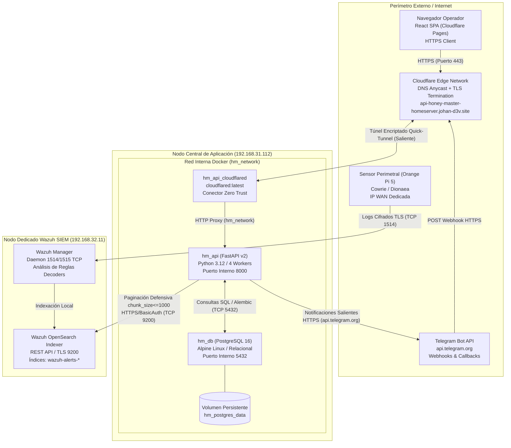
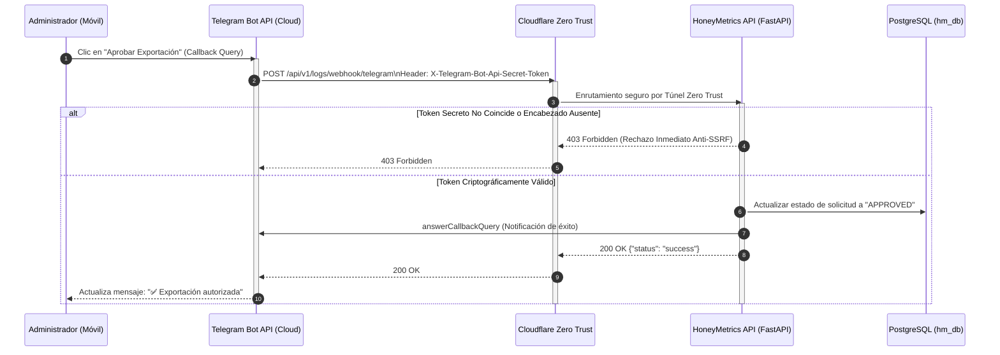
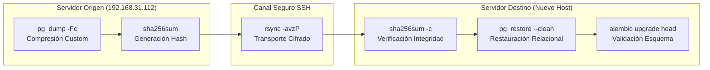

# Guía de Despliegue y Puesta en Marcha en Producción — HoneyMetrics v2.0

Este documento de ingeniería establece la especificación técnica, topología de red, prerrequisitos de infraestructura, parametrización de entorno y los procedimientos operacionales rigurosos para aprovisionar y mantener la plataforma **HoneyMetrics v2.0** en servidores dedicados o entornos locales de alta disponibilidad.

> **Ver también:**
> - [manual-tecnico.md → Sección 2: Arquitectura Polyrepo y Contratos](./manual-tecnico.md#2-visión-general-polyrepo) — Visión global de los componentes del backend y su interacción con el frontend.
> - [manual-tecnico.md → Sección 4: Seguridad y Control de Acceso](./manual-tecnico.md#4-seguridad-criptográfica-y-sesiones) — Parámetros de hashing Bcrypt, tokens JWT y autenticación de doble factor (TOTP).
> - [diccionario-datos.md → Sección 1: Modelo Entidad-Relación](./diccionario-datos.md#1-modelo-entidad-relación-mer) — Estructura física de tablas PostgreSQL, claves primarias y relaciones foráneas.
> - [matriz-cambios.md → Base de Datos y DevOps](./matriz-cambios.md#matriz-exhaustiva-de-localización-de-cambios) — Ubicación de archivos de configuración, Dockerfiles y migraciones Alembic.

---

## Índice

- [1. Topología de Red Distribuida](#1-topología-de-red-distribuida)
  - [1.1. Arquitectura de Nodos y Flujos de Telemetría](#11-arquitectura-de-nodos-y-flujos-de-telemetría)
  - [1.2. Diagrama de Conectividad Perimetral e Interna](#12-diagrama-de-conectividad-perimetral-e-interna)
- [2. Prerrequisitos de Hardware y Software](#2-prerrequisitos-de-hardware-y-software)
  - [2.1. Requerimientos de Capacidad de Cómputo y Almacenamiento](#21-requerimientos-de-capacidad-de-cómputo-y-almacenamiento)
  - [2.2. Matriz de Software Base y Comandos de Verificación](#22-matriz-de-software-base-y-comandos-de-verificación)
- [3. Configuración de Variables de Entorno (.env)](#3-configuración-de-variables-de-entorno-env)
  - [3.1. Especificación Canónica de Parámetros](#31-especificación-canónica-de-parámetros)
  - [3.2. Criterios de Seguridad y Aislamiento en Producción](#32-criterios-de-seguridad-y-aislamiento-en-producción)
- [4. Despliegue Paso a Paso (Docker Compose)](#4-despliegue-paso-a-paso-docker-compose)
  - [Paso 1: Clonación del Código y Preparación del Directorio](#paso-1-clonación-del-código-y-preparación-del-directorio)
  - [Paso 2: Aprovisionamiento y Blindaje del Archivo .env](#paso-2-aprovisionamiento-y-blindaje-del-archivo-env)
  - [Paso 3: Construcción de Imágenes y Orquestación de Contenedores](#paso-3-construcción-de-imágenes-y-orquestación-de-contenedores)
  - [Paso 4: Verificación de Salud e Inspección de Registros](#paso-4-verificación-de-salud-e-inspección-de-registros)
  - [Paso 5: Ejecución de Migraciones de Base de Datos con Alembic](#paso-5-ejecución-de-migraciones-de-base-de-datos-con-alembic)
- [5. Inicialización de Datos Semilla (Database Seeding)](#5-inicialización-de-datos-semilla-database-seeding)
  - [5.1. Funcionamiento Interno de seed_admin.py](#51-funcionamiento-interno-de-seed_adminpy)
  - [5.2. Procedimiento de Ejecución y Validación](#52-procedimiento-de-ejecución-y-validación)
- [6. Configuración del Webhook de Telegram](#6-configuración-del-webhook-de-telegram)
  - [6.1. Flujo Humano-en-el-Bucle (HITL) y Protección Anti-SSRF](#61-flujo-humano-en-el-bucle-hitl-y-protección-anti-ssrf)
  - [6.2. Registro Automatizado con set_telegram_webhook.py](#62-registro-automatizado-con-set_telegram_webhookpy)
- [7. Cheatsheet de Operaciones Cotidianas](#7-cheatsheet-de-operaciones-cotidianas)
  - [7.1. Inspección y Monitoreo de Procesos](#71-inspección-y-monitoreo-de-procesos)
  - [7.2. Mantenimiento y Redespliegue sin Pérdida de Datos](#72-mantenimiento-y-redespliegue-sin-pérdida-de-datos)
- [8. Migración de Servidor (Dump → Transfer → Restore)](#8-migración-de-servidor-dump--transfer--restore)
  - [Fase A: Volcado Lógico Consistente (Dump)](#fase-a-volcado-lógico-consistente-dump)
  - [Fase B: Transferencia Segura Cifrada (Transfer)](#fase-b-transferencia-segura-cifrada-transfer)
  - [Fase C: Restauración Atómica en Servidor Destino (Restore)](#fase-c-restauración-atómica-en-servidor-destino-restore)
- [9. Resolución de Problemas Comunes (Troubleshooting)](#9-resolución-de-problemas-comunes-troubleshooting)

---

## 1. Topología de Red Distribuida

HoneyMetrics v2.0 opera sobre una infraestructura híbrida y distribuida en cuatro niveles independientes. Cada nodo cumple un propósito funcional delimitado para evitar cuellos de botella por concurrencia y proteger el servidor transaccional frente a ataques de denegación de servicio o saturación de memoria.

### 1.1. Arquitectura de Nodos y Flujos de Telemetría

1. **Nodo Sensor / Perimetral (Honeypot):** Dispositivo embebido (Orange Pi 5) expuesto en la zona desmilitarizada (DMZ) o con IP pública directa. Ejecuta servicios trampa de baja y mediana interacción (Cowrie en puertos 22/2222 y Dionaea en protocolos industriales/SMB). Un agente Wazuh transporta la telemetría en tiempo real mediante un canal TLS hacia el clúster central.
2. **Nodo SIEM e Indexación (OpenSearch Indexer):** Servidor dedicado en la subred de seguridad (`192.168.32.11`). Aloja el motor Wazuh Indexer en el puerto `9200` y Wazuh Manager en el puerto `55000`. Almacena los índices duales de eventos (`wazuh-alerts-4.x-*` y `wazuh-archives-4.x-*`). En este nodo **no se ejecuta código del aplicativo HoneyMetrics**, blindando su estabilidad contra colapsos de memoria (OOM).
3. **Nodo Central de Aplicación (Backend Activo):** Estación de trabajo o servidor local (`192.168.31.112` en producción LAN / `192.168.33.2` en staging) con 16 GB de memoria RAM. Aloja el motor Docker que orquesta la API en FastAPI (`hm_api`), el motor relacional PostgreSQL 16 Alpine (`hm_db`) y el conector seguro `cloudflared` (`hm_api_cloudflared`).
4. **Perímetro Cloud y Clientes Externos:** La red perimetral de Cloudflare recibe las peticiones HTTPS públicas en el dominio institucional (ej. `https://api-honey-master-homeserver.johan-d3v.site`) y las canaliza mediante un túnel Zero Trust saliente hacia el contenedor `hm_api:8000`, eliminando la necesidad de abrir puertos entrantes en el enrutador físico (Port Forwarding). La interfaz de usuario (React SPA) y la API de Telegram interactúan exclusivamente contra este punto de entrada seguro.

!!! note "⚡ El Por Qué Técnico — Aislamiento Físico de OpenSearch (`192.168.32.11`)"
    Las consultas analíticas agregadas sobre millones de eventos no estructurados demandan asignaciones intensivas de heap Java (JVM). Si el indexador compartiera memoria física con PostgreSQL y los workers Uvicorn de FastAPI, una extracción masiva de auditoría provocaría la invocación del Out-Of-Memory Killer del kernel Linux, terminando intempestivamente el motor de base de datos relacional.

### 1.2. Diagrama de Conectividad Perimetral e Interna



---

## 2. Prerrequisitos de Hardware y Software

El aprovisionamiento de la infraestructura debe cumplir con los límites de capacidad y compatibilidad descritos a continuación para garantizar la estabilidad del servicio bajo cargas sostenidas de telemetría.

### 2.1. Requerimientos de Capacidad de Cómputo y Almacenamiento

| Recurso | Requisito Mínimo Absoluto | Configuración Recomendada de Producción | Propósito Técnico e Impacto de Capacidad |
| :--- | :--- | :--- | :--- |
| **Procesador (CPU)** | 2 Cores (x86_64 o ARM64) | 4 Cores a 2.5 GHz o superior | Procesamiento asíncrono de streaming JSONL y cálculo de hashes criptográficos. |
| **Memoria RAM** | 4 GB | 16 GB | 1 GB para PostgreSQL (`shared_buffers=64MB`), 2 GB para Uvicorn y margen libre para buffer de I/O. |
| **Almacenamiento** | 20 GB SSD | 80 GB NVMe | Espacio para el motor relacional y retención temporal de exportaciones en disco (`/tmp`). |
| **Conectividad LAN** | 100 Mbps Fast Ethernet | 1 Gbps Full-Duplex | Flujo sostenido hacia el indexador OpenSearch en `192.168.32.11` sin latencia acumulativa. |
| **Conectividad WAN** | 10 Mbps de subida | 30 Mbps simétricos | Capacidad para transferir artefactos descargados y mantener la conexión persistente del túnel. |

### 2.2. Matriz de Software Base y Comandos de Verificación

El servidor anfitrión debe contar con una distribución Linux moderna (Ubuntu Server 22.04 LTS o Debian 12 recomendados) y los paquetes fundamentales de contenedorización:

| Paquete / Servicio | Versión Mínima | Comando de Verificación | Salida de Confirmación Esperada |
| :--- | :--- | :--- | :--- |
| **Kernel Linux** | 5.15.0+ | `uname -r` | `5.15.0-XX-generic` o superior |
| **Docker Engine** | 24.0.0+ | `docker --version` | `Docker version 24.0.7, build afdd53b` |
| **Docker Compose** | 2.20.0+ | `docker compose version` | `Docker Compose version v2.2X.X` |
| **Git** | 2.34.0+ | `git --version` | `git version 2.34.X` |
| **OpenSSL** | 3.0.0+ | `openssl version` | `OpenSSL 3.0.2 15 Mar 2022` |
| **Curl** | 7.81.0+ | `curl --version` | `curl 7.81.0 (x86_64-pc-linux-gnu)` |

Ejecute la siguiente secuencia en la terminal del host para validar la preparación completa del entorno:

```bash
# 1. Verificar versión y disponibilidad del daemon de Docker:
docker version --format '{{.Server.Version}}'

# 2. Verificar versión integrada del plugin Docker Compose:
docker compose version --short

# 3. Comprobar memoria RAM disponible antes de levantar contenedores:
# -m: Muestra las cifras consolidadas en megabytes para lectura técnica rápida.
free -m

# 4. Comprobar espacio disponible en la partición raíz del sistema:
# -h: Formato legible para humanos (Gigabytes / Megabytes).
# -T: Muestra el sistema de archivos (debe ser ext4, xfs o btrfs).
df -hT /
```

---

## 3. Configuración de Variables de Entorno (.env)

La parametrización del aplicativo se gobierna mediante la clase `Settings` en `app/core/config.py`, la cual implementa `pydantic-settings` para validar tipados y consistencia en tiempo de arranque.

### 3.1. Especificación Canónica de Parámetros

A continuación se detalla cada una de las variables presentes en `.env.example`, complementadas con los parámetros de integración requeridos por la plataforma:

| Variable de Entorno | Valor de Referencia / Ejemplo | Obligatoria | Descripción Técnica y Propósito | Riesgo / Impacto si se Omite o Configura Mal |
| :--- | :--- | :---: | :--- | :--- |
| `PROJECT_NAME` | `"HoneyMetrics v2 API"` | Sí | Nombre representativo del aplicativo utilizado en la documentación interactiva OpenAPI/Swagger. | Cosmético; OpenAPI muestra títulos por defecto si se omite. |
| `VERSION` | `"2.4.1"` | Sí | Identificador semántico de versión desplegado en los metadatos globales del servicio. | Dificulta la trazabilidad de versión durante auditorías operacionales. |
| `ENVIRONMENT` | `"production"` | Sí | Define el modo operativo del aplicativo (`development`, `staging`, `production`). | En `production` activa validaciones estrictas; si se deja `development` relaja la seguridad. |
| `DEBUG` | `False` | Sí | Controla el nivel de detalle de las trazas de error y la exposición de logs de depuración. | Si se activa (`True`) en producción, filtra trazas internas y estructuras SQL a clientes externos. |
| `API_V1_STR` | `"/api/v1"` | Sí | Prefijo canónico de ruta para todos los endpoints expuestos por la API REST. | Rompe el contrato de enrutamiento con el frontend cliente si no concuerda. |
| `BACKEND_CORS_ORIGINS` | `["https://api-honey-master-homeserver.johan-d3v.site"]` | Sí | Lista JSON de orígenes autorizados para intercambiar peticiones Cross-Origin con credenciales. | Si está mal configurado, el navegador bloquea las solicitudes de la SPA con error CORS. |
| `POSTGRES_USER` | `"usr_honeymetrics"` | Sí | Nombre de usuario exclusivo asignado a la base de datos bajo Principio de Menor Privilegio (PoLP). | Usar superusuarios debilita la contención del host si el contenedor se ve vulnerado. |
| `POSTGRES_PASSWORD` | `"ClaveComplejaProd2026#"` | Sí | Contraseña criptográfica para autenticación contra el motor PostgreSQL. | Claves débiles permiten ataques de fuerza bruta en redes internas comprometidas. |
| `POSTGRES_DB` | `"honeymetrics"` | Sí | Nombre de la base de datos relacional creada durante la inicialización del contenedor. | PostgreSQL creará un catálogo genérico impidiendo que el aplicativo localice sus tablas. |
| `DATABASE_URL` | `"postgresql://usr_honeymetrics:pass@hm_db:5432/honeymetrics"` | Sí | Cadena canónica de conexión utilizada por el pool de SQLAlchemy y Alembic (`hm_db` es el host Docker). | Fallo inmediato en el arranque del servicio (`OperationalError`), impidiendo iniciar la API. |
| `SECRET_KEY` | `"64_caracteres_hexadecimales"` | Sí | Semilla criptográfica de alta entropía para firmar tokens de sesión JWT mediante HS256. | Si se mantiene el valor por defecto, atacantes pueden forjar tokens y usurpar cualquier rol. |
| `ALGORITHM` | `"HS256"` | Sí | Algoritmo simétrico de firma empleado para la codificación y validación de tokens JWT. | Tokens firmados con algoritmos no soportados serán rechazados, bloqueando el login. |
| `ACCESS_TOKEN_EXPIRE_MINUTES` | `30` | Sí | Tiempo de vigencia en minutos antes de que el token de portador (Bearer Token) expire. | Valores muy elevados aumentan la ventana de riesgo ante la sustracción de credenciales. |
| `REQUIRE_PASSWORD_CHANGE_ON_FIRST_LOGIN` | `True` | Sí | Fuerza al usuario a actualizar su credencial temporal al autenticarse por primera vez. | Si es `False`, credenciales iniciales conocidas (como las de seed) permanecen activas. |
| `CLOUDFLARE_TUNNEL_TOKEN` | `"<CLOUDFLARE_ZERO_TRUST_TUNNEL_TOKEN>"` | Sí (Prod) | Token de autenticación del conector `cloudflared` emitido en la consola Cloudflare Zero Trust. | El contenedor `hm_api_cloudflared` falla al arrancar y la API queda inaccesible desde WAN. |
| `ML_AUTOPILOT_ENABLED` | `False` | No | Flag para el servicio de tareas analíticas secundarias en segundo plano (Fase 2 Enterprise). | Debe permanecer en `False` en producción estándar para evitar consumo de CPU no programado. |
| `ML_AUTOPILOT_ON_STARTUP` | `False` | No | Determina si las rutinas analíticas secundarias se disparan al arrancar el contenedor (Fase 2). | Mantener deshabilitado en el entorno de producción estándar. |
| `ML_AUTOPILOT_INTERVAL_HOURS` | `12` | No | Intervalo de periodicidad horaria para tareas analíticas en segundo plano (Fase 2). | Sin impacto funcional si el flag principal se encuentra en `False`. |
| `ML_MIN_HOURS_BETWEEN_RETRAINS` | `6.0` | No | Ventana mínima temporal de espera entre ciclos analíticos secundarios (Fase 2). | Sin impacto funcional cuando el piloto automático está inactivo. |
| `ML_MIN_NEW_EVENTS` | `1000` | No | Umbral de eventos requeridos para invocar rutinas secundarias en segundo plano (Fase 2). | Sin impacto funcional cuando el piloto automático está inactivo. |
| `ML_DEGRADATION_THRESHOLD` | `0.005` | No | Margen de tolerancia para auditorías analíticas secundarias en segundo plano (Fase 2). | Sin impacto funcional cuando el piloto automático está inactivo. |
| `ML_REMOTE_SYNC_ENABLED` | `False` | No | Bandera para habilitar la réplica de artefactos analíticos hacia nodos remotos (Fase 2). | Debe permanecer en `False` para no abrir sesiones SSH desatendidas hacia otros servidores. |
| `ML_REMOTE_HOST` | `"192.168.33.2"` | No | Dirección IP del nodo de réplica analítica remota en staging (Fase 2). | Sin impacto si la sincronización remota está deshabilitada. |
| `ML_REMOTE_USER` | `"sebas"` | No | Usuario del sistema operativo para transporte SSH de artefactos secundarios (Fase 2). | Sin impacto si la sincronización remota está deshabilitada. |
| `ML_REMOTE_ARTIFACTS_PATH` | `"/home/sebas/app/artifacts"` | No | Ruta del sistema de archivos en el nodo remoto para alojar artefactos (Fase 2). | Sin impacto si la sincronización remota está deshabilitada. |
| `ML_REMOTE_API_URL` | `"http://192.168.33.2:8000/api/v1/ml/reload"` | No | Endpoint HTTP para invocar recarga de artefactos en el nodo remoto (Fase 2). | Sin impacto si la sincronización remota está deshabilitada. |
| `WAZUH_INDEXER_URL` | `"https://192.168.32.11:9200"` | Sí | URL base del clúster OpenSearch del SIEM Wazuh alojado en el nodo dedicado. | Fallo total en la extracción de eventos CTI y visualización del panel de telemetría. |
| `WAZUH_INDEXER_USER` | `"admin"` | Sí | Usuario con privilegios de lectura sobre los índices `wazuh-alerts-*` y `wazuh-archives-*`. | Peticiones hacia Wazuh devuelven error HTTP 401 Unauthorized. |
| `WAZUH_INDEXER_PASSWORD` | `"CredencialSeguraWazuh"` | Sí | Contraseña de autenticación básica (Basic Auth) para el indexador OpenSearch. | Peticiones hacia Wazuh fallan por autenticación, impidiendo alimentar el CTI Center. |
| `WAZUH_CA_CERT_PATH` | `"/etc/ssl/root-ca.pem"` | No | Ruta absoluta al certificado CA raíz para validar la cadena TLS del clúster Wazuh. | Si no se provee y `WAZUH_TLS_VERIFY=True`, las solicitudes arrojan error de validación SSL. |
| `WAZUH_TLS_VERIFY` | `True` | Sí | Bandera que exige validación criptográfica de certificados en las peticiones HTTPS a Wazuh. | Si es `False`, expone la comunicación interna a ataques de intermediario (MitM). |
| `TELEGRAM_BOT_TOKEN` | `"<TU_TELEGRAM_BOT_TOKEN>"` | Sí | Token HTTP API provisto por `@BotFather` para controlar el bot institucional. | Impide el despacho de alertas críticas y la recepción de aprobaciones en el canal Telegram. |
| `ADMIN_TELEGRAM_CHAT_ID` | `"1307616056"` | Sí | Identificador numérico del chat del administrador global que recibe solicitudes HITL. | Las aprobaciones interactivas de descargas masivas no llegan a ningún destinatario. |
| `TELEGRAM_WEBHOOK_SECRET` | `"SecretoAntiSSRF2026#"` | Sí | Secreto compartido validado contra el encabezado `X-Telegram-Bot-Api-Secret-Token`. | Permite a adversarios falsificar peticiones POST y aprobar descargas o bloqueos espurios. |

### 3.2. Criterios de Seguridad y Aislamiento en Producción

!!! danger "⚡ Principio de Menor Privilegio (PoLP) en PostgreSQL"
    En entornos de producción está estrictamente prohibido utilizar el usuario `postgres` en la variable `DATABASE_URL`. El aplicativo debe operar con un usuario sin atributos de superusuario (`usr_honeymetrics`) cuyos permisos se limiten exclusivamente al esquema `public` de la base de datos `honeymetrics_v2`.

    [!NOTE]
    **El Por Qué Técnico — Generación de `SECRET_KEY` vía OpenSSL:** Emplear frases legibles o valores autogenerados por frameworks debilita la resistencia contra ataques de diccionario fuera de línea (offline dictionary attacks). Ejecutar `openssl rand -hex 32` extrae 256 bits de entropía real desde el generador pseudoaleatorio del kernel Linux (`/dev/urandom`), garantizando un espacio de claves de $2^{256}$ combinaciones imposibles de vulnerar por fuerza bruta.

---

## 4. Despliegue Paso a Paso (Docker Compose)

Siga rigurosamente esta secuencia de comandos para poner en marcha el entorno de producción en un servidor virgen.

### Paso 1: Clonación del Código y Preparación del Directorio

```bash
# -b main: Clona exclusivamente la rama estable de producción auditada para release.
# --single-branch: Descarga únicamente el historial de la rama objetivo, optimizando ancho de banda y espacio.
git clone -b main --single-branch https://github.com/johanP051/honeymetrics-backend.git

# Ingresar al directorio raíz del proyecto backend:
cd honeymetrics-backend
```

### Paso 2: Aprovisionamiento y Blindaje del Archivo .env

Genere claves seguras y restrinja los permisos de lectura del archivo de configuración antes de inicializar los contenedores:

```bash
# 1. Crear el archivo productivo copiando la plantilla base:
cp .env.example .env

# 2. Generar SECRET_KEY criptográfica de 256 bits y anexarla:
# rand -hex 32: Emite 32 bytes aleatorios formateados como 64 caracteres hexadecimales.
openssl rand -hex 32

# 3. Generar token secreto anti-SSRF para el webhook de Telegram:
openssl rand -hex 16

# 4. Asignar permisos estrictos de sistema de archivos POSIX:
# 600: Lectura y escritura únicamente para el usuario propietario; denegado para grupo y otros.
chmod 600 .env
```

Edite el archivo `.env` con un editor de texto seguro (`nano .env` o `vim .env`) e inyecte los valores correspondientes a su entorno según la tabla de la Sección 3.

### Paso 3: Construcción de Imágenes y Orquestación de Contenedores

HoneyMetrics separa la configuración de desarrollo (`docker-compose.yml`) de la optimización industrial (`docker-compose.prod.yml`). En producción, la API ejecuta 4 workers Uvicorn concurrentes, PostgreSQL limita su memoria compartida (`shared_buffers=64MB`, `work_mem=4MB`, `max_connections=30`) y se activa el perfil del túnel Zero Trust:

```bash
# -f docker-compose.yml: Carga la estructura base de servicios, redes y volúmenes.
# -f docker-compose.prod.yml: Aplica sobreescritura de producción (workers, recursos y tunel).
# --profile tunnel: Activa el perfil condicional 'tunnel' que incluye el servicio hm_api_cloudflared.
# up: Crea y arranca la totalidad de los contenedores requeridos.
# -d: Modo detached (segundo plano / daemon), liberando la consola del operador.
# --build: Fuerza la reconstrucción de la imagen local a partir del Dockerfile garantizando paridad de código.
docker compose -f docker-compose.yml -f docker-compose.prod.yml --profile tunnel up -d --build
```

### Paso 4: Verificación de Salud e Inspección de Registros

Compruebe que los servicios hayan superado las pruebas de vitalidad (healthchecks) y estén enlazados correctamente a la red virtual `hm_network`:

```bash
# ps: Muestra el estado operacional de los contenedores orquestados.
# --filter "name=hm_": Filtra la visualización exclusivamente a los contenedores de HoneyMetrics.
docker compose ps --filter "name=hm_"

# logs: Inspecciona la salida estándar (stdout/stderr) de los procesos.
# -f: Sigue el flujo de logs en tiempo real (follow mode).
# --tail 50: Limita el búfer inicial a las últimas 50 líneas para evitar saturación de terminal.
docker compose logs -f --tail 50 api
```

### Paso 5: Ejecución de Migraciones de Base de Datos con Alembic

Una vez que el contenedor `hm_db` reporte estado `healthy`, aplique las revisiones pendientes para estructurar el esquema relacional en PostgreSQL:

```bash
# exec: Ejecuta una instrucción dentro de un contenedor en ejecución.
# -T: Deshabilita la asignación de pseudo-TTY, permitiendo canalizaciones y ejecución desatendida.
# api: Nombre del servicio definido en Compose que contiene el entorno FastAPI y Alembic.
# alembic upgrade head: Aplica todas las migraciones acumuladas hasta la versión más reciente.
docker compose exec -T api alembic upgrade head
```

---

## 5. Inicialización de Datos Semilla (Database Seeding)

Para garantizar la continuidad operativa de la plataforma sin requerir intervenciones manuales en la consola SQL, el backend dispone de una rutina de inicialización canónica en `scripts/seed_admin.py`.

### 5.1. Funcionamiento Interno de seed_admin.py

El script implementa una arquitectura idempotente gobernada por SQLAlchemy:

1. **Gestión Transaccional de Roles:** Consulta la existencia del rol `Administrador` en la tabla `roles`. Si no existe, lo instancia y persiste mediante un `commit()` atómico.
2. **Creación del Administrador Maestro:** Crea la cuenta `admin@ucundinamarca.edu.co` asignándole el hash Bcrypt de la contraseña temporal `Admin123!`. Establece la bandera `must_change_password=True`, forzando al usuario a actualizar su credencial antes de acceder a las funcionalidades del sistema.
3. **Creación del Usuario Institucional:** Registra la cuenta institucional `jsebastianposada@ucundinamarca.edu.co` vinculada al rol `Administrador`.
4. **Cuentas Técnicas de Integración:** Instancia de forma controlada las identidades `root` y `root@honeymetrics.com` requeridas para pruebas de integración automatizadas y scripts CLI de soporte.
5. **Cierre de Conexión:** En el bloque `finally`, garantiza la liberación de la sesión relacional (`db.close()`), previniendo fugas de conexiones en el pool.

### 5.2. Procedimiento de Ejecución y Validación

Invoque el sembrado ejecutando el script dentro del contenedor de la API:

```bash
# exec: Invoca un proceso en el contenedor activo.
# -it: Mantiene STDIN abierto y asigna un pseudo-terminal para visualizar la salida en vivo.
# api: Servicio de la API donde reside el entorno Python 3.12 y los modelos ORM.
# python scripts/seed_admin.py: Ejecuta el script de aprovisionamiento de identidades base.
docker compose exec -it api python scripts/seed_admin.py
```

La salida esperada en la consola debe confirmar la creación o actualización de los registros:

```text
Role 'Administrador' created.
Admin user 'admin@ucundinamarca.edu.co' created.
User 'jsebastianposada@ucundinamarca.edu.co' created.
User 'root' with password 'root' created.
User 'root@honeymetrics.com' with password 'root' created.
```

!!! warning "⚡ Saneamiento Obligatorio Post-Despliegue"
    Inmediatamente después de inicializar la plataforma, el administrador debe iniciar sesión en la interfaz web, actualizar la contraseña por defecto `Admin123!` por una clave robusta y enrolar su dispositivo en el flujo de autenticación de doble factor (TOTP) mediante Google Authenticator o FreeOTP.

---

## 6. Configuración del Webhook de Telegram

HoneyMetrics v2.0 incorpora un flujo de aprobación Humano-en-el-Bucle (Human-in-the-Loop - HITL) para autorizar solicitudes de extracción masiva de registros de auditoría y bloqueos de IPs maliciosas sin obligar al operador a ingresar a la consola administrativa.

### 6.1. Flujo Humano-en-el-Bucle (HITL) y Protección Anti-SSRF

Cuando un analista solicita la exportación de más de 5,000 eventos de telemetría (PB-HM-40) o se detecta una amenaza de severidad crítica, el backend envía un mensaje interactivo al chat de Telegram del administrador (`ADMIN_TELEGRAM_CHAT_ID`) provisto de botones en línea (Inline Keyboards: "Aprobar" / "Rechazar").

Al hacer clic, Telegram despacha una petición HTTP POST asíncrona hacia el endpoint `/api/v1/logs/webhook/telegram`. Para mitigar vectores de Server-Side Request Forgery (SSRF) o inyección de callbacks falsificados por terceros, el sistema implementa una barrera criptográfica:

1. Al registrar el webhook, se suministra el parámetro `secret_token` a la API de Telegram.
2. En cada llamada, Telegram adjunta dicho secreto en la cabecera HTTP `X-Telegram-Bot-Api-Secret-Token`.
3. El middleware de FastAPI en `app/services/telegram_service.py` valida la cabecera contra `TELEGRAM_WEBHOOK_SECRET` mediante comparación en tiempo constante (`hmac.compare_digest`). Peticiones no coincidentes son descartadas de inmediato con un código de respuesta `403 Forbidden`.



### 6.2. Registro Automatizado con set_telegram_webhook.py

!!! danger "⚡ Precedencia de Red Obligatoria"
    El registro del webhook debe ejecutarse **exclusivamente después** de que el túnel de Cloudflare se encuentre activo y respondiendo satisfactoriamente en Internet bajo HTTPS. Si la URL pública no resuelve o no cuenta con certificado TLS válido, los servidores de Telegram rechazarán el registro.

Ejecute el script de vinculación desde el servidor anfitrión suministrando la URL pública definitiva del túnel:

```bash
# 1. Exportar temporalmente en la sesión de terminal las credenciales requeridas:
export TELEGRAM_BOT_TOKEN="TU_TOKEN_GENERADO_EN_BOTFATHER"
export TELEGRAM_WEBHOOK_SECRET="SecretoAntiSSRF2026#"

# 2. Invocar el script suministrando la URL pública terminada en HTTPS:
python3 scripts/set_telegram_webhook.py https://api-honey-master-homeserver.johan-d3v.site
```

La consola debe mostrar la confirmación directa emitida por los servidores de Telegram:

```json
{"ok": true, "result": true, "description": "Webhook was set"}
```

Para verificar en cualquier momento el estado del webhook, el recuento de eventos pendientes y posibles errores de entrega, utilice `curl` y procese la respuesta con `jq`:

```bash
# -s: Modo silencioso, suprime medidores de progreso de descarga.
# -X GET: Especifica método de consulta contra la API oficial de Telegram.
curl -s "https://api.telegram.org/bot${TELEGRAM_BOT_TOKEN}/getWebhookInfo" | jq .
```

---

## 7. Cheatsheet de Operaciones Cotidianas

Esta sección compila los procedimientos rutinarios indispensables para administradores de sistemas y operadores de seguridad a cargo de HoneyMetrics v2.0.

### 7.1. Inspección y Monitoreo de Procesos

```bash
# Monitorear logs unificados de todos los servicios en streaming continuo:
docker compose logs -f --tail 100

# Aislar exclusivamente los registros de la base de datos relacional:
docker compose logs -f db

# Visualizar el consumo de CPU, memoria y ancho de banda de los contenedores en vivo:
docker stats --format "table {{.Name}}\t{{.CPUPerc}}\t{{.MemUsage}}\t{{.NetIO}}"

# Ingresar a una sesión interactiva Bash dentro del contenedor de la API:
docker compose exec -it api /bin/bash

# Acceder directamente a la consola SQL psql dentro del contenedor de base de datos:
# -U: Especifica el usuario de base de datos definido en .env.
# -d: Especifica la base de datos a consultar.
docker compose exec -it db psql -U usr_honeymetrics -d honeymetrics_v2
```

### 7.2. Mantenimiento y Redespliegue sin Pérdida de Datos

Cuando se liberen correcciones de código en la rama `main`, ejecute el siguiente ciclo de actualización sin destruir los volúmenes de datos ni interrumpir el estado de PostgreSQL:

```bash
# 1. Obtener los últimos commits estables del repositorio:
git pull origin main

# 2. Reconstruir la imagen de la API incorporando los cambios:
# build: Compila el nuevo contexto Dockerfile sin alterar los contenedores en ejecución.
docker compose -f docker-compose.yml -f docker-compose.prod.yml build api

# 3. Reemplazar en caliente el contenedor de la API minimizando el tiempo de inactividad:
# --no-deps: Evita reiniciar servicios dependientes que no sufrieron alteraciones (como db).
docker compose -f docker-compose.yml -f docker-compose.prod.yml --profile tunnel up -d --no-deps api

# 4. Aplicar cualquier nueva migración de base de datos requerida por el nuevo código:
docker compose exec -T api alembic upgrade head

# 5. Purgar imágenes intermedias obsoletas (dangling images) para liberar almacenamiento:
# -f: Omite la solicitud interactiva de confirmación.
docker image prune -f
```

---

## 8. Migración de Servidor (Dump → Transfer → Restore)

Para trasladar la infraestructura hacia un nuevo nodo físico o restaurar el entorno ante contingencias mayores, aplique el protocolo estructurado de migración en tres fases.



### Fase A: Volcado Lógico Consistente (Dump)

Genere un archivo de volcado binario consistente que capture la totalidad de tablas, secuencias, tipos de datos e índices del motor relacional:

```bash
# -U: Usuario con permisos de lectura integral sobre las tablas.
# -Fc: Formato Custom nativo de PostgreSQL (comprimido, permite restauración selectiva y paralela).
# -b: Incluye Large Objects en el volcado para integridad de adjuntos.
# -v: Modo detallado (verbose) para auditoría de tablas respaldadas.
# honeymetrics_v2: Nombre de la base de datos de origen.
docker compose exec -T db pg_dump -U usr_honeymetrics -Fc -b -v honeymetrics_v2 > backup_honeymetrics_$(date +%Y%m%d_%H%M%S).dump

# Generar el checksum criptográfico SHA-256 para validación posterior de integridad:
sha256sum backup_honeymetrics_*.dump > backup_honeymetrics.sha256
```

### Fase B: Transferencia Segura Cifrada (Transfer)

Transfiera el volcado binario y su firma criptográfica hacia el nuevo servidor de destino mediante `rsync` sobre SSH:

```bash
# -a: Modo archivo (preserva propietarios, permisos POSIX y marcas de tiempo).
# -v: Modo detallado para observar el progreso en la terminal.
# -z: Comprime los datos durante la transmisión de red para acelerar la transferencia.
# -P: Muestra barra de progreso en tiempo real y permite reanudar transferencias interrumpidas.
rsync -avzP backup_honeymetrics_* sebas@192.168.31.200:/home/sebas/backups/
```

En el servidor de destino, verifique que los archivos no hayan sufrido corrupción en tránsito:

```bash
# -c: Valida los archivos listados en el manifiesto comparando sus hashes calculados:
sha256sum -c backup_honeymetrics.sha256
```

### Fase C: Restauración Atómica en Servidor Destino (Restore)

!!! note "⚡ El Por Qué Técnico — Formato Custom (`-Fc`) vs SQL Plano (`.sql`)"
    El volcado en texto plano procesa instrucciones secuenciales lentas propensas a bloqueos si una restricción foránea se carga desordenada. El formato binario comprimido (`-Fc`) almacena un catálogo interno que permite a `pg_restore` reordenar la inyección de índices y llaves foráneas después de haber poblado las filas, reduciendo el tiempo de recuperación de desastres en un 70%.

En el nuevo servidor, clone el código, configure el archivo `.env`, levante exclusivamente el contenedor de base de datos y ejecute la restauración:

```bash
# 1. Levantar únicamente el contenedor de la base de datos en el nuevo servidor:
docker compose -f docker-compose.yml -f docker-compose.prod.yml up -d db

# 2. Esperar a que PostgreSQL complete su inicialización y supere el healthcheck:
until docker compose exec -T db pg_isready -U usr_honeymetrics; do sleep 2; done

# 3. Restaurar la estructura y los datos empleando pg_restore:
# -U: Usuario de conexión con permisos de creación de objetos en PostgreSQL.
# -d: Base de datos de destino donde se inyectará la información.
# --clean: Elimina las tablas existentes antes de recrearlas para evitar duplicados.
# --if-exists: Previene errores si se intenta eliminar una tabla que aún no ha sido creada.
# --no-owner: Omite la asignación del propietario original para compatibilidad de usuarios.
# --no-privileges: Previene la restauración de privilegios de acceso no aplicables.
cat backup_honeymetrics_*.dump | docker compose exec -T db pg_restore -U usr_honeymetrics -d honeymetrics_v2 --clean --if-exists --no-owner --no-privileges -v

# 4. Validar el estado del esquema con Alembic y levantar la suite completa:
docker compose -f docker-compose.yml -f docker-compose.prod.yml --profile tunnel up -d
docker compose exec -T api alembic current
```

---

## 9. Resolución de Problemas Comunes (Troubleshooting)

La siguiente matriz documenta los incidentes operacionales más frecuentes en HoneyMetrics v2.0, su causa raíz técnica diagnosticada y el procedimiento de resolución comprobado en campo:

| Síntoma / Mensaje de Error | Causa Raíz Probable | Procedimiento de Resolución Técnica |
| :--- | :--- | :--- |
| `psycopg2.OperationalError: could not connect to server: Connection refused` | El contenedor `hm_db` aún no completa el arranque o no está escuchando en el puerto 5432 de la red Docker. | Verificar estado del contenedor con `docker compose ps db`. Comprobar logs con `docker compose logs db`. Asegurar que en `.env` el host de `DATABASE_URL` sea `db` y no `localhost` o `127.0.0.1`. |
| `alembic.util.exc.CommandError: Target database is not up to date.` | La base de datos relacional contiene revisiones previas pero no se han aplicado las migraciones más recientes. | Ejecutar `docker compose exec -T api alembic upgrade head`. Si persiste inconsistencia de ramas, ejecutar `alembic current` para identificar la revisión discrepante. |
| `403 Forbidden - Invalid Telegram Secret Token` en el webhook | La cabecera `X-Telegram-Bot-Api-Secret-Token` no coincide exactamente con el valor definido en `TELEGRAM_WEBHOOK_SECRET`. | Verificar que el valor en `.env` coincida byte a byte con el secreto inyectado en `set_telegram_webhook.py`. Re-ejecutar el script de registro para forzar la sincronización en Telegram. |
| `Telegram API Error: 429 Too Many Requests: retry after X` | El aplicativo superó los límites de tasa (rate limiting) de despacho de mensajes en Telegram (máximo 30 mensajes/segundo global). | El servicio de notificación implementa reintentos con backoff. Esperar el número de segundos estipulado en el parámetro `retry_after` o reducir el envío de alertas masivas no agrupadas. |
| `Wazuh Indexer Connection Timeout: Request to https://192.168.32.11:9200 failed` | Bloqueo perimetral a nivel de firewall en el nodo SIEM, caída del servicio OpenSearch o ruta LAN inaccesible desde el host. | Ejecutar `ping 192.168.32.11` y `nc -zv 192.168.32.11 9200` desde el host anfitrión. En el nodo SIEM, verificar el estado del demonio con `systemctl status wazuh-indexer`. |
| `SSL: CERTIFICATE_VERIFY_FAILED en conexión a Wazuh OpenSearch` | El certificado autofirmado de Wazuh Indexer no es reconocido por la biblioteca `httpx` de Python en el contenedor. | Colocar el certificado CA raíz en el contenedor y configurar su ruta en `WAZUH_CA_CERT_PATH`. Para pruebas locales estrictas, establecer temporalmente `WAZUH_TLS_VERIFY=False`. |
| `Cloudflare Tunnel Error: Tunnel credentials file not found o Token inválido` | La variable `CLOUDFLARE_TUNNEL_TOKEN` está vacía o el token emitido en Zero Trust fue revocado en la consola web. | Validar la variable en `.env`. Regenerar el conector en la consola de Cloudflare Zero Trust e inyectar el nuevo token. Reiniciar el servicio con `docker compose restart cloudflared`. |
| `Error: Port 8000 already in use / bind: address already in use` | Existe otro proceso local o una instancia previa de Uvicorn/Nginx ocupando el puerto en el host anfitrión. | Identificar el PID conflictivo ejecutando `lsof -i :8000` o `netstat -tlpn \| grep 8000`. Terminar el proceso con `kill -9 <PID>` o remapear el puerto expuesto en Compose. |
| `docker-compose: healthcheck failed for service db` | El comando `pg_isready` dentro del contenedor no responde exitosamente dentro de los 5 reintentos estipulados. | Comprobar que `POSTGRES_USER` coincida entre la variable y el flag `-U` del healthcheck. Inspeccionar si el volumen `hm_postgres_data` tiene permisos de escritura corruptos. |
| `JWT SignatureVerificationError / Could not validate credentials tras reinicio` | La variable `SECRET_KEY` fue alterada o regenerada en `.env`, invalidando todos los tokens emitidos con la clave anterior. | Esperar la expiración natural del token o solicitar a los operadores que inicien sesión nuevamente para obtener tokens firmados con la nueva `SECRET_KEY`. |
| `CORS Policy Error: Response to preflight request doesn't pass access control check` | La URL del cliente frontend (React SPA) no se encuentra registrada en la lista `BACKEND_CORS_ORIGINS`. | Agregar la URL exacta del cliente (ej. `"https://api-honey-master-homeserver.johan-d3v.site"`) a `BACKEND_CORS_ORIGINS` en `.env` y reiniciar la API con `docker compose restart api`. |
| `PostgreSQL: could not resize shared memory segment (No space left on device)` | El parámetro `shared_buffers` de PostgreSQL excede el tamaño asignado a `/dev/shm` en el contenedor. | En `docker-compose.prod.yml`, ajustar la directiva de memoria: `postgres -c shared_buffers=64MB -c work_mem=4MB` o agregar la directiva `shm_size: 256mb` al servicio `db`. |
| `Error 502 Bad Gateway en Cloudflare al acceder al dominio público` | El contenedor `hm_api_cloudflared` está activo pero no puede comunicarse internamente con el contenedor `hm_api:8000`. | Inspeccionar los logs del conector con `docker compose logs cloudflared`. Verificar en Zero Trust que el servicio apunte a `http://api:8000` (nombre del servicio en `hm_network`). |
| `Permission denied: /tmp/export_*.jsonl al generar descargas de auditoría` | El usuario sin privilegios que ejecuta Uvicorn dentro del contenedor carece de permisos de escritura sobre el directorio de destino. | Asegurar que el Dockerfile configure permisos adecuados en el directorio de trabajo (`chown -R appuser:appuser /app`). No ejecutar procesos como root en producción. |

---

## 10. Troubleshooting Avanzado: Redes Docker, Variables de Entorno, Alembic y Deploy Keys SSH

La operación continua de HoneyMetrics v2.0 en entornos de producción e infraestructura homelab compartida demanda un entendimiento exhaustivo de las fronteras de red, el ciclo de vida de los contenedores Docker y los mecanismos de sincronización de esquemas relacionales. Durante el ciclo de vida operacional en el servidor de producción anfitrión `192.168.33.2`, surgen anomalías técnicas que escapan a los procedimientos rutinarios de reinicio y exigen diagnósticos deterministas a bajo nivel. Esta sección documenta cuatro incidentes operacionales complejos experimentados durante el despliegue real de la plataforma, detallando la causa raíz física y el protocolo de remediación correspondiente. Cada escenario proporciona comandos reproducibles, análisis de aislamiento de espacios de nombres del kernel Linux y lineamientos de seguridad basados en el Principio de Menor Privilegio para garantizar la resiliencia del sistema.

### 10.1. Problema 1: La Trampa del "Double Loopback" — Por qué Uvicorn y PostgreSQL escuchan en 0.0.0.0 pero el host publica en 127.0.0.1:5433

#### 10.1.1. Síntoma Observable

El administrador de base de datos o el ingeniero de operaciones configura una sesión remota en DBeaver mediante un túnel SSH dirigido al puerto `5433` del homeserver `192.168.33.2`, logrando autenticarse e inspeccionar las tablas relacionales de manera completamente satisfactoria. Sin embargo, cuando el contenedor `hm_api` inicia su ejecución en el mismo host y los workers Uvicorn intentan resolver las dependencias de base de datos, la aplicación colapsa arrojando excepciones fatales de tipo `psycopg2.OperationalError: could not connect to server: Connection refused`. Este fallo ocurre invariablemente si en el archivo de entorno `.env` se especifica `DATABASE_URL` utilizando `127.0.0.1` o `localhost` como dirección del host de base de datos. La aparente paradoja radica en que la base de datos se encuentra respondiendo activamente hacia las conexiones externas tunelizadas, mientras que el contenedor de la API local alojado en el mismo equipo físico resulta incapaz de establecer comunicación de socket TCP.

```text
[ERROR] [uvicorn.error] Application startup failed. Exiting.
Traceback (most recent call last):
  File "/app/app/main.py", line 45, in lifespan
    await test_database_connection()
  File "/app/app/core/database.py", line 88, in test_database_connection
    async with engine.connect() as conn:
  File "/usr/local/lib/python3.12/site-packages/sqlalchemy/ext/asyncio/engine.py", line 258, in connect
    return await self._connection_factory()
  File "/usr/local/lib/python3.12/site-packages/asyncpg/connection.py", line 2324, in connect
    return await connect_utils._connect(
  File "/usr/local/lib/python3.12/site-packages/asyncpg/connect_utils.py", line 525, in _connect
    raise OSError("could not connect to server: Connection refused")
OSError: [Errno 111] Connect call failed ('127.0.0.1', 5432)
```

La inspección inicial de registros mediante `docker compose logs api` confirma que el cliente asíncrono intenta abrir un socket TCP hacia la dirección `127.0.0.1:5432` o `127.0.0.1:5433` dentro de su propio entorno aislado. El sistema operativo del contenedor rechaza inmediatamente el paquete SYN debido a que en dicho espacio de nombres local no reside ningún proceso escuchando en tales puertos. Esta discordancia genera confusión operacional en equipos de desarrollo habituados a despliegues monolíticos donde la base de datos y el servidor web residen físicamente en el mismo localhost del sistema anfitrión. Para resolver esta contradicción, resulta indispensable descomponer los límites de red de los contenedores Docker y la topología de publicación de puertos aplicada en la máquina servidora.

#### 10.1.2. Análisis Causal Profundo

Cada contenedor Docker opera dentro de su propio espacio de nombres de red (`netns`) aislado por el kernel Linux, disponiendo de su propia interfaz de loopback virtual (`lo`) totalmente desvinculada de la interfaz de loopback del sistema anfitrión. Cuando la aplicación FastAPI dentro de `hm_api` intenta conectarse a `127.0.0.1`, los paquetes TCP no viajan hacia la tarjeta de red física ni hacia el sistema operativo anfitrión, sino que se enrutan internamente contra el loopback privado del propio contenedor `hm_api`. Como el motor de PostgreSQL no reside en dicho contenedor sino en un entorno independiente denominado `hm_db`, la llamada de socket `connect()` finaliza instantáneamente con un código de error de rechazo de conexión emitido por el kernel. Intentar conectarse a `localhost` o `127.0.0.1` desde dentro de un contenedor asume erróneamente una memoria de red compartida que contradice el principio fundamental de aislamiento de procesos de Docker.

La comunicación directa entre contenedores gestionados por Docker Compose se efectúa a través de redes puente personalizadas, en este caso la red definida como `honeymetrics-network`. El motor de Docker ejecuta un servidor DNS interno embebido en la dirección IP `127.0.0.11`, el cual intercepta las resoluciones de nombres dentro de la red del puente y resuelve dinámicamente los nombres de los servicios definidos en el archivo de configuración. De este modo, cuando el contenedor `hm_api` solicita comunicarse con el host `hm_db`, el resolvedor DNS de Docker traduce dicho nombre a la dirección IP privada asignada a la interfaz virtual de `hm_db` dentro del segmento de red del puente. Esta comunicación entre contenedores transcurre directamente a través de las interfaces virtuales `veth` del puente de Docker, alcanzando el puerto nativo interno `5432` sin necesidad de pasar por el cortafuegos iptables ni por la tabla de traducción de direcciones de red (NAT) del host anfitrión.

Para que este esquema funcione de forma segura, el demonio de PostgreSQL dentro de `hm_db` está configurado para escuchar en todas sus interfaces de red internas mediante el parámetro `listen_addresses = '*'`. Esta directiva hace que el proceso de base de datos se enlace a `0.0.0.0:5432` dentro de su espacio de nombres aislado, permitiendo recibir conexiones tanto de su interfaz de loopback interna como de su interfaz de red virtual conectada a `honeymetrics-network`. No obstante, la directiva de puertos en el archivo de orquestación `docker-compose.yml` restringe intencionalmente la publicación externa mediante la regla de mapeo `127.0.0.1:5433:5432`. Esta sintaxis indica a Docker que cree una regla de enrutamiento DNAT en iptables vinculada exclusivamente a la dirección de loopback del sistema anfitrión `127.0.0.1` en el puerto `5433`, canalizando el tráfico entrante hacia el puerto `5432` del contenedor `hm_db`.

La decisión arquitectónica de publicar la base de datos en el puerto host `5433` obedece a una restricción física de infraestructura en el homeserver `192.168.33.2`. En dicho servidor ya se encuentra en ejecución el proyecto TantauStock/Vuelos, cuyo motor transaccional ocupa de forma exclusiva el puerto estándar `5432` en las interfaces de red del host anfitrión. Para permitir que los ingenieros administren la base de datos de HoneyMetrics mediante herramientas gráficas como DBeaver sin colisionar con otros proyectos, se establece un túnel seguro mediante el comando SSH `ssh -N -L 5433:127.0.0.1:5433 sebas@192.168.33.2`. Este túnel SSH reenvía el puerto local `5433` de la estación de trabajo hacia la interfaz `127.0.0.1:5433` del homeserver, donde Docker recibe la solicitud autorizada y la redirige hacia el contenedor `hm_db` en el puerto `5432`.

!!! note "⚡ El Por Qué Técnico — Aislamiento de Namespaces de Red y Loopback Virtual"
    En los sistemas Linux, la virtualización basada en contenedores implementa aislamiento estricto de recursos mediante grupos de control (cgroups) y espacios de nombres (namespaces). La interfaz de loopback `lo` dentro de `hm_api` posee la dirección IP `127.0.0.1` pero está confinada a su propia tabla de enrutamiento del kernel, sin visibilidad de los sockets abiertos en el loopback del anfitrión `192.168.33.2`. Por tal motivo, los servicios dentro de una misma red puente deben comunicarse referenciándose por sus nombres de servicio de Docker Compose en sus puertos nativos internos. Esta separación física y lógica evita dependencias del host y asegura que la topología interna del aplicativo permanezca reproducible en cualquier servidor o clúster sin colisión de puertos.

La adopción estricta del enlace restringido a loopback (`127.0.0.1:5433:5432`) constituye un requisito no negociable de seguridad informática regido por el Principio de Menor Privilegio (PoLP). Si el archivo de Compose publicara el puerto utilizando la sintaxis abreviada `"5433:5432"`, Docker manipularía las cadenas de iptables para exponer dicho puerto en `0.0.0.0:5433`, volviéndolo accesible desde cualquier dispositivo conectado a la red local `192.168.33.0/24`. Esta exposición inadvertida permitiría que atacantes que comprometan la red inalámbrica o dispositivos periféricos intenten ataques de fuerza bruta directamente contra el puerto de PostgreSQL sin pasar por la capa de autenticación criptográfica SSH. Al forzar el enlace exclusivo sobre el loopback del anfitrión, el acceso administrativo queda restringido estrictamente a sesiones SSH autenticadas mediante pares de llaves asimétricas robustas, diferenciando los roles del usuario de API `usr_honeymetrics`, el usuario de migraciones `hm_migrator` y el superusuario DBA `postgres`.

#### 10.1.3. Solución Paso a Paso

Para solucionar de manera definitiva la desconexión de la API y preservar el acceso administrativo seguro vía DBeaver, se debe configurar una topología dual que distinga el tráfico entre contenedores del tráfico administrativo exterior. En primer lugar, se debe actualizar la directiva de puertos y red en el manifiesto de orquestación `docker-compose.yml` para garantizar el aislamiento perimetral mediante Loopback-Only Binding. En segundo lugar, se debe ajustar la variable `DATABASE_URL` en el archivo `.env` del backend para utilizar el nombre del servicio de Compose y el puerto nativo interno de PostgreSQL. Finalmente, los operadores que requieran acceso visual forense deben iniciar un túnel SSH cifrado desde su estación de trabajo local apuntando a la dirección de loopback del homeserver.

La parametrización de red de la base de datos debe establecerse de manera explícita en el archivo de orquestación `docker-compose.yml` para evitar la exposición involuntaria de puertos en las interfaces físicas del host. El servicio `hm_db` utiliza la imagen oficial `postgres:16-alpine` y vincula el volumen de almacenamiento persistente `hm_db_data` en la ruta `/var/lib/postgresql/data`. La directiva de puertos implementa el enlace restrictivo `127.0.0.1:5433:5432`, garantizando que únicamente los procesos locales del anfitrión o túneles SSH autenticados puedan interactuar con el socket externo. A continuación, se presenta la especificación canónica del servicio de base de datos dentro de la red interna `honeymetrics-network`:

```yaml
  hm_db:
    image: postgres:16-alpine
    container_name: hm_db
    restart: unless-stopped
    environment:
      POSTGRES_DB: honeymetrics
      POSTGRES_USER: usr_honeymetrics  
      POSTGRES_PASSWORD: "${POSTGRES_PASSWORD}"
    ports:
      - "127.0.0.1:5433:5432"  # Loopback-Only Binding: DBeaver via SSH tunnel
    networks:
      - honeymetrics-network
    volumes:
      - hm_db_data:/var/lib/postgresql/data
```

La cadena de conexión consumida por el backend en FastAPI debe desacoplarse de las direcciones IP del sistema anfitrión para operar correctamente dentro de la red puente. En el archivo `.env` localizado en la raíz del backend, la variable `DATABASE_URL` debe construirse utilizando las credenciales asignadas al rol de menor privilegio `usr_honeymetrics`. El nombre de host en el URI de conexión debe corresponder exactamente al identificador del servicio `hm_db` en el puerto interno `5432`. La siguiente asignación refleja la sintaxis exacta que debe residir en el archivo de entorno en el entorno de producción:

```bash
DATABASE_URL=postgresql://usr_honeymetrics:HoneyMetrics_Sec2026_PoLP%23@hm_db:5432/honeymetrics
```

Los operadores de base de datos que requieran realizar tareas de inspección estructural mediante herramientas de interfaz gráfica como DBeaver no deben modificar la configuración de red del contenedor en producción. El procedimiento seguro consiste en establecer un túnel SSH interactivo o persistente desde la estación de trabajo del desarrollador hacia el nodo `192.168.33.2`. Dicho túnel vincula un puerto arbitrario o idéntico en la máquina local contra el socket de loopback `127.0.0.1:5433` publicado por Docker en el servidor remoto. Ejecute el siguiente comando en la terminal local de su estación de trabajo para abrir el canal cifrado:

```bash
# Ejecutar en la estación de trabajo del desarrollador para abrir el canal cifrado:
ssh -N -L 5433:127.0.0.1:5433 sebas@192.168.33.2 -i ~/.ssh/id_ed25519
```

Con esta configuración, el contenedor `hm_api` se comunica directamente con `hm_db:5432` utilizando el usuario no privilegiado de aplicación `usr_honeymetrics`. Al mismo tiempo, el administrador conecta DBeaver configurando como host `127.0.0.1` en el puerto `5433` de su máquina local, ingresando como superusuario DBA `postgres` a través del túnel seguro. Las migraciones automatizadas de Alembic se ejecutan mediante el usuario transaccional `hm_migrator` o `usr_honeymetrics` directamente dentro de la red interna de Docker. Esta arquitectura satisface de forma simultánea los requisitos de concurrencia interna de alta velocidad y los estrictos controles perimetrales de seguridad del homelab.

#### 10.1.4. Verificación y Validación Operacional

Para validar de manera fehaciente que la topología de red se encuentra correctamente establecida, se deben realizar comprobaciones tanto en el sistema anfitrión como en el interior de los contenedores. En el homeserver, se debe inspeccionar el estado de escucha de los puertos para certificar que el puerto `5433` no esté expuesto a interfaces públicas o de red de área local. En el contenedor de la API, se debe probar la resolución DNS interna y la apertura del socket TCP bidireccional contra el servicio de base de datos. Por último, desde la máquina del desarrollador se debe contrastar la respuesta de PostgreSQL a través del puerto tunelizado local.

La verificación técnica de la topología de red se estructura en un protocolo secuencial de cinco comandos ejecutados entre el host anfitrión y los contenedores en ejecución. En primera instancia, se auditan los sockets abiertos en el kernel del servidor para verificar que el puerto `5433` no esté escuchando en `0.0.0.0`. Posteriormente, se comprueba que la API resuelva el nombre del servicio `hm_db` e intercambie tráfico de socket TCP en el puerto nativo `5432`. Finalmente, se prueba el canal administrativo tunelizado desde la estación de trabajo del operador ejecutando la siguiente batería de comprobaciones:

```bash
# 1. Comprobar en el homeserver (192.168.33.2) que el puerto 5433 solo escuche en 127.0.0.1:
ss -tlpn | grep 5433
# Salida esperada en el host:
# LISTEN 0 4096 127.0.0.1:5433 0.0.0.0:* users:(("docker-proxy",pid=12345,fd=4))

# 2. Verificar que el puerto estándar 5432 permanezca ocupado por TantauStock/Vuelos:
ss -tlpn | grep 5432

# 3. Validar la conectividad de socket TCP desde hm_api hacia hm_db en la red interna:
docker compose exec api python -c "import socket; s = socket.socket(); s.connect(('hm_db', 5432)); print('Conexión interna exitosa a hm_db:5432'); s.close()"

# 4. Validar disponibilidad de PostgreSQL desde la API con pg_isready:
docker compose exec api pg_isready -h hm_db -p 5432 -U usr_honeymetrics

# 5. Comprobar desde la estación de trabajo local la conectividad por el túnel SSH a DBeaver:
pg_isready -h 127.0.0.1 -p 5433 -U postgres
```

!!! tip "Verificación Rápida de Conexión Asíncrona en SQLAlchemy"
    Para verificar la conexión real de la aplicación incluyendo credenciales y permisos de tabla, ejecute una consulta de prueba directamente con el intérprete de Python dentro del contenedor. El comando `docker compose exec api python -c "from app.core.database import test_database_connection; import asyncio; asyncio.run(test_database_connection())"` ejecuta el sondeo oficial de arranque. Si la salida confirma la obtención exitosa de la sesión, la cadena de conexión `DATABASE_URL` y la red interna están operando en perfecta armonía. En caso contrario, el traceback señalará si el fallo se debe a autenticación denegada o a falta de visibilidad en el enrutamiento IP.

El resultado exitoso de estas cinco pruebas garantiza que la trampa del doble loopback ha quedado completamente superada en el entorno de despliegue. La API procesa peticiones HTTP y despacha consultas transaccionales hacia la base de datos sin retardos de enrutamiento ni bloqueos de cortafuegos. Simultáneamente, la base de datos permanece invisible e inalcanzable para cualquier dispositivo externo a la máquina física anfitriona que no posea la llave criptográfica SSH. Este esquema de conectividad proporciona la base de estabilidad indispensable para el correcto funcionamiento de las restantes capas de la plataforma.

---

### 10.2. Problema 2: Por qué docker compose restart api NO Recarga los Cambios del .env

#### 10.2.1. Síntoma Observable

Durante una ventana de mantenimiento preventivo, el operador de infraestructura edita el archivo de variables de entorno `.env` en el servidor `192.168.33.2` para habilitar la autenticación de doble factor mediante la asignación `MFA_ENABLED=True`. Acto seguido, el operador ejecuta el comando habitual de recarga rápida `docker compose restart api` con la expectativa de que el proceso Uvicorn adopte la nueva parametrización de seguridad. Sin embargo, al realizar pruebas funcionales de autenticación en la interfaz web, el sistema continúa permitiendo el acceso con contraseñas simples sin solicitar el código criptográfico TOTP esperado. Al ejecutar una inspección interna en el contenedor mediante `docker compose exec api printenv MFA_ENABLED`, la salida devuelve inesperadamente el valor anterior `False`, demostrando que los cambios del archivo `.env` fueron totalmente ignorados por el motor de contenedores.

Este mismo comportamiento anómalo se replica al intentar modificar la lista de dominios institucionales autorizados mediante `ALLOWED_EMAIL_DOMAINS` o al rotar el secreto del webhook de mensajería `TELEGRAM_WEBHOOK_SECRET`. El registro de eventos del contenedor tampoco refleja ningún reinicio en los submódulos de configuración ni registra la invocación de los validadores tipados de Pydantic. La persistencia de valores obsoletos en las variables de entorno induce a falsas conclusiones de depuración, llevando al personal operativo a sospechar erróneamente de fallos en el código fuente o en la caché de la aplicación. La raíz de este problema radica en una concepción errónea acerca del alcance funcional del comando `restart` en la especificación de Docker Engine.

#### 10.2.2. Análisis Causal Profundo

En la arquitectura interna de Docker, las variables de entorno definidas en las directivas `environment` o `env_file` son inyectadas en el contenedor de forma inmutable durante la fase de creación (`docker create` o `docker compose up`). El demonio de Docker procesa el archivo `.env` en el momento en que construye la estructura de configuración del contenedor en el almacenamiento de metadatos de `/var/lib/docker/containers/`. Dicho bloque de entorno se transfiere al proceso inicial con PID 1 mediante el arreglo de cadenas del sistema operativo en la llamada del kernel `execve()`. Una vez que el objeto contenedor ha sido creado en el motor de Docker, su especificación de configuración estática permanece congelada e inalterable frente a ediciones posteriores en el disco del sistema anfitrión.

La invocación del comando `docker compose restart api` no destruye ni recrea la estructura de metadatos del contenedor en el subsistema de Docker. Este comando envía exclusivamente una señal de terminación `SIGTERM` al proceso Uvicorn que opera como PID 1, concediendo un periodo de gracia de diez segundos antes de forzar un `SIGKILL`. Una vez que el proceso se detiene por completo, el demonio invoca inmediatamente la llamada `docker start` sobre el mismo contenedor preexistente sin consultar nuevamente el archivo `.env` ni evaluar cambios en el disco. En consecuencia, el nuevo proceso Uvicorn se bifurca heredando exactamente el mismo bloque de variables de entorno estáticas que fueron registradas en el instante original de creación del contenedor.

Para forzar la relectura del archivo `.env` y la consiguiente reconstrucción del bloque de entorno del proceso, es mandatario recrear el contenedor mediante `docker compose up -d --no-deps api`. Al ejecutar esta instrucción, Docker Compose detecta que la configuración deseada en disco difiere de la configuración activa del contenedor y procede a detenerlo, destruirlo y crear una nueva instancia con los metadatos actualizados. La inclusión de la bandera `--no-deps` reviste una importancia operacional crítica, ya que previene la recreación en cascada de los servicios vinculados como la base de datos `hm_db`. De este modo, la API se actualiza en cuestión de segundos conservando intactas las conexiones de red y evitando reinicios innecesarios en el motor transaccional de PostgreSQL.

!!! warning "Inmutabilidad del Bloque de Entorno en Contenedores en Ejecución"
    Docker no monitorea el sistema de archivos del anfitrión para detectar modificaciones reactivas en los archivos `.env` referenciados por `env_file`. El archivo `.env` sirve únicamente como una plantilla de entrada para el cliente CLI de Docker Compose durante la síntesis del manifiesto de ejecución. Cualquier comando que no altere el ciclo de vida del contenedor mantendrá vigentes los valores antiguos independientemente de las modificaciones guardadas en disco. Toda alteración en credenciales, tokens o banderas booleanas exige imperativamente la recreación explícita del contenedor mediante la orden de despliegue atómica.

Si un operador desconoce este principio y recurre al comando drástico `docker compose down && docker compose up -d`, logrará actualizar el entorno pero provocará una interrupción generalizada del servicio. Dicho reinicio total desconecta abruptamente el clúster de base de datos relacional y corta temporalmente las conexiones activas de otros servicios acoplados en el servidor anfitrión. Por lo tanto, el procedimiento mediante `--no-deps` representa el estándar técnico para desplegar alteraciones en parámetros como `ALLOWED_EMAIL_DOMAINS` o `TELEGRAM_WEBHOOK_SECRET` sin afectar la disponibilidad de la plataforma. Comprender esta distinción entre reinicio de proceso y recreación de contenedor resulta fundamental para garantizar transiciones operacionales limpias en entornos de alta criticidad.

#### 10.2.3. Solución Paso a Paso

El procedimiento de actualización de variables de entorno requiere una secuencia disciplinada de comandos que asegure la inyección de los nuevos valores sin causar tiempo de inactividad colateral en los servicios adyacentes. En primer lugar, se debe aplicar la edición deseada en el archivo `.env` del servidor verificando la ausencia de errores tipográficos en los nombres de las variables. En segundo lugar, se debe ejecutar la recreación dirigida del servicio de la API empleando la directiva de aislamiento de dependencias. Si se requiere una actualización global de todo el stack en una ventana de mantenimiento autorizada, se puede aplicar la secuencia completa de detención y levantamiento controlado.

La selección de la orden de despliegue determina si la actualización de variables de entorno se realiza de forma quirúrgica o interrumpiendo la totalidad de los servicios. El uso de comandos convencionales de reinicio como `docker compose restart api` debe descartarse definitivamente debido a que preserva el bloque inmutable de variables del proceso original. Por el contrario, la instrucción `docker compose up -d --no-deps api` recrea exclusivamente el contenedor de la API garantizando la inyección atómica de los nuevos valores sin reiniciar el contenedor de PostgreSQL. Aplique la instrucción correspondiente según el alcance operacional planificado en la ventana de mantenimiento:

```bash
# INCORRECTO - no recarga .env:
docker compose restart api

# CORRECTO - recrea el contenedor con las nuevas variables:
docker compose up -d --no-deps api

# Alternativa completa (reinicia toda la infraestructura incluyendo la base de datos hm_db):
docker compose down && docker compose up -d
```

Al ejecutar `docker compose up -d --no-deps api`, Docker Compose compara el hash de la configuración del archivo `.env` actual contra la etiqueta de metadatos almacenada en el contenedor existente. Al advertir la discrepancia, Compose detiene ordenadamente el contenedor `hm_api`, lo elimina de la memoria de Docker y construye un contenedor nuevo que hereda el nuevo entorno. Gracias a la bandera `--no-deps`, el contenedor de la base de datos `hm_db` continúa operando sin interrupción, manteniendo vivos sus buffers compartidos y preservando el estado de sus conexiones. Los workers Uvicorn del nuevo contenedor inician su secuencia de arranque procesando inmediatamente las variables actualizadas con sus nuevos valores booleanos o cadenas de texto.

#### 10.2.4. Verificación y Validación Operacional

Tras ejecutar la recreación del contenedor, es obligatorio realizar una inspección directa del entorno del proceso para confirmar que las variables hayan sido inyectadas de manera fidedigna. Esta validación se efectúa invocando la utilidad `printenv` directamente dentro del espacio de ejecución del contenedor `hm_api`. Adicionalmente, se deben revisar los registros de arranque de FastAPI para constatar que los módulos de seguridad hayan adoptado las nuevas directivas de autenticación. El procedimiento de verificación previene que incongruencias de configuración pasen inadvertidas a las fases de producción.

Para confirmar que los nuevos valores declarados en el archivo `.env` fueron absorbidos efectivamente por el contenedor de la API, se debe interrogar el entorno del proceso en ejecución. La herramienta `printenv` invocada a través de `docker compose exec` permite extraer los valores reales alojados en la memoria del contenedor sin alterar su estado operativo. Asimismo, es aconsejable inspeccionar las últimas líneas del registro de Uvicorn para certificar que el proceso no haya presentado excepciones de arranque durante la carga de las variables. Ejecute los siguientes comandos en la terminal del homeserver para auditar la configuración activa:

```bash
# Verificar que la variable fue inyectada:
docker compose exec api printenv MFA_ENABLED
docker compose exec api printenv ALLOWED_EMAIL_DOMAINS

# Verificar variables de seguridad y mensajería adicionales:
docker compose exec api printenv TELEGRAM_WEBHOOK_SECRET

# Inspeccionar los registros de inicio de Uvicorn para corroborar la configuración activa:
docker compose logs api --tail 50
```

!!! tip "Inspección de Configuración Tipada con Pydantic Settings"
    Para inspeccionar cómo la aplicación FastAPI interpreta las variables inyectadas a través de su esquema Pydantic, ejecute una llamada directa al módulo de configuración. El comando `docker compose exec api python -c "from app.core.config import settings; print('MFA:', settings.MFA_ENABLED, 'Dominios:', settings.ALLOWED_EMAIL_DOMAINS)"` imprime los valores parseados. Esta comprobación valida no solo la presencia de la cadena de texto en el sistema operativo, sino también su conversión tipada a tipos booleanos o listas de cadenas en Python. Si se presenta un error de formato, Pydantic mostrará el mensaje exacto de validación permitiendo corregir el archivo `.env` antes de recibir peticiones reales.

La confirmación visual de las variables mediante `printenv` y la salida del modelo de configuración garantizan que el procedimiento de recreación ha concluido satisfactoriamente. Las peticiones entrantes de autenticación serán evaluadas ahora bajo las políticas de seguridad actualizadas, exigiendo el segundo factor cuando `MFA_ENABLED` sea verdadero. Este protocolo estandarizado de recreación con `--no-deps` debe incorporarse en todos los manuales de procedimiento del equipo de DevOps para evitar reinicios ineficaces en el futuro. De este modo, se asegura una administración determinista y libre de ambigüedades sobre toda la suite de microservicios de HoneyMetrics.

---

### 10.3. Problema 3: Resolución de Desfases en Alembic (`Can't locate revision identified by 'a3f912b8c001'`)

#### 10.3.1. Síntoma Observable

Al ejecutar el procedimiento estándar de migración de esquema relacional tras una actualización de código mediante `docker compose exec api alembic upgrade head`, el comando se interrumpe de forma intempestiva arrojando una excepción crítica de Alembic. La consola de depuración imprime el mensaje unívoco `ERROR [alembic.util.exc] Can't locate revision identified by 'a3f912b8c001'`, abortando inmediatamente la transacción de control de versiones. Como resultado de este fallo, las nuevas migraciones de base de datos no se ejecutan y el contenedor de la aplicación entra en un bucle de reinicios o falla en sus healthchecks al detectar un esquema no sincronizado. El equipo de operaciones queda impedido de continuar con el despliegue continuo hasta que el registro de revisiones de Alembic sea reconciliado de manera consistente.

```text
INFO  [alembic.runtime.migration] Context impl PostgresqlImpl.
INFO  [alembic.runtime.migration] Will assume transactional DDL.
ERROR [alembic.util.exc] Can't locate revision identified by 'a3f912b8c001'
Traceback (most recent call last):
  File "/usr/local/bin/alembic", line 8, in <module>
    sys.exit(main())
  File "/usr/local/lib/python3.12/site-packages/alembic/config.py", line 631, in main
    CommandLine(prog=prog).main(argv=argv)
  File "/usr/local/lib/python3.12/site-packages/alembic/config.py", line 625, in main
    self.run_cmd(cfg, options)
  File "/usr/local/lib/python3.12/site-packages/alembic/config.py", line 602, in run_cmd
    fn(
  File "/usr/local/lib/python3.12/site-packages/alembic/command.py", line 403, in upgrade
    script.run_env()
  File "/usr/local/lib/python3.12/site-packages/alembic/script/base.py", line 583, in run_env
    util.load_python_file(self.dir, "env.py")
  File "/usr/local/lib/python3.12/site-packages/alembic/util/pyfiles.py", line 95, in load_python_file
    module = load_module_py(module_id, path)
  File "/usr/local/lib/python3.12/site-packages/alembic/util/pyfiles.py", line 113, in load_module_py
    spec.loader.exec_module(module)
  File "alembic/env.py", line 112, in <module>
    run_migrations_online()
  File "alembic/env.py", line 106, in run_migrations_online
    context.run_migrations()
  File "<string>", line 8, in run_migrations
  File "/usr/local/lib/python3.12/site-packages/alembic/runtime/migration.py", line 627, in run_migrations
    for step in self._migrations_fn(heads, self):
  File "/usr/local/lib/python3.12/site-packages/alembic/command.py", line 389, in check_against
    for rev in self.revision_map.iterate_revisions(
  File "/usr/local/lib/python3.12/site-packages/alembic/script/revision.py", line 777, in iterate_revisions
    revisions = list(
  File "/usr/local/lib/python3.12/site-packages/alembic/script/revision.py", line 1445, in _filter_into_tree
    for rev in self._revisions_for_heads(heads):
  File "/usr/local/lib/python3.12/site-packages/alembic/script/revision.py", line 1251, in _revisions_for_heads
    raise RangeNotAncestorError(
alembic.util.exc.CommandError: Can't locate revision identified by 'a3f912b8c001'
```

La anomalía se produce porque la tabla física `alembic_version` dentro de PostgreSQL almacena el identificador alfanumérico `'a3f912b8c001'` como el puntero de versión actual de la base de datos. Cuando el motor de Alembic compila el grafo acíclico dirigido (DAG) de dependencias a partir de los archivos ubicados en `alembic/versions/`, comprueba que dicho identificador no existe en ningún script de migración presente en el sistema de archivos del contenedor. Al no poder reconstruir el camino lineal entre la versión registrada en la base de datos y la versión objetivo definida por `head`, Alembic suspende toda operación para proteger la integridad estructural de las tablas. Este desfase requiere un diagnóstico metódico del árbol de ramas de migración para aplicar la estrategia de corrección apropiada según el entorno afectado.

#### 10.3.2. Análisis Causal Profundo

El framework Alembic gestiona el versionamiento del esquema mediante una tabla relacional de metadatos denominada `alembic_version`, la cual consta de una única columna llamada `version_num` que almacena una sola fila con el hash de la última migración aplicada. Antes de ejecutar cualquier instrucción DDL de actualización o reversión, Alembic consulta dicha tabla para establecer el nodo de partida dentro del árbol genealógico de revisiones. Cada archivo de migración en el directorio `alembic/versions/` define explícitamente dos identificadores clave denominados `revision` y `down_revision`. Si el valor presente en `version_num` no encuentra correspondencia exacta con el atributo `revision` de alguno de los archivos en disco, el motor de migración declara un estado de corrupción de grafo y detiene el proceso.

La causa principal de este incidente se produce cuando un desarrollador crea una migración en una rama de trabajo, la aplica en el entorno del servidor y posteriormente decide eliminarla o fusionarla con otra revisión antes de consolidar los cambios en la rama principal. Cuando el servidor ejecuta una actualización de código mediante `git pull` de una rama saneada, el archivo de migración intermedio desaparece del árbol de código fuente. Sin embargo, el volumen persistente de PostgreSQL (`hm_postgres_data`) continúa reteniendo el identificador antiguo en la tabla `alembic_version` debido a que dicha base de datos ya había transitado por esa revisión previa. Este desacoplamiento entre el catálogo persistido en el motor de base de datos y los artefactos de código vigentes en el repositorio origina el desfase observado.

Un escenario concurrente muy habitual ocurre cuando se despliega código actualizado en el servidor anfitrión pero se omite la reconstrucción de la imagen Docker de la API. Si el operador ejecuta `git pull` en el host anfitrión pero inicia el contenedor utilizando una imagen antigua en caché, el contenedor montará una versión del directorio `alembic/versions/` desincronizada respecto a los commits vigentes. En tales circunstancias, el contenedor carece de los scripts de migración recién incorporados al repositorio, produciendo exactamente el mismo síntoma de imposibilidad de localización de revisión. Por consiguiente, resulta imperativo aislar si el problema radica en una imagen desactualizada o en una divergencia real entre el esquema físico de PostgreSQL y el código fuente.

!!! danger "Riesgo de Inconsistencia Estructural al Forzar alembic stamp"
    Ejecutar la instrucción de estampado de versión sin auditar previamente el estado de las tablas físicas puede provocar discrepancias irreversibles entre los modelos de Python y las columnas de la base de datos. El comando `alembic stamp` no ejecuta sentencias DDL como `ALTER TABLE` o `CREATE INDEX`, limitándose únicamente a sobreescribir la fila de control en `alembic_version`. Si el esquema de PostgreSQL carece de columnas requeridas por el código fuente, la aplicación fallará con errores de tipo `UndefinedColumn` durante las transacciones ordinarias de los usuarios. Este comando debe reservarse exclusivamente para situaciones donde se haya comprobado manualmente la total paridad estructural entre el modelo relacional y el código.

Ante este error, el operador no debe ejecutar comandos destructivos de manera impulsiva sin antes haber verificado el estado real de las tablas físicas en la base de datos. La herramienta ofrece el comando `alembic stamp`, el cual altera manualmente el contenido de la tabla `alembic_version` sin modificar ni una sola columna, tabla o restricción de la base de datos física. Si se utiliza `alembic stamp` sobre un esquema que no coincide estructuralmente con el código de los modelos de SQLAlchemy, la aplicación fallará silenciosamente durante consultas transaccionales en tiempo de ejecución. Por esta razón, el personal de ingeniería debe aplicar un árbol de decisión técnico que distinga entre la reconstrucción de imágenes, la reconciliación controlada de punteros y la recreación total del esquema en desarrollo.

#### 10.3.3. Solución Paso a Paso

Para solventar el desfase de Alembic, el equipo de ingeniería debe ejecutar un procedimiento de diagnóstico previo antes de seleccionar la estrategia de remediación adecuada. La inspección inicial permite identificar cuál es la revisión huérfana registrada en la base de datos y cuál es el historial de migraciones reconocido por el código. Dependiendo del origen del problema y de la naturaleza del entorno, se presentan tres vías de solución técnica debidamente verificadas. A continuación, se detallan los comandos exactos de diagnóstico y las tres opciones operacionales disponibles.

Antes de aplicar cualquier modificación correctiva sobre el esquema relacional, es indispensable ejecutar un diagnóstico forense sobre el historial de revisiones de Alembic. La directiva `history --verbose` expone la totalidad de migraciones reconocidas en el sistema de archivos del contenedor junto con sus hashes y dependencias ascendentes. Paralelamente, el comando `current` interroga la tabla física `alembic_version` en la base de datos para identificar el hash exacto que originó la discrepancia. Ejecute los siguientes comandos diagnósticos en el contenedor para evaluar la divergencia de ramas:

```bash
# Diagnóstico previo:
docker compose exec api alembic history --verbose
docker compose exec api alembic current
```

La primera opción se aplica cuando la estructura física de la base de datos ya contiene todas las columnas e índices correspondientes al estado más reciente del código, habiéndose eliminado únicamente un archivo de migración intermedio obsoleto. En este caso, se fuerza al motor de Alembic a sincronizar su puntero de versión con la cabecera actual del código fuente sin ejecutar alteraciones DDL redundantes. La directiva `--purge` asegura que cualquier registro residual o identificador huérfano en la tabla de control sea completamente sustituido por el hash de la última revisión válida. Este procedimiento restablece la continuidad del grafo acíclico y habilita la aplicación normal de futuras migraciones en los despliegues venideros.

```bash
# Opción 1: Forzar el puntero al último estado conocido (cuando la BD ya tiene el schema correcto)
docker compose exec api alembic stamp head --purge
docker compose exec api alembic current  # Verificar estado
```

La segunda opción aborda el escenario donde los archivos de migración sí existen en el repositorio de Git en el host anfitrión, pero la imagen Docker del contenedor `hm_api` fue construida previamente y no contiene dichos archivos en su sistema de archivos interno. Para solucionar esta condición, se debe ordenar la reconstrucción explícita de la imagen de la aplicación garantizando que el contexto de compilación absorba los scripts actualizados. Posteriormente, se levanta el servicio recreando el contenedor con la nueva imagen y se procede a ejecutar la migración estándar hacia la cabecera del repositorio. Esta alternativa representa la vía canónica cuando el desfase se originó por desincronización de artefactos de construcción en el servidor.

```bash
# Opción 2: Reconstruir la imagen con las migraciones actuales y re-aplicar
docker compose build api
docker compose up -d --no-deps --build api
docker compose exec api alembic upgrade head
```

La tercera opción, clasificada como alternativa nuclear, está estrictamente reservada para entornos locales de desarrollo o servidores de prueba controlados donde los datos existentes sean descartables. Este procedimiento consiste en revertir el esquema completo hasta el estado base inicial mediante la instrucción `downgrade base`, purgando todas las tablas gestionadas por el framework. Seguidamente, se ejecuta `upgrade head` para reconstruir la totalidad de las tablas relacionales, secuencias y llaves foráneas desde la primera migración histórica. Jamás debe aplicarse esta opción en el servidor de producción `192.168.33.2` debido a que provocaría la pérdida inmediata e irrecuperable de la información transaccional y los registros de auditoría.

```bash
# Opción nuclear (borra y recrea el schema completo en desarrollo)
docker compose exec api alembic downgrade base
docker compose exec api alembic upgrade head
```

#### 10.3.4. Verificación y Validación Operacional

Una vez aplicada la estrategia de remediación seleccionada, es indispensable verificar que el estado del esquema y el puntero de Alembic se encuentren perfectamente alineados. La validación comprende la consulta del comando `alembic current` para certificar que el hash activo coincida con el identificador de la migración cabecera. Asimismo, se debe inspeccionar directamente la tabla física `alembic_version` dentro del contenedor de PostgreSQL mediante el cliente interactivo `psql`. Finalmente, se debe verificar que la aplicación FastAPI inicie su ciclo de vida sin registrar excepciones de inicialización de modelos relacionales.

La certificación del esquema de base de datos tras la resolución del desfase de revisiones requiere contrastar tanto la perspectiva lógica de Alembic como la perspectiva física del motor PostgreSQL. En primer lugar, se debe constatar que la herramienta de migración informe que la base de datos se encuentra al nivel de la cabecera actual del código fuente. En segundo lugar, se debe consultar directamente la tabla relacional de control para certificar que el hash persistido coincida con el script de migración vigente. Por último, se debe validar que el validador estructural de Alembic no reporte discrepancias entre las entidades de SQLAlchemy y el catálogo relacional ejecutando la siguiente secuencia:

```bash
# 1. Comprobar que Alembic reporte la revisión actual como 'head':
docker compose exec api alembic current

# 2. Consultar directamente el valor registrado en la tabla física de PostgreSQL:
docker compose exec db psql -U usr_honeymetrics -d honeymetrics -c "SELECT version_num FROM alembic_version;"

# 3. Validar que la cadena de migraciones sea contigua y no presente ramas divergentes:
docker compose exec api alembic check

# 4. Inspeccionar los registros de inicio del backend para confirmar la conexión de SQLAlchemy:
docker compose logs api --tail 40
```

!!! warning "Advertencia Crítica sobre alembic stamp head --purge"
    La instrucción `alembic stamp head --purge` registra en la base de datos que el esquema está en el estado más reciente sin ejecutar migraciones reales de datos o esquemas. Solo debe utilizarse si el personal técnico tiene la certeza absoluta y comprobada de que el esquema físico de PostgreSQL coincide plenamente con los modelos vigentes en el código. Si se estampa una versión sin haber aplicado las sentencias DDL correspondientes, las consultas SQL de FastAPI fallarán al intentar acceder a tablas o campos inexistentes en producción. Ante cualquier duda sobre la paridad del esquema, se debe generar una copia de respaldo con `pg_dump` antes de alterar manualmente la tabla de versiones.

La verificación del puntero de Alembic en consonancia con la última migración registrada consolida la estabilidad del pipeline de despliegue continuo de HoneyMetrics v2.0. Los desarrolladores pueden introducir nuevas migraciones de base de datos con la confianza de que el árbol genealógico del esquema se expandirá de forma lineal y ordenada. Esta metodología de diagnóstico previene la corrupción del catálogo del sistema y minimiza el tiempo de inactividad durante las actualizaciones programadas de versión. La documentación de este procedimiento capacita al equipo de operaciones para actuar de forma protocolizada y segura ante cualquier eventualidad de desincronización de código.

---

### 10.4. Problema 4: Deploy Keys SSH Dedicadas (id_ed25519_hm_v2) para Servidores sin Credenciales Personales

#### 10.4.1. Síntoma / Escenario Operacional

Durante el aprovisionamiento inicial o el mantenimiento continuo del servidor de producción `192.168.33.2`, el ingeniero a cargo requiere clonar el repositorio de código fuente y desplegar actualizaciones mediante instrucciones `git pull`. En servidores remotos desatendidos, el ingreso interactivo de credenciales de usuario y contraseñas personales de GitHub resulta inviable y vulnera los estándares elementales de automatización de operaciones. Asimismo, la práctica común de generar tokens de acceso personal (Personal Access Tokens o PAT) y almacenarlos en el sistema de archivos del servidor expone al operador a severos riesgos de seguridad. Para resolver esta necesidad operacional de forma segura, se implementa una Deploy Key SSH dedicada con permisos de solo lectura, aislando las credenciales del servidor respecto a la identidad corporativa del desarrollador.

Si no se configuran adecuadamente las directivas de SSH, el comando `git clone` intentará utilizar la identidad por defecto `id_rsa` o `id_ed25519` del usuario del sistema anfitrión, ocasionando errores de permisos denegados (`Permission denied (publickey)`). Además, cuando un mismo servidor aloja múltiples proyectos alojados en GitHub, el cliente SSH del sistema operativo ofrece todas las identidades cargadas en el agente, agotando el límite máximo de intentos de autenticación del servidor remoto. Esta condición provoca que GitHub rechace la conexión con el mensaje `Too many authentication failures for git` antes de haber evaluado la llave criptográfica correcta. Por consiguiente, es mandatorio articular un par de llaves Ed25519 sin contraseña asociado a un bloque de configuración de host exclusivo en el archivo `~/.ssh/config`.

#### 10.4.2. Análisis Causal Profundo

El almacenamiento de tokens de acceso personal o llaves SSH principales en servidores de producción infringe el Principio de Menor Privilegio (PoLP) y expande drásticamente la superficie de ataque de la infraestructura. Si un atacante logra comprometer el servidor anfitrión mediante una vulnerabilidad perimetral en otro contenedor, un token personal almacenado le otorgaría acceso indiscriminado a todos los repositorios, organizaciones y recursos privados vinculados a dicha cuenta. Por el contrario, las GitHub Deploy Keys son credenciales asimétricas asociadas de manera estricta y exclusiva a un único repositorio de código dentro de la plataforma. Al delimitar el alcance criptográfico al proyecto `johanP051/honeymetrics-backend`, cualquier potencial brecha de seguridad en el host queda contenida sin afectar los restantes activos de la organización.

La selección del algoritmo de firma digital Ed25519 sobre curvas de Edwards ofrece un rendimiento computacional óptimo y una resistencia superior frente a ataques de canal lateral en comparación con esquemas RSA tradicionales. Al registrar la llave en la interfaz administrativa de GitHub, la política de seguridad impone marcar exclusivamente el permiso de lectura (`Allow read access`) y mantener desmarcada la opción de escritura (`Allow write access`). Esta configuración garantiza que el servidor de despliegue opere en modalidad estrictamente receptora, impidiendo que comandos accidentales o códigos maliciosos ejecuten instrucciones `git push` o alteren el historial de ramas en GitHub. La ausencia de frase de contraseña (`passphrase`) en la llave del servidor es admisible únicamente porque el archivo queda protegido por permisos POSIX estrictos en el sistema de archivos local y su ámbito de acción se encuentra severamente acotado.

El mecanismo de resolución de conexiones del cliente OpenSSH evalúa las directivas declaradas en el archivo de configuración de usuario `~/.ssh/config`. Mediante la definición de un alias como `Host github.com-hm-v2`, el cliente intercepta las solicitudes dirigidas a dicho nombre ficticio y las redirige hacia el servidor real `github.com` bajo el usuario `git`. La inclusión de la directiva `IdentitiesOnly yes` resulta determinante, ya que instruye al cliente SSH a ofrecer únicamente el archivo de identidad declarado en `IdentityFile ~/.ssh/id_ed25519_hm_v2`, ignorando cualquier otra llave presente en el agente `ssh-agent`. Este desacoplamiento previene colisiones con llaves pertenecientes a otros proyectos como TantauStock o Taiga alojados en el mismo homelab, asegurando una autenticación limpia y predecible.

!!! note "⚡ El Por Qué Técnico — Principio de Menor Privilegio (PoLP) con SSH Deploy Keys"
    Las Deploy Keys de GitHub constituyen la implementación canónica del Principio de Menor Privilegio para sistemas automatizados de integración y despliegue continuo. Al limitar los privilegios de la clave pública a operaciones exclusivas de lectura (`read-only`), se neutraliza cualquier vector de ataque orientado a inyectar código malicioso en el repositorio central desde un servidor comprometido. Cada repositorio dispone de su propio par criptográfico independiente, impidiendo que una llave comprometida en una máquina de laboratorio permita acceder a repositorios institucionales de producción. Esta segmentación criptográfica representa una salvaguarda esencial en arquitecturas distribuidas modernas donde múltiples entornos consumen artefactos desde repositorios compartidos.

Gracias a esta arquitectura de autenticación granular, los scripts de despliegue continuo y las tareas cron pueden ejecutar comandos `git pull` de forma desatendida sin requerir interacción de contraseñas por terminal. En caso de que se determine la necesidad de desmantelar o rotar el servidor `192.168.33.2`, el administrador puede revocar instantáneamente la Deploy Key desde la consola web de GitHub en un solo clic. Esta revocación no interrumpe el acceso de los desarrolladores ni invalida las credenciales de otros servidores de staging o respaldo. De este modo, la plataforma HoneyMetrics v2.0 mantiene un aislamiento criptográfico integral entre los diferentes ambientes que componen su ecosistema operacional.

#### 10.4.3. Solución Paso a Paso: Guía Completa de 6 Pasos

Para implementar este esquema de autenticación sin credenciales personales, se debe seguir un procedimiento estructurado de seis pasos directamente en el servidor homeserver `192.168.33.2`. El proceso abarca la generación criptográfica de la llave Ed25519, su registro en la consola de GitHub, la configuración del alias en el cliente OpenSSH y la validación de la clonación del repositorio. Cada comando debe ejecutarse con el usuario de sistema `sebas` respetando rigurosamente los permisos de los archivos de seguridad. A continuación, se presenta la guía completa paso a paso con todos los comandos y salidas esperadas.

```bash
# PASO 1: Generar par de claves Ed25519 sin passphrase en el servidor
ssh-keygen -t ed25519 -f ~/.ssh/id_ed25519_hm_v2 -C "deploy-key-honeymetrics-backend-homeserver" -N ""
chmod 600 ~/.ssh/id_ed25519_hm_v2
chmod 644 ~/.ssh/id_ed25519_hm_v2.pub

# PASO 2: Mostrar la clave pública para copiarla en GitHub
cat ~/.ssh/id_ed25519_hm_v2.pub
# Copiar el output en: GitHub -> Repositorio -> Settings -> Deploy Keys -> Add deploy key
# Marcar SOLO "Allow read access" (NO marcar "Allow write access")

# PASO 3: Configurar el alias de Host en ~/.ssh/config del servidor
cat >> ~/.ssh/config << 'EOF'
Host github.com-hm-v2
    HostName github.com
    User git
    IdentityFile ~/.ssh/id_ed25519_hm_v2
    IdentitiesOnly yes
EOF
chmod 600 ~/.ssh/config

# PASO 4: Probar la autenticación
ssh -T git@github.com-hm-v2
# Respuesta esperada: Hi johanP051/honeymetrics-backend! You've successfully authenticated, but GitHub does not provide shell access.

# PASO 5: Clonar usando el alias (PRIMERA VEZ en el servidor)
git clone -b main --single-branch git@github.com-hm-v2:johanP051/honeymetrics-backend.git

# PASO 6: Actualizar (git pull en despliegues posteriores)
git -C /home/sebas/honeymetrics-backend pull git@github.com-hm-v2:johanP051/honeymetrics-backend.git main
# O simplemente desde dentro del directorio si el remote ya está configurado:
git remote set-url origin git@github.com-hm-v2:johanP051/honeymetrics-backend.git
git pull
```

Al configurar la URL remota del repositorio local mediante el comando `git remote set-url origin git@github.com-hm-v2:johanP051/honeymetrics-backend.git`, las invocaciones cotidianas de `git pull` se vuelven totalmente transparentes para el operador. El cliente Git traduce el prefijo `github.com-hm-v2` recurriendo automáticamente a las directivas de `~/.ssh/config` y enviando exclusivamente la identidad `id_ed25519_hm_v2`. Esta arquitectura desacopla por completo los flujos de actualización de software respecto a las cuentas individuales de los miembros del equipo. Cualquier script de despliegue automatizado en Bash o tubería de webhook puede invocar actualizaciones sin requerir la intervención de un operador humano para desbloquear llaves o ingresar contraseñas.

#### 10.4.4. Verificación y Validación Operacional

Para certificar que la Deploy Key SSH y la configuración de red se encuentren operando bajo los más rigurosos estándares de seguridad, se deben realizar cuatro comprobaciones deterministas. En primer lugar, se deben auditar los permisos POSIX del sistema de archivos local para asegurar que las llaves privadas no sean legibles por otros usuarios del servidor. En segundo lugar, se debe ejecutar una prueba de handshake detallada con GitHub para inspeccionar el intercambio de certificados criptográficos. Por último, se debe confirmar la imposibilidad de realizar escrituras accidentales validando que la política de solo lectura permanezca activa en la plataforma remota.

El proceso de auditoría de la Deploy Key SSH requiere verificar tanto la integridad de los permisos en el sistema de archivos local como el establecimiento exitoso de la sesión criptográfica contra los servidores de GitHub. Las llaves privadas que presenten permisos permisivos serán rechazadas de inmediato por el cliente OpenSSH por considerarse inseguras. Adicionalmente, se debe comprobar que el repositorio local utilice el alias de host configurado y que cualquier intento accidental de escritura sea bloqueado por la directiva de solo lectura. Ejecute los siguientes comandos de verificación en la consola del homeserver `192.168.33.2`:

```bash
# 1. Verificar los permisos POSIX del par de llaves y del archivo de configuración SSH:
ls -la ~/.ssh/id_ed25519_hm_v2* ~/.ssh/config

# 2. Validar la conexión criptográfica detallada hacia GitHub comprobando la llave utilizada:
ssh -Tv git@github.com-hm-v2 2>&1 | grep -E "(Offering public key|Authentication succeeded)"

# 3. Confirmar que la URL remota del repositorio utilice el alias configurado:
git -C /home/sebas/honeymetrics-backend remote -v

# 4. Comprobar que una prueba de escritura sea rechazada por la política de solo lectura:
git -C /home/sebas/honeymetrics-backend push origin main 2>&1 | grep -i "denied"
```

!!! tip "Rotación Periódica de Deploy Keys en Ambientes de Producción"
    Como buena práctica de seguridad de la información, las Deploy Keys deben ser rotadas periódicamente cada noventa o ciento ochenta días según las políticas institucionales. Para realizar una rotación sin interrumpir los despliegues, genere un nuevo par de llaves con un sufijo temporal y regístrelo en la interfaz de GitHub antes de eliminar la llave anterior. Una vez actualizada la ruta en `~/.ssh/config` y comprobada la conectividad mediante `ssh -T`, proceda a dar de baja la clave antigua en la consola administrativa. Este procedimiento de rotación en caliente asegura una transición fluida sin generar ventanas de indisponibilidad en los servicios automatizados de sincronización.

La implementación exitosa de la Deploy Key dedicada `id_ed25519_hm_v2` culmina la estrategia de blindaje operacional para el repositorio central de HoneyMetrics v2.0. El servidor anfitrión `192.168.33.2` queda plenamente facultado para mantener sincronizado el código fuente sin arriesgar credenciales personales ni requerir la intervención manual de los desarrolladores. La combinación de llaves Ed25519, alias de host aislados y permisos exclusivos de solo lectura representa el estándar más elevado de ingeniería en despliegues sobre infraestructura autogestionada. Con este capítulo, la guía de despliegue proporciona un compendio integral de resolución de problemas avanzados que fortalece la resiliencia y la confiabilidad del sistema ante cualquier contingencia operativa.
