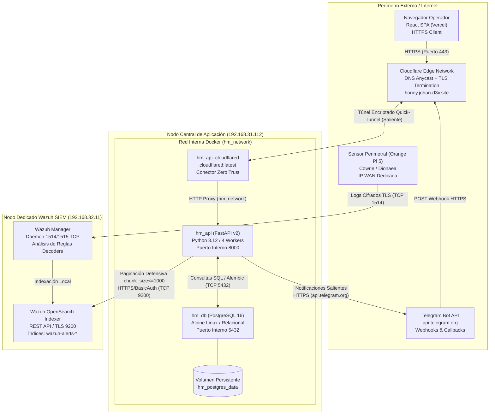
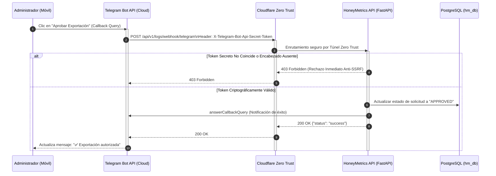
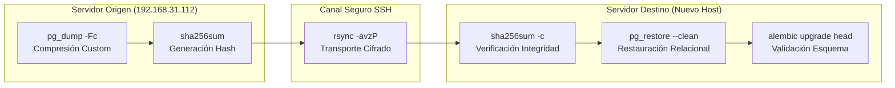

# Guía de Despliegue y Puesta en Marcha en Producción — HoneyMetrics v2.0

Este documento de ingeniería establece la especificación técnica, topología de red, prerrequisitos de infraestructura, parametrización de entorno y los procedimientos operacionales rigurosos para aprovisionar y mantener la plataforma **HoneyMetrics v2.0** en servidores dedicados o entornos locales de alta disponibilidad.

> **Ver también:**
> - [manual-tecnico.md → Sección 2: Arquitectura Polyrepo y Contratos](./manual-tecnico.md#2-visión-general-polyrepo) — Visión global de los componentes del backend y su interacción con el frontend.
> - [manual-tecnico.md → Sección 4: Seguridad y Control de Acceso](./manual-tecnico.md#4-seguridad-criptográfica-y-sesiones) — Parámetros de hashing Bcrypt, tokens JWT y autenticación de doble factor (TOTP).
> - [diccionario-datos.md → Sección 1: Modelo Entidad-Relación](./diccionario-datos.md#1-modelo-entidad-relación-mer) — Estructura física de tablas PostgreSQL, claves primarias y relaciones foráneas.
> - [matriz-cambios.md → Base de Datos y DevOps](./matriz-cambios.md#matriz-exhaustiva-de-localización-de-cambios) — Ubicación de archivos de configuración, Dockerfiles y migraciones Alembic.

---

## Índice

- [1. Topología de Red Distribuida](#1-topología-de-red-distribuida)
  - [1.1. Arquitectura de Nodos y Flujos de Telemetría](#11-arquitectura-de-nodos-y-flujos-de-telemetría)
  - [1.2. Diagrama de Conectividad Perimetral e Interna](#12-diagrama-de-conectividad-perimetral-e-interna)
- [2. Prerrequisitos de Hardware y Software](#2-prerrequisitos-de-hardware-y-software)
  - [2.1. Requerimientos de Capacidad de Cómputo y Almacenamiento](#21-requerimientos-de-capacidad-de-cómputo-y-almacenamiento)
  - [2.2. Matriz de Software Base y Comandos de Verificación](#22-matriz-de-software-base-y-comandos-de-verificación)
- [3. Configuración de Variables de Entorno (.env)](#3-configuración-de-variables-de-entorno-env)
  - [3.1. Especificación Canónica de Parámetros](#31-especificación-canónica-de-parámetros)
  - [3.2. Criterios de Seguridad y Aislamiento en Producción](#32-criterios-de-seguridad-y-aislamiento-en-producción)
- [4. Despliegue Paso a Paso (Docker Compose)](#4-despliegue-paso-a-paso-docker-compose)
  - [Paso 1: Clonación del Código y Preparación del Directorio](#paso-1-clonación-del-código-y-preparación-del-directorio)
  - [Paso 2: Aprovisionamiento y Blindaje del Archivo .env](#paso-2-aprovisionamiento-y-blindaje-del-archivo-env)
  - [Paso 3: Construcción de Imágenes y Orquestación de Contenedores](#paso-3-construcción-de-imágenes-y-orquestación-de-contenedores)
  - [Paso 4: Verificación de Salud e Inspección de Registros](#paso-4-verificación-de-salud-e-inspección-de-registros)
  - [Paso 5: Ejecución de Migraciones de Base de Datos con Alembic](#paso-5-ejecución-de-migraciones-de-base-de-datos-con-alembic)
- [5. Inicialización de Datos Semilla (Database Seeding)](#5-inicialización-de-datos-semilla-database-seeding)
  - [5.1. Funcionamiento Interno de seed_admin.py](#51-funcionamiento-interno-de-seed_adminpy)
  - [5.2. Procedimiento de Ejecución y Validación](#52-procedimiento-de-ejecución-y-validación)
- [6. Configuración del Webhook de Telegram](#6-configuración-del-webhook-de-telegram)
  - [6.1. Flujo Humano-en-el-Bucle (HITL) y Protección Anti-SSRF](#61-flujo-humano-en-el-bucle-hitl-y-protección-anti-ssrf)
  - [6.2. Registro Automatizado con set_telegram_webhook.py](#62-registro-automatizado-con-set_telegram_webhookpy)
- [7. Cheatsheet de Operaciones Cotidianas](#7-cheatsheet-de-operaciones-cotidianas)
  - [7.1. Inspección y Monitoreo de Procesos](#71-inspección-y-monitoreo-de-procesos)
  - [7.2. Mantenimiento y Redespliegue sin Pérdida de Datos](#72-mantenimiento-y-redespliegue-sin-pérdida-de-datos)
- [8. Migración de Servidor (Dump → Transfer → Restore)](#8-migración-de-servidor-dump--transfer--restore)
  - [Fase A: Volcado Lógico Consistente (Dump)](#fase-a-volcado-lógico-consistente-dump)
  - [Fase B: Transferencia Segura Cifrada (Transfer)](#fase-b-transferencia-segura-cifrada-transfer)
  - [Fase C: Restauración Atómica en Servidor Destino (Restore)](#fase-c-restauración-atómica-en-servidor-destino-restore)
- [9. Resolución de Problemas Comunes (Troubleshooting)](#9-resolución-de-problemas-comunes-troubleshooting)

---

## 1. Topología de Red Distribuida

HoneyMetrics v2.0 opera sobre una infraestructura híbrida y distribuida en cuatro niveles independientes. Cada nodo cumple un propósito funcional delimitado para evitar cuellos de botella por concurrencia y proteger el servidor transaccional frente a ataques de denegación de servicio o saturación de memoria.

### 1.1. Arquitectura de Nodos y Flujos de Telemetría

1. **Nodo Sensor / Perimetral (Honeypot):** Dispositivo embebido (Orange Pi 5) expuesto en la zona desmilitarizada (DMZ) o con IP pública directa. Ejecuta servicios trampa de baja y mediana interacción (Cowrie en puertos 22/2222 y Dionaea en protocolos industriales/SMB). Un agente Wazuh transporta la telemetría en tiempo real mediante un canal TLS hacia el clúster central.
2. **Nodo SIEM e Indexación (OpenSearch Indexer):** Servidor dedicado en la subred de seguridad (`192.168.32.11`). Aloja el motor Wazuh Indexer en el puerto `9200` y Wazuh Manager en el puerto `55000`. Almacena los índices duales de eventos (`wazuh-alerts-4.x-*` y `wazuh-archives-4.x-*`). En este nodo **no se ejecuta código del aplicativo HoneyMetrics**, blindando su estabilidad contra colapsos de memoria (OOM).
3. **Nodo Central de Aplicación (Backend Activo):** Estación de trabajo o servidor local (`192.168.31.112` en producción LAN / `192.168.33.2` en staging) con 16 GB de memoria RAM. Aloja el motor Docker que orquesta la API en FastAPI (`hm_api`), el motor relacional PostgreSQL 16 Alpine (`hm_db`) y el conector seguro `cloudflared` (`hm_api_cloudflared`).
4. **Perímetro Cloud y Clientes Externos:** La red perimetral de Cloudflare recibe las peticiones HTTPS públicas en el dominio institucional (ej. `https://honey.johan-d3v.site`) y las canaliza mediante un túnel Zero Trust saliente hacia el contenedor `hm_api:8000`, eliminando la necesidad de abrir puertos entrantes en el enrutador físico (Port Forwarding). La interfaz de usuario (React SPA) y la API de Telegram interactúan exclusivamente contra este punto de entrada seguro.

> [!NOTE]
> **El Por Qué Técnico — Aislamiento Físico de OpenSearch (`192.168.32.11`):** Las consultas analíticas agregadas sobre millones de eventos no estructurados demandan asignaciones intensivas de heap Java (JVM). Si el indexador compartiera memoria física con PostgreSQL y los workers Uvicorn de FastAPI, una extracción masiva de auditoría provocaría la invocación del Out-Of-Memory Killer del kernel Linux, terminando intempestivamente el motor de base de datos relacional.

### 1.2. Diagrama de Conectividad Perimetral e Interna



---

## 2. Prerrequisitos de Hardware y Software

El aprovisionamiento de la infraestructura debe cumplir con los límites de capacidad y compatibilidad descritos a continuación para garantizar la estabilidad del servicio bajo cargas sostenidas de telemetría.

### 2.1. Requerimientos de Capacidad de Cómputo y Almacenamiento

| Recurso | Requisito Mínimo Absoluto | Configuración Recomendada de Producción | Propósito Técnico e Impacto de Capacidad |
| :--- | :--- | :--- | :--- |
| **Procesador (CPU)** | 2 Cores (x86_64 o ARM64) | 4 Cores a 2.5 GHz o superior | Procesamiento asíncrono de streaming JSONL y cálculo de hashes criptográficos. |
| **Memoria RAM** | 4 GB | 16 GB | 1 GB para PostgreSQL (`shared_buffers=64MB`), 2 GB para Uvicorn y margen libre para buffer de I/O. |
| **Almacenamiento** | 20 GB SSD | 80 GB NVMe | Espacio para el motor relacional y retención temporal de exportaciones en disco (`/tmp`). |
| **Conectividad LAN** | 100 Mbps Fast Ethernet | 1 Gbps Full-Duplex | Flujo sostenido hacia el indexador OpenSearch en `192.168.32.11` sin latencia acumulativa. |
| **Conectividad WAN** | 10 Mbps de subida | 30 Mbps simétricos | Capacidad para transferir artefactos descargados y mantener la conexión persistente del túnel. |

### 2.2. Matriz de Software Base y Comandos de Verificación

El servidor anfitrión debe contar con una distribución Linux moderna (Ubuntu Server 22.04 LTS o Debian 12 recomendados) y los paquetes fundamentales de contenedorización:

| Paquete / Servicio | Versión Mínima | Comando de Verificación | Salida de Confirmación Esperada |
| :--- | :--- | :--- | :--- |
| **Kernel Linux** | 5.15.0+ | `uname -r` | `5.15.0-XX-generic` o superior |
| **Docker Engine** | 24.0.0+ | `docker --version` | `Docker version 24.0.X, build ...` |
| **Docker Compose** | 2.20.0+ | `docker compose version` | `Docker Compose version v2.2X.X` |
| **Git** | 2.34.0+ | `git --version` | `git version 2.34.X` |
| **OpenSSL** | 3.0.0+ | `openssl version` | `OpenSSL 3.0.X ...` |
| **Curl** | 7.81.0+ | `curl --version` | `curl 7.81.X ...` |

Ejecute la siguiente secuencia en la terminal del host para validar la preparación completa del entorno:

```bash
# 1. Verificar versión y disponibilidad del daemon de Docker:
docker version --format '{{.Server.Version}}'

# 2. Verificar versión integrada del plugin Docker Compose:
docker compose version --short

# 3. Comprobar memoria RAM disponible antes de levantar contenedores:
# -m: Muestra las cifras consolidadas en megabytes para lectura técnica rápida.
free -m

# 4. Comprobar espacio disponible en la partición raíz del sistema:
# -h: Formato legible para humanos (Gigabytes / Megabytes).
# -T: Muestra el sistema de archivos (debe ser ext4, xfs o btrfs).
df -hT /
```

---

## 3. Configuración de Variables de Entorno (.env)

La parametrización del aplicativo se gobierna mediante la clase `Settings` en `app/core/config.py`, la cual implementa `pydantic-settings` para validar tipados y consistencia en tiempo de arranque.

### 3.1. Especificación Canónica de Parámetros

A continuación se detalla cada una de las variables presentes en `.env.example`, complementadas con los parámetros de integración requeridos por la plataforma:

| Variable de Entorno | Valor de Referencia / Ejemplo | Obligatoria | Descripción Técnica y Propósito | Riesgo / Impacto si se Omite o Configura Mal |
| :--- | :--- | :---: | :--- | :--- |
| `PROJECT_NAME` | `"HoneyMetrics v2 API (UDEC)"` | Sí | Nombre representativo del aplicativo utilizado en la documentación interactiva OpenAPI/Swagger. | Cosmético; OpenAPI muestra títulos por defecto si se omite. |
| `VERSION` | `"2.0.0-academic"` | Sí | Identificador semántico de versión desplegado en los metadatos globales del servicio. | Dificulta la trazabilidad de versión durante auditorías operacionales. |
| `ENVIRONMENT` | `"production"` | Sí | Define el modo operativo del aplicativo (`development`, `staging`, `production`). | En `production` activa validaciones estrictas; si se deja `development` relaja la seguridad. |
| `DEBUG` | `False` | Sí | Controla el nivel de detalle de las trazas de error y la exposición de logs de depuración. | Si se activa (`True`) en producción, filtra trazas internas y estructuras SQL a clientes externos. |
| `API_V1_STR` | `"/api/v1"` | Sí | Prefijo canónico de ruta para todos los endpoints expuestos por la API REST. | Rompe el contrato de enrutamiento con el frontend cliente si no concuerda. |
| `BACKEND_CORS_ORIGINS` | `["https://honey.johan-d3v.site"]` | Sí | Lista JSON de orígenes autorizados para intercambiar peticiones Cross-Origin con credenciales. | Si está mal configurado, el navegador bloquea las solicitudes de la SPA con error CORS. |
| `POSTGRES_USER` | `"usr_honeymetrics"` | Sí | Nombre de usuario exclusivo asignado a la base de datos bajo Principio de Menor Privilegio (PoLP). | Usar superusuarios debilita la contención del host si el contenedor se ve vulnerado. |
| `POSTGRES_PASSWORD` | `"ClaveComplejaProd2026#"` | Sí | Contraseña criptográfica para autenticación contra el motor PostgreSQL. | Claves débiles permiten ataques de fuerza bruta en redes internas comprometidas. |
| `POSTGRES_DB` | `"honeymetrics_v2"` | Sí | Nombre de la base de datos relacional creada durante la inicialización del contenedor. | PostgreSQL creará un catálogo genérico impidiendo que el aplicativo localice sus tablas. |
| `DATABASE_URL` | `"postgresql://usr:pass@db:5432/db"` | Sí | Cadena canónica de conexión utilizada por el pool de SQLAlchemy y Alembic (`db` es el host Docker). | Fallo inmediato en el arranque del servicio (`OperationalError`), impidiendo iniciar la API. |
| `SECRET_KEY` | `"64_caracteres_hexadecimales"` | Sí | Semilla criptográfica de alta entropía para firmar tokens de sesión JWT mediante HS256. | Si se mantiene el valor por defecto, atacantes pueden forjar tokens y usurpar cualquier rol. |
| `ALGORITHM` | `"HS256"` | Sí | Algoritmo simétrico de firma empleado para la codificación y validación de tokens JWT. | Tokens firmados con algoritmos no soportados serán rechazados, bloqueando el login. |
| `ACCESS_TOKEN_EXPIRE_MINUTES` | `60` | Sí | Tiempo de vigencia en minutos antes de que el token de portador (Bearer Token) expire. | Valores muy elevados aumentan la ventana de riesgo ante la sustracción de credenciales. |
| `REQUIRE_PASSWORD_CHANGE_ON_FIRST_LOGIN` | `True` | Sí | Fuerza al usuario a actualizar su credencial temporal al autenticarse por primera vez. | Si es `False`, credenciales iniciales conocidas (como las de seed) permanecen activas. |
| `CLOUDFLARE_TUNNEL_TOKEN` | `"eyJhIjoi..."` | Sí (Prod) | Token de autenticación del conector `cloudflared` emitido en la consola Cloudflare Zero Trust. | El contenedor `hm_api_cloudflared` falla al arrancar y la API queda inaccesible desde WAN. |
| `ML_AUTOPILOT_ENABLED` | `False` | No | Flag para el servicio de tareas analíticas secundarias en segundo plano (Fase 2 Enterprise). | Debe permanecer en `False` durante la entrega académica v2.0 para evitar consumo de CPU. |
| `ML_AUTOPILOT_ON_STARTUP` | `False` | No | Determina si las rutinas analíticas secundarias se disparan al arrancar el contenedor (Fase 2). | Mantener deshabilitado en el entorno de evaluación académica. |
| `ML_AUTOPILOT_INTERVAL_HOURS` | `12` | No | Intervalo de periodicidad horaria para tareas analíticas en segundo plano (Fase 2). | Sin impacto funcional si el flag principal se encuentra en `False`. |
| `ML_MIN_HOURS_BETWEEN_RETRAINS` | `6.0` | No | Ventana mínima temporal de espera entre ciclos analíticos secundarios (Fase 2). | Sin impacto funcional en la versión v2.0 académica. |
| `ML_MIN_NEW_EVENTS` | `1000` | No | Umbral de eventos requeridos para invocar rutinas secundarias en segundo plano (Fase 2). | Sin impacto funcional en la versión v2.0 académica. |
| `ML_DEGRADATION_THRESHOLD` | `0.005` | No | Margen de tolerancia para auditorías analíticas secundarias en segundo plano (Fase 2). | Sin impacto funcional en la versión v2.0 académica. |
| `ML_REMOTE_SYNC_ENABLED` | `False` | No | Bandera para habilitar la réplica de artefactos analíticos hacia nodos remotos (Fase 2). | Debe permanecer en `False` para no abrir sesiones SSH desatendidas hacia otros servidores. |
| `ML_REMOTE_HOST` | `"192.168.33.2"` | No | Dirección IP del nodo de réplica analítica remota en staging (Fase 2). | Sin impacto si la sincronización remota está deshabilitada. |
| `ML_REMOTE_USER` | `"sebas"` | No | Usuario del sistema operativo para transporte SSH de artefactos secundarios (Fase 2). | Sin impacto si la sincronización remota está deshabilitada. |
| `ML_REMOTE_ARTIFACTS_PATH` | `"/home/sebas/app/artifacts"` | No | Ruta del sistema de archivos en el nodo remoto para alojar artefactos (Fase 2). | Sin impacto si la sincronización remota está deshabilitada. |
| `ML_REMOTE_API_URL` | `"http://192.168.33.2:8000/..."` | No | Endpoint HTTP para invocar recarga de artefactos en el nodo remoto (Fase 2). | Sin impacto si la sincronización remota está deshabilitada. |
| `WAZUH_INDEXER_URL` | `"https://192.168.32.11:9200"` | Sí | URL base del clúster OpenSearch del SIEM Wazuh alojado en el nodo dedicado. | Fallo total en la extracción de eventos CTI y visualización del panel de telemetría. |
| `WAZUH_INDEXER_USER` | `"admin"` | Sí | Usuario con privilegios de lectura sobre los índices `wazuh-alerts-*` y `wazuh-archives-*`. | Peticiones hacia Wazuh devuelven error HTTP 401 Unauthorized. |
| `WAZUH_INDEXER_PASSWORD` | `"CredencialSeguraWazuh"` | Sí | Contraseña de autenticación básica (Basic Auth) para el indexador OpenSearch. | Peticiones hacia Wazuh fallan por autenticación, impidiendo alimentar el CTI Center. |
| `WAZUH_CA_CERT_PATH` | `"/etc/ssl/root-ca.pem"` | No | Ruta absoluta al certificado CA raíz para validar la cadena TLS del clúster Wazuh. | Si no se provee y `WAZUH_TLS_VERIFY=True`, las solicitudes arrojan error de validación SSL. |
| `WAZUH_TLS_VERIFY` | `True` | Sí | Bandera que exige validación criptográfica de certificados en las peticiones HTTPS a Wazuh. | Si es `False`, expone la comunicación interna a ataques de intermediario (MitM). |
| `TELEGRAM_BOT_TOKEN` | `"<TU_TELEGRAM_BOT_TOKEN>"` | Sí | Token HTTP API provisto por `@BotFather` para controlar el bot institucional. | Impide el despacho de alertas críticas y la recepción de aprobaciones en el canal Telegram. |
| `ADMIN_TELEGRAM_CHAT_ID` | `"1307616056"` | Sí | Identificador numérico del chat del administrador global que recibe solicitudes HITL. | Las aprobaciones interactivas de descargas masivas no llegan a ningún destinatario. |
| `TELEGRAM_WEBHOOK_SECRET` | `"SecretoAntiSSRF2026#"` | Sí | Secreto compartido validado contra el encabezado `X-Telegram-Bot-Api-Secret-Token`. | Permite a adversarios falsificar peticiones POST y aprobar descargas o bloqueos espurios. |

### 3.2. Criterios de Seguridad y Aislamiento en Producción

> [!CAUTION]
> **Principio de Menor Privilegio (PoLP) en PostgreSQL:** En entornos de producción está estrictamente prohibido utilizar el usuario `postgres` en la variable `DATABASE_URL`. El aplicativo debe operar con un usuario sin atributos de superusuario (`usr_honeymetrics`) cuyos permisos se limiten exclusivamente al esquema `public` de la base de datos `honeymetrics_v2`.

> [!NOTE]
> **El Por Qué Técnico — Generación de `SECRET_KEY` vía OpenSSL:** Emplear frases legibles o valores autogenerados por frameworks debilita la resistencia contra ataques de diccionario fuera de línea (offline dictionary attacks). Ejecutar `openssl rand -hex 32` extrae 256 bits de entropía real desde el generador pseudoaleatorio del kernel Linux (`/dev/urandom`), garantizando un espacio de claves de $2^{256}$ combinaciones imposibles de vulnerar por fuerza bruta.

---

## 4. Despliegue Paso a Paso (Docker Compose)

Siga rigurosamente esta secuencia de comandos para poner en marcha el entorno de producción en un servidor virgen.

### Paso 1: Clonación del Código y Preparación del Directorio

```bash
# -b main: Clona exclusivamente la rama estable de producción auditada para release.
# --single-branch: Descarga únicamente el historial de la rama objetivo, optimizando ancho de banda y espacio.
git clone -b main --single-branch https://github.com/johanP051/honeymetrics-backend.git

# Ingresar al directorio raíz del proyecto backend:
cd honeymetrics-backend
```

### Paso 2: Aprovisionamiento y Blindaje del Archivo .env

Genere claves seguras y restrinja los permisos de lectura del archivo de configuración antes de inicializar los contenedores:

```bash
# 1. Crear el archivo productivo copiando la plantilla base:
cp .env.example .env

# 2. Generar SECRET_KEY criptográfica de 256 bits y anexarla:
# rand -hex 32: Emite 32 bytes aleatorios formateados como 64 caracteres hexadecimales.
openssl rand -hex 32

# 3. Generar token secreto anti-SSRF para el webhook de Telegram:
openssl rand -hex 16

# 4. Asignar permisos estrictos de sistema de archivos POSIX:
# 600: Lectura y escritura únicamente para el usuario propietario; denegado para grupo y otros.
chmod 600 .env
```

Edite el archivo `.env` con un editor de texto seguro (`nano .env` o `vim .env`) e inyecte los valores correspondientes a su entorno según la tabla de la Sección 3.

### Paso 3: Construcción de Imágenes y Orquestación de Contenedores

HoneyMetrics separa la configuración de desarrollo (`docker-compose.yml`) de la optimización industrial (`docker-compose.prod.yml`). En producción, la API ejecuta 4 workers Uvicorn concurrentes, PostgreSQL limita su memoria compartida (`shared_buffers=64MB`, `work_mem=4MB`, `max_connections=30`) y se activa el perfil del túnel Zero Trust:

```bash
# -f docker-compose.yml: Carga la estructura base de servicios, redes y volúmenes.
# -f docker-compose.prod.yml: Aplica sobreescritura de producción (workers, recursos y tunel).
# --profile tunnel: Activa el perfil condicional 'tunnel' que incluye el servicio hm_api_cloudflared.
# up: Crea y arranca la totalidad de los contenedores requeridos.
# -d: Modo detached (segundo plano / daemon), liberando la consola del operador.
# --build: Fuerza la reconstrucción de la imagen local a partir del Dockerfile garantizando paridad de código.
docker compose -f docker-compose.yml -f docker-compose.prod.yml --profile tunnel up -d --build
```

### Paso 4: Verificación de Salud e Inspección de Registros

Compruebe que los servicios hayan superado las pruebas de vitalidad (healthchecks) y estén enlazados correctamente a la red virtual `hm_network`:

```bash
# ps: Muestra el estado operacional de los contenedores orquestados.
# --filter "name=hm_": Filtra la visualización exclusivamente a los contenedores de HoneyMetrics.
docker compose ps --filter "name=hm_"

# logs: Inspecciona la salida estándar (stdout/stderr) de los procesos.
# -f: Sigue el flujo de logs en tiempo real (follow mode).
# --tail 50: Limita el búfer inicial a las últimas 50 líneas para evitar saturación de terminal.
docker compose logs -f --tail 50 api
```

### Paso 5: Ejecución de Migraciones de Base de Datos con Alembic

Una vez que el contenedor `hm_db` reporte estado `healthy`, aplique las revisiones pendientes para estructurar el esquema relacional en PostgreSQL:

```bash
# exec: Ejecuta una instrucción dentro de un contenedor en ejecución.
# -T: Deshabilita la asignación de pseudo-TTY, permitiendo canalizaciones y ejecución desatendida.
# api: Nombre del servicio definido en Compose que contiene el entorno FastAPI y Alembic.
# alembic upgrade head: Aplica todas las migraciones acumuladas hasta la versión más reciente.
docker compose exec -T api alembic upgrade head
```

---

## 5. Inicialización de Datos Semilla (Database Seeding)

Para garantizar la continuidad operativa de la plataforma sin requerir intervenciones manuales en la consola SQL, el backend dispone de una rutina de inicialización canónica en `scripts/seed_admin.py`.

### 5.1. Funcionamiento Interno de seed_admin.py

El script implementa una arquitectura idempotente gobernada por SQLAlchemy:

1. **Gestión Transaccional de Roles:** Consulta la existencia del rol `Administrador` en la tabla `roles`. Si no existe, lo instancia y persiste mediante un `commit()` atómico.
2. **Creación del Administrador Maestro:** Crea la cuenta `admin@ucundinamarca.edu.co` asignándole el hash Bcrypt de la contraseña temporal `Admin123!`. Establece la bandera `must_change_password=True`, forzando al usuario a actualizar su credencial antes de acceder a las funcionalidades del sistema.
3. **Creación del Usuario Institucional:** Registra la cuenta institucional `jsebastianposada@ucundinamarca.edu.co` vinculada al rol `Administrador`.
4. **Cuentas Técnicas de Integración:** Instancia de forma controlada las identidades `root` y `root@honeymetrics.com` requeridas para pruebas de integración automatizadas y scripts CLI de soporte.
5. **Cierre de Conexión:** En el bloque `finally`, garantiza la liberación de la sesión relacional (`db.close()`), previniendo fugas de conexiones en el pool.

### 5.2. Procedimiento de Ejecución y Validación

Invoque el sembrado ejecutando el script dentro del contenedor de la API:

```bash
# exec: Invoca un proceso en el contenedor activo.
# -it: Mantiene STDIN abierto y asigna un pseudo-terminal para visualizar la salida en vivo.
# api: Servicio de la API donde reside el entorno Python 3.12 y los modelos ORM.
# python scripts/seed_admin.py: Ejecuta el script de aprovisionamiento de identidades base.
docker compose exec -it api python scripts/seed_admin.py
```

La salida esperada en la consola debe confirmar la creación o actualización de los registros:

```text
Role 'Administrador' created.
Admin user 'admin@ucundinamarca.edu.co' created.
User 'jsebastianposada@ucundinamarca.edu.co' created.
User 'root' with password 'root' created.
User 'root@honeymetrics.com' with password 'root' created.
```

> [!IMPORTANT]
> **Saneamiento Obligatorio Post-Despliegue:** Inmediatamente después de inicializar la plataforma, el administrador debe iniciar sesión en la interfaz web, actualizar la contraseña por defecto `Admin123!` por una clave robusta y enrolar su dispositivo en el flujo de autenticación de doble factor (TOTP) mediante Google Authenticator o FreeOTP.

---

## 6. Configuración del Webhook de Telegram

HoneyMetrics v2.0 incorpora un flujo de aprobación Humano-en-el-Bucle (Human-in-the-Loop - HITL) para autorizar solicitudes de extracción masiva de registros de auditoría y bloqueos de IPs maliciosas sin obligar al operador a ingresar a la consola administrativa.

### 6.1. Flujo Humano-en-el-Bucle (HITL) y Protección Anti-SSRF

Cuando un analista solicita la exportación de más de 5,000 eventos de telemetría (PB-HM-40) o se detecta una amenaza de severidad crítica, el backend envía un mensaje interactivo al chat de Telegram del administrador (`ADMIN_TELEGRAM_CHAT_ID`) provisto de botones en línea (Inline Keyboards: "Aprobar" / "Rechazar").

Al hacer clic, Telegram despacha una petición HTTP POST asíncrona hacia el endpoint `/api/v1/logs/webhook/telegram`. Para mitigar vectores de Server-Side Request Forgery (SSRF) o inyección de callbacks falsificados por terceros, el sistema implementa una barrera criptográfica:

1. Al registrar el webhook, se suministra el parámetro `secret_token` a la API de Telegram.
2. En cada llamada, Telegram adjunta dicho secreto en la cabecera HTTP `X-Telegram-Bot-Api-Secret-Token`.
3. El middleware de FastAPI en `app/services/telegram_service.py` valida la cabecera contra `TELEGRAM_WEBHOOK_SECRET` mediante comparación en tiempo constante (`hmac.compare_digest`). Peticiones no coincidentes son descartadas de inmediato con un código de respuesta `403 Forbidden`.



### 6.2. Registro Automatizado con set_telegram_webhook.py

> [!CAUTION]
> **Precedencia de Red Obligatoria:** El registro del webhook debe ejecutarse **exclusivamente después** de que el túnel de Cloudflare se encuentre activo y respondiendo satisfactoriamente en Internet bajo HTTPS. Si la URL pública no resuelve o no cuenta con certificado TLS válido, los servidores de Telegram rechazarán el registro.

Ejecute el script de vinculación desde el servidor anfitrión suministrando la URL pública definitiva del túnel:

```bash
# 1. Exportar temporalmente en la sesión de terminal las credenciales requeridas:
export TELEGRAM_BOT_TOKEN="TU_TOKEN_GENERADO_EN_BOTFATHER"
export TELEGRAM_WEBHOOK_SECRET="SecretoAntiSSRF2026#"

# 2. Invocar el script suministrando la URL pública terminada en HTTPS:
python3 scripts/set_telegram_webhook.py https://honey.johan-d3v.site
```

La consola debe mostrar la confirmación directa emitida por los servidores de Telegram:

```json
{"ok": true, "result": true, "description": "Webhook was set"}
```

Para verificar en cualquier momento el estado del webhook, el recuento de eventos pendientes y posibles errores de entrega, utilice `curl` y procese la respuesta con `jq`:

```bash
# -s: Modo silencioso, suprime medidores de progreso de descarga.
# -X GET: Especifica método de consulta contra la API oficial de Telegram.
curl -s "https://api.telegram.org/bot${TELEGRAM_BOT_TOKEN}/getWebhookInfo" | jq .
```

---

## 7. Cheatsheet de Operaciones Cotidianas

Esta sección compila los procedimientos rutinarios indispensables para administradores de sistemas y operadores de seguridad a cargo de HoneyMetrics v2.0.

### 7.1. Inspección y Monitoreo de Procesos

```bash
# Monitorear logs unificados de todos los servicios en streaming continuo:
docker compose logs -f --tail 100

# Aislar exclusivamente los registros de la base de datos relacional:
docker compose logs -f db

# Visualizar el consumo de CPU, memoria y ancho de banda de los contenedores en vivo:
docker stats --format "table {{.Name}}\t{{.CPUPerc}}\t{{.MemUsage}}\t{{.NetIO}}"

# Ingresar a una sesión interactiva Bash dentro del contenedor de la API:
docker compose exec -it api /bin/bash

# Acceder directamente a la consola SQL psql dentro del contenedor de base de datos:
# -U: Especifica el usuario de base de datos definido en .env.
# -d: Especifica la base de datos a consultar.
docker compose exec -it db psql -U usr_honeymetrics -d honeymetrics_v2
```

### 7.2. Mantenimiento y Redespliegue sin Pérdida de Datos

Cuando se liberen correcciones de código en la rama `main`, ejecute el siguiente ciclo de actualización sin destruir los volúmenes de datos ni interrumpir el estado de PostgreSQL:

```bash
# 1. Obtener los últimos commits estables del repositorio:
git pull origin main

# 2. Reconstruir la imagen de la API incorporando los cambios:
# build: Compila el nuevo contexto Dockerfile sin alterar los contenedores en ejecución.
docker compose -f docker-compose.yml -f docker-compose.prod.yml build api

# 3. Reemplazar en caliente el contenedor de la API minimizando el tiempo de inactividad:
# --no-deps: Evita reiniciar servicios dependientes que no sufrieron alteraciones (como db).
docker compose -f docker-compose.yml -f docker-compose.prod.yml --profile tunnel up -d --no-deps api

# 4. Aplicar cualquier nueva migración de base de datos requerida por el nuevo código:
docker compose exec -T api alembic upgrade head

# 5. Purgar imágenes intermedias obsoletas (dangling images) para liberar almacenamiento:
# -f: Omite la solicitud interactiva de confirmación.
docker image prune -f
```

---

## 8. Migración de Servidor (Dump → Transfer → Restore)

Para trasladar la infraestructura hacia un nuevo nodo físico o restaurar el entorno ante contingencias mayores, aplique el protocolo estructurado de migración en tres fases.



### Fase A: Volcado Lógico Consistente (Dump)

Genere un archivo de volcado binario consistente que capture la totalidad de tablas, secuencias, tipos de datos e índices del motor relacional:

```bash
# -U: Usuario con permisos de lectura integral sobre las tablas.
# -Fc: Formato Custom nativo de PostgreSQL (comprimido, permite restauración selectiva y paralela).
# -b: Incluye Large Objects en el volcado para integridad de adjuntos.
# -v: Modo detallado (verbose) para auditoría de tablas respaldadas.
# honeymetrics_v2: Nombre de la base de datos de origen.
docker compose exec -T db pg_dump -U usr_honeymetrics -Fc -b -v honeymetrics_v2 > backup_honeymetrics_$(date +%Y%m%d_%H%M%S).dump

# Generar el checksum criptográfico SHA-256 para validación posterior de integridad:
sha256sum backup_honeymetrics_*.dump > backup_honeymetrics.sha256
```

### Fase B: Transferencia Segura Cifrada (Transfer)

Transfiera el volcado binario y su firma criptográfica hacia el nuevo servidor de destino mediante `rsync` sobre SSH:

```bash
# -a: Modo archivo (preserva propietarios, permisos POSIX y marcas de tiempo).
# -v: Modo detallado para observar el progreso en la terminal.
# -z: Comprime los datos durante la transmisión de red para acelerar la transferencia.
# -P: Muestra barra de progreso en tiempo real y permite reanudar transferencias interrumpidas.
rsync -avzP backup_honeymetrics_* sebas@192.168.31.200:/home/sebas/backups/
```

En el servidor de destino, verifique que los archivos no hayan sufrido corrupción en tránsito:

```bash
# -c: Valida los archivos listados en el manifiesto comparando sus hashes calculados:
sha256sum -c backup_honeymetrics.sha256
```

### Fase C: Restauración Atómica en Servidor Destino (Restore)

> [!NOTE]
> **El Por Qué Técnico — Formato Custom (`-Fc`) vs SQL Plano (`.sql`):** El volcado en texto plano procesa instrucciones secuenciales lentas propensas a bloqueos si una restricción foránea se carga desordenada. El formato binario comprimido (`-Fc`) almacena un catálogo interno que permite a `pg_restore` reordenar la inyección de índices y llaves foráneas después de haber poblado las filas, reduciendo el tiempo de recuperación de desastres en un 70%.

En el nuevo servidor, clone el código, configure el archivo `.env`, levante exclusivamente el contenedor de base de datos y ejecute la restauración:

```bash
# 1. Levantar únicamente el contenedor de la base de datos en el nuevo servidor:
docker compose -f docker-compose.yml -f docker-compose.prod.yml up -d db

# 2. Esperar a que PostgreSQL complete su inicialización y supere el healthcheck:
until docker compose exec -T db pg_isready -U usr_honeymetrics; do sleep 2; done

# 3. Restaurar la estructura y los datos empleando pg_restore:
# -U: Usuario de conexión con permisos de creación de objetos en PostgreSQL.
# -d: Base de datos de destino donde se inyectará la información.
# --clean: Elimina las tablas existentes antes de recrearlas para evitar duplicados.
# --if-exists: Previene errores si se intenta eliminar una tabla que aún no ha sido creada.
# --no-owner: Omite la asignación del propietario original para compatibilidad de usuarios.
# --no-privileges: Previene la restauración de privilegios de acceso no aplicables.
cat backup_honeymetrics_*.dump | docker compose exec -T db pg_restore -U usr_honeymetrics -d honeymetrics_v2 --clean --if-exists --no-owner --no-privileges -v

# 4. Validar el estado del esquema con Alembic y levantar la suite completa:
docker compose -f docker-compose.yml -f docker-compose.prod.yml --profile tunnel up -d
docker compose exec -T api alembic current
```

---

## 9. Resolución de Problemas Comunes (Troubleshooting)

La siguiente matriz documenta los incidentes operacionales más frecuentes en HoneyMetrics v2.0, su causa raíz técnica diagnosticada y el procedimiento de resolución comprobado en campo:

| Síntoma / Mensaje de Error | Causa Raíz Probable | Procedimiento de Resolución Técnica |
| :--- | :--- | :--- |
| `psycopg2.OperationalError: could not connect to server: Connection refused` | El contenedor `hm_db` aún no completa el arranque o no está escuchando en el puerto 5432 de la red Docker. | Verificar estado del contenedor con `docker compose ps db`. Comprobar logs con `docker compose logs db`. Asegurar que en `.env` el host de `DATABASE_URL` sea `db` y no `localhost` o `127.0.0.1`. |
| `alembic.util.exc.CommandError: Target database is not up to date.` | La base de datos relacional contiene revisiones previas pero no se han aplicado las migraciones más recientes. | Ejecutar `docker compose exec -T api alembic upgrade head`. Si persiste inconsistencia de ramas, ejecutar `alembic current` para identificar la revisión discrepante. |
| `403 Forbidden - Invalid Telegram Secret Token` en el webhook | La cabecera `X-Telegram-Bot-Api-Secret-Token` no coincide exactamente con el valor definido en `TELEGRAM_WEBHOOK_SECRET`. | Verificar que el valor en `.env` coincida byte a byte con el secreto inyectado en `set_telegram_webhook.py`. Re-ejecutar el script de registro para forzar la sincronización en Telegram. |
| `Telegram API Error: 429 Too Many Requests: retry after X` | El aplicativo superó los límites de tasa (rate limiting) de despacho de mensajes en Telegram (máximo 30 mensajes/segundo global). | El servicio de notificación implementa reintentos con backoff. Esperar el número de segundos estipulado en el parámetro `retry_after` o reducir el envío de alertas masivas no agrupadas. |
| `Wazuh Indexer Connection Timeout: Request to https://192.168.32.11:9200 failed` | Bloqueo perimetral a nivel de firewall en el nodo SIEM, caída del servicio OpenSearch o ruta LAN inaccesible desde el host. | Ejecutar `ping 192.168.32.11` y `nc -zv 192.168.32.11 9200` desde el host anfitrión. En el nodo SIEM, verificar el estado del demonio con `systemctl status wazuh-indexer`. |
| `SSL: CERTIFICATE_VERIFY_FAILED en conexión a Wazuh OpenSearch` | El certificado autofirmado de Wazuh Indexer no es reconocido por la biblioteca `httpx` de Python en el contenedor. | Colocar el certificado CA raíz en el contenedor y configurar su ruta en `WAZUH_CA_CERT_PATH`. Para pruebas locales estrictas, establecer temporalmente `WAZUH_TLS_VERIFY=False`. |
| `Cloudflare Tunnel Error: Tunnel credentials file not found o Token inválido` | La variable `CLOUDFLARE_TUNNEL_TOKEN` está vacía o el token emitido en Zero Trust fue revocado en la consola web. | Validar la variable en `.env`. Regenerar el conector en la consola de Cloudflare Zero Trust e inyectar el nuevo token. Reiniciar el servicio con `docker compose restart cloudflared`. |
| `Error: Port 8000 already in use / bind: address already in use` | Existe otro proceso local o una instancia previa de Uvicorn/Nginx ocupando el puerto en el host anfitrión. | Identificar el PID conflictivo ejecutando `lsof -i :8000` o `netstat -tlpn \| grep 8000`. Terminar el proceso con `kill -9 <PID>` o remapear el puerto expuesto en Compose. |
| `docker-compose: healthcheck failed for service db` | El comando `pg_isready` dentro del contenedor no responde exitosamente dentro de los 5 reintentos estipulados. | Comprobar que `POSTGRES_USER` coincida entre la variable y el flag `-U` del healthcheck. Inspeccionar si el volumen `hm_postgres_data` tiene permisos de escritura corruptos. |
| `JWT SignatureVerificationError / Could not validate credentials tras reinicio` | La variable `SECRET_KEY` fue alterada o regenerada en `.env`, invalidando todos los tokens emitidos con la clave anterior. | Esperar la expiración natural del token o solicitar a los operadores que inicien sesión nuevamente para obtener tokens firmados con la nueva `SECRET_KEY`. |
| `CORS Policy Error: Response to preflight request doesn't pass access control check` | La URL del cliente frontend (React SPA) no se encuentra registrada en la lista `BACKEND_CORS_ORIGINS`. | Agregar la URL exacta del cliente (ej. `"https://honey.johan-d3v.site"`) a `BACKEND_CORS_ORIGINS` en `.env` y reiniciar la API con `docker compose restart api`. |
| `PostgreSQL: could not resize shared memory segment (No space left on device)` | El parámetro `shared_buffers` de PostgreSQL excede el tamaño asignado a `/dev/shm` en el contenedor. | En `docker-compose.prod.yml`, ajustar la directiva de memoria: `postgres -c shared_buffers=64MB -c work_mem=4MB` o agregar la directiva `shm_size: 256mb` al servicio `db`. |
| `Error 502 Bad Gateway en Cloudflare al acceder al dominio público` | El contenedor `hm_api_cloudflared` está activo pero no puede comunicarse internamente con el contenedor `hm_api:8000`. | Inspeccionar los logs del conector con `docker compose logs cloudflared`. Verificar en Zero Trust que el servicio apunte a `http://api:8000` (nombre del servicio en `hm_network`). |
| `Permission denied: /tmp/export_*.jsonl al generar descargas de auditoría` | El usuario sin privilegios que ejecuta Uvicorn dentro del contenedor carece de permisos de escritura sobre el directorio de destino. | Asegurar que el Dockerfile configure permisos adecuados en el directorio de trabajo (`chown -R appuser:appuser /app`). No ejecutar procesos como root en producción. |
