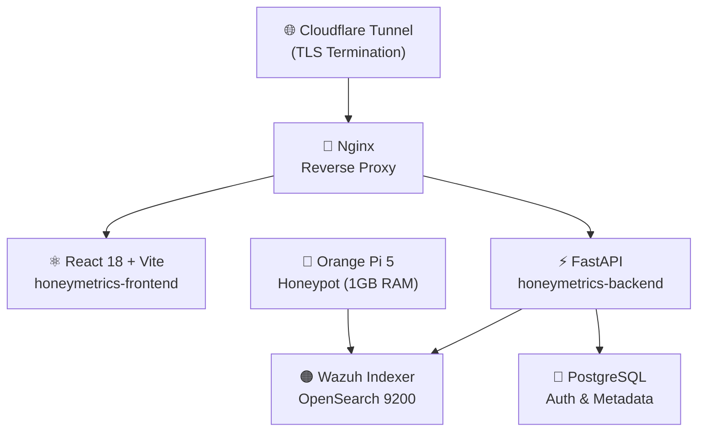

# 🍯 HoneyMetrics v2.0 — Documentación Enterprise

> **Plataforma CTI (Cyber Threat Intelligence) de monitoreo de Honeypots y correlación de ataques.**  
> Análisis basado en **165.247 eventos reales** de Wazuh Indexer | 5 meses | Abril — Agosto 2026

---

## 🗺️ Mapa del Ecosistema

---

## 🏗️ Repositorios del Polyrepo

| Repositorio | Stack | Rol |
|---|---|---|
| `honeymetrics-frontend` | React 18 + Vite (SWC) + Tailwind | SPA — UI/UX Enterprise Dark CTI |
| `honeymetrics-backend` | FastAPI + Pydantic v2 + Pytest | API REST — Service Layer Pattern |
| `honeymetrics-documentacion` | MkDocs Material + Scrum | Mapa de Negocio y Arquitectura |

---

## ⚡ Features Core v2.0

| Feature | Datos Reales que lo Justifican | Tier |
|---|---|---|
| **Threat Intelligence Center** | 1.107 IPs únicas, 9 APT persistentes, Threat Score 0-100 | Pro |
| **Predictive Heatmap** | Pico consistente Lunes 11-12 UTC — 28% del volumen total | Free |
| **Patch Intelligence** | 1.721 CVEs críticos (≥7.0) sin parche, 4+ meses de exposición | Enterprise |
| **Kill Chain Visualizer** | 8 tácticas MITRE ATT&CK mapeadas en datos reales | Enterprise |
| **Human-in-the-Loop (HITL)** | 1.139 detecciones Rootcheck en `/bin/passwd`, `/usr/bin/chsh` | Pro |
| **Dashboard Compliance** | Score CIS Benchmark 45-50% (Reprobado) en todos los agentes | Pro |
