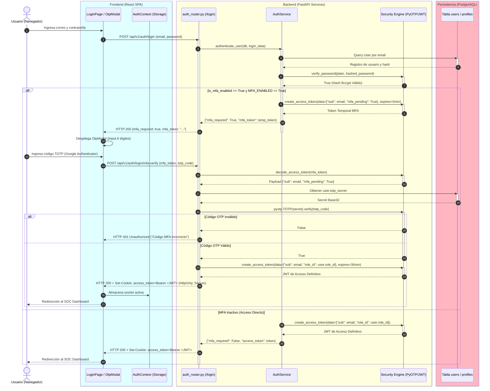
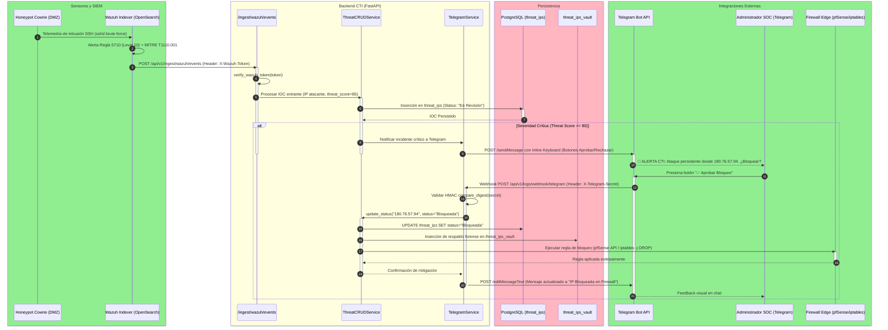
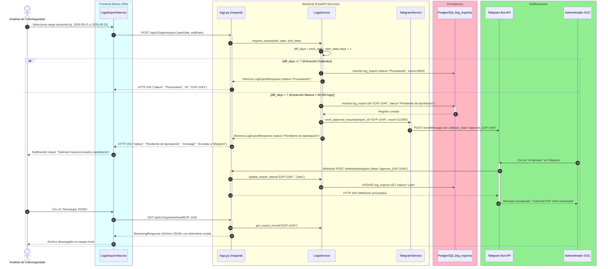
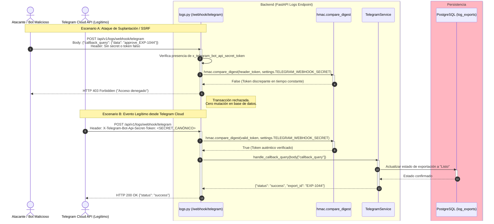
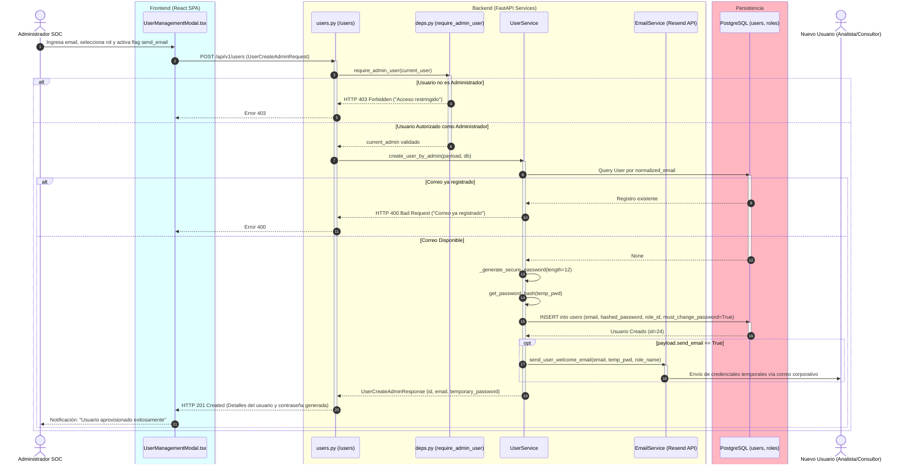

# Manual Técnico de Arquitectura, Flujos y Seguridad — HoneyMetrics v2.0

> **Ver también:**
> - [diccionario-datos.md → Sección 3: Módulo 1 Seguridad y RBAC](./diccionario-datos.md#3-módulo-1--seguridad-autenticación-y-control-de-acceso) — Esquema de tablas `users`, `roles` y `permissions` sobre las que operan los flujos de autorización.
> - [matriz-cambios.md → Matriz Exhaustiva de Localización de Cambios](./matriz-cambios.md#matriz-exhaustiva-de-localización-de-cambios) — Ubicación física en el código fuente de los endpoints, servicios y middlewares documentados.
> - [guia-despliegue.md → Sección 4: Configuración de Variables de Entorno](./guia-despliegue.md#4-configuración-env) — Parámetros requeridos para activar el modo SIEM real, tokens de Telegram y políticas de seguridad.

---

## Índice

- [1. Visión General de la Arquitectura Polyrepo](#1-visión-general-de-la-arquitectura-polyrepo)
  - [1.1 Justificación del Desacoplamiento](#11-justificación-del-desacoplamiento)
  - [1.2 Catálogo de Repositorios del Ecosistema](#12-catálogo-de-repositorios-del-ecosistema)
  - [1.3 Topología de Red y Aislamiento de Capas](#13-topología-de-red-y-aislamiento-de-capas)
- [2. Arquitectura del Backend FastAPI y Enrutamiento Modular](#2-arquitectura-del-backend-fastapi-y-enrutamiento-modular)
  - [2.1 Principios de Diseño y Service Layer Pattern](#21-principios-de-diseño-y-service-layer-pattern)
  - [2.2 Jerarquía de Enrutamiento Modular (`app/api/v1/router.py`)](#22-jerarquía-de-enrutamiento-modular-appapiv1routerpy)
  - [2.3 Diagrama de Flujo del Enrutamiento FastAPI](#23-diagrama-de-flujo-del-enrutamiento-fastapi)
  - [2.4 Inyección de Dependencias y Ciclo de Vida (`app/api/deps.py`)](#24-inyección-de-dependencias-y-ciclo-de-vida-appapidepspy)
- [3. Flujos Críticos de Negocio y Seguridad (Diagramas de Secuencia)](#3-flujos-críticos-de-negocio-y-seguridad-diagramas-de-secuencia)
  - [3.1 Flujo 1: Autenticación Multifactor y Emisión de Sesión (Login + TOTP)](#31-flujo-1-autenticación-multifactor-y-emisión-de-sesión-login--totp)
  - [3.2 Flujo 2: Detección, Correlación CTI y Bloqueo Perimetral (Wazuh → FastAPI → Telegram → Firewall)](#32-flujo-2-detección-correlación-cti-y-bloqueo-perimetral-wazuh--fastapi--telegram--firewall)
  - [3.3 Flujo 3: Descarga Masiva de Logs y Aprobación Humana (HITL)](#33-flujo-3-descarga-masiva-de-logs-y-aprobación-humana-hitl)
  - [3.4 Flujo 4: Prevención Anti-SSRF en el Webhook de Telegram](#34-flujo-4-prevención-anti-ssrf-en-el-webhook-de-telegram)
  - [3.5 Flujo 5: Aprovisionamiento y Creación de Usuario por Administrador](#35-flujo-5-aprovisionamiento-y-creación-de-usuario-por-administrador)
- [4. Control de Acceso Basado en Roles (RBAC)](#4-control-de-acceso-basado-en-roles-rbac)
  - [4.1 Deuda Técnica: El Riesgo de los Magic Strings](#41-deuda-técnica-el-riesgo-de-los-magic-strings)
  - [4.2 Refactorización Canónica con `RoleEnum`](#42-refactorización-canónica-con-roleenum)
  - [4.3 Inyección Callable con `RoleChecker`](#43-inyección-callable-con-rolechecker)
  - [4.4 Matriz Exhaustiva de Autorización (Rol → Permisos y Módulos)](#44-matriz-exhaustiva-de-autorización-rol--permisos-y-módulos)
- [5. Seguridad Criptográfica y Primitivas de Protección](#5-seguridad-criptográfica-y-primitivas-de-protección)
  - [5.1 JSON Web Tokens (JWT) Stateless](#51-json-web-tokens-jwt-stateless)
  - [5.2 Hashing Adaptativo de Contraseñas con Bcrypt](#52-hashing-adaptativo-de-contraseñas-con-bcrypt)
  - [5.3 Doble Factor de Autenticación con TOTP (PyOTP)](#53-doble-factor-de-autenticación-con-totp-pyotp)
  - [5.4 Mitigación de Timing Attacks con HMAC (`compare_digest`)](#54-mitigación-de-timing-attacks-con-hmac-compare_digest)
  - [5.5 Política Anti-Enumeración de Cuentas (CWE-200)](#55-política-anti-enumeración-de-cuentas-cwe-200)
- [6. Integración con el SIEM Wazuh y Resiliencia Operativa](#6-integración-con-el-siem-wazuh-y-resiliencia-operativa)
  - [6.1 Arquitectura de Índices Duales (`wazuh-alerts-*` vs `wazuh-archives-*`)](#61-arquitectura-de-índices-duales-wazuh-alerts--vs-wazuh-archives-)
  - [6.2 Pipeline de Consulta y Normalización hacia OpenSearch API](#62-pipeline-de-consulta-y-normalización-hacia-opensearch-api)
  - [6.3 Modos de Operación y Mecanismo de Fallback Automático](#63-modos-de-operación-y-mecanismo-de-fallback-automático)
- [7. Registro de Decisiones de Arquitectura (ADRs)](#7-registro-de-decisiones-de-arquitectura-adrs)
  - [ADR-01: Offloading de Renderizado de Reportes PDF al Cliente (jsPDF)](#adr-01-offloading-de-renderizado-de-reportes-pdf-al-cliente-jspdf)
  - [ADR-02: Formato de Almacenamiento y Streaming de Logs: JSONL vs CSV](#adr-02-formato-de-almacenamiento-y-streaming-de-logs-jsonl-vs-csv)
  - [ADR-03: Esquema de Identificadores: Prefijos Semánticos Legibles (EXP-XXXX) vs UUIDv4](#adr-03-esquema-de-identificadores-prefijos-semánticos-legibles-exp-xxxx-vs-uuidv4)
  - [ADR-04: Bóveda Forense de Auditoría (`threat_ips_vault`) para No-Repudio](#adr-04-bóveda-forense-de-auditoría-threat_ips_vault-para-no-repudio)

---

## 1. Visión General de la Arquitectura Polyrepo

La plataforma **HoneyMetrics v2.0** está concebida bajo una arquitectura orientada a servicios desacoplados, implementada mediante una estructura **Polyrepo**. Esta separación estricta garantiza fronteras claras de responsabilidad técnica, despliegues independientes y una superficie de ataque reducida.

### 1.1 Justificación del Desacoplamiento

La transición desde monolitos convencionales hacia un modelo desacoplado responde a la necesidad de aislar la computación intensiva de ingesta y correlación de ciberinteligencia (CTI) respecto a la capa de presentación visual. La separación física de repositorios garantiza:

1. **Ciclos de vida independientes:** El frontend puede desplegar mejoras de experiencia de usuario o parches de accesibilidad sin necesidad de reiniciar el proceso ASGI del servidor backend.
2. **Aislamiento de dependencias:** Las librerías de infraestructura del sistema operativo (drivers PostgreSQL, clientes OpenSearch, herramientas criptográficas) quedan confinadas al contenedor backend, evitando dependencias cruzadas con el entorno Node.js / Vite.
3. **Control granular de acceso al código fuente:** Los equipos de infraestructura, analistas de seguridad y auditores de documentación pueden operar sobre repositorios acotados sin acceso a credenciales o artefactos ajenos a su dominio.

### 1.2 Catálogo de Repositorios del Ecosistema

El ecosistema HoneyMetrics v2.0 se divide formalmente en tres repositorios independientes:

| Repositorio | Stack Tecnológico Principal | Responsabilidades del Sistema | Puertos / Protocolos | Ruta en Espacio de Trabajo |
| :--- | :--- | :--- | :--- | :--- |
| **`honeymetrics-backend`** | FastAPI, Python 3.12, SQLAlchemy 2.0, PostgreSQL 15, Alembic, Uvicorn, Gunicorn, Pydantic v2 | API RESTful asíncrona, control de acceso RBAC, autenticación JWT/TOTP, Service Layer, integración Wazuh Indexer (OpenSearch), aprobación HITL vía Telegram y vault forense de IOCs. | HTTP `:8000`<br/>(ASGI / Proxy) | `/media/sebas/Exdrive/Workspace/honeymetrics-backend` |
| **`honeymetrics-frontend`** | React 18, TypeScript, Vite, Tailwind CSS (Dark CTI Theme), Lucide Icons, Axios, jsPDF, AutoTable | SPA (Single Page Application), renderizado reactivo del SOC Dashboard, consolas interactivas de amenazas, escaneo de QR TOTP, gestión de usuarios y generación client-side de reportes ejecutivos. | HTTP `:5173` (Dev)<br/>HTTP `:80` (Nginx Prod) | `/media/sebas/Exdrive/Workspace/honeymetrics-frontend` |
| **`honeymetrics-documentacion`** | MkDocs Material, Markdown, Python pymdown-extensions, Mermaid.js | Repositorio canónico de ingeniería documental: arquitectura de software, manuales técnicos y operativos, diccionario relacional de datos y especificaciones formales de sustentación. | HTTP `:8008` (Local)<br/>HTTPS (GitHub Pages) | `/media/sebas/Exdrive/Workspace/honeymetrics-documentacion` |

### 1.3 Topología de Red y Aislamiento de Capas

Las comunicaciones entre los repositorios se gobiernan bajo el principio de menor privilegio mediante redes segmentadas:

- **Capa Cliente a Backend:** El navegador web del analista consume exclusivamente la API REST mediante HTTPS (o HTTP local en desarrollo) utilizando el prefijo estandarizado `/api/v1`. La transferencia de estado se realiza con payloads JSON serializados y tipados bajo contratos Pydantic v2.
- **Capa Backend a Persistencia:** FastAPI se conecta a PostgreSQL mediante un pool de conexiones administrado por SQLAlchemy (`app/db/session.py`), sin exponer los puertos de base de datos a redes públicas.
- **Capa Backend a Infraestructura SIEM:** Las consultas al cluster de indexación de Wazuh transitan a través de una red interna dedicada, protegida por credenciales de servicio restringidas y certificados de autoridad local (TLS).

!!! note "⚡ El Por Qué Técnico — Aislamiento Polyrepo vs Monorepo"
    En plataformas de ciberseguridad corporativa, un monorepo incrementa el riesgo de fuga accidental de credenciales o de inclusión de dependencias de desarrollo frontend en imágenes de producción backend. El enfoque Polyrepo enforcea contratos de API REST puros y auditorías de seguridad independientes por cada frente tecnológico.

---

## 2. Arquitectura del Backend FastAPI y Enrutamiento Modular

El backend de HoneyMetrics v2.0 se fundamenta en **FastAPI**, adoptando una arquitectura por capas estructurada bajo el patrón **Service Layer**. Esta separación garantiza que los endpoints HTTP funcionen como adaptadores de entrada delgados, delegando la lógica de negocio a servicios especializados y la persistencia a modelos SQLAlchemy.

### 2.1 Principios de Diseño y Service Layer Pattern

La arquitectura interna desacopla responsabilidades en cuatro capas bien delimitadas:

1. **Capa de Transporte y Controladores (`app/api/`):** Define los endpoints REST, parámetros de ruta, validación inicial mediante esquemas Pydantic (`app/schemas/`) y políticas de autorización por inyección de dependencias.
2. **Capa de Servicios de Negocio (`app/services/`):** Clases estáticas y de clase puras que orquestan las reglas del sistema (cálculo de severidad de amenazas, invocación a Telegram Bot API, consultas booleanas a Wazuh y hashing criptográfico). No dependen del contexto de la petición HTTP.
3. **Capa de Acceso a Datos y Persistencia (`app/models/` y `app/db/`):** Mapeo relacional objeto-relacional (ORM) mediante SQLAlchemy 2.0 y control de migraciones con Alembic.
4. **Capa de Configuración y Seguridad Central (`app/core/`):** Variables de entorno validadas en arranque (`Settings`), encriptación y codificación de tokens (`security.py`), y constantes del sistema (`constants.py`).

### 2.2 Jerarquía de Enrutamiento Modular (`app/api/v1/router.py`)

Para evitar controladores monolíticos, el enrutador central `api_router` consolida subenrutadores especializados bajo prefijos semánticos:

```python
# app/api/v1/router.py
from fastapi import APIRouter
from app.api.v1.endpoints import (
    health, threats, threats_crud, logs,
    users, roles, dashboard, ingest
)
from app.api.v1.auth_router import router as auth_router

api_router = APIRouter()

api_router.include_router(health.router, tags=["Health"])
api_router.include_router(auth_router, prefix="/auth", tags=["Auth"])
api_router.include_router(threats.router, prefix="/threats", tags=["Threat Intelligence"])
api_router.include_router(threats_crud.router, prefix="/threats-center", tags=["Threat Center CRUD"])
api_router.include_router(logs.router, prefix="/logs", tags=["Logs & Export"])
api_router.include_router(users.router, prefix="/users", tags=["Users & Profile"])
api_router.include_router(roles.router, prefix="/roles", tags=["Roles & Permissions"])
api_router.include_router(dashboard.router, prefix="/dashboard", tags=["Dashboard"])
api_router.include_router(ingest.router, prefix="/ingest", tags=["Ingesta Wazuh"])
```

### 2.3 Diagrama de Flujo del Enrutamiento FastAPI

El siguiente diagrama detalla la traza que recorre una petición HTTP entrante desde el cliente hasta la resolución de persistencia o servicios externos:


### 2.4 Inyección de Dependencias y Ciclo de Vida (`app/api/deps.py`)

El archivo `app/api/deps.py` orquesta la seguridad y el ciclo de vida transaccional mediante el sistema `Depends` de FastAPI:

- **`get_db()`:** Generador que abre una sesión de base de datos (`SessionLocal()`) por cada petición entrante, garantizando el aislamiento transaccional y forzando el cierre determinista (`db.close()`) en un bloque `finally`.
- **`get_current_user()`:** Extrae el token JWT desde el encabezado `Authorization: Bearer <token>` o, en su defecto, desde la cookie segura `access_token`. Decodifica la firma utilizando la clave criptográfica del servidor, valida la vigencia temporal del claim `exp`, localiza al usuario en la base de datos y verifica que su estado sea estrictamente activo (`user.is_active == True`).
- **`RoleChecker`:** Clase invocable (*callable dependency*) que intercepta la ejecución de los endpoints para validar que el rol asignado al usuario pertenezca a la lista de roles autorizados.

!!! tip "⚡ El Por Qué Técnico — Sesión por Request (`get_db`)"
    Evita la fuga de conexiones en el pool de PostgreSQL y previene condiciones de carrera (*Race Conditions*) entre hilos asíncronos concurrentes. Cada corutina opera sobre su propio contexto transaccional.

---

## 3. Flujos Críticos de Negocio y Seguridad (Diagramas de Secuencia)

Para ilustrar de forma exhaustiva la interacción entre componentes, a continuación se detallan los 5 flujos operacionales críticos de HoneyMetrics v2.0.

---

### 3.1 Flujo 1: Autenticación Multifactor y Emisión de Sesión (Login + TOTP)

El proceso de autenticación garantiza que ninguna credencial comprometida permita el acceso directo a la plataforma. La sesión definitiva solo se otorga tras resolver satisfactoriamente el desafío TOTP.



---

### 3.2 Flujo 2: Detección, Correlación CTI y Bloqueo Perimetral (Wazuh → FastAPI → Telegram → Firewall)

Este flujo representa la cadena defensiva integral: el honeypot registra la actividad adversaria, el SIEM enriquece el evento con MITRE ATT&CK, FastAPI evalúa la amenaza y el administrador autoriza la contramedida en el firewall perimetral.



---

### 3.3 Flujo 3: Descarga Masiva de Logs y Aprobación Humana (HITL)

Para proteger la infraestructura de caídas por agotamiento de recursos o exfiltraciones accidentales, cualquier extracción masiva que supere los 7 días de telemetría requiere una autorización humana explícita (*Human-In-The-Loop*).



---

### 3.4 Flujo 4: Prevención Anti-SSRF en el Webhook de Telegram

Este flujo documenta la mitigación contra ataques de falsificación de peticiones del lado del servidor (SSRF) o suplantación del webhook de Telegram mediante el token secreto criptográfico en el encabezado `X-Telegram-Bot-Api-Secret-Token`.



---

### 3.5 Flujo 5: Aprovisionamiento y Creación de Usuario por Administrador

Este flujo cubre la creación controlada de cuentas de usuario por parte de un Administrador, cumpliendo con la regla de forzado de cambio de clave en el primer acceso (`must_change_password`) y despacho transaccional de bienvenida.



---

## 4. Control de Acceso Basado en Roles (RBAC)

El modelo de control de acceso de HoneyMetrics v2.0 implementa una política estricta de **RBAC (Role-Based Access Control)** con separación funcional de cuatro roles canónicos.

### 4.1 Deuda Técnica: El Riesgo de los Magic Strings

En versiones tempranas del prototipo, las validaciones de acceso se resolvían mediante comprobaciones directas de cadenas de texto (*Magic Strings*):

```python
# ❌ PATRÓN OBSOLETO Y VULNERABLE:
if current_user.role.name == "admin":
    # Permitir operación...
```

Este esquema introducía tres vectores de falla críticos:

1. **Sensibilidad a mayúsculas y acentos:** Inconsistencias entre `"Administrador"`, `"administrador"` o `"admin"` provocaban denegaciones de servicio accidentales a operadores legítimos.
2. **Falta de validación estática:** Errores tipográficos en el código fuente (ej. `"Analista de Datos"` en lugar de `"Analista de datos"`) no eran detectados por linters ni herramientas de tipado estático, fallando silenciosamente en producción.
3. **Imposibilidad de refactorización segura:** Renombrar un rol en la base de datos requería buscar y reemplazar manualmente ocurrencias en decenas de endpoints dispersos.

### 4.2 Refactorización Canónica con `RoleEnum`

La versión 2.0 formalizó los roles del sistema mediante la enumeración estricta `RoleEnum` en `app/core/constants.py`:

```python
# app/core/constants.py
from enum import Enum

class RoleEnum(str, Enum):
    """
    Roles canónicos del sistema HoneyMetrics v2.0.
    Hereda de str para interoperabilidad con esquemas Pydantic y serializadores ORM.
    """
    ADMINISTRADOR = "Administrador"
    ANALISTA = "Analista de datos"
    CONSULTOR = "Consultor de Ciberseguridad"
    DIRECTIVO = "Directivo de T.I."

    # Aliases semánticos para compatibilidad y legibilidad interna
    ANALISTA_DE_DATOS = "Analista de datos"
    CONSULTOR_DE_CIBERSEGURIDAD = "Consultor de Ciberseguridad"
    DIRECTIVO_DE_TI = "Directivo de T.I."
```

### 4.3 Inyección Callable con `RoleChecker`

La validación de permisos se centraliza en la clase invocable `RoleChecker` (`app/api/deps.py`), la cual se inyecta de forma declarativa en las dependencias de FastAPI:

```python
# app/api/deps.py
class RoleChecker:
    ROLE_ALIASES: dict[RoleEnum, list[str]] = {
        RoleEnum.ADMINISTRADOR: ["Administrador"],
        RoleEnum.ANALISTA: ["Analista de datos", "Analista"],
        RoleEnum.CONSULTOR: ["Consultor de Ciberseguridad", "Consultor"],
        RoleEnum.DIRECTIVO: ["Directivo de T.I.", "Directivo"],
    }

    def __init__(self, allowed_roles: Sequence[Union[RoleEnum, str]]):
        self.allowed_roles: list[RoleEnum] = []
        self._allowed_values: set[str] = set()
        # Normalización y carga de valores válidos...

    def __call__(self, current_user: User = Depends(get_current_user)) -> User:
        role_name = current_user.role.name if current_user.role else ""
        if role_name not in self._allowed_values:
            allowed_names = [r.value for r in self.allowed_roles]
            raise HTTPException(
                status_code=status.HTTP_403_FORBIDDEN,
                detail=f"Acceso restringido: Se requiere uno de los siguientes roles: {', '.join(allowed_names)}."
            )
        return current_user
```

### 4.4 Matriz Exhaustiva de Autorización (Rol → Permisos y Módulos)

La siguiente matriz documenta los privilegios exactos configurados para cada rol del sistema en los módulos de HoneyMetrics:

| Módulo Funcional | Endpoint / Operación REST | Administrador | Analista de datos | Consultor de Ciberseguridad | Directivo de T.I. |
| :--- | :--- | :---: | :---: | :---: | :---: |
| **Autenticación** | `POST /api/v1/auth/login` | ✅ | ✅ | ✅ | ✅ |
| **Autenticación** | `POST /api/v1/auth/login/mfa-verify` | ✅ | ✅ | ✅ | ✅ |
| **Autenticación** | `POST /api/v1/auth/forgot-password` | ✅ | ✅ | ✅ | ✅ |
| **Perfil Propio** | `GET /api/v1/users/me` | ✅ | ✅ | ✅ | ✅ |
| **Perfil Propio** | `PUT /api/v1/users/me/password` | ✅ | ✅ | ✅ | ✅ |
| **Perfil Propio** | `POST /api/v1/users/me/mfa/setup` | ✅ | ✅ | ✅ | ✅ |
| **Threat Center** | `GET /api/v1/threats/summary` | ✅ | ✅ | ✅ | ✅ |
| **Threat Center** | `GET /api/v1/threats-center/` | ✅ | ✅ | ✅ | ✅ |
| **Threat Center** | `POST /api/v1/threats-center/` (Crear IOC) | ✅ | ❌ | ✅ | ❌ |
| **Threat Center** | `PUT /api/v1/threats-center/{id}` (Actualizar) | ✅ | ❌ | ✅ | ❌ |
| **Threat Center** | `DELETE /api/v1/threats-center/{id}` (Eliminar) | ✅ | ❌ | ✅ | ❌ |
| **Bóveda Forense** | `GET /api/v1/threats-center/vault` | ✅ | ❌ | ❌ | ❌ |
| **Logs & Export** | `POST /api/v1/logs/request` (≤ 7 días) | ✅ | ✅ | ✅ | ❌ |
| **Logs & Export** | `POST /api/v1/logs/request` (> 7 días HITL) | ✅ | ✅ | ✅ | ❌ |
| **Logs & Export** | `GET /api/v1/logs/download/{id}` | ✅ | ✅ | ✅ | ❌ |
| **Logs & Export** | `POST /api/v1/logs/webhook/telegram` | ✅ *(Bot)* | ❌ | ❌ | ❌ |
| **Gestión Usuarios**| `GET /api/v1/users` (Listado global) | ✅ | ❌ | ❌ | ❌ |
| **Gestión Usuarios**| `POST /api/v1/users` (Aprovisionar) | ✅ | ❌ | ❌ | ❌ |
| **Gestión Usuarios**| `PUT /api/v1/users/{id}` (Modificar rol) | ✅ | ❌ | ❌ | ❌ |
| **Gestión Usuarios**| `DELETE /api/v1/users/{id}` (Baja) | ✅ | ❌ | ❌ | ❌ |
| **Gestión Roles** | `GET /api/v1/roles` (Listado y conteos) | ✅ | ❌ | ❌ | ❌ |
| **Gestión Roles** | `POST /api/v1/roles` (Crear nuevo rol) | ✅ | ❌ | ❌ | ❌ |
| **Ingesta Wazuh** | `POST /api/v1/ingest/wazuh/events` | ✅ *(Sensor)*| ❌ | ❌ | ❌ |

---

## 5. Seguridad Criptográfica y Primitivas de Protección

La postura de ciberseguridad del backend se sustenta en primitivas criptográficas validadas por estándares de la industria, evitando implementaciones propietarias.

### 5.1 JSON Web Tokens (JWT) Stateless

La gestión de sesiones implementa **JWT (RFC 7519)** firmado mediante el algoritmo simétrico **HMAC con SHA-256 (`HS256`)**:

- **Token de Sesión Definitivo:** Vigencia de 30 minutos (`ACCESS_TOKEN_EXPIRE_MINUTES = 30`). Contiene los claims `sub` (identificador de correo), `role_id` y `exp`.
- **Token Transitorio MFA:** Vigencia estricta de 5 minutos con el claim específico `{"mfa_pending": True}`. Este token carece de privilegios para consumir endpoints operacionales y solo es aceptado por el endpoint `/login/mfa-verify`.
- **Almacenamiento Seguro:** Transmitido tanto en el cuerpo JSON de respuesta como mediante la cookie de navegador `access_token` configurada con las directivas obligatorias:
  ```python
  response.set_cookie(
      key="access_token",
      value=f"Bearer {access_token}",
      httponly=True,  # Inaccesible desde JavaScript (mitigación XSS)
      secure=True,    # Transmisión obligatoria sobre TLS/HTTPS
      samesite="none",# Requerido para desacoplamiento Cross-Origin
      max_age=1800
  )
  ```

!!! note "⚡ El Por Qué Técnico — Tokens MFA de 5 Minutos"
    Emitir un JWT transitorio de corta duración con un claim de ámbito restringido (`mfa_pending`) asegura que un atacante que intercepte credenciales válidas en la fase inicial no pueda mantener abierta una sesión indeterminada ni realizar peticiones autenticadas sin superar el segundo factor.

### 5.2 Hashing Adaptativo de Contraseñas con Bcrypt

El almacenamiento de credenciales en la base de datos utiliza la función de derivación de claves **Bcrypt** mediante `passlib.context.CryptContext(schemes=["bcrypt"], deprecated="auto")`.

- **Salt Aleatorio:** Bcrypt genera un salt criptográfico de 128 bits incrustado en el hash resultante.
- **Factor de Coste Adaptativo:** La función implementa un retardo deliberado en la ejecución de la función de resumen, haciendo inviable el cálculo masivo de ataques basados en tablas precalculadas (*Rainbow Tables*) o fuerza bruta por GPU.

### 5.3 Doble Factor de Autenticación con TOTP (PyOTP)

La autenticación de doble factor sigue la especificación **RFC 6238 (Time-Based One-Time Password)** a través de la librería `pyotp`:

- **Secreto Compartido:** Cadena de 160 bits codificada en Base32 generada con entropía del sistema operativo (`pyotp.random_base32()`).
- **Ventana de Validación:** Pasos de tiempo fijos de 30 segundos. La verificación valida el token recibido contra el secreto almacenado sin tolerar reutilización del mismo token.

### 5.4 Mitigación de Timing Attacks con HMAC (`compare_digest`)

Para la validación del webhook de Telegram (`/api/v1/logs/webhook/telegram`), el servidor compara el token secreto entrante con la variable de entorno `TELEGRAM_WEBHOOK_SECRET` utilizando `hmac.compare_digest`:

```python
# app/api/v1/endpoints/logs.py
if settings.TELEGRAM_WEBHOOK_SECRET and x_telegram_bot_api_secret_token:
    import hmac
    if not hmac.compare_digest(x_telegram_bot_api_secret_token, settings.TELEGRAM_WEBHOOK_SECRET):
        raise HTTPException(
            status_code=status.HTTP_403_FORBIDDEN,
            detail="Acceso denegado",
        )
```

!!! danger "⚡ El Por Qué Técnico — `compare_digest` vs Operador `==`"
    El operador de igualdad estándar de Python (`==`) compara cadenas caracter por caracter y retorna `False` inmediatamente en la primera discrepancia (*early exit*). Un atacante remoto puede medir las diferencias en nanosegundos en el tiempo de respuesta del servidor (ataque de canal lateral o *Timing Attack*) para inferir carácter por carácter el secreto del webhook. `hmac.compare_digest` ejecuta la comparación en tiempo constante $O(n)$, eliminando la fuga de información temporal.

### 5.5 Política Anti-Enumeración de Cuentas (CWE-200)

En el flujo de recuperación de contraseña (`/api/v1/auth/forgot-password`), si el correo consultado no existe en la base de datos, el backend retorna silenciosamente un mensaje idéntico al de una solicitud exitosa:

```python
# app/services/auth_service.py
user = db.query(User).filter(User.email == email).first()
if not user:
    # Anti-Enumeración (CWE-200): Retorno silencioso si el usuario no existe
    return
```

Esta técnica previene que un adversario automatizado deduzca la lista de cuentas de correo institucionales registradas en el SOC midiendo las variaciones en las respuestas del servidor.

---

## 6. Integración con el SIEM Wazuh y Resiliencia Operativa

La plataforma HoneyMetrics v2.0 se conecta con el clúster de indexación del SIEM corporativo (**Wazuh Indexer**, basado en OpenSearch) para correlacionar la actividad de los sensores con la base de conocimiento de ciberinteligencia.

### 6.1 Arquitectura de Índices Duales (`wazuh-alerts-*` vs `wazuh-archives-*`)

El servicio `WazuhIntegrationService` consulta de forma coordinada dos índices independientes para cada dirección IP sospechosa:

| Índice SIEM | Tipo de Contenido | Estructura de Datos | Propósito en HoneyMetrics |
| :--- | :--- | :--- | :--- |
| **`wazuh-alerts-4.x-*`** | Alertas decodificadas y enriquecidas | JSON estructurado con reglas Wazuh (IDs 5710, 5712, etc.), niveles de severidad (1-16) y mapeo del framework **MITRE ATT&CK** (T1110.001 Brute Force, etc.). | Cálculo del Threat Score, visualización de tácticas adversarias en el dashboard y detección de patrones de ataque. |
| **`wazuh-archives-4.x-*`** | Registros crudos completos de telemetría | Contiene el campo `full_log` con la traza textual íntegra generada por el demonio (ej. Syslog, SSHD, Cowrie) sin filtros de decodificación. | Evidencia pericial inmutable, auditoría forense profunda y exportación masiva de logs para análisis offline. |

### 6.2 Pipeline de Consulta y Normalización hacia OpenSearch API

Las peticiones al clúster Wazuh se ejecutan mediante consultas booleanas estructuradas que buscan coincidencias tanto en campos indexados como en el cuerpo del registro crudo:

```python
# app/services/wazuh_integration_service.py
query_payload = {
    "size": 50,
    "query": {
        "bool": {
            "should": [
                {"term": {"data.srcip.keyword": ip}},
                {"match": {"data.srcip": ip}},
                {"match": {"srcip": ip}},
                {"match_phrase": {"full_log": ip}},
            ]
        }
    },
}
```

La autenticación contra el Indexer se realiza mediante `HTTPBasicAuth` utilizando credenciales de servicio aisladas (`WAZUH_INDEXER_USER` y `WAZUH_INDEXER_PASSWORD`), respetando la política de verificación de certificados TLS (`WAZUH_TLS_VERIFY`).

### 6.3 Modos de Operación y Mecanismo de Fallback Automático

Para garantizar la alta disponibilidad de la consola de analistas ante mantenimientos del clúster de indexación, el servicio implementa un patrón de degradación elegante (*Graceful Degradation*):

```python
# app/services/wazuh_integration_service.py
if not settings.WAZUH_INTEGRATION_ENABLED:
    logger.info("Wazuh integration disabled via feature flag. Returning mock logs.")
    return cls._generate_mock_dual_index_logs(ip, is_simulation=False)

if not indexer_url:
    return cls._generate_mock_dual_index_logs(ip, is_simulation=True)

try:
    # Consulta HTTP al endpoint real de Wazuh Indexer...
    alerts_resp = requests.post(f"{indexer_url}/wazuh-alerts-*/_search", timeout=5, ...)
    # Retorno en modo "live_indexer"
except Exception as err:
    logger.warning("Fallo de conexión con Wazuh Indexer. Aplicando fallback simulado: %s", str(err))
    return cls._generate_mock_dual_index_logs(ip, is_simulation=True)
```

El servicio opera en tres modalidades:

1. **`live_indexer`:** Conexión operativa en tiempo real contra el clúster OpenSearch.
2. **`simulated`:** Activado automáticamente cuando el Indexer sufre un fallo de red o un timeout superior a 5 segundos, retornando una réplica sintética coherente para evitar el bloqueo del frontend.
3. **`mock`:** Modo de desarrollo desconectado cuando la bandera `WAZUH_INTEGRATION_ENABLED=False` está fijada en el archivo `.env`.

!!! tip "⚡ El Por Qué Técnico — Fallback de Doble Índice"
    En un centro de operaciones de seguridad (SOC), la indisponibilidad temporal de un nodo indexador no puede congelar la interfaz del analista ni bloquear la respuesta a incidentes. El fallback simulado permite mantener la interactividad de la UI mientras los mecanismos de monitoreo restablecen la conectividad con el SIEM.

---

## 7. Registro de Decisiones de Arquitectura (ADRs)

A continuación se registran formalmente las Decisiones de Arquitectura de Software (*Architectural Decision Records*) que fundamentan la construcción de HoneyMetrics v2.0.

---

### ADR-01: Offloading de Renderizado de Reportes PDF al Cliente (jsPDF)

- **Estado:** Aprobado e Implementado.
- **Contexto:** La plataforma requiere generar reportes ejecutivos en PDF con métricas del dashboard, tablas de amenazas activas y firmas MITRE ATT&CK para el rol Directivo de T.I. y Consultores.
- **Decisión:** Delegar el ensamblado y rasterizado del documento PDF exclusivamente al navegador web del cliente mediante las librerías `jsPDF` y `jspdf-autotable`, en lugar de compilar el binario en el servidor FastAPI utilizando librerías Python como `ReportLab` o `WeasyPrint`.
- **Consecuencias Positivas:**
  - Reducción drástica del consumo de memoria RAM en el servidor backend (ahorro de ~250-400 MB por hilo de renderizado concurrente).
  - Eliminación de dependencias del sistema operativo en el contenedor Docker (ej. fuentes TrueType, motores Pango/Cairo requeridos por WeasyPrint).
  - Distribución horizontal del costo computacional de maquetación entre los clientes conectados.
- **Consecuencias Negativas:**
  - El tiempo de generación del reporte depende de la capacidad de procesamiento de la estación de trabajo del usuario.
- **El Por Qué Técnico:** La concurrencia de múltiples analistas solicitando reportes voluminosos en un servidor backend con memoria acotada puede desencadenar incidentes de *Out-Of-Memory (OOM)* y la terminación forzada del proceso ASGI. Al delegar la rasterización al motor V8 de React, el servidor backend conserva sus recursos dedicados a la API REST y a la ingesta de telemetría.

---

### ADR-02: Formato de Almacenamiento y Streaming de Logs: JSONL vs CSV

- **Estado:** Aprobado e Implementado.
- **Contexto:** El sistema permite extraer volúmenes superiores a 50,000 registros de telemetría capturados por los honeypots perimetrales para su exportación hacia herramientas forenses externas.
- **Decisión:** Estandarizar la persistencia y transmisión de extracciones en formato **JSON Lines (JSONL)** en lugar del formato delimitado por comas (CSV).
- **Consecuencias Positivas:**
  - Preservación íntegra de estructuras de datos anidadas complejas (metadatos MITRE, decodificadores SSH, cabeceras de red y diccionarios de autenticación) sin pérdida de fidelidad forense.
  - Compatibilidad nativa con la lectura por streaming (*chunked streaming*), permitiendo transmitir el archivo línea por línea mediante `StreamingResponse` sin cargar el archivo completo en la memoria del servidor.
  - Consumo directo en herramientas analíticas modernas (Pandas, DuckDB, Spark, jq) sin necesidad de preprocesamiento de aplanado de columnas.
- **Consecuencias Negativas:**
  - Mayor tamaño en bytes por registro respecto a un archivo CSV comprimido sin cabeceras repetidas.
- **El Por Qué Técnico:** Forzar la telemetría polimórfica de honeypots (donde un evento Cowrie tiene campos totalmente distintos a un evento Dionaea) dentro de un archivo CSV plano exige rellenar con valores nulos o serializar sub-cadenas escapadas, degradando la interoperabilidad forense. JSONL mantiene la inmutabilidad y riqueza de cada evento como un objeto independiente.

---

### ADR-03: Esquema de Identificadores: Prefijos Semánticos Legibles (EXP-XXXX) vs UUIDv4

- **Estado:** Aprobado e Implementado.
- **Contexto:** Las solicitudes de exportación de logs masivos deben ser aprobadas por operadores humanos a través de la interfaz de chat de Telegram.
- **Decisión:** Utilizar identificadores con prefijos semánticos legibles (`EXP-1044`) para las solicitudes operacionales expuestas a interacción humana (*Human-In-The-Loop*), manteniendo claves primarias enteras secuenciales indexadas internamente en PostgreSQL.
- **Consecuencias Positivas:**
  - Reducción de fatiga cognitiva y prevención de errores humanos: un operador puede dictar o verificar rápidamente `EXP-1044` durante una llamada de triaje de incidentes.
  - Respeto del límite estricto de 64 bytes impuesto por la API de Telegram para el campo `callback_data` de los botones interactivos (*Inline Keyboards*). Un UUIDv4 junto con prefijos de acción consumiría la mayor parte del búfer disponible.
- **Consecuencias Negativas:**
  - Espacio de colisión menor respecto a un identificador UUIDv4 de 128 bits (mitigado mediante verificación de unicidad en base de datos).
- **El Por Qué Técnico:** En interfaces de mensajería móvil, la legibilidad visual directa es un control de seguridad operacional crítico. Presentar cadenas de 36 caracteres (`b4d9a712-8e1f-4b92-9843-f1a8c9831991`) induce a errores de aprobación accidental cuando múltiples solicitudes masivas se encolan simultáneamente.

---

### ADR-04: Bóveda Forense de Auditoría (`threat_ips_vault`) para No-Repudio

- **Estado:** Aprobado e Implementado.
- **Contexto:** Cuando un analista o administrador retira un indicador de compromiso (IOC) de la lista negra activa, se requiere preservar la evidencia histórica para evitar el borrado malicioso de registros o la pérdida de trazabilidad pericial.
- **Decisión:** Implementar una tabla de bóveda forense inmutable (`threat_ips_vault`) que captura una copia íntegra del registro antes de confirmar su eliminación lógica o física en la tabla principal `threat_ips`.
- **Consecuencias Positivas:**
  - Cumplimiento de estándares de no-repudio y cadena de custodia digital (ISO 27037).
  - Registro auditable del usuario exacto que autorizó el retiro (`deleted_by_user_id`) y la marca temporal UTC inalterable (`deleted_at`).
  - Capacidad de reconstrucción histórica de incidentes aun si un actor malintencionado intenta vaciar la lista negra de amenazas activas.
- **Consecuencias Negativas:**
  - Consumo incremental de espacio de almacenamiento en disco en la base de datos PostgreSQL.
- **El Por Qué Técnico:** En sistemas de ciberinteligencia corporativos, una operación de eliminación destructiva (`DELETE` sin respaldo) representa un riesgo crítico de seguridad operacional. La bóveda forense garantiza que la eliminación en la vista operativa del SOC sea transparente mientras que el registro pericial subyacente permanezca blindado.
