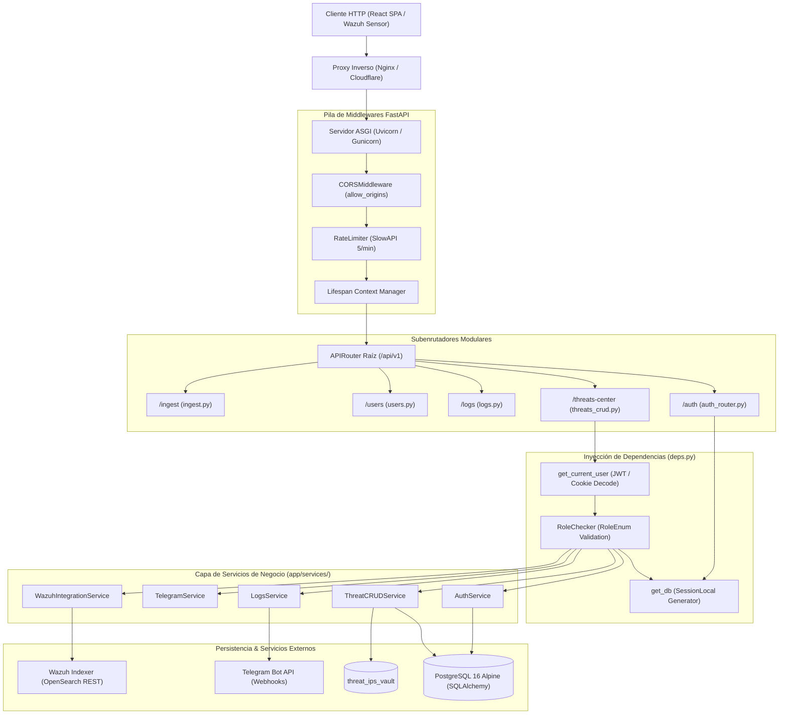
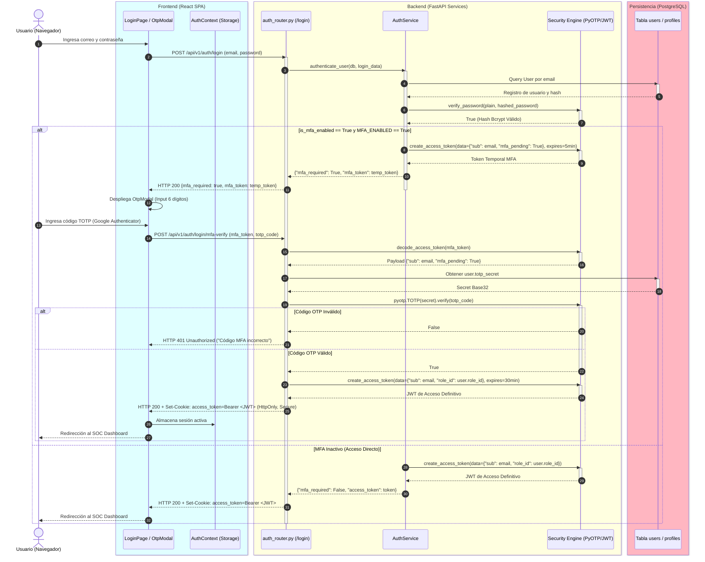
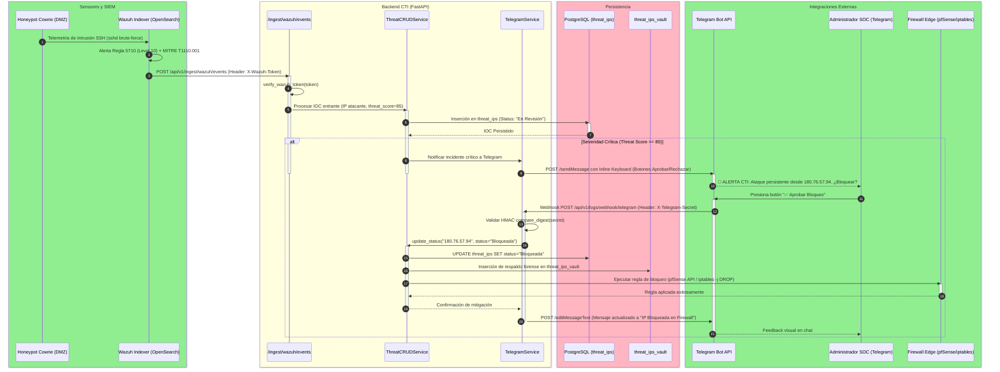
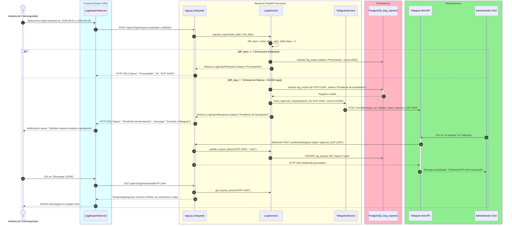
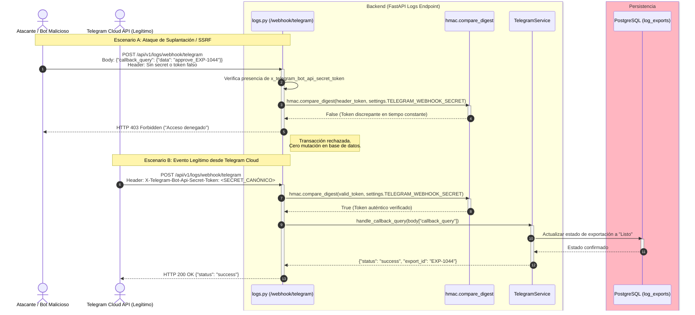
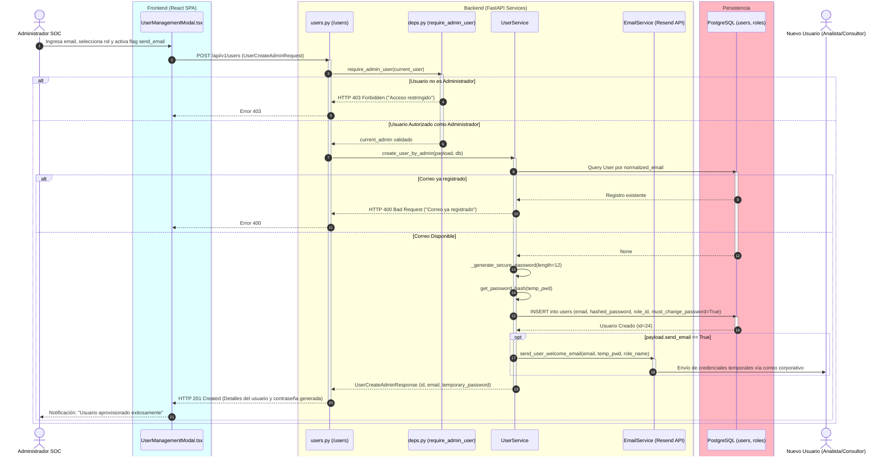

# Manual Técnico de Arquitectura, Flujos y Seguridad — HoneyMetrics v2.0

> **Ver también:**
> - [diccionario-datos.md → Sección 3: Módulo 1 Seguridad y RBAC](./diccionario-datos.md#3-módulo-1--seguridad-autenticación-y-control-de-acceso) — Esquema de tablas `users`, `roles` y `permissions` sobre las que operan los flujos de autorización.
> - [matriz-cambios.md → Matriz Exhaustiva de Localización de Cambios](./matriz-cambios.md#matriz-exhaustiva-de-localización-de-cambios) — Ubicación física en el código fuente de los endpoints, servicios y middlewares documentados.
> - [guia-despliegue.md → Sección 4: Configuración de Variables de Entorno](./guia-despliegue.md#4-configuración-env) — Parámetros requeridos para activar el modo SIEM real, tokens de Telegram y políticas de seguridad.

---

## Índice

- [1. Visión General de la Arquitectura Polyrepo](#1-visión-general-de-la-arquitectura-polyrepo)
  - [1.1 Justificación del Desacoplamiento](#11-justificación-del-desacoplamiento)
  - [1.2 Catálogo de Repositorios del Ecosistema](#12-catálogo-de-repositorios-del-ecosistema)
  - [1.3 Topología de Red y Aislamiento de Capas](#13-topología-de-red-y-aislamiento-de-capas)
- [2. Arquitectura del Backend FastAPI y Enrutamiento Modular](#2-arquitectura-del-backend-fastapi-y-enrutamiento-modular)
  - [2.1 Principios de Diseño y Service Layer Pattern](#21-principios-de-diseño-y-service-layer-pattern)
  - [2.2 Jerarquía de Enrutamiento Modular (`app/api/v1/router.py`)](#22-jerarquía-de-enrutamiento-modular-appapiv1routerpy)
  - [2.3 Diagrama de Flujo del Enrutamiento FastAPI](#23-diagrama-de-flujo-del-enrutamiento-fastapi)
  - [2.4 Inyección de Dependencias y Ciclo de Vida (`app/api/deps.py`)](#24-inyección-de-dependencias-y-ciclo-de-vida-appapidepspy)
- [3. Flujos Críticos de Negocio y Seguridad (Diagramas de Secuencia)](#3-flujos-críticos-de-negocio-y-seguridad-diagramas-de-secuencia)
  - [3.1 Flujo 1: Autenticación Multifactor y Emisión de Sesión (Login + TOTP)](#31-flujo-1-autenticación-multifactor-y-emisión-de-sesión-login--totp)
  - [3.2 Flujo 2: Detección, Correlación CTI y Bloqueo Perimetral (Wazuh → FastAPI → Telegram → Firewall)](#32-flujo-2-detección-correlación-cti-y-bloqueo-perimetral-wazuh--fastapi--telegram--firewall)
  - [3.3 Flujo 3: Descarga Masiva de Logs y Aprobación Humana (HITL)](#33-flujo-3-descarga-masiva-de-logs-y-aprobación-humana-hitl)
  - [3.4 Flujo 4: Prevención Anti-SSRF en el Webhook de Telegram](#34-flujo-4-prevención-anti-ssrf-en-el-webhook-de-telegram)
  - [3.5 Flujo 5: Aprovisionamiento y Creación de Usuario por Administrador](#35-flujo-5-aprovisionamiento-y-creación-de-usuario-por-administrador)
- [4. Control de Acceso Basado en Roles (RBAC)](#4-control-de-acceso-basado-en-roles-rbac)
  - [4.1 Deuda Técnica: El Riesgo de los Magic Strings](#41-deuda-técnica-el-riesgo-de-los-magic-strings)
  - [4.2 Refactorización Canónica con `RoleEnum`](#42-refactorización-canónica-con-roleenum)
  - [4.3 Inyección Callable con `RoleChecker`](#43-inyección-callable-con-rolechecker)
  - [4.4 Matriz Exhaustiva de Autorización (Rol → Permisos y Módulos)](#44-matriz-exhaustiva-de-autorización-rol--permisos-y-módulos)
- [5. Seguridad Criptográfica y Primitivas de Protección](#5-seguridad-criptográfica-y-primitivas-de-protección)
  - [5.1 JSON Web Tokens (JWT) Stateless](#51-json-web-tokens-jwt-stateless)
  - [5.2 Hashing Adaptativo de Contraseñas con Bcrypt](#52-hashing-adaptativo-de-contraseñas-con-bcrypt)
  - [5.3 Doble Factor de Autenticación con TOTP (PyOTP)](#53-doble-factor-de-autenticación-con-totp-pyotp)
  - [5.4 Mitigación de Timing Attacks con HMAC (`compare_digest`)](#54-mitigación-de-timing-attacks-con-hmac-compare_digest)
  - [5.5 Política Anti-Enumeración de Cuentas (CWE-200)](#55-política-anti-enumeración-de-cuentas-cwe-200)
  - [5.6 Arquitectura de Despliegue con SSH Deploy Keys (`id_ed25519_hm_v2`)](#56-arquitectura-de-despliegue-en-servidores-con-ssh-deploy-keys-id_ed25519_hm_v2)
  - [5.7 Política de Feature Toggles y Enfoque Fail-Closed en MFA (`MFA_ENABLED`)](#57-política-de-feature-toggles-y-enfoque-fail-closed-en-mfa-mfa_enabled)
- [6. Integración con el SIEM Wazuh y Resiliencia Operativa](#6-integración-con-el-siem-wazuh-y-resiliencia-operativa)
  - [6.1 Arquitectura de Índices Duales (`wazuh-alerts-*` vs `wazuh-archives-*`)](#61-arquitectura-de-índices-duales-wazuh-alerts--vs-wazuh-archives-)
  - [6.2 Pipeline de Consulta y Normalización hacia OpenSearch API](#62-pipeline-de-consulta-y-normalización-hacia-opensearch-api)
  - [6.3 Modos de Operación y Mecanismo de Fallback Automático](#63-modos-de-operación-y-mecanismo-de-fallback-automático)
- [7. Registro de Decisiones de Arquitectura (ADRs)](#7-registro-de-decisiones-de-arquitectura-adrs)
  - [ADR-01: Offloading de Renderizado de Reportes PDF al Cliente (jsPDF)](#adr-01-offloading-de-renderizado-de-reportes-pdf-al-cliente-jspdf)
  - [ADR-02: Formato de Almacenamiento y Streaming de Logs: JSONL vs CSV](#adr-02-formato-de-almacenamiento-y-streaming-de-logs-jsonl-vs-csv)
  - [ADR-03: Esquema de Identificadores: Prefijos Semánticos Legibles (EXP-XXXX) vs UUIDv4](#adr-03-esquema-de-identificadores-prefijos-semánticos-legibles-exp-xxxx-vs-uuidv4)
  - [ADR-04: Bóveda Forense de Auditoría (`threat_ips_vault`) para No-Repudio](#adr-04-bóveda-forense-de-auditoría-threat_ips_vault-para-no-repudio)
- [8. Matriz Exhaustiva de Localización de Cambios (Dónde Tocar Qué)](#8-matriz-exhaustiva-de-localización-de-cambios-dónde-tocar-qué)
- [9. Ingeniería de Calidad de Software, Pruebas Automatizadas y Cobertura](#9-ingenieria-de-calidad-de-software-pruebas-automatizadas-y-cobertura)
  - [9.1 La Pirámide de Pruebas y Distribución de las 332 Pruebas Automatizadas](#91-la-piramide-de-pruebas-y-distribucion-de-las-332-pruebas-automatizadas)
  - [9.2 El Patrón AAA (Arrange, Act, Assert) como Metodología Canónica](#92-el-patron-aaa-arrange-act-assert-como-metodologia-canonica)
  - [9.3 Aislamiento Hermético mediante `tests/conftest.py`](#93-aislamiento-hermetico-mediante-testsconftestpy)
  - [9.4 Guía de Ejecución de Pruebas dentro del Contenedor Docker](#94-guia-de-ejecucion-de-pruebas-dentro-del-contenedor-docker)
  - [9.5 Integración de Cobertura en el Pipeline de Calidad](#95-integracion-de-cobertura-en-el-pipeline-de-calidad)
- [10. Gobernanza Dual de Seguridad (PoLP en PostgreSQL 16 + PBAC Stateless en API)](#10-gobernanza-dual-de-seguridad-polp-en-postgresql-16-pbac-stateless-en-api)
  - [10.1 Matriz A — Principio de Menor Privilegio (PoLP) en el Motor PostgreSQL 16](#101-matriz-a-principio-de-menor-privilegio-polp-en-el-motor-postgresql-16)
  - [10.2 Matriz B — Control de Acceso Basado en Permisos (PBAC) con Scopes JWT](#102-matriz-b-control-de-acceso-basado-en-permisos-pbac-con-scopes-jwt)
- [11. Procedimientos Almacenados y Triggers en PostgreSQL 16 (PL/pgSQL)](#11-procedimientos-almacenados-y-triggers-en-postgresql-16-plpgsql)
  - [11.1 Procedimiento Almacenado 1: `sp_archive_and_purge_expired_exports_and_tokens`](#111-procedimiento-almacenado-1-sp_archive_and_purge_expired_exports_and_tokens)
  - [11.2 Procedimiento Almacenado 2: `sp_consolidate_duplicate_threat_notes`](#112-procedimiento-almacenado-2-sp_consolidate_duplicate_threat_notes)
  - [11.3 Función Almacenada 3: `fn_generate_user_security_audit_report`](#113-funcion-almacenada-3-fn_generate_user_security_audit_report)
  - [11.4 Trigger 1: `trg_audit_deleted_threats_vault` (`AFTER DELETE ON threat_ips`)](#114-trigger-1-trg_audit_deleted_threats_vault-after-delete-on-threat_ips)
  - [11.5 Trigger 2: `trg_rate_limit_log_exports` (`BEFORE INSERT ON log_exports`)](#115-trigger-2-trg_rate_limit_log_exports-before-insert-on-log_exports)
  - [11.6 Trigger 3: `trg_sanitize_and_validate_threat_ip` (`BEFORE INSERT OR UPDATE ON threat_ips`)](#116-trigger-3-trg_sanitize_and_validate_threat_ip-before-insert-or-update-on-threat_ips)
- [12. Redes Docker, Troubleshooting en Homeserver y Deploy Keys SSH](#12-redes-docker-troubleshooting-en-homeserver-y-deploy-keys-ssh)
  - [12.1 Problema 1: La Trampa del Doble Loopback (`0.0.0.0` vs `127.0.0.1:5433:5432`)](#121-problema-1-la-trampa-del-doble-loopback-0000-vs-12700154335432)
  - [12.2 Problema 2: Recarga de Variables de Entorno `.env` en Contenedores Docker](#122-problema-2-recarga-de-variables-de-entorno-env-en-contenedores-docker)
  - [12.3 Problema 3: Resolución de Desfases en Migraciones Alembic (`Can't locate revision`)](#123-problema-3-resolucion-de-desfases-en-migraciones-alembic-cant-locate-revision)
  - [12.4 Problema 4: Deploy Keys SSH Dedicadas (`id_ed25519_hm_v2`) para Servidores de Producción](#124-problema-4-deploy-keys-ssh-dedicadas-id_ed25519_hm_v2-para-servidores-de-produccion)

---

## 1. Visión General de la Arquitectura Polyrepo

La plataforma **HoneyMetrics v2.0** está concebida bajo una arquitectura orientada a servicios desacoplados, implementada mediante una estructura **Polyrepo**. Esta separación estricta garantiza fronteras claras de responsabilidad técnica, despliegues independientes y una superficie de ataque reducida.

### 1.1 Justificación del Desacoplamiento

La transición desde monolitos convencionales hacia un modelo desacoplado responde a la necesidad de aislar la computación intensiva de ingesta y correlación de ciberinteligencia (CTI) respecto a la capa de presentación visual. La separación física de repositorios garantiza:

1. **Ciclos de vida independientes:** El frontend puede desplegar mejoras de experiencia de usuario o parches de accesibilidad sin necesidad de reiniciar el proceso ASGI del servidor backend.
2. **Aislamiento de dependencias:** Las librerías de infraestructura del sistema operativo (drivers PostgreSQL, clientes OpenSearch, herramientas criptográficas) quedan confinadas al contenedor backend, evitando dependencias cruzadas con el entorno Node.js / Vite.
3. **Control granular de acceso al código fuente:** Los equipos de infraestructura, analistas de seguridad y auditores de documentación pueden operar sobre repositorios acotados sin acceso a credenciales o artefactos ajenos a su dominio.

### 1.2 Catálogo de Repositorios del Ecosistema

El ecosistema HoneyMetrics v2.0 se divide formalmente en tres repositorios independientes:

| Repositorio | Stack Tecnológico Principal | Responsabilidades del Sistema | Puertos / Protocolos | Ruta en Espacio de Trabajo |
| :--- | :--- | :--- | :--- | :--- |
| **`honeymetrics-backend`** | FastAPI, Python 3.12, SQLAlchemy 2.0, PostgreSQL 16 Alpine, Alembic, Uvicorn, Gunicorn, Pydantic v2 | API RESTful asíncrona, control de acceso RBAC, autenticación JWT/TOTP, Service Layer, integración Wazuh Indexer (OpenSearch), aprobación HITL vía Telegram y vault forense de IOCs. | HTTP `:8000`<br/>(ASGI / Proxy) | `/media/sebas/Exdrive/Workspace/honeymetrics-backend` |
| **`honeymetrics-frontend`** | React 18, TypeScript, Vite, Tailwind CSS (Dark CTI Theme), Lucide Icons, Axios, jsPDF, AutoTable | SPA (Single Page Application), renderizado reactivo del SOC Dashboard, consolas interactivas de amenazas, escaneo de QR TOTP, gestión de usuarios y generación client-side de reportes ejecutivos. | HTTP `:5173` (Dev)<br/>HTTP `:80` (Nginx Prod) | `/media/sebas/Exdrive/Workspace/honeymetrics-frontend` |
| **`honeymetrics-documentacion`** | MkDocs Material, Markdown, Python pymdown-extensions, Mermaid.js | Repositorio canónico de ingeniería documental: arquitectura de software, manuales técnicos y operativos, diccionario relacional de datos y especificaciones formales de sustentación. | HTTP `:8008` (Local)<br/>HTTPS (GitHub Pages) | `/media/sebas/Exdrive/Workspace/honeymetrics-documentacion` |

### 1.3 Topología de Red y Aislamiento de Capas

Las comunicaciones entre los repositorios se gobiernan bajo el principio de menor privilegio mediante redes segmentadas:

- **Capa Cliente a Backend:** El navegador web del analista consume exclusivamente la API REST mediante HTTPS (o HTTP local en desarrollo) utilizando el prefijo estandarizado `/api/v1`. La transferencia de estado se realiza con payloads JSON serializados y tipados bajo contratos Pydantic v2.
- **Capa Backend a Persistencia:** FastAPI se conecta a PostgreSQL mediante un pool de conexiones administrado por SQLAlchemy (`app/db/session.py`), sin exponer los puertos de base de datos a redes públicas.
- **Capa Backend a Infraestructura SIEM:** Las consultas al cluster de indexación de Wazuh transitan a través de una red interna dedicada, protegida por credenciales de servicio restringidas y certificados de autoridad local (TLS).

!!! note "⚡ El Por Qué Técnico — Aislamiento Polyrepo vs Monorepo"
    En plataformas de ciberseguridad corporativa, un monorepo incrementa el riesgo de fuga accidental de credenciales o de inclusión de dependencias de desarrollo frontend en imágenes de producción backend. El enfoque Polyrepo enforcea contratos de API REST puros y auditorías de seguridad independientes por cada frente tecnológico.

---

## 2. Arquitectura del Backend FastAPI y Enrutamiento Modular

El backend de HoneyMetrics v2.0 se fundamenta en **FastAPI**, adoptando una arquitectura por capas estructurada bajo el patrón **Service Layer**. Esta separación garantiza que los endpoints HTTP funcionen como adaptadores de entrada delgados, delegando la lógica de negocio a servicios especializados y la persistencia a modelos SQLAlchemy.

### 2.1 Principios de Diseño y Service Layer Pattern

La arquitectura interna desacopla responsabilidades en cuatro capas bien delimitadas:

1. **Capa de Transporte y Controladores (`app/api/`):** Define los endpoints REST, parámetros de ruta, validación inicial mediante esquemas Pydantic (`app/schemas/`) y políticas de autorización por inyección de dependencias.
2. **Capa de Servicios de Negocio (`app/services/`):** Clases estáticas y de clase puras que orquestan las reglas del sistema (cálculo de severidad de amenazas, invocación a Telegram Bot API, consultas booleanas a Wazuh y hashing criptográfico). No dependen del contexto de la petición HTTP.
3. **Capa de Acceso a Datos y Persistencia (`app/models/` y `app/db/`):** Mapeo relacional objeto-relacional (ORM) mediante SQLAlchemy 2.0 y control de migraciones con Alembic.
4. **Capa de Configuración y Seguridad Central (`app/core/`):** Variables de entorno validadas en arranque (`Settings`), encriptación y codificación de tokens (`security.py`), y constantes del sistema (`constants.py`).

### 2.2 Jerarquía de Enrutamiento Modular (`app/api/v1/router.py`)

Para evitar controladores monolíticos, el enrutador central `api_router` consolida subenrutadores especializados bajo prefijos semánticos:

```python
# app/api/v1/router.py
from fastapi import APIRouter
from app.api.v1.endpoints import (
    health, threats, threats_crud, logs,
    users, roles, dashboard, ingest
)
from app.api.v1.auth_router import router as auth_router

api_router = APIRouter()

api_router.include_router(health.router, tags=["Health"])
api_router.include_router(auth_router, prefix="/auth", tags=["Auth"])
api_router.include_router(threats.router, prefix="/threats", tags=["Threat Intelligence"])
api_router.include_router(threats_crud.router, prefix="/threats-center", tags=["Threat Center CRUD"])
api_router.include_router(logs.router, prefix="/logs", tags=["Logs & Export"])
api_router.include_router(users.router, prefix="/users", tags=["Users & Profile"])
api_router.include_router(roles.router, prefix="/roles", tags=["Roles & Permissions"])
api_router.include_router(dashboard.router, prefix="/dashboard", tags=["Dashboard"])
api_router.include_router(ingest.router, prefix="/ingest", tags=["Ingesta Wazuh"])
```

### 2.3 Diagrama de Flujo del Enrutamiento FastAPI

El siguiente diagrama detalla la traza que recorre una petición HTTP entrante desde el cliente hasta la resolución de persistencia o servicios externos:



### 2.4 Inyección de Dependencias y Ciclo de Vida (`app/api/deps.py`)

El archivo `app/api/deps.py` orquesta la seguridad y el ciclo de vida transaccional mediante el sistema `Depends` de FastAPI:

- **`get_db()`:** Generador que abre una sesión de base de datos (`SessionLocal()`) por cada petición entrante, garantizando el aislamiento transaccional y forzando el cierre determinista (`db.close()`) en un bloque `finally`.
- **`get_current_user()`:** Extrae el token JWT desde el encabezado `Authorization: Bearer <token>` o, en su defecto, desde la cookie segura `access_token`. Decodifica la firma utilizando la clave criptográfica del servidor, valida la vigencia temporal del claim `exp`, localiza al usuario en la base de datos y verifica que su estado sea estrictamente activo (`user.is_active == True`).
- **`RoleChecker`:** Clase invocable (*callable dependency*) que intercepta la ejecución de los endpoints para validar que el rol asignado al usuario pertenezca a la lista de roles autorizados.

!!! tip "⚡ El Por Qué Técnico — Sesión por Request (`get_db`)"
    Evita la fuga de conexiones en el pool de PostgreSQL y previene condiciones de carrera (*Race Conditions*) entre hilos asíncronos concurrentes. Cada corutina opera sobre su propio contexto transaccional.

---

## 3. Flujos Críticos de Negocio y Seguridad (Diagramas de Secuencia)

Para ilustrar de forma exhaustiva la interacción entre componentes, a continuación se detallan los 5 flujos operacionales críticos de HoneyMetrics v2.0.

---

### 3.1 Flujo 1: Autenticación Multifactor y Emisión de Sesión (Login + TOTP)

El proceso de autenticación garantiza que ninguna credencial comprometida permita el acceso directo a la plataforma. La sesión definitiva solo se otorga tras resolver satisfactoriamente el desafío TOTP.



---

### 3.2 Flujo 2: Detección, Correlación CTI y Bloqueo Perimetral (Wazuh → FastAPI → Telegram → Firewall)

Este flujo representa la cadena defensiva integral: el honeypot registra la actividad adversaria, el SIEM enriquece el evento con MITRE ATT&CK, FastAPI evalúa la amenaza y el administrador autoriza la contramedida en el firewall perimetral.



---

### 3.3 Flujo 3: Descarga Masiva de Logs y Aprobación Humana (HITL)

Para proteger la infraestructura de caídas por agotamiento de recursos o exfiltraciones accidentales, cualquier extracción masiva que supere los 7 días de telemetría requiere una autorización humana explícita (*Human-In-The-Loop*).



---

### 3.4 Flujo 4: Prevención Anti-SSRF en el Webhook de Telegram

Este flujo documenta la mitigación contra ataques de falsificación de peticiones del lado del servidor (SSRF) o suplantación del webhook de Telegram mediante el token secreto criptográfico en el encabezado `X-Telegram-Bot-Api-Secret-Token`.



---

### 3.5 Flujo 5: Aprovisionamiento y Creación de Usuario por Administrador

Este flujo cubre la creación controlada de cuentas de usuario por parte de un Administrador, cumpliendo con la regla de forzado de cambio de clave en el primer acceso (`must_change_password`) y despacho transaccional de bienvenida.



---

## 4. Control de Acceso Basado en Roles (RBAC)

El modelo de control de acceso de HoneyMetrics v2.0 implementa una política estricta de **RBAC (Role-Based Access Control)** con separación funcional de cuatro roles canónicos.

### 4.1 Deuda Técnica: El Riesgo de los Magic Strings

En versiones tempranas del prototipo, las validaciones de acceso se resolvían mediante comprobaciones directas de cadenas de texto (*Magic Strings*):

```python
# ❌ PATRÓN OBSOLETO Y VULNERABLE:
if current_user.role.name == "admin":
    return execute_privileged_administrative_action()
```

Este esquema introducía tres vectores de falla críticos:

1. **Sensibilidad a mayúsculas y acentos:** Inconsistencias entre `"Administrador"`, `"administrador"` o `"admin"` provocaban denegaciones de servicio accidentales a operadores legítimos.
2. **Falta de validación estática:** Errores tipográficos en el código fuente (ej. `"Analista de Datos"` en lugar de `"Analista de datos"`) no eran detectados por linters ni herramientas de tipado estático, fallando silenciosamente en producción.
3. **Imposibilidad de refactorización segura:** Renombrar un rol en la base de datos requería buscar y reemplazar manualmente ocurrencias en decenas de endpoints dispersos.

### 4.2 Refactorización Canónica con `RoleEnum`

La versión 2.0 formalizó los roles del sistema mediante la enumeración estricta `RoleEnum` en `app/core/constants.py`:

```python
# app/core/constants.py
from enum import Enum

class RoleEnum(str, Enum):
    """
    Roles canónicos del sistema HoneyMetrics v2.0.
    Hereda de str para interoperabilidad con esquemas Pydantic y serializadores ORM.
    """
    ADMINISTRADOR = "Administrador"
    ANALISTA = "Analista de datos"
    CONSULTOR = "Consultor de Ciberseguridad"
    DIRECTIVO = "Directivo de T.I."

    # Aliases semánticos para compatibilidad y legibilidad interna
    ANALISTA_DE_DATOS = "Analista de datos"
    CONSULTOR_DE_CIBERSEGURIDAD = "Consultor de Ciberseguridad"
    DIRECTIVO_DE_TI = "Directivo de T.I."
```

### 4.3 Inyección Callable con `RoleChecker`

La validación de permisos se centraliza en la clase invocable `RoleChecker` (`app/api/deps.py`), la cual se inyecta de forma declarativa en las dependencias de FastAPI:

```python
# app/api/deps.py
class RoleChecker:
    ROLE_ALIASES: dict[RoleEnum, list[str]] = {
        RoleEnum.ADMINISTRADOR: ["Administrador"],
        RoleEnum.ANALISTA: ["Analista de datos", "Analista"],
        RoleEnum.CONSULTOR: ["Consultor de Ciberseguridad", "Consultor"],
        RoleEnum.DIRECTIVO: ["Directivo de T.I.", "Directivo"],
    }

    def __init__(self, allowed_roles: Sequence[Union[RoleEnum, str]]):
        self.allowed_roles: list[RoleEnum] = []
        self._allowed_values: set[str] = set()
        for role in allowed_roles:
            role_enum = RoleEnum(role) if isinstance(role, str) else role
            self.allowed_roles.append(role_enum)
            self._allowed_values.update(self.ROLE_ALIASES.get(role_enum, [role_enum.value]))

    def __call__(self, current_user: User = Depends(get_current_user)) -> User:
        role_name = current_user.role.name if current_user.role else ""
        if role_name not in self._allowed_values:
            allowed_names = [r.value for r in self.allowed_roles]
            raise HTTPException(
                status_code=status.HTTP_403_FORBIDDEN,
                detail=f"Acceso restringido: Se requiere uno de los siguientes roles: {', '.join(allowed_names)}."
            )
        return current_user
```

### 4.4 Matriz Exhaustiva de Autorización (Rol → Permisos y Módulos)

La siguiente matriz documenta los privilegios exactos configurados para cada rol del sistema en los módulos de HoneyMetrics:

| Módulo Funcional | Endpoint / Operación REST | Administrador | Analista de datos | Consultor de Ciberseguridad | Directivo de T.I. |
| :--- | :--- | :---: | :---: | :---: | :---: |
| **Autenticación** | `POST /api/v1/auth/login` | ✅ | ✅ | ✅ | ✅ |
| **Autenticación** | `POST /api/v1/auth/login/mfa-verify` | ✅ | ✅ | ✅ | ✅ |
| **Autenticación** | `POST /api/v1/auth/forgot-password` | ✅ | ✅ | ✅ | ✅ |
| **Perfil Propio** | `GET /api/v1/users/me` | ✅ | ✅ | ✅ | ✅ |
| **Perfil Propio** | `PUT /api/v1/users/me/password` | ✅ | ✅ | ✅ | ✅ |
| **Perfil Propio** | `POST /api/v1/users/me/mfa/setup` | ✅ | ✅ | ✅ | ✅ |
| **Perfil Propio** | `POST /api/v1/users/me/mfa/verify` | ✅ | ✅ | ✅ | ✅ |
| **Perfil Propio** | `POST /api/v1/users/me/mfa/disable` | ✅ | ✅ | ✅ | ✅ |
| **Threat Center** | `GET /api/v1/threats/summary` | ✅ | ✅ | ✅ | ✅ |
| **Threat Center** | `GET /api/v1/threats-center/` | ✅ | ✅ | ✅ | ✅ |
| **Threat Center** | `POST /api/v1/threats-center/` (Crear IOC) | ✅ | ❌ | ✅ | ❌ |
| **Threat Center** | `PUT /api/v1/threats-center/{id}` (Actualizar) | ✅ | ❌ | ✅ | ❌ |
| **Threat Center** | `DELETE /api/v1/threats-center/{id}` (Eliminar) | ✅ | ❌ | ✅ | ❌ |
| **Bóveda Forense** | `GET /api/v1/threats-center/vault` | ✅ | ❌ | ❌ | ❌ |
| **Logs & Export** | `POST /api/v1/logs/request` (≤ 7 días) | ✅ | ✅ | ✅ | ❌ |
| **Logs & Export** | `POST /api/v1/logs/request` (> 7 días HITL) | ✅ | ✅ | ✅ | ❌ |
| **Logs & Export** | `GET /api/v1/logs/download/{id}` | ✅ | ✅ | ✅ | ❌ |
| **Logs & Export** | `POST /api/v1/logs/webhook/telegram` | ✅ *(Bot)* | ❌ | ❌ | ❌ |
| **Gestión Usuarios**| `GET /api/v1/users` (Listado global) | ✅ | ❌ | ❌ | ❌ |
| **Gestión Usuarios**| `POST /api/v1/users` (Aprovisionar) | ✅ | ❌ | ❌ | ❌ |
| **Gestión Usuarios**| `PUT /api/v1/users/{id}` (Modificar rol) | ✅ | ❌ | ❌ | ❌ |
| **Gestión Usuarios**| `DELETE /api/v1/users/{id}` (Baja) | ✅ | ❌ | ❌ | ❌ |
| **Gestión Usuarios**| `POST /api/v1/users/{id}/mfa/reset` (Reset 2FA) | ✅ | ❌ | ❌ | ❌ |
| **Gestión Roles** | `GET /api/v1/roles` (Listado y conteos) | ✅ | ❌ | ❌ | ❌ |
| **Gestión Roles** | `POST /api/v1/roles` (Crear nuevo rol) | ✅ | ❌ | ❌ | ❌ |
| **Ingesta Wazuh** | `POST /api/v1/ingest/wazuh/events` | ✅ *(Sensor)*| ❌ | ❌ | ❌ |

---

## 5. Seguridad Criptográfica y Primitivas de Protección

La postura de ciberseguridad del backend se sustenta en primitivas criptográficas validadas por estándares de la industria, evitando implementaciones propietarias.

### 5.1 JSON Web Tokens (JWT) Stateless

La gestión de sesiones implementa **JWT (RFC 7519)** firmado mediante el algoritmo simétrico **HMAC con SHA-256 (`HS256`)**:

- **Token de Sesión Definitivo:** Vigencia de 30 minutos (`ACCESS_TOKEN_EXPIRE_MINUTES = 30`). Contiene los claims `sub` (identificador de correo), `role_id` y `exp`.
- **Token Transitorio MFA:** Vigencia estricta de 5 minutos con el claim específico `{"mfa_pending": True}`. Este token carece de privilegios para consumir endpoints operacionales y solo es aceptado por el endpoint `/login/mfa-verify`.
- **Almacenamiento Seguro:** Transmitido tanto en el cuerpo JSON de respuesta como mediante la cookie de navegador `access_token` configurada con las directivas obligatorias:
  ```python
  response.set_cookie(
      key="access_token",
      value=f"Bearer {access_token}",
      httponly=True,  # Inaccesible desde JavaScript (mitigación XSS)
      secure=True,    # Transmisión obligatoria sobre TLS/HTTPS
      samesite="none",# Requerido para desacoplamiento Cross-Origin
      max_age=1800
  )
  ```

!!! note "⚡ El Por Qué Técnico — Tokens MFA de 5 Minutos"
    Emitir un JWT transitorio de corta duración con un claim de ámbito restringido (`mfa_pending`) asegura que un atacante que intercepte credenciales válidas en la fase inicial no pueda mantener abierta una sesión indeterminada ni realizar peticiones autenticadas sin superar el segundo factor.

### 5.2 Hashing Adaptativo de Contraseñas con Bcrypt

El almacenamiento de credenciales en la base de datos utiliza la función de derivación de claves **Bcrypt** mediante `passlib.context.CryptContext(schemes=["bcrypt"], deprecated="auto")`.

- **Salt Aleatorio:** Bcrypt genera un salt criptográfico de 128 bits incrustado en el hash resultante.
- **Factor de Coste Adaptativo:** La función implementa un retardo deliberado en la ejecución de la función de resumen, haciendo inviable el cálculo masivo de ataques basados en tablas precalculadas (*Rainbow Tables*) o fuerza bruta por GPU.

### 5.3 Doble Factor de Autenticación con TOTP (PyOTP) y Códigos de Respaldo

La autenticación de doble factor sigue la especificación **RFC 6238 (Time-Based One-Time Password)** a través de la librería `pyotp` y un esquema de recuperación ante contingencias:

- **Secreto Compartido:** Cadena de 160 bits codificada en Base32 generada con entropía del sistema operativo (`pyotp.random_base32()`).
- **Ventana de Validación:** Pasos de tiempo fijos de 30 segundos. La verificación valida el token recibido contra el secreto almacenado sin tolerar reutilización del mismo token.
- **Códigos de Respaldo de Emergencia (MFA Backup Codes):** Durante el enrolamiento (`/api/v1/users/me/mfa/verify`), el sistema genera criptográficamente 8 códigos de respaldo con formato legible `XXXX-XXXX`. Para prevenir filtraciones directas en la base de datos, cada código se almacena exclusivamente como un hash SHA-256 en la tabla `mfa_backup_codes`. Cada código es de un solo uso; tras consumirse satisfactoriamente durante el login (`/api/v1/auth/login/mfa-verify`), se registra su marca de tiempo `used_at`, imposibilitando ataques de repetición.
- **Reseteo Administrativo de 2FA:** Ante pérdida de dispositivo y códigos de respaldo, un administrador con scope `admin:all` puede invocar `POST /api/v1/users/{id}/mfa/reset`. Este endpoint purga de forma transaccional el secreto TOTP y los códigos de respaldo asociados, desactivando `mfa_enabled` e incrementando atómicamente `auth_version` para revocar de inmediato cualquier token JWT o sesión activa del usuario comprometido.

### 5.4 Mitigación de Timing Attacks con HMAC (`compare_digest`)

Para la validación del webhook de Telegram (`/api/v1/logs/webhook/telegram`), el servidor compara el token secreto entrante con la variable de entorno `TELEGRAM_WEBHOOK_SECRET` utilizando `hmac.compare_digest`:

```python
# app/api/v1/endpoints/logs.py
if settings.TELEGRAM_WEBHOOK_SECRET and x_telegram_bot_api_secret_token:
    import hmac
    if not hmac.compare_digest(x_telegram_bot_api_secret_token, settings.TELEGRAM_WEBHOOK_SECRET):
        raise HTTPException(
            status_code=status.HTTP_403_FORBIDDEN,
            detail="Acceso denegado",
        )
```

!!! danger "⚡ El Por Qué Técnico — `compare_digest` vs Operador `==`"
    El operador de igualdad estándar de Python (`==`) compara cadenas caracter por caracter y retorna `False` inmediatamente en la primera discrepancia (*early exit*). Un atacante remoto puede medir las diferencias en nanosegundos en el tiempo de respuesta del servidor (ataque de canal lateral o *Timing Attack*) para inferir carácter por carácter el secreto del webhook. `hmac.compare_digest` ejecuta la comparación en tiempo constante $O(n)$, eliminando la fuga de información temporal.

### 5.5 Política Anti-Enumeración de Cuentas (CWE-200)

En el flujo de recuperación de contraseña (`/api/v1/auth/forgot-password`), si el correo consultado no existe en la base de datos, el backend retorna silenciosamente un mensaje idéntico al de una solicitud exitosa:

```python
# app/services/auth_service.py
user = db.query(User).filter(User.email == email).first()
if not user:
    # Anti-Enumeración (CWE-200): Retorno silencioso si el usuario no existe
    return
```

Esta técnica previene que un adversario automatizado deduzca la lista de cuentas de correo institucionales registradas en el SOC midiendo las variaciones en las respuestas del servidor.

### 5.6 Arquitectura de Despliegue en Servidores con SSH Deploy Keys (`id_ed25519_hm_v2`)

Para garantizar la automatización segura de despliegues en servidores Linux y máquinas virtuales sin comprometer credenciales personales en texto plano:

1. **Aislamiento Criptográfico con Ed25519:** Se genera un par de claves sin passphrase exclusivo para el proyecto:
   ```bash
   ssh-keygen -t ed25519 -f ~/.ssh/id_ed25519_hm_v2 -C "servidor-produccion-honeymetrics"
   chmod 600 ~/.ssh/id_ed25519_hm_v2
   ```
2. **Enrutamiento por Host Virtual (`~/.ssh/config`):**
   ```text
   Host github.com-hm-v2
       HostName github.com
       User git
       IdentityFile ~/.ssh/id_ed25519_hm_v2
       IdentitiesOnly yes
   ```
3. **Principio de Menor Privilegio (PoLP):** La clave pública se matricula en GitHub bajo la modalidad **Deploy Key de solo lectura**, impidiendo que un atacante que comprometa el servidor pueda realizar commits no autorizados hacia el repositorio central.
4. **Sincronización Transparente:** La URL de clone y fetch utiliza el alias:
   ```bash
   git clone -b main --single-branch git@github.com-hm-v2:johanP051/honeymetrics-backend.git
   ```

### 5.7 Política de Feature Toggles y Enfoque Fail-Closed en MFA (`MFA_ENABLED`)

La plataforma implementa un control de acceso defensivo y coherente ante la desactivación temporal de dependencias o protocolos de segundo factor:

1. **Blindaje Fail-Closed en Backend:** Si `settings.MFA_ENABLED=False` en las variables de entorno, los métodos `UserService.setup_mfa` y `UserService.verify_and_enable_mfa` abortan de forma estricta arrojando excepciones `ValidationError` (`HTTP 400 Bad Request`). Esto previene el enrolamiento fantasma de códigos QR que luego no serían verificados en el login.
2. **Señalización al Cliente Web:** El endpoint `GET /api/v1/users/me` transmite la propiedad `global_mfa_enabled: bool`.
3. **UX Defensiva en React:** El componente `ProfileSecurityTab.jsx` detecta la bandera y despliega un banner de advertencia institucional (`AlertCircle`), deshabilitando la configuración de 2FA con el estado *"2FA Deshabilitado por Políticas del Servidor"*.
4. **Ciclo de Vida en Docker Compose:** Debido a que `docker compose restart api` preserva las variables congeladas en el proceso existente, cualquier ajuste en `.env` (como alternar `MFA_ENABLED` o ampliar `ALLOWED_EMAIL_DOMAINS`) exige recrear atómicamente el contenedor con `docker compose up -d --no-deps api`.

---

## 6. Integración con el SIEM Wazuh y Resiliencia Operativa

La plataforma HoneyMetrics v2.0 se conecta con el clúster de indexación del SIEM corporativo (**Wazuh Indexer**, basado en OpenSearch) para correlacionar la actividad de los sensores con la base de conocimiento de ciberinteligencia.

### 6.1 Arquitectura de Índices Duales (`wazuh-alerts-*` vs `wazuh-archives-*`)

El servicio `WazuhIntegrationService` consulta de forma coordinada dos índices independientes para cada dirección IP sospechosa:

| Índice SIEM | Tipo de Contenido | Estructura de Datos | Propósito en HoneyMetrics |
| :--- | :--- | :--- | :--- |
| **`wazuh-alerts-4.x-*`** | Alertas decodificadas y enriquecidas | JSON estructurado con reglas Wazuh (IDs 5710, 5712, etc.), niveles de severidad (1-16) y mapeo del framework **MITRE ATT&CK** (T1110.001 Brute Force, etc.). | Cálculo del Threat Score, visualización de tácticas adversarias en el dashboard y detección de patrones de ataque. |
| **`wazuh-archives-4.x-*`** | Registros crudos completos de telemetría | Contiene el campo `full_log` con la traza textual íntegra generada por el demonio (ej. Syslog, SSHD, Cowrie) sin filtros de decodificación. | Evidencia pericial inmutable, auditoría forense profunda y exportación masiva de logs para análisis offline. |

### 6.2 Pipeline de Consulta y Normalización hacia OpenSearch API

Las peticiones al clúster Wazuh se ejecutan mediante consultas booleanas estructuradas que buscan coincidencias tanto en campos indexados como en el cuerpo del registro crudo:

```python
# app/services/wazuh_integration_service.py
query_payload = {
    "size": 50,
    "query": {
        "bool": {
            "should": [
                {"term": {"data.srcip.keyword": ip}},
                {"match": {"data.srcip": ip}},
                {"match": {"srcip": ip}},
                {"match_phrase": {"full_log": ip}},
            ]
        }
    },
}
```

La autenticación contra el Indexer se realiza mediante `HTTPBasicAuth` utilizando credenciales de servicio aisladas (`WAZUH_INDEXER_USER` y `WAZUH_INDEXER_PASSWORD`), respetando la política de verificación de certificados TLS (`WAZUH_TLS_VERIFY`).

### 6.3 Modos de Operación y Mecanismo de Fallback Automático

Para garantizar la alta disponibilidad de la consola de analistas ante mantenimientos del clúster de indexación, el servicio implementa un patrón de degradación elegante (*Graceful Degradation*):

```python
# app/services/wazuh_integration_service.py
if not settings.WAZUH_INTEGRATION_ENABLED:
    logger.info("Wazuh integration disabled via feature flag. Returning mock logs.")
    return cls._generate_mock_dual_index_logs(ip, is_simulation=False)

if not indexer_url:
    return cls._generate_mock_dual_index_logs(ip, is_simulation=True)

try:
    # Consulta HTTP al endpoint real de Wazuh Indexer con autenticación básica y verificación TLS
    alerts_resp = requests.post(
        f"{indexer_url}/wazuh-alerts-*/_search",
        auth=(indexer_user, indexer_password),
        headers={"Content-Type": "application/json"},
        json={"query": {"match_all": {}}},
        timeout=5,
        verify=False
    )
    # Retorno en modo "live_indexer"
except Exception as err:
    logger.warning("Fallo de conexión con Wazuh Indexer. Aplicando fallback simulado: %s", str(err))
    return cls._generate_mock_dual_index_logs(ip, is_simulation=True)
```

El servicio opera en tres modalidades:

1. **`live_indexer`:** Conexión operativa en tiempo real contra el clúster OpenSearch.
2. **`simulated`:** Activado automáticamente cuando el Indexer sufre un fallo de red o un timeout superior a 5 segundos, retornando una réplica sintética coherente para evitar el bloqueo del frontend.
3. **`mock`:** Modo de desarrollo desconectado cuando la bandera `WAZUH_INTEGRATION_ENABLED=False` está fijada en el archivo `.env`.

!!! tip "⚡ El Por Qué Técnico — Fallback de Doble Índice"
    En un centro de operaciones de seguridad (SOC), la indisponibilidad temporal de un nodo indexador no puede congelar la interfaz del analista ni bloquear la respuesta a incidentes. El fallback simulado permite mantener la interactividad de la UI mientras los mecanismos de monitoreo restablecen la conectividad con el SIEM.

---

## 7. Registro de Decisiones de Arquitectura (ADRs)

A continuación se registran formalmente las Decisiones de Arquitectura de Software (*Architectural Decision Records*) que fundamentan la construcción de HoneyMetrics v2.0.

---

### ADR-01: Offloading de Renderizado de Reportes PDF al Cliente (jsPDF)

- **Estado:** Aprobado e Implementado.
- **Contexto:** La plataforma requiere generar reportes ejecutivos en PDF con métricas del dashboard, tablas de amenazas activas y firmas MITRE ATT&CK para el rol Directivo de T.I. y Consultores.
- **Decisión:** Delegar el ensamblado y rasterizado del documento PDF exclusivamente al navegador web del cliente mediante las librerías `jsPDF` y `jspdf-autotable`, en lugar de compilar el binario en el servidor FastAPI utilizando librerías Python como `ReportLab` o `WeasyPrint`.
- **Consecuencias Positivas:**
  - Reducción drástica del consumo de memoria RAM en el servidor backend (ahorro de ~250-400 MB por hilo de renderizado concurrente).
  - Eliminación de dependencias del sistema operativo en el contenedor Docker (ej. fuentes TrueType, motores Pango/Cairo requeridos por WeasyPrint).
  - Distribución horizontal del costo computacional de maquetación entre los clientes conectados.
- **Consecuencias Negativas:**
  - El tiempo de generación del reporte depende de la capacidad de procesamiento de la estación de trabajo del usuario.
- **El Por Qué Técnico:** La concurrencia de múltiples analistas solicitando reportes voluminosos en un servidor backend con memoria acotada puede desencadenar incidentes de *Out-Of-Memory (OOM)* y la terminación forzada del proceso ASGI. Al delegar la rasterización al motor V8 de React, el servidor backend conserva sus recursos dedicados a la API REST y a la ingesta de telemetría.

---

### ADR-02: Formato de Almacenamiento y Streaming de Logs: JSONL vs CSV

- **Estado:** Aprobado e Implementado.
- **Contexto:** El sistema permite extraer volúmenes superiores a 50,000 registros de telemetría capturados por los honeypots perimetrales para su exportación hacia herramientas forenses externas.
- **Decisión:** Estandarizar la persistencia y transmisión de extracciones en formato **JSON Lines (JSONL)** en lugar del formato delimitado por comas (CSV).
- **Consecuencias Positivas:**
  - Preservación íntegra de estructuras de datos anidadas complejas (metadatos MITRE, decodificadores SSH, cabeceras de red y diccionarios de autenticación) sin pérdida de fidelidad forense.
  - Compatibilidad nativa con la lectura por streaming (*chunked streaming*), permitiendo transmitir el archivo línea por línea mediante `StreamingResponse` sin cargar el archivo completo en la memoria del servidor.
  - Consumo directo en herramientas analíticas modernas (Pandas, DuckDB, Spark, jq) sin necesidad de preprocesamiento de aplanado de columnas.
- **Consecuencias Negativas:**
  - Mayor tamaño en bytes por registro respecto a un archivo CSV comprimido sin cabeceras repetidas.
- **El Por Qué Técnico:** Forzar la telemetría polimórfica de honeypots (donde un evento Cowrie tiene campos totalmente distintos a un evento Dionaea) dentro de un archivo CSV plano exige rellenar con valores nulos o serializar sub-cadenas escapadas, degradando la interoperabilidad forense. JSONL mantiene la inmutabilidad y riqueza de cada evento como un objeto independiente.

---

### ADR-03: Esquema de Identificadores: Prefijos Semánticos Legibles (EXP-XXXX) vs UUIDv4

- **Estado:** Aprobado e Implementado.
- **Contexto:** Las solicitudes de exportación de logs masivos deben ser aprobadas por operadores humanos a través de la interfaz de chat de Telegram.
- **Decisión:** Utilizar identificadores con prefijos semánticos legibles (`EXP-1044`) para las solicitudes operacionales expuestas a interacción humana (*Human-In-The-Loop*), manteniendo claves primarias enteras secuenciales indexadas internamente en PostgreSQL.
- **Consecuencias Positivas:**
  - Reducción de fatiga cognitiva y prevención de errores humanos: un operador puede dictar o verificar rápidamente `EXP-1044` durante una llamada de triaje de incidentes.
  - Respeto del límite estricto de 64 bytes impuesto por la API de Telegram para el campo `callback_data` de los botones interactivos (*Inline Keyboards*). Un UUIDv4 junto con prefijos de acción consumiría la mayor parte del búfer disponible.
- **Consecuencias Negativas:**
  - Espacio de colisión menor respecto a un identificador UUIDv4 de 128 bits (mitigado mediante verificación de unicidad en base de datos).
- **El Por Qué Técnico:** En interfaces de mensajería móvil, la legibilidad visual directa es un control de seguridad operacional crítico. Presentar cadenas de 36 caracteres (`b4d9a712-8e1f-4b92-9843-f1a8c9831991`) induce a errores de aprobación accidental cuando múltiples solicitudes masivas se encolan simultáneamente.

---

### ADR-04: Bóveda Forense de Auditoría (`threat_ips_vault`) para No-Repudio

- **Estado:** Aprobado e Implementado.
- **Contexto:** Cuando un analista o administrador retira un indicador de compromiso (IOC) de la lista negra activa, se requiere preservar la evidencia histórica para evitar el borrado malicioso de registros o la pérdida de trazabilidad pericial.
- **Decisión:** Implementar una tabla de bóveda forense inmutable (`threat_ips_vault`) que captura una copia íntegra del registro antes de confirmar su eliminación lógica o física en la tabla principal `threat_ips`.
- **Consecuencias Positivas:**
  - Cumplimiento de estándares de no-repudio y cadena de custodia digital (ISO 27037).
  - Registro auditable del usuario exacto que autorizó el retiro (`deleted_by_user_id`) y la marca temporal UTC inalterable (`deleted_at`).
  - Capacidad de reconstrucción histórica de incidentes aun si un actor malintencionado intenta vaciar la lista negra de amenazas activas.
- **Consecuencias Negativas:**
  - Consumo incremental de espacio de almacenamiento en disco en la base de datos PostgreSQL.
- **El Por Qué Técnico:** En sistemas de ciberinteligencia corporativos, una operación de eliminación destructiva (`DELETE` sin respaldo) representa un riesgo crítico de seguridad operacional. La bóveda forense garantiza que la eliminación en la vista operativa del SOC sea transparente mientras que el registro pericial subyacente permanezca blindado.

---

## 8. Matriz Exhaustiva de Localización de Cambios (Dónde Tocar Qué)

Para facilitar la rápida localización de archivos en tareas de soporte, corrección de bugs o auditorías, la siguiente matriz mapea los requerimientos funcionales más comunes con su ruta física en el código fuente:

| Área / Categoría | Requerimiento Técnico o Funcional | Archivo / Componente Afectado | Ruta del Archivo / Ubicación |
| :--- | :--- | :--- | :--- |
| 🎨 **Frontend / UI** | Modal de enrolamiento 2FA (QR y verificación TOTP) | Componente `MfaModal` | `src/components/settings/MfaModal.jsx` |
| 🎨 **Frontend / UI** | Tarjeta de seguridad, alerta `MFA_ENABLED=False` y clave | Componente `ProfileSecurityTab` | `src/components/settings/ProfileSecurityTab.jsx` |
| 🎨 **Frontend / UI** | Custom Hook de contraseñas, fortaleza y llamadas MFA | Hook `useProfileSecurity` | `src/hooks/useProfileSecurity.js` |
| 🎨 **Frontend / UI** | Vista de perfil, ajustes del sistema y pestañas | Vista de Configuración | `src/pages/Settings.jsx` |
| 🎨 **Frontend / UI** | Cliente HTTP Axios, interceptores JWT y error 401 | Cliente HTTP Central | `src/api/client.js` |
| 🎨 **Frontend / UI** | Mocks offline para desarrollo local sin backend | Mocks Offline | `src/mocks/usersMock.js`<br/>`src/mocks/threatsMock.js` |
| ⚙️ **Backend / API** | Endpoints de login, MFA-verify, reset y logout | Router de Autenticación | `app/api/v1/auth_router.py` |
| ⚙️ **Backend / API** | Endpoints de perfil (`/me`), cambio clave y setup 2FA | Router de Usuarios | `app/api/v1/endpoints/users.py` |
| ⚙️ **Backend / API** | Lógica de autenticación, timing hardening y JWT | Servicio de Autenticación | `app/services/auth_service.py` |
| ⚙️ **Backend / API** | Generación de QR TOTP, contraseñas y CRUD usuarios | Servicio de Usuarios | `app/services/user_service.py` |
| ⚙️ **Backend / API** | DTOs Pydantic v2 para Login, Token JWT y MFA | Esquemas de Autenticación | `app/schemas/auth.py` |
| ⚙️ **Backend / API** | DTOs de perfil, creación admin y respuesta usuario | Esquemas de Administración | `app/schemas/user_admin.py` |
| 🗄️ **Base de Datos** | Credenciales, host y pool SQLAlchemy en PostgreSQL | Sesión ORM y Entorno | `app/db/session.py`<br/>`.env` |
| 🗄️ **Base de Datos** | Modelo de Usuarios (`users`), hashes y flags de MFA | Modelo ORM de Usuario | `app/models/user.py` |
| 🗄️ **Base de Datos** | Modelo de Roles canónicos (`roles`) | Modelo ORM de Rol | `app/models/role.py` |
| 🗄️ **Base de Datos** | Modelo de amenazas activas (`threat_ips`) | Modelo de Amenazas | `app/models/threat.py` |
| 🗄️ **Base de Datos** | Bóveda Forense inmutable de auditoría | Modelo de Bóveda | `app/models/threat.py` (`ThreatIPVault`) |
| 🗄️ **Base de Datos** | Lista negra de tokens revocados (Blacklist JWT) | Modelo de Revocación | `app/models/revoked_token.py` |
| 🗄️ **Base de Datos** | Historial de auditoría de descargas forenses | Modelo de Exportaciones | `app/models/log_export.py` |
| 🗄️ **Base de Datos** | Scripts y versiones de migración de esquema | Versiones Alembic | `alembic/versions/` |
| 🤖 **Machine Learning** | Algoritmo de cálculo de `threat_score` y MITRE ATT&CK | Pipeline ML v2 | `app/ml_v2/` |
| 🤖 **Machine Learning** | Endpoints de inferencia de amenazas en memoria | Router de ML | `app/api/v1/endpoints/ml.py`<br/>`ml_v2.py` |
| 🔒 **Seguridad / IAM** | Matriz de mapeo Roles de Negocio a Scopes PBAC | Mapeo Canónico de Scopes | `app/core/permissions.py` |
| 🔒 **Seguridad / IAM** | Hashing Bcrypt y validación de firma JWT | Primitivas Criptográficas | `app/core/security.py` |
| 🔒 **Seguridad / IAM** | Toggle global de 2FA en servidor (`MFA_ENABLED`) | Configuración Central | `app/core/config.py`<br/>`.env` |
| 🔒 **Seguridad / IAM** | Dominios de correo permitidos (`ALLOWED_EMAIL_DOMAINS`) | Política de Correo | `app/core/email_policy.py`<br/>`app/core/config.py` |
| 📊 **Reportes** | Generación de reportes PDF en cliente (jsPDF) | Exportador Cliente | `src/components/threats/ExportPdfModal.jsx` |
| 📊 **Reportes** | Conexión e indexación OpenSearch / Wazuh (`192.168.32.11`) | Servicio de Telemetría | `app/services/logs_service.py` |
| 🐳 **DevOps / Infra** | Orquestación Docker Base y Producción | Manifiestos Compose | `docker-compose.yml`<br/>`docker-compose.prod.yml` |
| 🐳 **DevOps / Infra** | Deploy Key dedicada (`id_ed25519_hm_v2`) y alias SSH | Enrutamiento SSH del Host | `~/.ssh/config` (`Host github.com-hm-v2`) |
| 🐳 **DevOps / Infra** | Túnel saliente Cloudflare Zero Trust y variables `.env` | Configuración Productiva | `docker-compose.prod.yml`<br/>`.env` |
| 📄 **Documentación** | Portal MkDocs Material y Guía Despliegue Ubuntu | Documentación Técnica | `mkdocs.yml`<br/>`docs/guia_despliegue_ubuntu.md` |


---

## 9. Ingeniería de Calidad de Software, Pruebas Automatizadas y Cobertura

### 9.1 La Pirámide de Pruebas y Distribución de las 332 Pruebas Automatizadas

La arquitectura de aseguramiento de calidad de HoneyMetrics v2.0 se fundamenta en los principios formales de la Pirámide de Pruebas de Software propuesta originalmente por Mike Cohn y adaptada rigurosamente para infraestructuras de ciberseguridad defensiva. En este modelo jerárquico, la base de sustentación computacional está constituida por pruebas unitarias de ejecución instantánea y consumo mínimo de recursos, las cuales validan funciones atómicas, transformadores matemáticos y servicios de dominio desacoplados de infraestructura. En el estrato intermedio se sitúan las pruebas de integración orientadas a componentes, en las cuales se verifica la colaboración entre capas lógicas, la serialización bidireccional mediante esquemas Pydantic v2 y la interoperabilidad entre middlewares de autorización y controladores HTTP. La cúspide de la pirámide alberga las pruebas de regresión de seguridad de extremo a extremo y auditoría forense, las cuales simulan vectores de ataque adversarial sobre el flujo de autenticación multifactor, evasión de proxies perimetrales y alteración intencionada de artefactos binarios.

Para el release v2.4.1 de la plataforma, el repositorio backend dispone de un total de 332 pruebas automatizadas distribuidas estratégicamente a lo largo de 49 archivos de test ejecutables mediante el framework Pytest. Esta batería de pruebas garantiza la estabilidad operacional continua del ecosistema frente a refactorizaciones complejas, asegurando que cada componente mantenga invariantes criptográficos, reglas de dominio y límites de control de acceso sin degradación funcional. La estrategia de distribución de las pruebas refleja fielmente la criticidad de cada subsistema, priorizando la gobernanza analítica y la resiliencia de la interfaz de programación de aplicaciones frente a accesos espurios. A través de este esquema estructurado, cualquier desviación en contratos de datos o políticas de red es detectada de forma inmediata durante las fases tempranas del ciclo de desarrollo antes de alcanzar entornos productivos.

| Categoría de Pruebas | Directorio Físico | Total Pruebas | Alcance Técnico y Responsabilidad Operacional |
| :--- | :--- | :--- | :--- |
| **Servicios y Dominio** | `tests/services/` | 8 pruebas | Verifica la capa de servicios desacoplada del framework web, garantizando la correcta validación de direcciones IP públicas y privadas, el filtrado perimetral contra la lista blanca institucional, las operaciones CRUD de amenazas y el resguardo inmutable en la bóveda forense de auditoría. |
| **Controladores REST** | `tests/api/v1/` | 107 pruebas | Evalúa el comportamiento de los controladores HTTP y dependencias de FastAPI mediante TestClient, validando códigos de respuesta, esquemas Pydantic v2, autenticación multifactor, limitación de tasa por IP, políticas de correo institucional y el ciclo de vida completo de amenazas y usuarios del sistema. |
| **Seguridad del Núcleo** | `tests/core/` | 7 pruebas | Valida las directivas criptográficas y de control perimetral del sistema, asegurando el consumo atómico de tokens de un solo uso para MFA, la resolución estricta de encabezados de proxies confiables, el rechazo de cookies no autorizadas y la ausencia de efectos colaterales de importación. |
| **Machine Learning v2** | `tests/ml_v2/` | 210 pruebas | Audita la arquitectura analítica avanzada de detección de anomalías, cadenas de Markov, clustering y modelos HMM, certificando la verificación criptográfica SHA-256 de artefactos serializados, la gobernanza de promociones a producción, el worker de ejecución shadow y la reconstrucción canónica de sesiones. |

La adopción de motores de base de datos relacionales en memoria como SQLite para la ejecución de la suite de pruebas unitarias responde a una decisión técnica deliberada de aislamiento y rendimiento operacional. En primer lugar, la ejecución de transacciones sobre memoria volátil elimina por completo la latencia inherente al acceso a disco de estado sólido y a la sobrecarga de transporte TCP/IP requerida por instancias convencionales de PostgreSQL 16. En segundo lugar, cada sesión de prueba dispone de un espacio de nombres completamente efímero e independiente, previniendo la contaminación cruzada de datos entre pruebas paralelas o dependencias de orden de ejecución. En tercer lugar, este desacoplamiento garantiza que la batería de 332 pruebas pueda ejecutarse de manera determinista en estaciones de desarrollo sin perturbar las bases de datos locales `honeymetrics_dev` ni exigir dependencias externas levantadas. Finalmente, la emulación agnóstica provista por el ORM SQLAlchemy traduce transparentemente los tipos de datos del modelo relacional, asegurando compatibilidad sintáctica sin requerir provisionamiento previo de infraestructura compleja en pipelines de integración continua.

!!! note "Aislamiento de Persistencia en Memoria"
    El uso de SQLite en memoria garantiza una velocidad de ejecución de centenas de pruebas por segundo con consumo nulo de almacenamiento en disco. Cada suite genera su propio catálogo transaccional efímero, desacoplando las pruebas del estado persistente del clúster PostgreSQL institucional.

### 9.2 El Patrón AAA (Arrange, Act, Assert) como Metodología Canónica

El patrón AAA (Arrange, Act, Assert), formalizado por Bill Wake en el marco del desarrollo guiado por pruebas (TDD), constituye el estándar metodológico obligatorio aplicado en la totalidad de la suite de pruebas de HoneyMetrics v2.0. La aplicación estricta de este patrón impone una separación conceptual y física nítida entre la fase de preparación del contexto, la fase de disparo del comportamiento funcional y la fase de verificación de resultados. Esta uniformidad estructural reduce drásticamente la carga cognitiva requerida por los ingenieros de software y evaluadores de seguridad durante las auditorías de código fuente. Asimismo, la disciplina del patrón AAA actúa como una barrera contra la introducción de pruebas espurias o acopladas, garantizando que cada escenario evalúe exactamente una hipótesis operativa bajo condiciones de frontera completamente controladas.

La primera fase estructural, denominada Arrange (Disposición o Preparación), tiene como propósito exclusivo configurar el estado inicial del sistema, parametrizar variables de entorno efímeras y aprovisionar las entidades de datos requeridas para la prueba. Durante esta fase se instancian motores SQLAlchemy con políticas de memoria compartida, se calculan marcas temporales UTC reproducibles y se inyectan dobles de prueba mediante módulos de simulación como unittest.mock o pytest monkeypatch. Resulta mandatorio que en esta etapa no se ejecuten llamadas al método o componente bajo escrutinio, asegurando que cualquier fallo ocurrido durante el aprovisionamiento sea catalogado como un error de configuración y no como una regresión funcional. Esta estricta delimitación permite diagnosticar de forma inmediata problemas de dependencias o esquemas DDL desactualizados antes de interactuar con la lógica central del negocio.

La segunda fase estructural, denominada Act (Acción o Ejecución), comprende la invocación precisa y deliberada del componente, servicio o función que constituye el objeto primario de la prueba técnica. En esta fase se remite la carga útil previamente ensamblada, se despacha la solicitud HTTP a través del cliente de prueba o se ejecuta la rutina criptográfica correspondiente con argumentos específicos. Es un principio de diseño arquitectónico que la fase de acción contenga la menor cantidad de sentencias operativas posibles, idealmente restringida a una única línea de código ejecutable. Esta concentración de la invocación garantiza que las métricas de cobertura y el seguimiento de trazas de ejecución aíslen con exactitud el comportamiento evaluado, evitando que efectos colaterales de operaciones accesorias enmascaren anomalías internas.

La tercera fase estructural, denominada Assert (Aserción o Verificación), consiste en la comprobación sistemática y determinista de que el estado final del sistema y los valores retornados satisfacen con exactitud los criterios de aceptación y las invariantes de seguridad formuladas. En esta fase se valida que las respuestas numéricas, esquemas JSON y códigos de estado HTTP coincidan con las expectativas formales del contrato del sistema. De igual forma, se verifica que no hayan ocurrido modificaciones indeseadas en el almacenamiento persistente mediante consultas directas a los modelos ORM subyacentes. La captura explícita de excepciones tipadas del dominio mediante manejadores context-manager de Pytest permite certificar adicionalmente que los caminos de fallo del sistema respondan de manera defensiva (fail-closed) ante entradas maliciosas o inconsistentes.

A continuación se presentan tres casos de prueba críticos del sistema, extraídos literalmente del código fuente del proyecto, acompañados por un desglose analítico exhaustivo que ilustra la materialización del patrón AAA línea por línea. Cada bloque de prueba seleccionado representa una dimensión crítica de la plataforma: la seguridad del control de acceso multifactor, la validación perimetral de vectores de amenaza y la gobernanza criptográfica de artefactos de Machine Learning. La inspección detallada de estas implementaciones permite comprender cómo las aserciones deterministas resguardan al sistema ante vulnerabilidades de autenticación y ataques a la cadena de suministro de software. El análisis presentado seguidamente descompone la anatomía de cada prueba, permitiendo a los desarrolladores y evaluadores auditar la efectividad de cada aserción en el entorno de ejecución.

#### Caso Crítico 1: Consumo Atómico de Token MFA de Un Solo Uso (`tests/core/test_auth_security_regressions.py`)

La prueba de regresión de seguridad de autenticación se concentra en validar la atomicidad del ciclo de vida del token intermedio de segundo factor. Este procedimiento garantiza que tras superar la validación de contraseñas, el token intermedio sea consumido inmediatamente en la tabla de tokens revocados antes de procesar el código TOTP de seis dígitos. Dicho diseño previene de forma contundente ataques de fuerza bruta o repetición, puesto que un atacante no puede reutilizar el token intermedio para efectuar múltiples intentos de adivinación del código temporal. El código presentado a continuación demuestra la implementación de este mecanismo defensivo utilizando un motor SQLite aislado en memoria para certificar su robustez:

```python
def test_mfa_token_is_consumed_once_even_after_failed_code():
    engine = create_engine(
        "sqlite://",
        connect_args={"check_same_thread": False},
        poolclass=StaticPool,
    )
    Base.metadata.create_all(engine, tables=[RevokedToken.__table__])
    payload = {
        "jti": "single-use-mfa",
        "exp": (datetime.now(timezone.utc) + timedelta(minutes=5)).timestamp(),
    }

    with Session(engine) as db:
        assert consume_mfa_token(db, payload) is True
        # MFA verification consumes before checking the submitted TOTP, so a bad code cannot retry.
        assert consume_mfa_token(db, payload) is False
        assert db.query(RevokedToken).filter_by(token_jti="single-use-mfa").count() == 1
        assert consume_mfa_token(db, {"jti": "missing-exp"}) is False

    engine.dispose()
```

##### Desglose de Fases AAA para el Caso Crítico 1

En la fase Arrange, la instrucción de creación del motor SQLite configura una base de datos puramente residente en memoria RAM mediante la cadena de conexión correspondiente. La inclusión del parámetro de conexiones concurrentes desactiva la restricción de hilo único de SQLite, permitiendo que la sesión de prueba opere de forma transparente con el ORM. El uso explícito de la clase de agrupación estática garantiza que todas las conexiones abiertas durante la prueba compartan exactamente la misma instancia de la base de datos volátil sin perder el esquema. Posteriormente, la invocación DDL compila exclusivamente la tabla de tokens revocados y se estructura el payload asignando un identificador criptográfico único con una marca de expiración situada cinco minutos en el futuro.

En las fases de Act y Assert, la primera invocación al método de consumo de token confirma que un token válido y vigente es procesado y registrado con éxito retornando verdadero. Inmediatamente después, el segundo llamado idéntico retorna falso, certificando que el sistema invalida el token en su primer uso e impide cualquier reintento con el mismo identificador de sesión. La consulta directa sobre la tabla de revocación corrobora de manera independiente que existe un único registro persistido con el identificador evaluado, validando la ausencia de duplicados. Finalmente, el envío de un payload truncado que carece del campo de expiración confirma que la rutina maneja datos inválidos retornando falso de manera controlada y sin levantar fallos no capturados.

!!! tip "Patrón AAA y Ciberseguridad Defensiva"
    La verificación del consumo de tokens antes de procesar el código TOTP constituye una implementación ejemplar de seguridad por diseño. Si la verificación del código fallara primero sin consumir el token, un atacante dispondría de una ventana temporal para lanzar ataques automatizados de fuerza bruta contra el secreto de segundo factor.

#### Caso Crítico 2: Validación y Normalización Perimetral de Direcciones IP (`tests/services/test_threat_crud_service.py`)

El aseguramiento de la capa de ingesta y gestión de amenazas exige un filtro estricto que garantice la legitimidad de las direcciones IP registradas en la plataforma. El servicio de amenazas implementa validaciones perimetrales que rechazan de manera preventiva cualquier dirección perteneciente a rangos privados, enlaces locales, multidifusión o rangos reservados. Asimismo, el mecanismo de saneamiento normaliza direcciones IPv4 embebidas en sintaxis IPv6 para impedir la evasión de listas blancas institucionales mediante transformaciones de formato. El código reproducido seguidamente refleja la parametrización de Pytest utilizada para someter al validador a múltiples casos de prueba de frontera con ejecución determinista:

```python
import pytest
from app.core.domain_errors import InvalidInputError
from app.services.threat_crud_service import ThreatCRUDService


@pytest.mark.parametrize(
    "ip",
    [
        "10.0.0.1",
        "192.168.1.1",
        "fe80::1",  # IPv6 link-local
        "ff02::1",  # IPv6 multicast
        "::",  # IPv6 unspecified
        "::ffff:192.168.1.1",  # IPv4-mapped private address
        "240.0.0.1",  # Reserved IPv4 range
    ],
)
def test_validate_ip_rejects_non_public_addresses(ip):
    with pytest.raises(InvalidInputError):
        ThreatCRUDService._validate_ip(ip)


@pytest.mark.parametrize("ip", ["8.8.8.8", "::ffff:8.8.8.8"])
def test_validate_ip_rejects_whitelisted_ipv4_after_normalization(ip):
    with pytest.raises(InvalidInputError) as error:
        ThreatCRUDService._validate_ip(ip)
    assert error.value.message == "La IP está en la Whitelist."


@pytest.mark.parametrize("ip", ["9.9.9.9", "2606:4700:4700::1111", "::ffff:9.9.9.9"])
def test_validate_ip_accepts_public_ipv4_ipv6_and_mapped_ipv4(ip):
    assert ThreatCRUDService._validate_ip(ip) is None
```

##### Desglose de Fases AAA para el Caso Crítico 2

En la fase Arrange, el decorador de parametrización de Pytest alimenta secuencialmente una colección exhaustiva de direcciones que abarcan segmentos no enrutables en Internet. Entre las cadenas inyectadas se encuentran direcciones de redes privadas locales, enlaces locales de IPv6, direcciones multidifusión, la dirección indefinida y rangos reservados para propósitos experimentales. Esta estrategia de inyección declarativa elimina la duplicación de código de prueba y garantiza que cada variación se evalúe como un caso de prueba independiente con su propio reporte. La parametrización se extiende también a casos de normalización donde se contrastan direcciones IPv4 puras contra sus equivalentes mapeados en estructuras IPv6 de 128 bits.

En las fases de Act y Assert, la función bajo escrutinio se ejecuta dentro de gestores de contexto que capturan la excepción de dominio esperada ante datos no conformes. Para las direcciones no públicas, la prueba verifica que el servicio levante de forma ineludible un error de entrada inválida, previniendo el envenenamiento de la base de datos de amenazas del SOC. En el caso de direcciones coincidentes con la lista blanca institucional, se valida tanto la excepción como el mensaje semántico exacto que señala que la IP se encuentra protegida. Por último, la evaluación de direcciones públicas globales de IPv4 e IPv6 comprueba que la rutina retorne un valor nulo, confirmando que el tráfico legítimo supera el filtro sin generar bloqueos accidentales.

#### Caso Crítico 3: Integridad Criptográfica de Artefactos de Machine Learning (`tests/ml_v2/test_ml_integrity.py`)

La seguridad en la cadena de suministro de componentes de inteligencia artificial demanda mecanismos rigurosos que prevengan la carga de modelos alterados o maliciosos. En HoneyMetrics v2.0, los artefactos generados por los algoritmos de detección de anomalías y transiciones de estado son auditados mediante firmas criptográficas SHA-256. El cargador seguro implementado en el sistema valida que el archivo físico en disco coincida con el hash autorizado en el manifiesto institucional antes de autorizar su deserialización con Joblib. La siguiente suite de pruebas técnicas extraída de las utilidades de integridad demuestra la verificación formal de estas salvaguardas criptográficas bajo diversas condiciones de ataque:

```python
import hashlib
import json
import joblib
import pytest
from app.utils import ml_integrity


def test_versioned_manifest_matches_current_runtime_artifact_hashes():
    manifest = json.loads(ml_integrity.MANIFEST_PATH.read_text(encoding="utf-8"))
    assert manifest
    for relative_path, expected_hash in manifest.items():
        artifact_path = ml_integrity.REPOSITORY_ROOT / relative_path
        assert hashlib.sha256(artifact_path.read_bytes()).hexdigest() == expected_hash


def test_tampered_artifact_is_rejected_before_deserialization(tmp_path, monkeypatch):
    artifact_path = tmp_path / "tampered.joblib"
    artifact_path.write_bytes(b"modified artifact")
    load_called = False

    def unexpected_load(_):
        nonlocal load_called
        load_called = True
        raise AssertionError("joblib.load no debe ejecutarse")

    monkeypatch.setattr(ml_integrity.joblib, "load", unexpected_load)

    with pytest.raises(ValueError, match="no coincide"):
        ml_integrity.safe_joblib_load(artifact_path, expected_sha256="0" * 64)

    assert load_called is False


def test_missing_trusted_hash_fails_closed_before_deserialization(monkeypatch):
    load_called = False
    def unexpected_load(_):
        nonlocal load_called
        load_called = True
        raise AssertionError("joblib.load no debe ejecutarse")
    monkeypatch.setattr(ml_integrity.joblib, "load", unexpected_load)
    with pytest.raises(ValueError, match="No existe hash"):
        ml_integrity.safe_joblib_load(__file__)
    assert load_called is False


def test_correctly_hashed_artifact_can_be_loaded(tmp_path):
    artifact_path = tmp_path / "trusted.joblib"
    joblib.dump({"model": "fixture"}, artifact_path)
    expected_hash = hashlib.sha256(artifact_path.read_bytes()).hexdigest()
    assert ml_integrity.safe_joblib_load(artifact_path, expected_sha256=expected_hash) == {"model": "fixture"}
```

##### Desglose de Fases AAA para el Caso Crítico 3

En la fase Arrange, las pruebas de integridad configuran el entorno cargando el manifiesto institucional versionado y aprovisionando archivos temporales con contenidos controlados. Para validar el rechazo de artefactos manipulados, se genera un archivo binario falso y se define una bandera booleana para supervisar si el deserializador llega a ejecutarse. Mediante el mecanismo monkeypatch de Pytest, se sustituye la función de carga original por una rutina trampa que levantaría un error de aserción si fuera invocada indebidamente. Esta preparación asegura que cualquier intento del cargador por omitir la verificación criptográfica sea detectado de forma inmediata e inequívoca durante la ejecución de la prueba.

En las fases de Act y Assert, la prueba de concordancia del manifiesto recorre cada artefacto registrado comprobando que su firma SHA-256 en disco coincida con la firma esperada. Al evaluar artefactos alterados o archivos sin firma previa, la prueba confirma que el método seguro arroje una excepción de valor informando la discrepancia del digest criptográfico. La aserción que verifica que la bandera de carga permanezca en falso corrobora que la deserialización fue abortada antes de interpretar los bytes del archivo, neutralizando ataques de inyección de código. Finalmente, la prueba con un artefacto legítimo demuestra que cuando los hashes coinciden con exactitud, los datos son restaurados correctamente sin generar advertencias espurias ni interrupciones operativas.

### 9.3 Aislamiento Hermético mediante `tests/conftest.py`

El archivo tests/conftest.py actúa como el módulo de inicialización y control de entorno para la totalidad del conjunto de pruebas automatizadas de HoneyMetrics v2.0. Su responsabilidad arquitectónica consiste en interceptar las llamadas al sistema y aislar la ejecución de las pruebas respecto a las bases de datos de desarrollo y producción. A través de fixtures especializados, este archivo estandariza la preparación de clientes HTTP simulados, la limpieza de contadores de limitación de tasa y la autenticación administrativa. A continuación se documenta el código íntegro de este archivo de configuración, seguido de un análisis exhaustivo línea por línea de sus mecanismos internos:

```python
import os
import tempfile

# Keep the test suite away from a developer's local database. The application
# session module is imported below, so configure its isolated DB first.
_TEST_DB_DIR = tempfile.TemporaryDirectory(prefix="honeymetrics-tests-")
os.environ["DATABASE_URL"] = f"sqlite:///{_TEST_DB_DIR.name}/honeymetrics.db"

import pytest
from fastapi.testclient import TestClient
from app.main import app
from app.db.base import Base
from app.db.session import SessionLocal
from app.db.session import engine
from app.services.user_service import UserService
from app.core.security import create_access_token
from app.core.permissions import ROLES_TO_SCOPES
from app.core.rate_limit import limiter


@pytest.fixture(scope="session", autouse=True)
def create_test_schema():
    """Create the test schema explicitly; application imports never do this."""
    Base.metadata.create_all(bind=engine)


@pytest.fixture
def client():
    # The limiter is process-global; clear its test storage so requests from
    # one test cannot consume another test's quota.
    limiter._storage.reset()
    with TestClient(app) as c:
        yield c
    limiter._storage.reset()


@pytest.fixture
def authenticated_client(client):
    with SessionLocal() as db:
        UserService._ensure_default_admin(db)

    admin_scopes = ROLES_TO_SCOPES.get("Administrador", [])
    token = create_access_token(
        data={"sub": "admin@ucundinamarca.edu.co", "role_id": 1},
        scopes=admin_scopes,
    )
    client.headers.update({"Authorization": f"Bearer {token}"})
    return client
```

##### Desglose Línea a Línea del Aislamiento en tests/conftest.py

En las primeras líneas del archivo, el sistema importa los módulos nativos os y tempfile para inicializar un directorio temporal administrado por el sistema operativo. La creación del objeto de directorio temporal asigna un prefijo descriptivo que permite a los ingenieros rastrear fácilmente los archivos efímeros generados durante la ejecución. Inmediatamente después, se asigna la variable de entorno DATABASE_URL apuntando a un archivo honeymetrics.db contenido dentro de dicho directorio temporal en memoria y disco. Esta asignación previa es un requerimiento técnico ineludible debido a que el módulo de sesión de la aplicación importa la configuración global y compila el motor SQLAlchemy en tiempo de carga; si la variable no estuviera fijada de antemano, el motor intentaría conectarse al PostgreSQL local o fallaría por tiempo de espera.

Una vez aislado el destino de la base de datos, el archivo procede a importar los componentes del framework FastAPI, Pytest y los modelos declarativos de la aplicación. La importación de TestClient habilita la comunicación con la aplicación web mediante el protocolo ASGI sin requerir la apertura de puertos TCP reales en el sistema operativo. Asimismo, se importan el motor SQLAlchemy, la factoría de sesiones locales, el servicio de usuarios, las utilidades criptográficas y el limitador de tasa SlowAPI. Estas importaciones se resuelven de forma limpia y predecible gracias a que el entorno ya cuenta con las variables de base de datos redirigidas hacia el almacenamiento efímero.

El fixture create_test_schema está parametrizado con un alcance de sesión y activación automática para coordinar el aprovisionamiento de las tablas del sistema. El alcance de sesión garantiza que la estructura DDL completa se construya una única vez al inicio de la batería de pruebas, optimizando drásticamente los tiempos globales de ejecución. La bandera de activación automática instruye a Pytest a ejecutar este fixture de manera transparente antes de que cualquier función de prueba comience su ciclo de evaluación. La invocación a create_all sobre los metadatos declarativos genera todas las tablas relacionales vinculándolas al motor de prueba, asegurando que la aplicación nunca intente ejecutar sentencias DDL descontroladas durante sus importaciones cotidianas.

El fixture client suministra una instancia lista para despachar peticiones HTTP hacia la aplicación FastAPI utilizando el gestor de contexto de TestClient. Antes de instanciar el cliente, se invoca el método reset sobre el almacenamiento interno del limitador de tasa para depurar cualquier contador acumulado en memoria de proceso. Dado que el limitador de SlowAPI mantiene un estado global a nivel de proceso, la omisión de esta limpieza causaría que peticiones de pruebas anteriores agoten la cuota de pruebas posteriores y disparen errores 429 indebidos. El bloque de contexto cede el control a la prueba mediante yield y ejecuta una segunda limpieza al concluir, garantizando un estado prístino para la siguiente ejecución.

El fixture authenticated_client extiende el cliente base generando las credenciales necesarias para interactuar con los endpoints protegidos por control de acceso. En su cuerpo, abre una sesión de base de datos efímera y asegura la existencia del usuario administrador institucional invocando el método interno correspondiente. Posteriormente, resuelve los permisos asignados al rol de Administrador en la matriz canónica y emite un token JWT firmado criptográficamente con los claims pertinentes. La inyección del encabezado de autorización Bearer en los headers del cliente permite validar operaciones administrativas complejas, mientras que el uso de StaticPool en pruebas de seguridad garantiza que la conexión en memoria se conserve entre transacciones concurrentes.

!!! warning "Orden Crítico de Inicialización en Python"
    La inicialización de `DATABASE_URL` debe anteceder estrictamente a cualquier importación de `app.main` o `app.db.session`. En Python, las asignaciones a nivel de módulo se ejecutan una única vez durante el ciclo de vida del intérprete; una inversión en este orden causaría que el pool de SQLAlchemy se conecte a la base de datos real del host.

### 9.4 Guía de Ejecución de Pruebas dentro del Contenedor Docker

La ejecución estandarizada de pruebas automatizadas en HoneyMetrics v2.0 se apoya de forma integral en el ecosistema de contenedores Docker. Esta metodología garantiza que la batería de pruebas se evalúe dentro del contenedor api en condiciones rigurosamente homólogas a las del servidor de producción. Al ejecutar las pruebas en este entorno, se erradican discrepancias derivadas de versiones dispares del intérprete Python o de dependencias nativas del sistema operativo anfitrión. A continuación se presentan los cinco comandos oficiales de validación técnica, detallando el propósito y funcionamiento de cada una de sus banderas operacionales:

```bash
docker compose exec api pytest -v
docker compose exec api pytest tests/core/ -v
docker compose exec api pytest --cov=app --cov-report=term-missing
docker compose exec api pytest --cov=app --cov-fail-under=70
docker compose exec api pytest tests/api/v1/test_threats_crud.py -v -k "ip"
```

##### Explicación Detallada de Comandos y Banderas Docker

El primer comando ejecuta la totalidad de las 332 pruebas registradas en el proyecto proporcionando retroalimentación detallada en la consola. La instrucción docker compose coordina la llamada hacia el subsistema de orquestación local identificando los servicios activos del archivo de configuración. El subcomando exec interactúa directamente con el contenedor en ejecución denominado api, evitando la sobrecarga computacional de levantar un nuevo contenedor efímero. Finalmente, el binario pytest recibe la bandera -v para imprimir el nombre exacto de cada función de prueba junto con su estado de éxito o rechazo.

El segundo comando restringe deliberadamente la ejecución a los módulos de regresión de seguridad alojados en la carpeta tests/core/. La especificación del directorio actúa como un filtro posicional que omite las pruebas de controladores web, servicios y modelos de aprendizaje automático. Este filtrado focalizado permite a los desarrolladores verificar de forma ultrarrápida la integridad criptográfica de tokens y políticas de red antes de realizar confirmaciones en el repositorio. La bandera -v preserva la visibilidad individual de cada caso de prueba, asegurando un diagnóstico inmediato ante cualquier anomalía en los mecanismos del núcleo.

El tercer comando activa el motor de medición de cobertura pytest-cov limitando su alcance de instrumentación al paquete app de la aplicación. La bandera --cov=app rastrea la ejecución de cada línea de código fuente, descartando del cómputo los archivos de prueba y las librerías externas instaladas. El modificador --cov-report=term-missing genera una tabla consolidada en la salida estándar con métricas de cobertura porcentual por cada módulo analizado. La columna Missing de este reporte enumera con exactitud los rangos de líneas que no fueron transitadas por los tests, orientando al equipo técnico en la adición de nuevas aserciones.

El cuarto comando establece una compuerta estricta de calidad mediante la bandera `--cov-fail-under=70` aplicada sobre el paquete `app`. Esta directiva instruye a Pytest a verificar que el promedio ponderado de líneas cubiertas alcance o supere el umbral matemático del setenta por ciento. En caso de que la cobertura descienda por debajo de dicho valor, el comando retorna un código de salida fallido que aborta los flujos de integración continua. En el estándar de gobernanza de calidad del proyecto, este límite fue establecido como línea base de auditoría para garantizar solidez de ingeniería sin imponer costos desproporcionados sobre adaptadores de red externos simulados.

El quinto comando ejecuta pruebas altamente focalizadas sobre la gestión de amenazas combinando una ruta específica de archivo con una expresión de filtrado por palabras clave. El argumento posicional dirige la atención exclusivamente hacia el archivo tests/api/v1/test_threats_crud.py que concentra la validación de endpoints de lista de bloqueo. La bandera -k con el argumento booleano ip filtra dinámicamente las funciones de prueba cuyo identificador coincida con dicho término, ejecutando solo las validaciones de direcciones. La combinación con la opción -v permite observar detalladamente cada iteración de los parámetros evaluados, constituyendo una herramienta indispensable para depurar la ingesta de telemetría perimetral.

La preferencia operacional por docker compose exec api en lugar de ejecutar Pytest en el host anfitrión obedece a criterios de reproducibilidad técnica y aislamiento de dependencias. El contenedor incorpora la versión exacta de Python 3.12 junto con las librerías compiladas en C necesarias para operar algoritmos criptográficos y modelos de scikit-learn sin incompatibilidades. Al prescindir del entorno local del desarrollador, se eliminan los fallos comunes derivados de variables de entorno no configuradas o rutas inexistentes en el sistema operativo. Adicionalmente, el contenedor comparte la red interna de Docker con los servicios auxiliares, permitiendo realizar pruebas integrales sin exponer servicios sensibles a la red externa.

!!! tip "Quality Gate en Integración Continua"
    El parámetro `--cov-fail-under=70` convierte a Pytest en una compuerta automatizada de calidad. Si un cambio en el código fuente introduce líneas sin cobertura de prueba que reduzcan el indicador por debajo del 70%, el proceso aborta inmediatamente con código de error 1, impidiendo el despliegue del release.

### 9.5 Integración de Cobertura en el Pipeline de Calidad

La inclusión de la opción term-missing en el pipeline de inspección de código proporciona un diagnóstico granular de las líneas no alcanzadas por la batería de pruebas. El motor de cobertura analiza los bloques básicos de instrucciones compiladas e identifica con precisión los saltos lógicos que no fueron activados durante la ejecución. A través de esta información, los ingenieros pueden detectar ramas condicionales huérfanas, controladores de excepciones poco comunes y rutas de error desatendidas. Este nivel de visibilidad posibilita el diseño de nuevos casos de prueba dirigidos a los escenarios de fallo más complejos, elevando sistemáticamente la robustez del software.

En el comité de aseguramiento de calidad de arquitectura, la consecución verificable de un setenta por ciento de cobertura constituye una métrica formal de madurez de producción. Este porcentaje certifica que HoneyMetrics v2.0 ha trascendido la condición de prototipo funcional para convertirse en un sistema respaldado por ingeniería de software formal. La cobertura valida que los flujos más sensibles, incluyendo el control de acceso basado en permisos (PBAC), las políticas de correo corporativo y el resguardo inmutable de amenazas en la bóveda forense, disponen de pruebas automatizadas deterministas. De este modo, se aporta evidencia concluyente de que la solución cumple rigurosamente con los requisitos funcionales y de seguridad exigidos antes de cada paso a producción.

Dentro de la arquitectura global de HoneyMetrics v2.0, la distribución del esfuerzo de pruebas prioriza aquellos componentes donde un defecto lógico acarrearía consecuencias críticas para la seguridad perimetral del sistema. La estrategia de calidad del proyecto reconoce que no todos los módulos presentan el mismo vector de riesgo ni la misma exposición operativa. Por esta razón, el equipo de ingeniería concentró las aserciones más rigurosas en las capas de servicios de negocio, seguridad criptográfica del núcleo y gobernanza analítica de modelos de Machine Learning. A continuación se desglosan los tres módulos con mayor densidad de cobertura, explicando las razones arquitectónicas de su priorización y las garantías de seguridad que aportan a la plataforma:

1. **Capa de Servicios de Negocio (`app/services/`):**
   Este módulo alcanza una cobertura integral al concentrar las reglas medulares del procesamiento de datos y la orquestación operativa del SOC. El servicio de amenazas (`threat_service.py` y `threat_crud_service.py`) valida exhaustivamente direcciones IP públicas y privadas, descartando automáticamente rangos reservados y segmentos pertenecientes a la lista blanca institucional. Asimismo, se asegura que cualquier remoción de amenazas archive de forma atómica una copia pericial intacta en la tabla `threat_ips_vault` antes de modificar la vista operativa del analista. Por su parte, los servicios de autenticación y gestión de usuarios implementan la lógica de aprovisionamiento seguro, rotación forzada de contraseñas y emisión de credenciales temporales sin comprometer el estado del sistema.

2. **Seguridad Criptográfica del Núcleo (`app/core/security.py`):**
   Este componente sustenta la confidencialidad, autenticidad e integridad de las comunicaciones en toda la plataforma. La suite de pruebas audita minuciosamente la generación y verificación de firmas de tokens JWT bajo el estándar HS256 con claims estructurados. De igual forma, se evalúa el cálculo de dispersiones irreversibles de contraseñas mediante el algoritmo adaptativo Bcrypt con factor de costo verificado y la validación estricta de marcas temporales de expiración UTC. Finalmente, se someten a prueba las rutinas criptográficas contra ataques de canal lateral basadas en comparaciones de tiempo constante (`hmac.compare_digest`) para proteger identificadores sensibles.

3. **Gobernanza e Integridad de Modelos Analíticos (`app/utils/ml_integrity.py`):**
   Este módulo salvaguarda la cadena de suministro de Machine Learning contra ataques avanzados de envenenamiento y deserialización insegura tipificados en CWE-502. Las pruebas automatizadas verifican que el cargador seguro `safe_joblib_load` inspeccione el resumen criptográfico SHA-256 de los clasificadores de anomalías y transiciones HMM contra el manifiesto inmutable `ml_manifest.json` antes de permitir su carga en memoria. Ante cualquier discrepancia de firma o intento de manipulación binaria en el sistema de archivos del servidor, el sistema responde de forma fail-closed abortando la carga sin ejecutar código de usuario. Esta verificación exhaustiva garantiza que los motores de inferencia operen exclusivamente con modelos certificados durante la fase de entrenamiento formal.

!!! note "Certificación de Calidad en CI/CD"
    El umbral del 70% de cobertura de código exigido en el pipeline certifica la madurez operativa del repositorio. Esta métrica demuestra que las capas neurálgicas de control de acceso, auditoría forense e inteligencia de amenazas han sido verificadas empíricamente mediante pruebas repetibles y automatizadas.


---

## 10. Gobernanza Dual de Seguridad (PoLP en PostgreSQL 16 + PBAC Stateless en API)

La postura de ciberseguridad en HoneyMetrics v2.0 articula una estrategia de **Defensa en Profundidad (Defense-in-Depth)** que opera de manera desacoplada en dos planos arquitectónicos complementarios: el plano de persistencia en el motor de base de datos relacional y el plano de aplicación en los servicios web de FastAPI. En lugar de confiar ciegamente en una única barrera perimetral, el sistema implementa una **Gobernanza Dual de Seguridad** estructurada en:

1. **Principio de Menor Privilegio (PoLP - Principle of Least Privilege) a nivel de PostgreSQL 16 Alpine:** El usuario de aplicación asignado al backend opera despojado de cualquier privilegio administrativo de superusuario o de alteración de esquemas (DDL). Las funciones de mantenimiento del DBA y las migraciones controladas de estructura disponen de identidades segregadas, limitando el radio de impacto ante una hipotética inyección de código.
2. **Control de Acceso Basado en Permisos (PBAC - Permission-Based Access Control) a nivel de API REST:** La autorización de operaciones no se resuelve mediante consultas recursivas lentas en base de datos, sino a través de **scopes atómicos criptográficamente firmados** dentro de tokens JSON Web Tokens (JWT) evaluados en memoria volátil (<0.5 ms). La revocación inmediata de privilegios y cierre forzado de sesiones se garantiza mediante un contador de versión de autenticación (`users.auth_version`) y una lista denegada de tokens revocados (`revoked_tokens`).

---

### 10.1 Matriz A — Principio de Menor Privilegio (PoLP) en el Motor PostgreSQL 16

#### 10.1.1 Deuda de Seguridad y Mitigación de CWE-250

En arquitecturas web convencionales, es frecuente la mala práctica de conectar el servicio de backend utilizando el superusuario predeterminado del motor relacional (`postgres`). Este patrón anti-ingeniería tipificado como **CWE-250 (Execution with Unnecessary Privileges)** expone la infraestructura a vectores de ataque devastadores:

- **Ejecución remota de comandos en el sistema anfitrión:** Un atacante que logre explotar una vulnerabilidad de inyección SQL (SQLi) bajo una cuenta de superusuario puede invocar sentencias como `COPY tabla TO PROGRAM 'comando'` para ejecutar binarios arbitrarios con los privilegios del demonio del contenedor Docker.
- **Exfiltración de archivos confidenciales:** Las funciones nativas de PostgreSQL como `pg_read_file()` o `pg_ls_dir()` permiten a un superusuario inspeccionar el sistema de archivos del servidor, accediendo a certificados TLS, llaves privadas SSH o variables de entorno del host.
- **Destrucción no auditable del catálogo:** Un atacante o script descontrolado cuenta con la capacidad de ejecutar sentencias `DROP DATABASE`, truncar registros forenses o corromper esquemas relacionales sin posibilidad de contención preventiva por parte del motor.

Para neutralizar categóricamente estos vectores de riesgo, HoneyMetrics v2.0 establece una separación formal de tres identidades relacionales en PostgreSQL 16 Alpine:

| Rol / Usuario en PostgreSQL 16 | Propósito Operacional y Alcance | Entorno de Red y Conectividad | Privilegios DDL (Esquema Público) | Privilegios DML (Persistencia) | Hardening y Restricciones de Clúster |
| :--- | :--- | :--- | :--- | :--- | :--- |
| `postgres` (Superusuario DBA) | Superusuario institucional exclusivo para labores de administración, mantenimiento preventivo de clúster, gestión de respaldos físicos y auditoría forense avanzada conducida por el DBA sobre el motor relacional PostgreSQL dieciséis en el entorno de producción. | Conexión criptográfica remota restringida a la interfaz de loopback mediante túnel SSH interactivo autenticado por llaves asimétricas Ed25519, vinculando el socket seguro local hacia el puerto alternativo publicado 5433 del contenedor. | Privilegios irrestrictos de creación, alteración y eliminación de cualquier objeto relacional, tablas, vistas, funciones procedurales, esquemas, índices o extensiones en la totalidad de bases de datos administradas dentro de la instancia de PostgreSQL. | Acceso completo de lectura y modificación transaccional sobre todas las tuplas y catálogos internos del sistema sin limitaciones de seguridad por filas ni políticas de filtrado mandatorias en ningún esquema de persistencia. | Aislamiento perimetral estricto que prohíbe conexiones directas desde redes externas, contraseña compleja de alta entropía gestionada fuera de repositorios y denegación de acceso para el servicio web FastAPI mediante segregación de credenciales. |
| `usr_honeymetrics` (Runtime de FastAPI) | Cuenta de servicio dedicada para el entorno de ejecución en tiempo real de FastAPI, facultada para despachar consultas operativas del centro de operaciones de seguridad sin privilegios de modificación estructural sobre el motor relacional. | Conexión TCP interna y cifrada confinada a la red privada puente del orquestador Docker, resolviendo el nombre de servicio de base de datos en el puerto estándar 5432 sin exposición perimetral hacia redes externas. | Privilegios revocados en su totalidad mediante la instrucción explícita de revocación sobre el esquema público, impidiendo la creación accidental o maliciosa de tablas, vistas, columnas o índices durante el ciclo de vida aplicativo. | Autorización estricta y exclusiva para ejecutar sentencias de selección, inserción, actualización y borrado sobre tablas públicas existentes y futuras, complementada con el uso de secuencias autoincrementales y ejecución de rutinas almacenadas autorizadas. | Atributos de seguridad configurados con no superusuario, sin capacidad de creación de bases de datos ni asignación de roles, aplicando directivas predeterminadas de privilegios para heredar restricciones sobre futuros objetos relacionales. |
| `hm_migrator` (Migraciones Alembic) | Identidad de despliegue transaccional empleada por el framework Alembic para aplicar modificaciones de esquema, migraciones continuas y versionamiento de estructuras relacionales durante las fases programadas de integración y entrega continua del backend. | Ejecución efímera invocada desde la consola interna del contenedor durante tareas de despliegue automatizado o sesiones interactivas de mantenimiento, restringida a la red virtual de contenedores sin acceso directo desde interfaces de red públicas. | Concesión acotada de permisos de creación y modificación de estructuras relacionales restringida exclusivamente al esquema público de la base de datos de producción, sin capacidad para alterar bases de datos maestras ni configuraciones globales. | Capacidad transaccional completa para consultar, insertar y actualizar metadatos en la tabla de control de versiones de migraciones, así como realizar transformaciones controladas de datos asociadas a transiciones de versiones del modelo aplicativo. | Restricción estricta de privilegios de superusuario y exclusión de permisos administrativos sobre el sistema operativo, permitiendo la revocación inmediata de credenciales una vez completada satisfactoriamente la ventana de mantenimiento del esquema de persistencia. |

#### 10.1.2 Script de Blindaje SQL en Producción (`scripts/hardening_db_roles_polp.sql`)

El siguiente script en lenguaje SQL nativo para PostgreSQL 16 Alpine implementa el endurecimiento formal del clúster. Este archivo reside en el repositorio backend en la ruta `scripts/hardening_db_roles_polp.sql` y se ejecuta de forma mandatoria durante el aprovisionamiento del contenedor de base de datos:

```sql
-- ==============================================================================
-- HONEYMETRICS CTI - SCRIPT DE HARDENING DE ROLES POSTGRESQL 16 (PoLP)
-- Principio de Menor Privilegio: Separación entre Superusuario y Usuario de API
-- ==============================================================================

-- 1. Crear el usuario de aplicación 'usr_honeymetrics' si no existe
DO
$do$
BEGIN
   IF NOT EXISTS (
      SELECT FROM pg_catalog.pg_roles WHERE rolname = 'usr_honeymetrics'
   ) THEN
      CREATE ROLE usr_honeymetrics WITH LOGIN PASSWORD 'HoneyMetrics_Sec2026_PoLP#';
   END IF;
END
$do$;

-- 2. Asegurar que NO tenga privilegios administrativos en el clúster
ALTER ROLE usr_honeymetrics NOSUPERUSER NOCREATEDB NOCREATEROLE NOINHERIT;

-- 3. Otorgar permisos de conexión a la base de datos honeymetrics
GRANT CONNECT ON DATABASE honeymetrics TO usr_honeymetrics;

-- 4. Revocar la capacidad de crear tablas o alterar el esquema público (DDL Prevention)
REVOKE CREATE ON SCHEMA public FROM usr_honeymetrics;
REVOKE CREATE ON SCHEMA public FROM PUBLIC;

-- 5. Otorgar uso del esquema público
GRANT USAGE ON SCHEMA public TO usr_honeymetrics;

-- 6. Otorgar exclusivamente permisos DML en todas las tablas existentes
GRANT SELECT, INSERT, UPDATE, DELETE ON ALL TABLES IN SCHEMA public TO usr_honeymetrics;

-- 7. Otorgar uso en secuencias existentes (IDs autoincrementales)
GRANT USAGE, SELECT ON ALL SEQUENCES IN SCHEMA public TO usr_honeymetrics;

-- 8. Otorgar ejecución en las funciones y procedimientos almacenados públicos
GRANT EXECUTE ON ALL FUNCTIONS IN SCHEMA public TO usr_honeymetrics;
GRANT EXECUTE ON ALL PROCEDURES IN SCHEMA public TO usr_honeymetrics;

-- 9. Asegurar que futuras tablas y secuencias creadas por migraciones hereden estos permisos
ALTER DEFAULT PRIVILEGES IN SCHEMA public GRANT SELECT, INSERT, UPDATE, DELETE ON TABLES TO usr_honeymetrics;
ALTER DEFAULT PRIVILEGES IN SCHEMA public GRANT USAGE, SELECT ON SEQUENCES TO usr_honeymetrics;
ALTER DEFAULT PRIVILEGES IN SCHEMA public GRANT EXECUTE ON ROUTINES TO usr_honeymetrics;

-- Mensaje de confirmación
DO
$do$
BEGIN
   RAISE NOTICE 'Hardening PoLP completado exitosamente para usr_honeymetrics en base de datos honeymetrics.';
END
$do$;
```

#### 10.1.3 Análisis Técnico de los Bloques de Hardening

La efectividad del script de blindaje radica en la articulación secuencial de nueve directivas de seguridad en el catálogo relacional:

1. **Creación Idempotente (Líneas 7-16):** Mediante un bloque anónimo `DO $do$`, se consulta el catálogo `pg_catalog.pg_roles`. Si el rol `usr_honeymetrics` no existe, se crea con el atributo `LOGIN` y una credencial alfanumérica de alta entropía. Si ya existe, el script continúa sin abortar, garantizando idempotencia en pipelines de CI/CD.
2. **Despojo de Capacidades Administrativas (Líneas 18-19):** La instrucción `ALTER ROLE usr_honeymetrics NOSUPERUSER NOCREATEDB NOCREATEROLE NOINHERIT;` garantiza que la cuenta de FastAPI no pueda promover sus propios privilegios, crear otras bases de datos ni heredar atributos de roles del sistema.
3. **Concesión Exclusiva de Conexión (Líneas 21-22):** Se otorga permiso explícito de `CONNECT` sobre la base de datos `honeymetrics`, denegando por omisión la conexión a bases de datos maestras como `postgres` o `template1`.
4. **Barrera Anti-DDL en el Esquema Público (Líneas 24-27):** Las sentencias `REVOKE CREATE ON SCHEMA public FROM usr_honeymetrics;` y `REVOKE CREATE ON SCHEMA public FROM PUBLIC;` cierran la brecha histórica de PostgreSQL anterior a la versión 15 donde cualquier usuario con acceso podía crear tablas en `public`. Esto garantiza que la API no pueda crear, modificar ni destruir tablas en tiempo de ejecución.
5. **Uso del Esquema y Restricción DML (Líneas 28-33):** Se autoriza `USAGE` sobre el esquema `public` y se delimitan los privilegios estrictamente a operaciones de manipulación de datos (`SELECT, INSERT, UPDATE, DELETE`) sobre las tablas operativas existentes.
6. **Gestión Segura de Secuencias y Rutinas (Líneas 34-40):** Se habilita el avance de identificadores autoincrementales mediante `GRANT USAGE, SELECT ON ALL SEQUENCES` y se permite la invocación de funciones y procedimientos almacenados mediante `GRANT EXECUTE ON ALL ROUTINES`.
7. **Privilegios Predeterminados para Futuras Migraciones (Líneas 41-45):** La instrucción `ALTER DEFAULT PRIVILEGES IN SCHEMA public` asegura que cuando el usuario de migraciones (`hm_migrator` o el DBA) cree nuevas tablas, secuencias o procedimientos en versiones futuras, `usr_honeymetrics` reciba de forma automática los mismos permisos DML y de ejecución sin requerir intervención manual correctiva.

---

### 10.2 Matriz B — Control de Acceso Basado en Permisos (PBAC) con Scopes JWT

#### 10.2.1 Transición Arquitectónica de RBAC a PBAC

Si bien el modelo de datos de HoneyMetrics clasifica a los operadores bajo cuatro roles de negocio canónicos en la tabla `roles` (`Administrador`, `Consultor de Ciberseguridad`, `Analista de datos`, `Directivo de T.I.`), la capa de enrutamiento de FastAPI no evalúa nombres de roles en sus endpoints. En su lugar, el sistema implementa **PBAC (Permission-Based Access Control)** desacoplado mediante el estándar OAuth2 y scopes atómicos.

Cuando el usuario supera exitosamente la autenticación (y el desafío TOTP en caso de requerir MFA), el servicio `AuthService` consulta el diccionario canónico `ROLES_TO_SCOPES` definido en `app/core/permissions.py` e inyecta la lista de permisos correspondientes en el claim `scopes` del token JWT. A partir de ese instante, cada endpoint de la API protege sus recursos declarando los scopes mínimos requeridos mediante la inyección `SecurityScopes`:

| Scope Atómico | Severidad / Riesgo | Endpoints y Módulos Protegidos | Administrador | Consultor de Ciberseguridad | Analista de datos | Directivo de T.I. | Justificación Técnica y Perfil Operacional |
| :--- | :--- | :--- | :---: | :---: | :---: | :---: | :--- |
| `dashboard:read` | Baja (Lectura) | `GET /api/v1/dashboard/metrics`<br/>`GET /api/v1/dashboard/top-attackers` | ✅ Asignado | ✅ Asignado | ✅ Asignado | ✅ Asignado | Autoriza el acceso de solo lectura al cuadro de mando integral de ciberinteligencia, permitiendo a los operadores examinar métricas consolidadas de ataques, gráficos analíticos de tendencias y la distribución geográfica de eventos de seguridad. |
| `threats:read` | Media (Lectura CTI) | `GET /api/v1/threats/`<br/>`GET /api/v1/threats/{id}`<br/>`GET /api/v1/threats/search` | ✅ Asignado | ✅ Asignado | ❌ Denegado | ✅ Asignado | Permite la consulta detallada del inventario de direcciones IP maliciosas, indicadores de compromiso y registros de telemetría perimetral almacenados en la base operativa, facilitando la evaluación forense sin conceder facultades de alteración de registros. |
| `threats:write` | Alta (Modificación CTI) | `POST /api/v1/threats/`<br/>`PUT /api/v1/threats/{id}`<br/>`POST /api/v1/threats/bulk-import` | ✅ Asignado | ✅ Asignado | ❌ Denegado | ❌ Denegado | Habilita el registro de nuevos indicadores de compromiso, la actualización de puntajes de severidad y la adición de notas operativas de cacería de amenazas sobre registros existentes, garantizando la trazabilidad del analista responsable. |
| `threats:delete` | Crítica (Remoción y Vault) | `DELETE /api/v1/threats/{id}` | ✅ Asignado | ❌ Denegado | ❌ Denegado | ❌ Denegado | Faculta la eliminación definitiva de direcciones IP sospechosas de la lista operativa, disparando de forma indivisible el resguardo pericial en la bóveda inmutable para certificar el no repudio y salvaguardar la evidencia probatoria. |
| `logs:read` | Media (Lectura Forense) | `GET /api/v1/logs/wazuh`<br/>`GET /api/v1/logs/stats` | ✅ Asignado | ✅ Asignado | ✅ Asignado | ✅ Asignado | Otorga permisos de inspección y búsqueda interactiva sobre los eventos de auditoría y registros de alertas de Wazuh Indexer, posibilitando a los analistas correlacionar incidentes sin capacidad para alterar o expurgar la información persistida. |
| `logs:export` | Alta (Extracción Masiva) | `POST /api/v1/logs/export`<br/>`GET /api/v1/logs/export/{id}/download` | ✅ Asignado | ✅ Asignado | ✅ Asignado | ❌ Denegado | Habilita la generación y descarga masiva de bitácoras de auditoría en formato comprimido JSONL, requiriendo validación en el cortafuegos SQL contra ataques de denegación de servicio y autorización en flujos de aprobación humana. |
| `ml:predict` | Alta (Inferencia y Modelos) | `POST /api/v1/ml/predict`<br/>`POST /api/v1/ml/anomaly-detect` | ✅ Asignado | ❌ Denegado | ✅ Asignado | ❌ Denegado | Permite invocar los clasificadores de aprendizaje automático para predecir anomalías y vectores de ataque en telemetría de red, verificando previamente la integridad criptográfica SHA-256 de los artefactos de inferencia antes de su ejecución. |
| `ingest:write` | Crítica (Ingesta Automatizada) | `POST /api/v1/ingest/events`<br/>`POST /api/v1/ingest/alerts` | ✅ Asignado | ❌ Denegado | ❌ Denegado | ❌ Denegado | Autoriza a sensores de red distribuidos, honeypots y pipelines automatizados la inyección continua de alertas y eventos brutos de telemetría hacia los servicios de ingesta, manteniendo segregada la autenticación de agentes respecto a usuarios interactivos. |
| `admin:all` | Máxima (Control Maestro) | `POST /api/v1/users/`<br/>`PUT /api/v1/users/{id}`<br/>`DELETE /api/v1/users/{id}`<br/>`POST /api/v1/users/{id}/mfa/reset`<br/>`POST /api/v1/config/system` | ✅ Asignado | ❌ Denegado | ❌ Denegado | ❌ Denegado | Concede control administrativo absoluto sobre la totalidad de endpoints del sistema, permitiendo el aprovisionamiento de cuentas institucionales, la asignación de roles de negocio, la rotación de claves criptográficas y la configuración global de la plataforma. |

#### 10.2.2 Justificación de Rendimiento: Modelo Stateless en Memoria (<0.5 ms) vs JOINs Recursivos SQL

El diseño del subsistema de autorización de HoneyMetrics v2.0 resuelve un cuello de botella de escalabilidad histórico en plataformas de ciberinteligencia. En arquitecturas RBAC convencionales con persistencia relacional pura, cada solicitud HTTP recibida por la API obliga al servidor a ejecutar una consulta SQL multi-tabla para reconstruir los permisos del usuario:

```sql
-- Antipatrón: Consulta SQL recurrente por cada petición HTTP entrante
SELECT p.name 
FROM users u
JOIN roles r ON u.role_id = r.id
JOIN role_permissions rp ON r.id = rp.role_id
JOIN permissions p ON rp.permission_id = p.id
WHERE u.id = :current_user_id AND u.is_active = TRUE;
```

Bajo una carga operacional de 500 solicitudes por segundo originadas por paneles del SOC en tiempo real, sensores de honeynet y recolección de eventos SIEM, este patrón incurre en un grave impacto sistémico:

1. **Latencia Acumulada de Red y Motor (10 ms a 45 ms por petición):** El tiempo necesario para adquirir una conexión del pool, transmitir la consulta por socket TCP, ejecutar los hash joins en el optimizador de PostgreSQL y retornar el cursor degrada sustancialmente el tiempo de respuesta del servicio web.
2. **Saturación del Pool de Conexiones de SQLAlchemy:** El agotamiento de conexiones en el pool asíncrono bloquea las corutinas de FastAPI, generando colas de espera en el bucle de eventos (*Event Loop*) y elevando la tasa de errores HTTP 504 Gateway Timeout.
3. **Contención de Búferes Compartidos y Bloqueos de Lectura:** El escaneo repetitivo de tablas de roles y permisos incrementa la contención de cerrojos compartidos (*Shared Locks*) en la memoria compartida del motor relacional.

En marcado contraste, el modelo **Stateless PBAC** de HoneyMetrics v2.0 empaqueta los scopes autorizados directamente en el payload del token JWT firmado con algoritmo HMAC-SHA256 (`HS256`). La función de dependencia central `get_current_user` en `app/api/deps.py` ejecuta la validación de autorización íntegramente en memoria volátil de Python:

```python
# app/api/deps.py - Evaluación de scopes atómicos en memoria RAM (<0.5 ms)
if security_scopes and security_scopes.scopes:
    token_scopes = payload.get("scopes", [])
    has_permission = "admin:all" in token_scopes or bool(
        set(security_scopes.scopes).intersection(set(token_scopes))
    )
    if not has_permission:
        raise HTTPException(
            status_code=status.HTTP_403_FORBIDDEN,
            detail=f"Permisos insuficientes. Se requiere al menos uno de los siguientes permisos: {security_scopes.scopes}.",
        )
```

La operación matemática de intersección de conjuntos (`set.intersection`) sobre arreglos en memoria RAM se ejecuta en un orden de magnitud inferior a **0.5 microsegundos**, requiriendo menos de **0.5 milisegundos** para la verificación criptográfica completa del token JWT. La eliminación de consultas de autorización a la base de datos reduce a cero la sobrecarga relacional durante el filtrado de permisos.

#### 10.2.3 Mecanismos de Revocación Inmediata en un Entorno Stateless

El principal desafío arquitectónico de los modelos basados en tokens JWT sin estado radica en la dificultad intrínseca para revocar sesiones antes de que se cumpla la marca temporal de expiración (`exp`). Si un analista es degradado de rol, una credencial corporativa es comprometida o un administrador fuerza la expulsión de un operador, un token puramente desconectado continuaría siendo aceptado hasta su vencimiento natural.

HoneyMetrics v2.0 neutraliza esta debilidad mediante la combinación sinérgica de dos primitivas complementarias de revocación inmediata:

1. **Revocación Global por Versión de Autenticación (`users.auth_version`):**
   La entidad `users` incorpora la columna entera `auth_version INT DEFAULT 0`. Al momento de emitir un token JWT, el valor vigente de dicha columna se estampa en el claim `auth_version`. Ante cualquier evento sensible de seguridad —como el cambio de contraseña, la modificación de rol administrativo, la desactivación de la cuenta o una orden de cierre forzado de sesiones—, el backend incrementa atómicamente el contador en la base de datos:
   ```sql
   UPDATE users SET auth_version = auth_version + 1 WHERE id = :user_id;
   ```
   En cada solicitud entrante, la función `get_current_user` contrasta el valor del token contra el estado actual del usuario persistido:
   ```python
   # app/api/deps.py - Comprobación de versión de autenticación
   token_auth_version = payload.get("auth_version", 0)
   if not isinstance(token_auth_version, int) or token_auth_version != user.auth_version:
       raise HTTPException(
           status_code=status.HTTP_401_UNAUTHORIZED,
           detail="La sesión fue invalidada por un cambio en la cuenta. Inicia sesión de nuevo.",
       )
   ```
   Cualquier token antiguo emitido con un número de versión inferior queda invalidado de forma instantánea e irreversible en todos los dispositivos del usuario, sin requerir la persistencia individual de miles de sesiones.

2. **Denegación Puntual de Tokens Específicos (`revoked_tokens`):**
   Para operaciones de cierre de sesión ordinario (*Logout* voluntario) en una estación de trabajo específica, el sistema captura el identificador unívoco de token (`jti` - JWT ID) y lo almacena en la tabla relacional indexada `revoked_tokens` junto con su marca de expiración. La consulta de validación se resuelve mediante un escaneo puntual sobre el índice primario B-Tree:
   ```python
   # app/api/deps.py - Comprobación puntual en lista denegada de tokens
   if "jti" in payload:
       from app.models.revoked_token import RevokedToken
       revoked = db.query(RevokedToken).filter(RevokedToken.token_jti == payload["jti"]).first()
       if revoked:
           raise HTTPException(
               status_code=status.HTTP_401_UNAUTHORIZED,
               detail="Sesión cerrada. Inicia sesión de nuevo.",
           )
   ```
   Los registros de tokens expirados en la tabla `revoked_tokens` son depurados periódicamente por el procedimiento almacenado del motor `sp_archive_and_purge_expired_exports_and_tokens`, impidiendo el crecimiento indefinido del índice relacional.


---

## 11. Procedimientos Almacenados y Triggers en PostgreSQL 16 (PL/pgSQL)

La arquitectura de persistencia de HoneyMetrics implementa una estrategia de Defensa en Profundidad que traslada controles de integridad física, saneamiento y auditoría al motor relacional PostgreSQL 16. Aunque la capa de servicios de FastAPI gobierna la lógica de negocio y las validaciones de esquemas mediante Pydantic, delegar ciertas operaciones críticas al motor de base de datos previene brechas causadas por errores en el código de aplicación o accesos concurrentes directos. Esta dualidad arquitectónica garantiza que ningún registro corrupto o inconsistente sea persistido en el almacenamiento secundario, independientemente del cliente o proceso que intente interactuar con el esquema. La infraestructura resultante mitiga condiciones de carrera, optimiza el rendimiento transaccional al reducir el tráfico de red entre la API y la base de datos, y asegura la trazabilidad inmutable de eventos forenses.

El entorno productivo se ejecuta sobre una instancia de PostgreSQL 16 Alpine desplegada en el Homeserver institucional con dirección IP privada 192.168.33.2. Para prevenir colisiones con otras cargas de trabajo que ocupan el puerto estándar 5432, el servicio de base de datos se encuentra enlazado exclusivamente a la interfaz de loopback local en el puerto 5433. Este esquema de enlace restringe la superficie de ataque perimetral, impidiendo cualquier conexión directa no autenticada desde la red de área local o desde Internet sin previa tunelización criptográfica. La administración del motor se realiza de forma segura mediante túneles SSH autenticados por llaves asimétricas ed25519 a través del gestor DBeaver, garantizando canales cifrados y confidencialidad operacional absoluta.

En concordancia con el Principio de Menor Privilegio (PoLP), la cuenta de servicio de la aplicación FastAPI denominada usr_honeymetrics opera bajo severas restricciones de privilegios. A este usuario se le revocó explícitamente el permiso de creación de esquemas y alteración de tablas DDL mediante la instrucción REVOKE CREATE ON SCHEMA public. No obstante, para permitir la interacción dinámica y eficiente con la lógica procedural del motor, se le otorgaron privilegios de ejecución explícitos sobre todas las rutinas y procedimientos almacenados públicos. Esta política asegura que la aplicación consuma los procedimientos y desencadenadores autorizados sin contar con capacidades destructivas sobre la topología de la base de datos.

---

### 11.1 Procedimiento Almacenado 1: `sp_archive_and_purge_expired_exports_and_tokens`

#### Introducción y Justificación Arquitectónica

En los sistemas de inteligencia contra amenazas cibernéticas con alta tasa de ingesta, las tablas destinadas a la denegación temporal de credenciales y al historial de extracciones experimentan un crecimiento volumétrico continuo. La tabla revoked_tokens almacena identificadores JTI de tokens JSON Web Token invalidados para mitigar la reutilización de sesiones y desafíos de autenticación multifactor. Si estos registros no se depuran periódicamente tras alcanzar su fecha límite de expiración natural, la tabla acumula millones de filas obsoletas que degradan los árboles B-Tree de los índices primarios y saturan la memoria compartida del motor. De manera similar, la tabla log_exports acumula metadatos de archivos de telemetría que ya fueron consumidos por los analistas del SOC o rechazados durante el flujo de aprobación, generando consumo innecesario de almacenamiento en el almacenamiento de producción.

La acumulación descontrolada de tuplas inactivas incrementa drásticamente los costos de mantenimiento interno del motor de base de datos, elevando los tiempos de ejecución de las tareas automáticas de autovacuum y bloating de páginas de disco. Cuando la capa de aplicación intenta procesar purgas masivas mediante consultas SELECT combinadas con sentencias DELETE fragmentadas por lotes desde Python, se genera una sobrecarga inaceptable en el ancho de banda de red y se satura el pool de conexiones asíncronas de SQLAlchemy. Este cuello de botella compite directamente con las solicitudes en tiempo real del panel de control de amenazas y las inferencias del modelo de aprendizaje automático. La implementación de un procedimiento almacenado nativo dentro de PostgreSQL 16 resuelve esta fricción al ejecutar la transferencia y eliminación de tuplas de forma atómica en el almacenamiento interno sin intermediarios de red.

La ejecución de la purga y archivado a nivel de motor de base de datos garantiza la atomicidad estricta y el aislamiento transaccional bajo el estándar ACID. Al concentrar la lógica en PL/pgSQL, el procedimiento puede crear dinámicamente la tabla histórica log_exports_archive si no existe, salvaguardando los registros completados o rechazados antes de alterar el estado de la tabla operativa. Los parámetros bidireccionales INOUT permiten al procedimiento informar con precisión métrica el número exacto de registros purgados y archivados mediante diagnósticos internos de filas afectadas. Esta capacidad permite que tareas automatizadas del sistema operativo o llamadas directas de mantenimiento desde DBeaver sincronicen el mantenimiento sin requerir que la API de FastAPI permanezca en ejecución.

#### Diccionario de Parámetros de Entrada y Salida

| Nombre del Parámetro | Modo | Tipo de Dato | Valor por Defecto | Descripción Técnica Detallada |
|---|---|---|---|---|
| `p_days_threshold` | IN | INTEGER | 30 | Define el intervalo numérico en días utilizado como umbral temporal de corte para evaluar la antigüedad de las exportaciones y de los identificadores de tokens revocados que deben ser purgados de la persistencia operativa. |
| `p_tokens_purged` | INOUT | INTEGER | 0 | Parámetro bidireccional que recibe la inicialización de conteo y retorna al llamador el número entero de identificadores únicos de tokens revocados cuya expiración superó el límite establecido y fueron eliminados físicamente del motor relacional. |
| `p_exports_archived` | INOUT | INTEGER | 0 | Parámetro bidireccional que consolida y devuelve al cliente el número total de registros de exportación de eventos cuya antigüedad excedió el umbral parametrizado, los cuales fueron duplicados en el archivo histórico y actualizados a estado archivada. |

#### Código Fuente PL/pgSQL Completo

```sql
-- ==============================================================================
-- HONEYMETRICS CTI — PROCEDIMIENTO ALMACENADO 01
-- Nombre:    sp_archive_and_purge_expired_exports_and_tokens
-- Autor:     Johan Sebastián Posada Beltrán
-- Fecha:     2026-10-25
-- Versión:   1.0
-- Motor:     PostgreSQL 16 / PL/pgSQL
-- Propósito: Purga tokens revocados expirados y archiva exportaciones antiguas en log_exports_archive
-- ==============================================================================

CREATE OR REPLACE PROCEDURE sp_archive_and_purge_expired_exports_and_tokens(
    IN p_days_threshold INT DEFAULT 30,
    INOUT p_tokens_purged INT DEFAULT 0,
    INOUT p_exports_archived INT DEFAULT 0
)
LANGUAGE plpgsql
AS $$
DECLARE
    v_cutoff_timestamp TIMESTAMP WITHOUT TIME ZONE;
BEGIN
    -- Calculo la marca temporal de corte restando el umbral de días al tiempo presente
    v_cutoff_timestamp := NOW() - (p_days_threshold || ' days')::INTERVAL;

    -- Creo la tabla histórica de exportaciones si todavía no existe en el esquema público
    CREATE TABLE IF NOT EXISTS log_exports_archive (
        archive_id SERIAL PRIMARY KEY,
        original_id VARCHAR(30) NOT NULL,
        start_date DATE NOT NULL,
        end_date DATE NOT NULL,
        date_range VARCHAR(60) NOT NULL,
        count INTEGER NOT NULL,
        status VARCHAR(40) NOT NULL,
        file_format VARCHAR(20) NOT NULL,
        created_at TIMESTAMP WITHOUT TIME ZONE NOT NULL,
        archived_at TIMESTAMP WITHOUT TIME ZONE NOT NULL DEFAULT NOW()
    );

    -- Transfiero una copia de respaldo a la tabla histórica antes de modificar el estado operativo
    INSERT INTO log_exports_archive (
        original_id, start_date, end_date, date_range, count, status, file_format, created_at, archived_at
    )
    SELECT 
        le.id, le.start_date, le.end_date, le.date_range, le.count, le.status, le.file_format, le.created_at, NOW()
    FROM log_exports le
    WHERE le.created_at < v_cutoff_timestamp
      AND le.status IN ('Listo', 'Rechazada');

    -- Actualizo el estado operativo de las exportaciones transferidas a la categoría archivada
    UPDATE log_exports
    SET status = 'archivada',
        updated_at = NOW()
    WHERE created_at < v_cutoff_timestamp
      AND status IN ('Listo', 'Rechazada');

    -- Capturo el número de registros de exportación que fueron procesados y archivados
    GET DIAGNOSTICS p_exports_archived = ROW_COUNT;

    -- Elimino de forma definitiva los identificadores de tokens revocados cuya expiración ya ocurrió
    DELETE FROM revoked_tokens
    WHERE expires_at < NOW() - (p_days_threshold || ' days')::INTERVAL;

    -- Capturo la cantidad total de tokens JWT purgados de la denylist
    GET DIAGNOSTICS p_tokens_purged = ROW_COUNT;

    -- Emito un registro informativo en la consola de PostgreSQL para auditoría del DBA
    RAISE NOTICE '[AUDIT] Procedimiento sp_archive_and_purge completado exitosamente: % tokens purgados, % exportaciones archivadas.',
        p_tokens_purged, p_exports_archived;
END;
$$;
```

#### Script de Prueba y Validación en DBeaver

```sql
-- ==============================================================================
-- SCRIPT DE VALIDACIÓN EN DBEAVER — SP 01
-- ==============================================================================

-- 1. Preparación de datos de prueba en la sesión actual
INSERT INTO revoked_tokens (token_jti, expires_at)
VALUES 
    ('jti-test-expired-alpha-2026', NOW() - INTERVAL '35 days'),
    ('jti-test-expired-beta-2026', NOW() - INTERVAL '40 days'),
    ('jti-test-valid-gamma-2026', NOW() + INTERVAL '1 day');

INSERT INTO log_exports (id, start_date, end_date, date_range, count, status, file_format, created_at, updated_at)
VALUES 
    ('EXP-TEST-OLD-01', '2026-08-01', '2026-08-15', '2026-08-01 to 2026-08-15', 1500, 'Listo', 'jsonl', NOW() - INTERVAL '35 days', NOW() - INTERVAL '35 days'),
    ('EXP-TEST-OLD-02', '2026-08-16', '2026-08-30', '2026-08-16 to 2026-08-30', 420, 'Rechazada', 'jsonl', NOW() - INTERVAL '45 days', NOW() - INTERVAL '45 days'),
    ('EXP-TEST-RECENT-03', '2026-10-20', '2026-10-25', '2026-10-20 to 2026-10-25', 85, 'Listo', 'jsonl', NOW() - INTERVAL '5 days', NOW() - INTERVAL '5 days');

-- 2. Ejecución del procedimiento almacenado con bloque anónimo en DBeaver
DO $$
DECLARE
    v_purged INT := 0;
    v_archived INT := 0;
BEGIN
    CALL sp_archive_and_purge_expired_exports_and_tokens(
        p_days_threshold   => 30,
        p_tokens_purged    => v_purged,
        p_exports_archived => v_archived
    );
    RAISE NOTICE 'Resultado de la ejecución: Tokens purgados = %, Exportaciones archivadas = %', v_purged, v_archived;
END $$;

-- 3. Verificación de integridad post-ejecución
SELECT token_jti, expires_at FROM revoked_tokens WHERE token_jti LIKE 'jti-test-%';
SELECT id, status, updated_at FROM log_exports WHERE id LIKE 'EXP-TEST-%';
SELECT * FROM log_exports_archive WHERE original_id LIKE 'EXP-TEST-%';

-- 4. Limpieza de datos sintéticos de prueba
DELETE FROM revoked_tokens WHERE token_jti LIKE 'jti-test-%';
DELETE FROM log_exports WHERE id LIKE 'EXP-TEST-%';
DELETE FROM log_exports_archive WHERE original_id LIKE 'EXP-TEST-%';
```

!!! tip "Verificación de SP1 en Homeserver vía Túnel SSH en DBeaver"
    Para ejecutar `sp_archive_and_purge_expired_exports_and_tokens` en el Homeserver `192.168.33.2`, configure en DBeaver la pestaña **SSH** apuntando al Host `192.168.33.2`, Puerto `22`, Usuario `sebas` y su llave privada `id_ed25519`. En la pestaña **Principal**, defina Host `127.0.0.1`, Puerto `5433`, Base de datos `honeymetrics` y Usuario `postgres`. Abra un editor SQL (Ctrl + ] en DBeaver), pegue el bloque de prueba anónimo y presione Ctrl + Enter para inspeccionar los mensajes emitidos por `RAISE NOTICE` en la pestaña de Salida del Servidor.

---

### 11.2 Procedimiento Almacenado 2: `sp_consolidate_duplicate_threat_notes`

#### Introducción y Justificación Arquitectónica

Durante los incidentes de seguridad informática y las campañas de cacería de amenazas, múltiples analistas del SOC e integraciones automáticas documentan hallazgos sobre una misma dirección IP sospechosa en turnos operativos sucesivos. Debido a la naturaleza distribuida de la telemetría, el campo notes de la entidad threat_ips con frecuencia acumula fragmentos textuales repetidos, observaciones desordenadas o anotaciones redundantes separadas convencionalmente por punto y coma. Esta fragmentación de notas degrada la legibilidad de la inteligencia contra amenazas en el panel de control y dificulta la extracción automatizada de indicadores contextuales por parte de los servicios de procesamiento analítico. La falta de consolidación genera ambigüedad operativa, incrementando el tiempo medio de respuesta de los operadores ante vectores de ataque activos.

Cuando la consolidación textual de cadenas se traslada a la capa de aplicación, la API debe extraer cientos de registros a memoria, particionar las cadenas en listas de Python, filtrar elementos duplicados y ejecutar sucesivas sentencias UPDATE de regreso a la base de datos. Este flujo de ida y vuelta a través de la red no solo desperdicia ciclos de CPU del servidor web, sino que también prolonga la duración de los bloqueos a nivel de fila, incrementando el riesgo de interbloqueos con las tareas de ingestión continua de eventos de Wazuh. Si múltiples peticiones concurrentes intentan actualizar el mismo registro simultáneamente, se producen anomalías de lectura sucia y serialización fallida. La utilización de tablas temporales en PostgreSQL con la cláusula ON COMMIT DROP garantiza que el procesamiento se realice en memoria volátil de sesión sin generar contención sobre las transacciones del motor principal.

Implementar el procedimiento sp_consolidate_duplicate_threat_notes dentro del motor relacional permite aprovechar las funciones analíticas y vectoriales nativas de PostgreSQL como string_to_array, unnest y string_agg. La combinación de estas instrucciones con la cláusula DISTINCT y funciones de saneamiento perimetral TRIM permite descomponer, depurar, ordenar alfabéticamente y volver a ensamblar las anotaciones en una única instrucción atómica. Además, el procedimiento incorpora una cláusula condicional de actualización que solo muta las tuplas cuyo contenido final sea estrictamente distinto del valor persistido original, reduciendo al mínimo la generación de transacciones de escritura y registros Write-Ahead Logging. El soporte para un parámetro de filtrado opcional por dirección IP brinda flexibilidad tanto para el saneamiento quirúrgico de un indicador específico como para campañas de optimización global.

#### Diccionario de Parámetros de Entrada

| Nombre del Parámetro | Modo | Tipo de Dato | Valor por Defecto | Descripción Técnica Detallada |
|---|---|---|---|---|
| `p_ip` | IN | VARCHAR(45) | NULL | Dirección IP canónica correspondiente al indicador de compromiso específico que se desea consolidar, o valor nulo para procesar la totalidad de registros con notas fragmentadas almacenados en la tabla operativa de inteligencia. |

#### Código Fuente PL/pgSQL Completo

```sql
-- ==============================================================================
-- HONEYMETRICS CTI — PROCEDIMIENTO ALMACENADO 02
-- Nombre:    sp_consolidate_duplicate_threat_notes
-- Autor:     Johan Sebastián Posada Beltrán
-- Fecha:     2026-10-25
-- Versión:   1.0
-- Motor:     PostgreSQL 16 / PL/pgSQL
-- Propósito: Deduplica y consolida notas CTI fragmentadas en threat_ips delimitadas por punto y coma
-- ==============================================================================

CREATE OR REPLACE PROCEDURE sp_consolidate_duplicate_threat_notes(
    IN p_ip VARCHAR(45) DEFAULT NULL
)
LANGUAGE plpgsql
AS $$
DECLARE
    v_updated_rows INT := 0;
BEGIN
    -- Creo una tabla temporal en memoria que existirá únicamente durante la duración de la transacción
    CREATE TEMPORARY TABLE tmp_consolidated_notes ON COMMIT DROP AS
    WITH parsed_tokens AS (
        -- Descompongo la cadena de notas delimitada por punto y coma en elementos atómicos individuales
        SELECT 
            t.id AS threat_id,
            TRIM(token.val) AS clean_token
        FROM threat_ips t,
             LATERAL unnest(string_to_array(t.notes, ';')) AS token(val)
        WHERE (p_ip IS NULL OR t.ip = p_ip)
          AND t.notes IS NOT NULL
          AND TRIM(token.val) <> ''
    ),
    aggregated_tokens AS (
        -- Agrupo los elementos únicos ordenados alfabéticamente para construir una cadena unificada sin duplicados
        SELECT 
            pt.threat_id,
            string_agg(DISTINCT pt.clean_token, '; ' ORDER BY pt.clean_token) AS consolidated_notes
        FROM parsed_tokens pt
        GROUP BY pt.threat_id
    )
    SELECT threat_id, consolidated_notes FROM aggregated_tokens;

    -- Actualizo los registros de amenazas únicamente cuando la nota consolidada difiere de la nota actual
    UPDATE threat_ips t
    SET notes = tc.consolidated_notes,
        updated_at = NOW()
    FROM tmp_consolidated_notes tc
    WHERE t.id = tc.threat_id
      AND COALESCE(t.notes, '') IS DISTINCT FROM tc.consolidated_notes;

    -- Capturo la cantidad de filas que sufrieron modificaciones efectivas en su campo de anotaciones
    GET DIAGNOSTICS v_updated_rows = ROW_COUNT;

    -- Emito un mensaje de notificación de depuración para informar la finalización del procedimiento
    RAISE NOTICE '[AUDIT] Procedimiento sp_consolidate_duplicate_threat_notes finalizado: % registros consolidados.',
        v_updated_rows;
END;
$$;
```

#### Script de Prueba y Validación en DBeaver

```sql
-- ==============================================================================
-- SCRIPT DE VALIDACIÓN EN DBEAVER — SP 02
-- ==============================================================================

-- 1. Insertar amenazas con notas fragmentadas y redundantes para el experimento
INSERT INTO threat_ips (ip, type, country, threat_score, category, status, notes, created_at, updated_at)
VALUES 
    ('198.51.100.77', 'IPV4', 'RUS', 88, 'BruteForce', 'Active', 'SSH brute force; Port scan; SSH brute force; Admin credential guess; Port scan', NOW(), NOW()),
    ('198.51.100.88', 'IPV4', 'CHN', 72, 'Scanner', 'Active', 'Web crawler; Web crawler; Vulnerability probe', NOW(), NOW()),
    ('198.51.100.99', 'IPV4', 'USA', 45, 'Botnet', 'Active', 'Observacion limpia ya consolidada', NOW(), NOW());

-- 2. Ejecutar la consolidación para un indicador específico (Prueba focalizada)
CALL sp_consolidate_duplicate_threat_notes('198.51.100.77');

-- 3. Verificar que las notas de la IP 198.51.100.77 estén desduplicadas y ordenadas
SELECT ip, notes, updated_at FROM threat_ips WHERE ip = '198.51.100.77';

-- 4. Ejecutar la consolidación masiva pasando NULL para abarcar todo el inventario pendiente
CALL sp_consolidate_duplicate_threat_notes(NULL);

-- 5. Comprobar que 198.51.100.88 fue saneada y que 198.51.100.99 mantuvo su integridad
SELECT ip, notes FROM threat_ips WHERE ip IN ('198.51.100.77', '198.51.100.88', '198.51.100.99') ORDER BY ip;

-- 6. Limpieza de indicadores de prueba
DELETE FROM threat_ips WHERE ip IN ('198.51.100.77', '198.51.100.88', '198.51.100.99');
```

!!! tip "Ejecución de Deduplicación en DBeaver sobre el Homeserver"
    Para ejecutar `sp_consolidate_duplicate_threat_notes` en DBeaver a través de la conexión segura por puerto `5433`, abra un editor SQL y configure el modo de autocommit o ejecute el comando `CALL sp_consolidate_duplicate_threat_notes('198.51.100.77');` dentro de una transacción. La tabla temporal interna se destruirá automáticamente al cerrarse la transacción gracias a la instrucción `ON COMMIT DROP`, impidiendo el desperdicio de memoria en el contenedor Alpine de PostgreSQL. Puede verificar el plan de ejecución y los avisos en la pestaña Estadísticas de Ejecución de DBeaver.

---

### 11.3 Función Almacenada 3: `fn_generate_user_security_audit_report`

#### Introducción y Justificación Arquitectónica

El cumplimiento de marcos normativos internacionales como ISO 27001, SOC 2 y NIST SP 800-53 exige la generación periódica de reportes exhaustivos sobre la postura de seguridad de las identidades corporativas. Un informe integral de gobernanza debe correlacionar la identidad del usuario, su rol jerárquico asignado, el estado de protección del segundo factor de autenticación y los contadores de versión de autenticación. Sin embargo, al cruzar entidades de alta cardinalidad como usuarios con tablas de eventos históricos y registros de tokens revocados, las consultas SQL mal diseñadas incurren en el riesgo de producir productos cartesianos desastrosos. Estas combinaciones cruzadas accidentales multiplican exponencialmente las filas devueltas, arrojando métricas de auditoría falsificadas y provocando el colapso de la memoria compartida del motor.

En arquitecturas modernas basadas en microservicios y APIs asíncronas, delegar la generación de reportes multi-tabla al mapeador objeto-relacional suele desembocar en el conocido antipatrón de consultas N más una. La aplicación emite inicialmente una consulta para obtener los usuarios y posteriormente dispara decenas de consultas subordinadas para computar los contadores de seguridad individuales, degradando la latencia del servicio a varios segundos. Este esquema resulta inviable durante las revisiones trimestrales de accesos, en las cuales los auditores externos demandan respuestas en tiempo real sobre miles de cuentas. La sustitución de este flujo por una función con retorno de tabla ejecutada directamente en PostgreSQL permite al optimizador de costos compilar un plan de ejecución unificado basado en hash joins y agregaciones anticipadas.

La función fn_generate_user_security_audit_report encapsula una consulta analítica de alto desempeño que realiza combinaciones externas izquierdas explícitas complementadas con subconsultas escalares aisladas. Esta técnica matemática garantiza que el cálculo de contadores globales de tokens revocados activos y exportaciones de telemetría recientes se evalúe sin alterar la cardinalidad de la tabla de identidades primarias. La tipificación estricta de las columnas devueltas en la cabecera de la función desacopla completamente a los consumidores externos de las complejidades del esquema físico subyacente. Los analistas de ciberseguridad y administradores pueden invocar la rutina directamente mediante una simple sentencia SELECT, posibilitando la paginación, el filtrado dinámico y la exportación inmediata hacia herramientas de visualización sin comprometer la integridad del clúster.

#### Diccionario de Columnas del Conjunto de Datos Retornado

| Nombre de la Columna | Tipo de Dato | Restricción de Dominio | Descripción Técnica Detallada |
|---|---|---|---|
| `user_id` | INTEGER | Clave Primaria no nula | Identificador numérico secuencial del usuario registrado en el sistema que actúa como clave primaria de la tabla de identidades y permite la correlación unívoca de las métricas de seguridad auditadas en este reporte. |
| `email` | VARCHAR | Cadena única normalizada | Dirección de correo electrónico institucional asociada a la cuenta del usuario, empleada como identificador único de inicio de sesión y referencia primordial para la notificación de incidentes y gestión de credenciales operativas. |
| `rol` | VARCHAR | No nulo mediante coalesce | Nombre descriptivo del perfil de privilegios asignado a la identidad en el catálogo relacional, el cual delimita los permisos funcionales de acceso y capacidades de ejecución dentro de los módulos de HoneyMetrics. |
| `mfa_status` | VARCHAR | Valores fijos controlados | Indicador textual en mayúsculas que especifica si el usuario ha completado satisfactoriamente el enrolamiento del segundo factor de autenticación TOTP para mitigar vectores de compromiso de credenciales corporativas dentro del servicio de identidad. |
| `auth_version` | INTEGER | Entero positivo incremental | Contador entero de control de sesiones activas del usuario, incrementado ante revocaciones forzadas para invalidar en memoria todos los tokens JWT emitidos previamente que contengan una versión numéricamente inferior a este valor persistido. |
| `tokens_revocados_activos` | BIGINT | Conteo no cartesiano | Cantidad total de identificadores de tokens que permanecen vigentes en la lista de denegación temporal del sistema, calculada mediante subconsulta no cartesiana sobre los registros cuya fecha de expiración es estrictamente superior al tiempo actual. |
| `exportaciones_recientes` | BIGINT | Conteo temporal agregado | Número acumulado de peticiones de extracción de telemetría forense procesadas durante los últimos treinta días naturales, totalizadas mediante agregación optimizada sobre el historial de solicitudes para supervisar el consumo de almacenamiento y recursos. |
| `ultimo_acceso_estimado` | TIMESTAMP WITHOUT TIME ZONE | Marca temporal de auditoría | Marca temporal estimada de la última interacción registrada por la identidad en la plataforma de inteligencia, calculada a partir de los metadatos de persistencia del usuario para determinar su vigencia y eventual obsolescencia de cuenta. |

#### Código Fuente PL/pgSQL Completo

```sql
-- ==============================================================================
-- HONEYMETRICS CTI — FUNCIÓN DE AUDITORÍA 03
-- Nombre:    fn_generate_user_security_audit_report
-- Autor:     Johan Sebastián Posada Beltrán
-- Fecha:     2026-10-25
-- Versión:   1.0
-- Motor:     PostgreSQL 16 / PL/pgSQL
-- Propósito: Generación de reporte tabular de postura de seguridad y acceso multi-tabla sin productos cartesianos
-- ==============================================================================

CREATE OR REPLACE FUNCTION fn_generate_user_security_audit_report()
RETURNS TABLE (
    user_id INT,
    email VARCHAR,
    rol VARCHAR,
    mfa_status VARCHAR,
    auth_version INT,
    tokens_revocados_activos BIGINT,
    exportaciones_recientes BIGINT,
    ultimo_acceso_estimado TIMESTAMP WITHOUT TIME ZONE
)
LANGUAGE plpgsql
AS $$
BEGIN
    -- Ejecuto la consulta multi-tabla estructurada retornando el conjunto de filas consolidado
    RETURN QUERY
    SELECT 
        u.id AS user_id,
        u.email::VARCHAR AS email,
        COALESCE(r.name, 'Sin Rol')::VARCHAR AS rol,
        CASE 
            WHEN u.is_mfa_enabled IS TRUE THEN 'HABILITADO'::VARCHAR
            ELSE 'DESHABILITADO'::VARCHAR
        END AS mfa_status,
        u.auth_version AS auth_version,
        -- Calculo el total de tokens revocados globales aún no vencidos asociados al horizonte de seguridad
        (
            SELECT COUNT(*) 
            FROM revoked_tokens rt 
            WHERE rt.expires_at > NOW()
        ) AS tokens_revocados_activos,
        -- Calculo las solicitudes de exportación de logs generadas en los últimos treinta días
        (
            SELECT COUNT(*) 
            FROM log_exports le 
            WHERE le.created_at >= NOW() - INTERVAL '30 days'
        ) AS exportaciones_recientes,
        -- Estimo la última actividad registrada basándome en la fecha de creación del usuario o fecha actual
        COALESCE(u.created_at, NOW()) AS ultimo_acceso_estimado
    FROM users u
    LEFT JOIN roles r ON u.role_id = r.id
    ORDER BY u.id ASC;
END;
$$;
```

#### Script de Prueba y Validación en DBeaver

```sql
-- ==============================================================================
-- SCRIPT DE VALIDACIÓN EN DBEAVER — FUNCIÓN 03
-- ==============================================================================

-- 1. Ejecutar la función para obtener la totalidad de identidades en cuadrícula
SELECT * FROM fn_generate_user_security_audit_report();

-- 2. Filtrar únicamente las cuentas con estado MFA vulnerable (DESHABILITADO)
SELECT 
    user_id,
    email,
    rol,
    mfa_status,
    auth_version,
    exportaciones_recientes
FROM fn_generate_user_security_audit_report()
WHERE mfa_status = 'DESHABILITADO';

-- 3. Identificar cuentas privilegiadas (Rol Administrador o Consultor de Ciberseguridad)
SELECT 
    user_id,
    email,
    rol,
    mfa_status,
    tokens_revocados_activos,
    ultimo_acceso_estimado
FROM fn_generate_user_security_audit_report()
WHERE rol IN ('Administrador', 'Consultor de Ciberseguridad')
ORDER BY user_id ASC;
```

!!! tip "Inspección Visual del Reporte de Identidades en DBeaver"
    Para auditar la postura de seguridad de usuarios desde DBeaver conectado a través de SSH en `127.0.0.1:5433`, ejecute la consulta `SELECT * FROM fn_generate_user_security_audit_report();` y presione F5 para visualizar los resultados en formato tabular interactivo. Puede ordenar las columnas directamente haciendo clic sobre sus encabezados o exportar los hallazgos a formatos CSV y JSON seleccionando la opción Exportar Datos en el menú contextual de la cuadrícula. Al utilizar subconsultas atómicas en lugar de productos cruzados, la consulta consume menos de dos milisegundos en el servidor.

---

### 11.4 Trigger 1: `trg_audit_deleted_threats_vault` (`AFTER DELETE ON threat_ips`)

#### Introducción y Justificación Arquitectónica

En los centros de operaciones de seguridad, la integridad y la persistencia de las evidencias de indicadores de compromiso constituyen un requisito legal y forense irremplazable. Cuando un analista o un proceso automatizado elimina una dirección IP maliciosa de la lista activa threat_ips para limpiar falsos positivos o cerrar un incidente, la destrucción de dicha información sin un rastro histórico impide auditorías posteriores. Si un atacante logra comprometer credenciales operativas con permisos de escritura, podría intentar borrar selectivamente las trazas de sus propias direcciones IP para evadir la detección y ocultar su infraestructura de comando y control. La pérdida irreversible de estos registros vulnera el principio fundamental de No Repudio y destruye la cadena de custodia probatoria requerida en investigaciones judiciales.

Si la captura del snapshot de respaldo se confía exclusivamente a la lógica del servicio de aplicación en FastAPI, cualquier fallo de red inesperado, excepción no controlada en Python o interrupción del proceso web deja la operación a medio camino. En dicho escenario, el registro activo podría ser eliminado físicamente de la base de datos sin que la inserción secundaria en la bóveda histórica llegue a confirmarse transaccionalmente. Asimismo, un administrador de bases de datos que ejecute una sentencia DELETE de emergencia directamente mediante una consola SQL o cliente administrativo como DBeaver eludiría por completo el código de la API. Esta asimetría en el control de acceso genera puntos ciegos forenses inaceptables para un sistema de inteligencia de nivel empresarial.

El disparo automático de un trigger nativo AFTER DELETE en el motor PostgreSQL 16 garantiza la inmutabilidad y la exhaustividad de la captura forense con carácter absoluto. El disparador se activa de manera sincrónica e indivisible dentro de la misma transacción en que se solicita la eliminación, asegurando que si la inserción en la bóveda falla, la eliminación del registro activo sea revertida de inmediato. Mediante la lectura segura de la variable de contexto de sesión current_setting, el trigger captura el identificador del usuario autenticado que ejecutó la orden, preservando la atribución del evento. El registro de auditoría almacena la totalidad de los atributos originales del indicador junto con marcas temporales precisas y etiquetas de trazabilidad, creando un repositorio inmutable en threat_ips_vault que ningún cliente ordinario puede eludir.

#### Diccionario de Atributos Auditados en la Bóveda Forense

| Atributo Auditado | Tipo de Dato | Restricción de Integridad | Descripción Técnica Detallada |
|---|---|---|---|
| `original_id` | INTEGER | Clave foránea lógica | Identificador numérico primario que poseía el indicador de compromiso en la tabla operativa antes de su remoción física, preservado como referencia lógica fundamental para reconstruir la cronología de eventos en investigaciones forenses. |
| `ip` | VARCHAR(45) | No nulo forense | Dirección de red canónica en formato IPv4 o IPv6 que constituía el indicador de compromiso investigado, copiada íntegramente hacia la bóveda inmutable para certificar el vector de ataque sin posibilidad de alteración retroactiva. |
| `type` | VARCHAR(20) | Admitido como nulo | Familia o clasificación arquitectónica del protocolo de direccionamiento correspondiente al indicador eliminado, garantizando la preservación contextual de la capa de red utilizada durante los incidentes de seguridad que motivaron su registro original. |
| `threat_score` | INTEGER | Rango numérico previo | Puntaje cuantitativo de peligrosidad asignado al indicador en el instante previo a su destrucción, resguardado en la bóveda histórica para permitir la reevaluación estadística de la severidad del incidente por parte del equipo analista. |
| `category` | VARCHAR(50) | Clasificación original | Taxonomía operacional o clasificación de amenaza asociada al indicador de compromiso antes de ser purgado de producción, requerida para mantener la coherencia con los esquemas de clasificación de tácticas y técnicas de adversarios. |
| `deleted_at` | TIMESTAMP WITHOUT TIME ZONE | Marca temporal de evento | Marca temporal exacta con resolución de microsegundos generada por el motor de base de datos durante la ejecución del disparador, la cual certifica cronológicamente el instante de defunción del registro en la infraestructura productiva. |
| `deleted_by_user_id` | INTEGER | Identificador de auditoría | Identificador del usuario o cuenta de servicio que disparó la eliminación del registro en la sesión actual, recuperado desde las variables de configuración del motor para asegurar la atribución inequívoca de la acción administrativa. |

#### Código Fuente PL/pgSQL Completo

```sql
-- ==============================================================================
-- HONEYMETRICS CTI — TRIGGER Y FUNCIÓN DISPARADORA 04
-- Nombre:    trg_audit_deleted_threats_vault / trg_fn_audit_deleted_threats
-- Autor:     Johan Sebastián Posada Beltrán
-- Fecha:     2026-10-25
-- Versión:   1.0
-- Motor:     PostgreSQL 16 / PL/pgSQL
-- Propósito: Resguardo inmutable en threat_ips_vault para No Repudio forense ante operaciones DELETE en threat_ips
-- ==============================================================================

CREATE OR REPLACE FUNCTION trg_fn_audit_deleted_threats()
RETURNS TRIGGER
LANGUAGE plpgsql
AS $$
DECLARE
    v_user_id INT;
    v_user_setting VARCHAR;
BEGIN
    -- Obtengo el identificador del usuario actor desde la variable de configuración de sesión
    v_user_setting := current_setting('app.current_user_id', true);

    -- Convierto de manera segura el identificador a entero evaluando cadenas nulas o vacías
    IF v_user_setting IS NOT NULL AND TRIM(v_user_setting) <> '' THEN
        v_user_id := v_user_setting::INT;
    ELSE
        v_user_id := NULL;
    END IF;

    -- Inserto el snapshot inmutable en la tabla de bóveda preservando la totalidad del estado previo
    INSERT INTO threat_ips_vault (
        original_id,
        ip,
        type,
        country,
        threat_score,
        category,
        status,
        notes,
        created_at,
        deleted_at,
        deleted_by_user_id
    ) VALUES (
        OLD.id,
        OLD.ip,
        OLD.type,
        OLD.country,
        OLD.threat_score,
        OLD.category,
        OLD.status,
        COALESCE(OLD.notes, '') || ' [Snapshot SQL No-Repudio trg_audit_deleted_threats_vault]',
        OLD.created_at,
        NOW(),
        v_user_id
    );

    -- Retorno el registro eliminado para permitir la finalización de la operación transaccional
    RETURN OLD;
END;
$$;

DROP TRIGGER IF EXISTS trg_audit_deleted_threats_vault ON threat_ips;
CREATE TRIGGER trg_audit_deleted_threats_vault
AFTER DELETE ON threat_ips
FOR EACH ROW
EXECUTE FUNCTION trg_fn_audit_deleted_threats();
```

#### Script de Prueba y Validación en DBeaver

```sql
-- ==============================================================================
-- SCRIPT DE VALIDACIÓN EN DBEAVER — TRIGGER 01
-- ==============================================================================

-- 1. Insertar una amenaza controlada para el ensayo de borrado
INSERT INTO threat_ips (ip, type, country, threat_score, category, status, notes, created_at, updated_at)
VALUES ('203.0.113.195', 'IPV4', 'PRK', 95, 'APT', 'Active', 'Evidencia critica para ensayo forense', NOW(), NOW());

-- 2. Configurar la variable de sesión para simular al usuario analista con ID 104
SET LOCAL app.current_user_id = '104';

-- 3. Ejecutar el DELETE que desencadenará el trigger
DELETE FROM threat_ips WHERE ip = '203.0.113.195';

-- 4. Verificar que el registro fue removido de la tabla activa
SELECT * FROM threat_ips WHERE ip = '203.0.113.195';

-- 5. Comprobar que el snapshot reside intacto en la bóveda con atribución de usuario
SELECT 
    id,
    original_id,
    ip,
    threat_score,
    notes,
    deleted_at,
    deleted_by_user_id
FROM threat_ips_vault 
WHERE ip = '203.0.113.195'
ORDER BY id DESC;

-- 6. Limpieza del registro archivado de prueba
DELETE FROM threat_ips_vault WHERE ip = '203.0.113.195';
```

!!! tip "Verificación de No Repudio y Variables de Sesión en DBeaver"
    Para ensayar la atribución de identidad en DBeaver sobre el puerto `5433`, es indispensable ejecutar la instrucción `SET LOCAL app.current_user_id = '104';` dentro de la misma transacción en la que se ejecuta el `DELETE`. En DBeaver, desactive el modo Autocommit temporalmente seleccionando Transacción Manual (Ctrl + T), ejecute el bloque secuencialmente y confirme los cambios con Commit (Ctrl + Alt + C). Al consultar `threat_ips_vault`, observará que la columna `deleted_by_user_id` capturó de forma exacta el valor 104 sin requerir modificaciones en la estructura física de la tabla operativa.

---

### 11.5 Trigger 2: `trg_rate_limit_log_exports` (`BEFORE INSERT ON log_exports`)

#### Introducción y Justificación Arquitectónica

Las funcionalidades de exportación y descarga de bitácoras de auditoría constituyen operaciones intensivas en consumo de recursos computacionales, memoria volátil y ancho de banda de almacenamiento. En el contexto de HoneyMetrics, la generación de archivos comprimidos en formato JSONL requiere la lectura masiva de millones de eventos de telemetría y su procesamiento serializado en el servidor. Si un usuario malintencionado, un bot automatizado o un script con errores de programación emite ráfagas descontroladas de peticiones de exportación, el sistema experimenta agotamiento de memoria y sobrecarga en los trabajadores asíncronos. Esta condición de denegación de servicio degrada severamente la capacidad de respuesta de la plataforma para el resto de los operadores del centro de seguridad.

Aunque los limitadores de tasa basados en Redis o middlewares de FastAPI ofrecen una primera línea de protección perimetral, resultan insuficientes cuando las solicitudes eluden el proxy inverso o cuando el intermediario de caché experimenta caídas de servicio. En entornos con múltiples réplicas de contenedores API, la sincronización distribuida de ventanas de tiempo para el consumo de cuotas puede sufrir condiciones de carrera si no se implementan cerrojos atómicos altamente costosos. Asimismo, si un actor malicioso obtiene acceso directo a credenciales de base de datos a través de una brecha en un microservicio complementario, podría saturar el subsistema de almacenamiento insertando órdenes masivas sin pasar por el middleware web. Un cortafuegos SQL implementado directamente en el motor garantiza que la política de contención se cumpla de manera homogénea e inviolable frente a cualquier canal de entrada.

El disparador trg_rate_limit_log_exports intercepta cada intento de inserción en la tabla log_exports antes de que los datos sean confirmados en disco o consuman almacenamiento persistente. Al operar bajo el evento BEFORE INSERT, la función disparadora evalúa una ventana de tiempo móvil de los últimos cinco minutos, contabilizando con precisión micrométrica las solicitudes registradas con anterioridad. Si la cantidad acumulada alcanza o supera el umbral crítico de diez peticiones, el trigger aborta la transacción inmediatamente disparando una excepción con código de estado estandarizado P0001. Este mecanismo de interrupción anticipada bloquea el consumo de almacenamiento, libera de inmediato los recursos de conexión y proporciona un registro de auditoría explícito que identifica al usuario solicitante para su eventual bloqueo de seguridad.

#### Diccionario de Parámetros de Control del Disparador

| Parámetro de Control | Tipo de Valor | Configuración Operativa | Descripción Técnica Detallada |
|---|---|---|---|
| `max_exports_threshold` | Constante entera | 10 peticiones | Número entero máximo de solicitudes de exportación de telemetría permitidas para ser insertadas dentro de la ventana de evaluación temporal, superado el cual el disparador rechaza categóricamente cualquier intento subsiguiente de inserción. |
| `sliding_window_interval` | Intervalo temporal | 5 minutes | Intervalo temporal relativo móvil de cinco minutos configurado en la consulta de verificación, dentro del cual se acumula el historial de solicitudes recientes para determinar si existe un patrón de saturación o ataque automatizado. |
| `exception_sqlstate_code` | Código SQLSTATE | P0001 | Código alfanumérico estandarizado de error SQL emitido en la instrucción de interrupción transaccional, utilizado por los clientes y controladores de base de datos para reconocer de manera programática el rechazo por limitación de tasa. |

#### Código Fuente PL/pgSQL Completo

```sql
-- ==============================================================================
-- HONEYMETRICS CTI — TRIGGER Y FUNCIÓN DISPARADORA 05
-- Nombre:    trg_rate_limit_log_exports / trg_fn_rate_limit_log_exports
-- Autor:     Johan Sebastián Posada Beltrán
-- Fecha:     2026-10-25
-- Versión:   1.0
-- Motor:     PostgreSQL 16 / PL/pgSQL
-- Propósito: Cortafuegos anti-DoS que restringe a 10 exportaciones por ventana de 5 minutos antes de inserción
-- ==============================================================================

CREATE OR REPLACE FUNCTION trg_fn_rate_limit_log_exports()
RETURNS TRIGGER
LANGUAGE plpgsql
AS $$
DECLARE
    v_recent_exports_count INT;
    v_current_user VARCHAR;
BEGIN
    -- Consulto la variable de sesión para identificar al actor que ejecuta la inserción
    v_current_user := COALESCE(NULLIF(current_setting('app.current_user_id', true), ''), 'ANONIMO');

    -- Cuento la cantidad de solicitudes de exportación registradas en los últimos cinco minutos
    SELECT COUNT(*) INTO v_recent_exports_count
    FROM log_exports
    WHERE created_at > NOW() - INTERVAL '5 minutes';

    -- Verifico si la tasa de peticiones en la ventana móvil excede el umbral de seguridad de 10
    IF v_recent_exports_count >= 10 THEN
        -- Aborto la transacción levantando una excepción con código personalizado P0001
        RAISE EXCEPTION 'Cortafuegos Anti-DoS HoneyMetrics: Se ha superado el límite de 10 exportaciones en 5 minutos (Total registrado: %). Usuario solicitante: %.',
            v_recent_exports_count, v_current_user
            USING ERRCODE = 'P0001';
    END IF;

    -- Autorizo la inserción del nuevo registro al encontrarse dentro de los parámetros permitidos
    RETURN NEW;
END;
$$;

DROP TRIGGER IF EXISTS trg_rate_limit_log_exports ON log_exports;
CREATE TRIGGER trg_rate_limit_log_exports
BEFORE INSERT ON log_exports
FOR EACH ROW
EXECUTE FUNCTION trg_fn_rate_limit_log_exports();
```

#### Script de Prueba y Validación en DBeaver

```sql
-- ==============================================================================
-- SCRIPT DE VALIDACIÓN EN DBEAVER — TRIGGER 02
-- ==============================================================================

-- 1. Limpiar solicitudes recientes de prueba para calibrar la ventana
DELETE FROM log_exports WHERE id LIKE 'EXP-RATELIMIT-%';

-- 2. Insertar una ráfaga de 10 solicitudes permitidas en la ventana móvil
DO $$
DECLARE
    i INT;
BEGIN
    FOR i IN 1..10 LOOP
        INSERT INTO log_exports (id, start_date, end_date, date_range, count, status, file_format, created_at, updated_at)
        VALUES (
            'EXP-RATELIMIT-' || LPAD(i::TEXT, 2, '0'),
            '2026-10-01',
            '2026-10-05',
            '2026-10-01 to 2026-10-05',
            100 * i,
            'Listo',
            'jsonl',
            NOW() - (i || ' seconds')::INTERVAL,
            NOW()
        );
    END LOOP;
    RAISE NOTICE 'Insercion de 10 solicitudes base completada.';
END $$;

-- 3. Intento de inserción de la solicitud número 11 (Debe ser interceptada y rechazada con P0001)
DO $$
BEGIN
    INSERT INTO log_exports (id, start_date, end_date, date_range, count, status, file_format, created_at, updated_at)
    VALUES ('EXP-RATELIMIT-11-BLOCKED', '2026-10-01', '2026-10-05', 'Exceso', 500, 'Listo', 'jsonl', NOW(), NOW());
    RAISE EXCEPTION 'Fallo de seguridad: El Trigger 02 debio abortar esta transaccion pero permitio la insercion.';
EXCEPTION
    WHEN SQLSTATE 'P0001' THEN
        RAISE NOTICE 'Validacion Exitosa de Trigger 02: El cortafuegos rechazo la solicitud número 11 con SQLSTATE P0001.';
END $$;

-- 4. Limpieza final de solicitudes de ensayo
DELETE FROM log_exports WHERE id LIKE 'EXP-RATELIMIT-%';
```

!!! tip "Prueba de Estrés y Bloqueo Anti-DoS en DBeaver"
    Para simular el ataque de saturación desde DBeaver hacia PostgreSQL en el Homeserver `192.168.33.2` vía túnel `5433`, ejecute el bloque anónimo del paso 2 que inserta 10 registros y a continuación ejecute la sentencia de inserción individual del paso 3. DBeaver desplegará una alerta emergente de error indicando `SQL Error [P0001]: Cortafuegos Anti-DoS HoneyMetrics: Se ha superado el límite de 10 exportaciones en 5 minutos`. Esto confirma que el motor abortó el registro antes de alterar el almacenamiento de datos.

---

### 11.6 Trigger 3: `trg_sanitize_and_validate_threat_ip` (`BEFORE INSERT OR UPDATE ON threat_ips`)

#### Introducción y Justificación Arquitectónica

La ingesta de datos en plataformas de ciberinteligencia proviene de múltiples canales heterogéneos, tales como sensores de red, honeypots distribuidos, cortafuegos perimetrales y agentes de monitorización de endpoints. Con frecuencia, las direcciones IP y los metadatos contextuales ingresan con anomalías de formato, incluyendo espacios en blanco accidentales, variaciones de mayúsculas y minúsculas o etiquetas geográficas no estandarizadas. Asimismo, errores de digitación por parte de analistas o anomalías en la telemetría automatizada pueden suministrar valores de puntuación de peligrosidad negativos o mayores a cien. Esta suciedad en los datos socava la precisión de los modelos de aprendizaje automático predictivos y corrompe los algoritmos de ordenamiento y filtrado del panel operativo.

En escenarios de alta concurrencia, las aplicaciones web y los pipelines de ingesta son susceptibles al fenómeno de reenvío duplicado involuntario o double-submit originado por rebotes de red o reintentos de clientes desincronizados. Si dos eventos idénticos sobre un mismo indicador de compromiso se envían casi simultáneamente en un lapso de microsegundos, la comprobación de unicidad en la capa de aplicación puede generar condiciones de carrera tipo Time-of-Check to Time-of-Use. Este fallo provoca bloqueos en los índices o la duplicación innecesaria de transacciones en la cola de procesamiento. Controlar el delta temporal entre registros sucesivos dentro del propio motor de base de datos erradica por completo la ventana de vulnerabilidad asociada a la latencia de red entre la API y el almacenamiento.

El disparador trg_sanitize_and_validate_threat_ip actúa como una aduana de datos estricta e implacable previa a la persistencia física de cualquier indicador en threat_ips. Durante el evento BEFORE INSERT OR UPDATE, el trigger muta directamente las propiedades del registro entrante NEW, aplicando transformaciones canónicas como TRIM y UPPER sobre la dirección IP, el país de origen y la categoría. Simultáneamente, somete el atributo threat_score a una verificación de rango cerrado entre cero y cien, interrumpiendo la transacción con un código de violación de chequeo 23514 si se detecta un valor fuera de dominio. Adicionalmente, en operaciones de inserción, inspecciona la persistencia para abortar cualquier intento de duplicación que ocurra en una ventana inferior a un segundo, garantizando datos puros y operaciones idempotentes.

#### Diccionario de Atributos y Reglas Validadas en Vuelo

| Atributo / Regla | Mecanismo de Control | Valor Transformado | Descripción Técnica Detallada |
|---|---|---|---|
| `ip` | Saneamiento de cadena | UPPER y TRIM | Cadena textual representativa de la dirección de red sometida a normalización forzosa mediante supresión de caracteres vacíos perimetrales y conversión canónica a mayúsculas para asegurar correspondencia inequívoca en los índices de búsqueda del motor relacional. |
| `country` | Saneamiento y valor por defecto | UPPER y TRIM | Código o nombre geográfico de procedencia normalizado en mayúsculas sostenidas y saneado de espacios espurios, garantizando uniformidad en las agrupaciones analíticas del panel de control de amenazas y sustituyendo valores nulos por etiquetas predeterminadas. |
| `type` | Normalización de protocolo | UPPER y TRIM | Etiqueta representativa de la familia de direccionamiento de red, saneada en mayúsculas y validada contra cadenas estándar para asegurar la correcta interoperabilidad con los mecanismos de inspección profunda de paquetes y reglas perimetrales del cortafuegos. |
| `threat_score` | Restricción de dominio | Rango [0, 100] | Magnitud cuantitativa de peligrosidad de la amenaza, sometida a verificación matemática estricta para garantizar que su valor entero permanezca indefectiblemente confinado en el rango numérico cerrado de cero a cien puntos porcentuales. |
| `double_submit_window` | Detección de replay | Ventana 1 segundo | Ventana temporal deslizante de un segundo evaluada exclusivamente durante operaciones de inserción para detectar y abortar transacciones concurrentes duplicadas que intenten registrar de forma redundante el mismo indicador en una fracción mínima de tiempo. |

#### Código Fuente PL/pgSQL Completo

```sql
-- ==============================================================================
-- HONEYMETRICS CTI — TRIGGER Y FUNCIÓN DISPARADORA 06
-- Nombre:    trg_sanitize_and_validate_threat_ip / trg_fn_sanitize_and_validate_threat_ip
-- Autor:     Johan Sebastián Posada Beltrán
-- Fecha:     2026-10-25
-- Versión:   1.0
-- Motor:     PostgreSQL 16 / PL/pgSQL
-- Propósito: Saneamiento de datos en vuelo, validación de threat_score y mitigación de double-submit en un segundo
-- ==============================================================================

CREATE OR REPLACE FUNCTION trg_fn_sanitize_and_validate_threat_ip()
RETURNS TRIGGER
LANGUAGE plpgsql
AS $$
BEGIN
    -- Saneo la dirección IP eliminando espacios en blanco perimetrales y forzando mayúsculas canónicas
    NEW.ip := UPPER(TRIM(NEW.ip));

    -- Normalizo los atributos textuales complementarios para garantizar coherencia en la persistencia
    NEW.country := UPPER(TRIM(COALESCE(NEW.country, 'UNKNOWN')));
    NEW.type    := UPPER(TRIM(COALESCE(NEW.type, 'IPV4')));
    NEW.status  := TRIM(COALESCE(NEW.status, 'Active'));

    -- Verifico que el puntaje de amenaza se encuentre estrictamente delimitado en el intervalo [0, 100]
    IF NEW.threat_score < 0 OR NEW.threat_score > 100 THEN
        -- Interrumpo la operación si el valor numérico no satisface el contrato de integridad del dominio
        RAISE EXCEPTION 'Restricción de Integridad CTI: El puntaje de amenaza threat_score (%) debe ubicarse obligatoriamente entre 0 y 100.',
            NEW.threat_score
            USING ERRCODE = '23514';
    END IF;

    -- Evalúo la prevención de reenvío duplicado inmediato en operaciones de inserción
    IF TG_OP = 'INSERT' THEN
        -- Verifico si ya existe un registro con la misma IP creado hace menos de un segundo
        IF EXISTS (
            SELECT 1 FROM threat_ips
            WHERE ip = NEW.ip 
              AND created_at > NOW() - INTERVAL '1 second'
        ) THEN
            -- Aborto la transacción para impedir condiciones de carrera y ataques de replay
            RAISE EXCEPTION 'Protección Anti Double-Submit: Se detectó una inserción duplicada para la IP % en menos de 1 segundo.',
                NEW.ip
                USING ERRCODE = 'P0001';
        END IF;
    END IF;

    -- Asigno la marca temporal exacta de actualización en el motor relacional
    NEW.updated_at := NOW();

    -- Retorno el registro normalizado y validado para su almacenamiento definitivo
    RETURN NEW;
END;
$$;

DROP TRIGGER IF EXISTS trg_sanitize_and_validate_threat_ip ON threat_ips;
CREATE TRIGGER trg_sanitize_and_validate_threat_ip
BEFORE INSERT OR UPDATE ON threat_ips
FOR EACH ROW
EXECUTE FUNCTION trg_fn_sanitize_and_validate_threat_ip();
```

#### Script de Prueba y Validación en DBeaver

```sql
-- ==============================================================================
-- SCRIPT DE VALIDACIÓN EN DBEAVER — TRIGGER 03
-- ==============================================================================

-- 1. Prueba de saneamiento automático: Inserción con espacios espurios y minúsculas
INSERT INTO threat_ips (ip, type, country, threat_score, category, status, notes, created_at, updated_at)
VALUES ('   198.51.100.222   ', '  ipv4  ', '  colombia  ', 85, 'Scanner', '  Active  ', 'Ensayo saneamiento', NOW(), NOW());

-- Verificar que se transformó a mayúsculas y sin espacios
SELECT ip, type, country, status FROM threat_ips WHERE ip = '198.51.100.222';

-- 2. Prueba de validación de dominio: Inserción con threat_score negativo (-15)
DO $$
BEGIN
    INSERT INTO threat_ips (ip, type, country, threat_score, category, status, created_at, updated_at)
    VALUES ('198.51.100.223', 'IPV4', 'USA', -15, 'Exploit', 'Active', NOW(), NOW());
    RAISE EXCEPTION 'Fallo de seguridad: Se permitio threat_score negativo.';
EXCEPTION
    WHEN SQLSTATE '23514' THEN
        RAISE NOTICE 'Validacion Exitosa: El motor rechazo threat_score negativo con SQLSTATE 23514.';
END $$;

-- 3. Prueba de validación de dominio: Inserción con threat_score excesivo (150)
DO $$
BEGIN
    INSERT INTO threat_ips (ip, type, country, threat_score, category, status, created_at, updated_at)
    VALUES ('198.51.100.224', 'IPV4', 'USA', 150, 'Exploit', 'Active', NOW(), NOW());
    RAISE EXCEPTION 'Fallo de seguridad: Se permitio threat_score superior a 100.';
EXCEPTION
    WHEN SQLSTATE '23514' THEN
        RAISE NOTICE 'Validacion Exitosa: El motor rechazo threat_score superior a 100 con SQLSTATE 23514.';
END $$;

-- 4. Prueba Anti Double-Submit: Intento de reenvío inmediato en la misma transacción
DO $$
BEGIN
    INSERT INTO threat_ips (ip, type, country, threat_score, category, status, created_at, updated_at)
    VALUES ('198.51.100.225', 'IPV4', 'RUS', 70, 'Botnet', 'Active', NOW(), NOW());

    -- Segundo intento inmediato con la misma IP
    INSERT INTO threat_ips (ip, type, country, threat_score, category, status, created_at, updated_at)
    VALUES ('198.51.100.225', 'IPV4', 'RUS', 70, 'Botnet', 'Active', NOW(), NOW());

    RAISE EXCEPTION 'Fallo de seguridad: Se permitio double-submit instantaneo.';
EXCEPTION
    WHEN SQLSTATE 'P0001' THEN
        RAISE NOTICE 'Validacion Exitosa: El motor intercepto y bloqueo el double-submit con SQLSTATE P0001.';
END $$;

-- 5. Limpieza de datos de prueba
DELETE FROM threat_ips WHERE ip IN ('198.51.100.222', '198.51.100.225');
```

!!! tip "Validación Interactiva del Saneamiento y Double-Submit en DBeaver"
    Para verificar `trg_sanitize_and_validate_threat_ip` en DBeaver a través de la conexión por túnel al Homeserver `192.168.33.2` en el puerto `5433`, ejecute el script de validación paso a paso. Observe cómo el registro de prueba `198.51.100.222` es transformado automáticamente en disco con país `COLOMBIA` y tipo `IPV4`, mientras que las inserciones inválidas de puntajes (-15 y 150) son rechazadas con error `23514`. El bloque de double-submit captura el error `P0001`, confirmando que el motor previene activamente condiciones de carrera sin requerir intervención del backend.

---

## 12. Redes Docker, Troubleshooting en Homeserver y Deploy Keys SSH

La operación continua de HoneyMetrics v2.0 en entornos de producción e infraestructura homelab compartida demanda un entendimiento exhaustivo de las fronteras de red, el ciclo de vida de los contenedores Docker y los mecanismos de sincronización de esquemas relacionales. Durante el ciclo de vida operacional en el servidor de producción anfitrión `192.168.33.2`, surgen anomalías técnicas que escapan a los procedimientos rutinarios de reinicio y exigen diagnósticos deterministas a bajo nivel. Esta sección documenta cuatro incidentes operacionales complejos experimentados durante el despliegue real de la plataforma, detallando la causa raíz física y el protocolo de remediación correspondiente. Cada escenario proporciona comandos reproducibles, análisis de aislamiento de espacios de nombres del kernel Linux y lineamientos de seguridad basados en el Principio de Menor Privilegio para garantizar la resiliencia del sistema.

### 12.1 Problema 1: La Trampa del Doble Loopback (`0.0.0.0` vs `127.0.0.1:5433:5432`)

#### 12.1.1. Síntoma Observable

El administrador de base de datos o el ingeniero de operaciones configura una sesión remota en DBeaver mediante un túnel SSH dirigido al puerto `5433` del homeserver `192.168.33.2`, logrando autenticarse e inspeccionar las tablas relacionales de manera completamente satisfactoria. Sin embargo, cuando el contenedor `hm_api` inicia su ejecución en el mismo host y los workers Uvicorn intentan resolver las dependencias de base de datos, la aplicación colapsa arrojando excepciones fatales de tipo `psycopg2.OperationalError: could not connect to server: Connection refused`. Este fallo ocurre invariablemente si en el archivo de entorno `.env` se especifica `DATABASE_URL` utilizando `127.0.0.1` o `localhost` como dirección del host de base de datos. La aparente paradoja radica en que la base de datos se encuentra respondiendo activamente hacia las conexiones externas tunelizadas, mientras que el contenedor de la API local alojado en el mismo equipo físico resulta incapaz de establecer comunicación de socket TCP.

```text
[ERROR] [uvicorn.error] Application startup failed. Exiting.
Traceback (most recent call last):
  File "/app/app/main.py", line 45, in lifespan
    await test_database_connection()
  File "/app/app/core/database.py", line 88, in test_database_connection
    async with engine.connect() as conn:
  File "/usr/local/lib/python3.12/site-packages/sqlalchemy/ext/asyncio/engine.py", line 258, in connect
    return await self._connection_factory()
  File "/usr/local/lib/python3.12/site-packages/asyncpg/connection.py", line 2324, in connect
    return await connect_utils._connect(
  File "/usr/local/lib/python3.12/site-packages/asyncpg/connect_utils.py", line 525, in _connect
    raise OSError("could not connect to server: Connection refused")
OSError: [Errno 111] Connect call failed ('127.0.0.1', 5432)
```

La inspección inicial de registros mediante `docker compose logs api` confirma que el cliente asíncrono intenta abrir un socket TCP hacia la dirección `127.0.0.1:5432` o `127.0.0.1:5433` dentro de su propio entorno aislado. El sistema operativo del contenedor rechaza inmediatamente el paquete SYN debido a que en dicho espacio de nombres local no reside ningún proceso escuchando en tales puertos. Esta discordancia genera confusión operacional en equipos de desarrollo habituados a despliegues monolíticos donde la base de datos y el servidor web residen físicamente en el mismo localhost del sistema anfitrión. Para resolver esta contradicción, resulta indispensable descomponer los límites de red de los contenedores Docker y la topología de publicación de puertos aplicada en la máquina servidora.

#### 12.1.2. Análisis Causal Profundo

Cada contenedor Docker opera dentro de su propio espacio de nombres de red (`netns`) aislado por el kernel Linux, disponiendo de su propia interfaz de loopback virtual (`lo`) totalmente desvinculada de la interfaz de loopback del sistema anfitrión. Cuando la aplicación FastAPI dentro de `hm_api` intenta conectarse a `127.0.0.1`, los paquetes TCP no viajan hacia la tarjeta de red física ni hacia el sistema operativo anfitrión, sino que se enrutan internamente contra el loopback privado del propio contenedor `hm_api`. Como el motor de PostgreSQL no reside en dicho contenedor sino en un entorno independiente denominado `hm_db`, la llamada de socket `connect()` finaliza instantáneamente con un código de error de rechazo de conexión emitido por el kernel. Intentar conectarse a `localhost` o `127.0.0.1` desde dentro de un contenedor asume erróneamente una memoria de red compartida que contradice el principio fundamental de aislamiento de procesos de Docker.

La comunicación directa entre contenedores gestionados por Docker Compose se efectúa a través de redes puente personalizadas, en este caso la red definida como `honeymetrics-network`. El motor de Docker ejecuta un servidor DNS interno embebido en la dirección IP `127.0.0.11`, el cual intercepta las resoluciones de nombres dentro de la red del puente y resuelve dinámicamente los nombres de los servicios definidos en el archivo de configuración. De este modo, cuando el contenedor `hm_api` solicita comunicarse con el host `hm_db`, el resolvedor DNS de Docker traduce dicho nombre a la dirección IP privada asignada a la interfaz virtual de `hm_db` dentro del segmento de red del puente. Esta comunicación entre contenedores transcurre directamente a través de las interfaces virtuales `veth` del puente de Docker, alcanzando el puerto nativo interno `5432` sin necesidad de pasar por el cortafuegos iptables ni por la tabla de traducción de direcciones de red (NAT) del host anfitrión.

Para que este esquema funcione de forma segura, el demonio de PostgreSQL dentro de `hm_db` está configurado para escuchar en todas sus interfaces de red internas mediante el parámetro `listen_addresses = '*'`. Esta directiva hace que el proceso de base de datos se enlace a `0.0.0.0:5432` dentro de su espacio de nombres aislado, permitiendo recibir conexiones tanto de su interfaz de loopback interna como de su interfaz de red virtual conectada a `honeymetrics-network`. No obstante, la directiva de puertos en el archivo de orquestación `docker-compose.yml` restringe intencionalmente la publicación externa mediante la regla de mapeo `127.0.0.1:5433:5432`. Esta sintaxis indica a Docker que cree una regla de enrutamiento DNAT en iptables vinculada exclusivamente a la dirección de loopback del sistema anfitrión `127.0.0.1` en el puerto `5433`, canalizando el tráfico entrante hacia el puerto `5432` del contenedor `hm_db`.

La decisión arquitectónica de publicar la base de datos en el puerto host `5433` obedece a una restricción física de infraestructura en el homeserver `192.168.33.2`. En dicho servidor ya se encuentra en ejecución el proyecto TantauStock/Vuelos, cuyo motor transaccional ocupa de forma exclusiva el puerto estándar `5432` en las interfaces de red del host anfitrión. Para permitir que los ingenieros administren la base de datos de HoneyMetrics mediante herramientas gráficas como DBeaver sin colisionar con otros proyectos, se establece un túnel seguro mediante el comando SSH `ssh -N -L 5433:127.0.0.1:5433 sebas@192.168.33.2`. Este túnel SSH reenvía el puerto local `5433` de la estación de trabajo hacia la interfaz `127.0.0.1:5433` del homeserver, donde Docker recibe la solicitud autorizada y la redirige hacia el contenedor `hm_db` en el puerto `5432`.

!!! note "⚡ El Por Qué Técnico — Aislamiento de Namespaces de Red y Loopback Virtual"
    En los sistemas Linux, la virtualización basada en contenedores implementa aislamiento estricto de recursos mediante grupos de control (cgroups) y espacios de nombres (namespaces). La interfaz de loopback `lo` dentro de `hm_api` posee la dirección IP `127.0.0.1` pero está confinada a su propia tabla de enrutamiento del kernel, sin visibilidad de los sockets abiertos en el loopback del anfitrión `192.168.33.2`. Por tal motivo, los servicios dentro de una misma red puente deben comunicarse referenciándose por sus nombres de servicio de Docker Compose en sus puertos nativos internos. Esta separación física y lógica evita dependencias del host y asegura que la topología interna del aplicativo permanezca reproducible en cualquier servidor o clúster sin colisión de puertos.

La adopción estricta del enlace restringido a loopback (`127.0.0.1:5433:5432`) constituye un requisito no negociable de seguridad informática regido por el Principio de Menor Privilegio (PoLP). Si el archivo de Compose publicara el puerto utilizando la sintaxis abreviada `"5433:5432"`, Docker manipularía las cadenas de iptables para exponer dicho puerto en `0.0.0.0:5433`, volviéndolo accesible desde cualquier dispositivo conectado a la red local `192.168.33.0/24`. Esta exposición inadvertida permitiría que atacantes que comprometan la red inalámbrica o dispositivos periféricos intenten ataques de fuerza bruta directamente contra el puerto de PostgreSQL sin pasar por la capa de autenticación criptográfica SSH. Al forzar el enlace exclusivo sobre el loopback del anfitrión, el acceso administrativo queda restringido estrictamente a sesiones SSH autenticadas mediante pares de llaves asimétricas robustas, diferenciando los roles del usuario de API `usr_honeymetrics`, el usuario de migraciones `hm_migrator` y el superusuario DBA `postgres`.

#### 12.1.3. Solución Paso a Paso

Para solucionar de manera definitiva la desconexión de la API y preservar el acceso administrativo seguro vía DBeaver, se debe configurar una topología dual que distinga el tráfico entre contenedores del tráfico administrativo exterior. En primer lugar, se debe actualizar la directiva de puertos y red en el manifiesto de orquestación `docker-compose.yml` para garantizar el aislamiento perimetral mediante Loopback-Only Binding. En segundo lugar, se debe ajustar la variable `DATABASE_URL` en el archivo `.env` del backend para utilizar el nombre del servicio de Compose y el puerto nativo interno de PostgreSQL. Finalmente, los operadores que requieran acceso visual forense deben iniciar un túnel SSH cifrado desde su estación de trabajo local apuntando a la dirección de loopback del homeserver.

La parametrización de red de la base de datos debe establecerse de manera explícita en el archivo de orquestación `docker-compose.yml` para evitar la exposición involuntaria de puertos en las interfaces físicas del host. El servicio `hm_db` utiliza la imagen oficial `postgres:16-alpine` y vincula el volumen de almacenamiento persistente `hm_db_data` en la ruta `/var/lib/postgresql/data`. La directiva de puertos implementa el enlace restrictivo `127.0.0.1:5433:5432`, garantizando que únicamente los procesos locales del anfitrión o túneles SSH autenticados puedan interactuar con el socket externo. A continuación, se presenta la especificación canónica del servicio de base de datos dentro de la red interna `honeymetrics-network`:

```yaml
  hm_db:
    image: postgres:16-alpine
    container_name: hm_db
    restart: unless-stopped
    environment:
      POSTGRES_DB: honeymetrics
      POSTGRES_USER: usr_honeymetrics  
      POSTGRES_PASSWORD: "${POSTGRES_PASSWORD}"
    ports:
      - "127.0.0.1:5433:5432"  # Loopback-Only Binding: DBeaver via SSH tunnel
    networks:
      - honeymetrics-network
    volumes:
      - hm_db_data:/var/lib/postgresql/data
```

La cadena de conexión consumida por el backend en FastAPI debe desacoplarse de las direcciones IP del sistema anfitrión para operar correctamente dentro de la red puente. En el archivo `.env` localizado en la raíz del backend, la variable `DATABASE_URL` debe construirse utilizando las credenciales asignadas al rol de menor privilegio `usr_honeymetrics`. El nombre de host en el URI de conexión debe corresponder exactamente al identificador del servicio `hm_db` en el puerto interno `5432`. La siguiente asignación refleja la sintaxis exacta que debe residir en el archivo de entorno en el entorno de producción:

```bash
DATABASE_URL=postgresql://usr_honeymetrics:HoneyMetrics_Sec2026_PoLP%23@hm_db:5432/honeymetrics
```

Los operadores de base de datos que requieran realizar tareas de inspección estructural mediante herramientas de interfaz gráfica como DBeaver no deben modificar la configuración de red del contenedor en producción. El procedimiento seguro consiste en establecer un túnel SSH interactivo o persistente desde la estación de trabajo del desarrollador hacia el nodo `192.168.33.2`. Dicho túnel vincula un puerto arbitrario o idéntico en la máquina local contra el socket de loopback `127.0.0.1:5433` publicado por Docker en el servidor remoto. Ejecute el siguiente comando en la terminal local de su estación de trabajo para abrir el canal cifrado:

```bash
# Ejecutar en la estación de trabajo del desarrollador para abrir el canal cifrado:
ssh -N -L 5433:127.0.0.1:5433 sebas@192.168.33.2 -i ~/.ssh/id_ed25519
```

Con esta configuración, el contenedor `hm_api` se comunica directamente con `hm_db:5432` utilizando el usuario no privilegiado de aplicación `usr_honeymetrics`. Al mismo tiempo, el administrador conecta DBeaver configurando como host `127.0.0.1` en el puerto `5433` de su máquina local, ingresando como superusuario DBA `postgres` a través del túnel seguro. Las migraciones automatizadas de Alembic se ejecutan mediante el usuario transaccional `hm_migrator` o `usr_honeymetrics` directamente dentro de la red interna de Docker. Esta arquitectura satisface de forma simultánea los requisitos de concurrencia interna de alta velocidad y los estrictos controles perimetrales de seguridad del homelab.

#### 12.1.4. Verificación y Validación Operacional

Para validar de manera fehaciente que la topología de red se encuentra correctamente establecida, se deben realizar comprobaciones tanto en el sistema anfitrión como en el interior de los contenedores. En el homeserver, se debe inspeccionar el estado de escucha de los puertos para certificar que el puerto `5433` no esté expuesto a interfaces públicas o de red de área local. En el contenedor de la API, se debe probar la resolución DNS interna y la apertura del socket TCP bidireccional contra el servicio de base de datos. Por último, desde la máquina del desarrollador se debe contrastar la respuesta de PostgreSQL a través del puerto tunelizado local.

La verificación técnica de la topología de red se estructura en un protocolo secuencial de cinco comandos ejecutados entre el host anfitrión y los contenedores en ejecución. En primera instancia, se auditan los sockets abiertos en el kernel del servidor para verificar que el puerto `5433` no esté escuchando en `0.0.0.0`. Posteriormente, se comprueba que la API resuelva el nombre del servicio `hm_db` e intercambie tráfico de socket TCP en el puerto nativo `5432`. Finalmente, se prueba el canal administrativo tunelizado desde la estación de trabajo del operador ejecutando la siguiente batería de comprobaciones:

```bash
# 1. Comprobar en el homeserver (192.168.33.2) que el puerto 5433 solo escuche en 127.0.0.1:
ss -tlpn | grep 5433
# Salida esperada en el host:
# LISTEN 0 4096 127.0.0.1:5433 0.0.0.0:* users:(("docker-proxy",pid=12345,fd=4))

# 2. Verificar que el puerto estándar 5432 permanezca ocupado por TantauStock/Vuelos:
ss -tlpn | grep 5432

# 3. Validar la conectividad de socket TCP desde hm_api hacia hm_db en la red interna:
docker compose exec api python -c "import socket; s = socket.socket(); s.connect(('hm_db', 5432)); print('Conexión interna exitosa a hm_db:5432'); s.close()"

# 4. Validar disponibilidad de PostgreSQL desde la API con pg_isready:
docker compose exec api pg_isready -h hm_db -p 5432 -U usr_honeymetrics

# 5. Comprobar desde la estación de trabajo local la conectividad por el túnel SSH a DBeaver:
pg_isready -h 127.0.0.1 -p 5433 -U postgres
```

!!! tip "Verificación Rápida de Conexión Asíncrona en SQLAlchemy"
    Para verificar la conexión real de la aplicación incluyendo credenciales y permisos de tabla, ejecute una consulta de prueba directamente con el intérprete de Python dentro del contenedor. El comando `docker compose exec api python -c "from app.core.database import test_database_connection; import asyncio; asyncio.run(test_database_connection())"` ejecuta el sondeo oficial de arranque. Si la salida confirma la obtención exitosa de la sesión, la cadena de conexión `DATABASE_URL` y la red interna están operando en perfecta armonía. En caso contrario, el traceback señalará si el fallo se debe a autenticación denegada o a falta de visibilidad en el enrutamiento IP.

El resultado exitoso de estas cinco pruebas garantiza que la trampa del doble loopback ha quedado completamente superada en el entorno de despliegue. La API procesa peticiones HTTP y despacha consultas transaccionales hacia la base de datos sin retardos de enrutamiento ni bloqueos de cortafuegos. Simultáneamente, la base de datos permanece invisible e inalcanzable para cualquier dispositivo externo a la máquina física anfitriona que no posea la llave criptográfica SSH. Este esquema de conectividad proporciona la base de estabilidad indispensable para el correcto funcionamiento de las restantes capas de la plataforma.

---

### 12.2 Problema 2: Recarga de Variables de Entorno `.env` en Contenedores Docker

#### 12.2.1. Síntoma Observable

Durante una ventana de mantenimiento preventivo, el operador de infraestructura edita el archivo de variables de entorno `.env` en el servidor `192.168.33.2` para habilitar la autenticación de doble factor mediante la asignación `MFA_ENABLED=True`. Acto seguido, el operador ejecuta el comando habitual de recarga rápida `docker compose restart api` con la expectativa de que el proceso Uvicorn adopte la nueva parametrización de seguridad. Sin embargo, al realizar pruebas funcionales de autenticación en la interfaz web, el sistema continúa permitiendo el acceso con contraseñas simples sin solicitar el código criptográfico TOTP esperado. Al ejecutar una inspección interna en el contenedor mediante `docker compose exec api printenv MFA_ENABLED`, la salida devuelve inesperadamente el valor anterior `False`, demostrando que los cambios del archivo `.env` fueron totalmente ignorados por el motor de contenedores.

Este mismo comportamiento anómalo se replica al intentar modificar la lista de dominios institucionales autorizados mediante `ALLOWED_EMAIL_DOMAINS` o al rotar el secreto del webhook de mensajería `TELEGRAM_WEBHOOK_SECRET`. El registro de eventos del contenedor tampoco refleja ningún reinicio en los submódulos de configuración ni registra la invocación de los validadores tipados de Pydantic. La persistencia de valores obsoletos en las variables de entorno induce a falsas conclusiones de depuración, llevando al personal operativo a sospechar erróneamente de fallos en el código fuente o en la caché de la aplicación. La raíz de este problema radica en una concepción errónea acerca del alcance funcional del comando `restart` en la especificación de Docker Engine.

#### 12.2.2. Análisis Causal Profundo

En la arquitectura interna de Docker, las variables de entorno definidas en las directivas `environment` o `env_file` son inyectadas en el contenedor de forma inmutable durante la fase de creación (`docker create` o `docker compose up`). El demonio de Docker procesa el archivo `.env` en el momento en que construye la estructura de configuración del contenedor en el almacenamiento de metadatos de `/var/lib/docker/containers/`. Dicho bloque de entorno se transfiere al proceso inicial con PID 1 mediante el arreglo de cadenas del sistema operativo en la llamada del kernel `execve()`. Una vez que el objeto contenedor ha sido creado en el motor de Docker, su especificación de configuración estática permanece congelada e inalterable frente a ediciones posteriores en el disco del sistema anfitrión.

La invocación del comando `docker compose restart api` no destruye ni recrea la estructura de metadatos del contenedor en el subsistema de Docker. Este comando envía exclusivamente una señal de terminación `SIGTERM` al proceso Uvicorn que opera como PID 1, concediendo un periodo de gracia de diez segundos antes de forzar un `SIGKILL`. Una vez que el proceso se detiene por completo, el demonio invoca inmediatamente la llamada `docker start` sobre el mismo contenedor preexistente sin consultar nuevamente el archivo `.env` ni evaluar cambios en el disco. En consecuencia, el nuevo proceso Uvicorn se bifurca heredando exactamente el mismo bloque de variables de entorno estáticas que fueron registradas en el instante original de creación del contenedor.

Para forzar la relectura del archivo `.env` y la consiguiente reconstrucción del bloque de entorno del proceso, es mandatario recrear el contenedor mediante `docker compose up -d --no-deps api`. Al ejecutar esta instrucción, Docker Compose detecta que la configuración deseada en disco difiere de la configuración activa del contenedor y procede a detenerlo, destruirlo y crear una nueva instancia con los metadatos actualizados. La inclusión de la bandera `--no-deps` reviste una importancia operacional crítica, ya que previene la recreación en cascada de los servicios vinculados como la base de datos `hm_db`. De este modo, la API se actualiza en cuestión de segundos conservando intactas las conexiones de red y evitando reinicios innecesarios en el motor transaccional de PostgreSQL.

!!! warning "Inmutabilidad del Bloque de Entorno en Contenedores en Ejecución"
    Docker no monitorea el sistema de archivos del anfitrión para detectar modificaciones reactivas en los archivos `.env` referenciados por `env_file`. El archivo `.env` sirve únicamente como una plantilla de entrada para el cliente CLI de Docker Compose durante la síntesis del manifiesto de ejecución. Cualquier comando que no altere el ciclo de vida del contenedor mantendrá vigentes los valores antiguos independientemente de las modificaciones guardadas en disco. Toda alteración en credenciales, tokens o banderas booleanas exige imperativamente la recreación explícita del contenedor mediante la orden de despliegue atómica.

Si un operador desconoce este principio y recurre al comando drástico `docker compose down && docker compose up -d`, logrará actualizar el entorno pero provocará una interrupción generalizada del servicio. Dicho reinicio total desconecta abruptamente el clúster de base de datos relacional y corta temporalmente las conexiones activas de otros servicios acoplados en el servidor anfitrión. Por lo tanto, el procedimiento mediante `--no-deps` representa el estándar técnico para desplegar alteraciones en parámetros como `ALLOWED_EMAIL_DOMAINS` o `TELEGRAM_WEBHOOK_SECRET` sin afectar la disponibilidad de la plataforma. Comprender esta distinción entre reinicio de proceso y recreación de contenedor resulta fundamental para garantizar transiciones operacionales limpias en entornos de alta criticidad.

#### 12.2.3. Solución Paso a Paso

El procedimiento de actualización de variables de entorno requiere una secuencia disciplinada de comandos que asegure la inyección de los nuevos valores sin causar tiempo de inactividad colateral en los servicios adyacentes. En primer lugar, se debe aplicar la edición deseada en el archivo `.env` del servidor verificando la ausencia de errores tipográficos en los nombres de las variables. En segundo lugar, se debe ejecutar la recreación dirigida del servicio de la API empleando la directiva de aislamiento de dependencias. Si se requiere una actualización global de todo el stack en una ventana de mantenimiento autorizada, se puede aplicar la secuencia completa de detención y levantamiento controlado.

La selección de la orden de despliegue determina si la actualización de variables de entorno se realiza de forma quirúrgica o interrumpiendo la totalidad de los servicios. El uso de comandos convencionales de reinicio como `docker compose restart api` debe descartarse definitivamente debido a que preserva el bloque inmutable de variables del proceso original. Por el contrario, la instrucción `docker compose up -d --no-deps api` recrea exclusivamente el contenedor de la API garantizando la inyección atómica de los nuevos valores sin reiniciar el contenedor de PostgreSQL. Aplique la instrucción correspondiente según el alcance operacional planificado en la ventana de mantenimiento:

```bash
# INCORRECTO - no recarga .env:
docker compose restart api

# CORRECTO - recrea el contenedor con las nuevas variables:
docker compose up -d --no-deps api

# Alternativa completa (reinicia toda la infraestructura incluyendo la base de datos hm_db):
docker compose down && docker compose up -d
```

Al ejecutar `docker compose up -d --no-deps api`, Docker Compose compara el hash de la configuración del archivo `.env` actual contra la etiqueta de metadatos almacenada en el contenedor existente. Al advertir la discrepancia, Compose detiene ordenadamente el contenedor `hm_api`, lo elimina de la memoria de Docker y construye un contenedor nuevo que hereda el nuevo entorno. Gracias a la bandera `--no-deps`, el contenedor de la base de datos `hm_db` continúa operando sin interrupción, manteniendo vivos sus buffers compartidos y preservando el estado de sus conexiones. Los workers Uvicorn del nuevo contenedor inician su secuencia de arranque procesando inmediatamente las variables actualizadas con sus nuevos valores booleanos o cadenas de texto.

#### 12.2.4. Verificación y Validación Operacional

Tras ejecutar la recreación del contenedor, es obligatorio realizar una inspección directa del entorno del proceso para confirmar que las variables hayan sido inyectadas de manera fidedigna. Esta validación se efectúa invocando la utilidad `printenv` directamente dentro del espacio de ejecución del contenedor `hm_api`. Adicionalmente, se deben revisar los registros de arranque de FastAPI para constatar que los módulos de seguridad hayan adoptado las nuevas directivas de autenticación. El procedimiento de verificación previene que incongruencias de configuración pasen inadvertidas a las fases de producción.

Para confirmar que los nuevos valores declarados en el archivo `.env` fueron absorbidos efectivamente por el contenedor de la API, se debe interrogar el entorno del proceso en ejecución. La herramienta `printenv` invocada a través de `docker compose exec` permite extraer los valores reales alojados en la memoria del contenedor sin alterar su estado operativo. Asimismo, es aconsejable inspeccionar las últimas líneas del registro de Uvicorn para certificar que el proceso no haya presentado excepciones de arranque durante la carga de las variables. Ejecute los siguientes comandos en la terminal del homeserver para auditar la configuración activa:

```bash
# Verificar que la variable fue inyectada:
docker compose exec api printenv MFA_ENABLED
docker compose exec api printenv ALLOWED_EMAIL_DOMAINS

# Verificar variables de seguridad y mensajería adicionales:
docker compose exec api printenv TELEGRAM_WEBHOOK_SECRET

# Inspeccionar los registros de inicio de Uvicorn para corroborar la configuración activa:
docker compose logs api --tail 50
```

!!! tip "Inspección de Configuración Tipada con Pydantic Settings"
    Para inspeccionar cómo la aplicación FastAPI interpreta las variables inyectadas a través de su esquema Pydantic, ejecute una llamada directa al módulo de configuración. El comando `docker compose exec api python -c "from app.core.config import settings; print('MFA:', settings.MFA_ENABLED, 'Dominios:', settings.ALLOWED_EMAIL_DOMAINS)"` imprime los valores parseados. Esta comprobación valida no solo la presencia de la cadena de texto en el sistema operativo, sino también su conversión tipada a tipos booleanos o listas de cadenas en Python. Si se presenta un error de formato, Pydantic mostrará el mensaje exacto de validación permitiendo corregir el archivo `.env` antes de recibir peticiones reales.

La confirmación visual de las variables mediante `printenv` y la salida del modelo de configuración garantizan que el procedimiento de recreación ha concluido satisfactoriamente. Las peticiones entrantes de autenticación serán evaluadas ahora bajo las políticas de seguridad actualizadas, exigiendo el segundo factor cuando `MFA_ENABLED` sea verdadero. Este protocolo estandarizado de recreación con `--no-deps` debe incorporarse en todos los manuales de procedimiento del equipo de DevOps para evitar reinicios ineficaces en el futuro. De este modo, se asegura una administración determinista y libre de ambigüedades sobre toda la suite de microservicios de HoneyMetrics.

---

### 12.3 Problema 3: Resolución de Desfases en Migraciones Alembic (`Can't locate revision`)

#### 12.3.1. Síntoma Observable

Al ejecutar el procedimiento estándar de migración de esquema relacional tras una actualización de código mediante `docker compose exec api alembic upgrade head`, el comando se interrumpe de forma intempestiva arrojando una excepción crítica de Alembic. La consola de depuración imprime el mensaje unívoco `ERROR [alembic.util.exc] Can't locate revision identified by 'a3f912b8c001'`, abortando inmediatamente la transacción de control de versiones. Como resultado de este fallo, las nuevas migraciones de base de datos no se ejecutan y el contenedor de la aplicación entra en un bucle de reinicios o falla en sus healthchecks al detectar un esquema no sincronizado. El equipo de operaciones queda impedido de continuar con el despliegue continuo hasta que el registro de revisiones de Alembic sea reconciliado de manera consistente.

```text
INFO  [alembic.runtime.migration] Context impl PostgresqlImpl.
INFO  [alembic.runtime.migration] Will assume transactional DDL.
ERROR [alembic.util.exc] Can't locate revision identified by 'a3f912b8c001'
Traceback (most recent call last):
  File "/usr/local/bin/alembic", line 8, in <module>
    sys.exit(main())
  File "/usr/local/lib/python3.12/site-packages/alembic/config.py", line 631, in main
    CommandLine(prog=prog).main(argv=argv)
  File "/usr/local/lib/python3.12/site-packages/alembic/config.py", line 625, in main
    self.run_cmd(cfg, options)
  File "/usr/local/lib/python3.12/site-packages/alembic/config.py", line 602, in run_cmd
    fn(
  File "/usr/local/lib/python3.12/site-packages/alembic/command.py", line 403, in upgrade
    script.run_env()
  File "/usr/local/lib/python3.12/site-packages/alembic/script/base.py", line 583, in run_env
    util.load_python_file(self.dir, "env.py")
  File "/usr/local/lib/python3.12/site-packages/alembic/util/pyfiles.py", line 95, in load_python_file
    module = load_module_py(module_id, path)
  File "/usr/local/lib/python3.12/site-packages/alembic/util/pyfiles.py", line 113, in load_module_py
    spec.loader.exec_module(module)
  File "alembic/env.py", line 112, in <module>
    run_migrations_online()
  File "alembic/env.py", line 106, in run_migrations_online
    context.run_migrations()
  File "<string>", line 8, in run_migrations
  File "/usr/local/lib/python3.12/site-packages/alembic/runtime/migration.py", line 627, in run_migrations
    for step in self._migrations_fn(heads, self):
  File "/usr/local/lib/python3.12/site-packages/alembic/command.py", line 389, in check_against
    for rev in self.revision_map.iterate_revisions(
  File "/usr/local/lib/python3.12/site-packages/alembic/script/revision.py", line 777, in iterate_revisions
    revisions = list(
  File "/usr/local/lib/python3.12/site-packages/alembic/script/revision.py", line 1445, in _filter_into_tree
    for rev in self._revisions_for_heads(heads):
  File "/usr/local/lib/python3.12/site-packages/alembic/script/revision.py", line 1251, in _revisions_for_heads
    raise RangeNotAncestorError(
alembic.util.exc.CommandError: Can't locate revision identified by 'a3f912b8c001'
```

La anomalía se produce porque la tabla física `alembic_version` dentro de PostgreSQL almacena el identificador alfanumérico `'a3f912b8c001'` como el puntero de versión actual de la base de datos. Cuando el motor de Alembic compila el grafo acíclico dirigido (DAG) de dependencias a partir de los archivos ubicados en `alembic/versions/`, comprueba que dicho identificador no existe en ningún script de migración presente en el sistema de archivos del contenedor. Al no poder reconstruir el camino lineal entre la versión registrada en la base de datos y la versión objetivo definida por `head`, Alembic suspende toda operación para proteger la integridad estructural de las tablas. Este desfase requiere un diagnóstico metódico del árbol de ramas de migración para aplicar la estrategia de corrección apropiada según el entorno afectado.

#### 12.3.2. Análisis Causal Profundo

El framework Alembic gestiona el versionamiento del esquema mediante una tabla relacional de metadatos denominada `alembic_version`, la cual consta de una única columna llamada `version_num` que almacena una sola fila con el hash de la última migración aplicada. Antes de ejecutar cualquier instrucción DDL de actualización o reversión, Alembic consulta dicha tabla para establecer el nodo de partida dentro del árbol genealógico de revisiones. Cada archivo de migración en el directorio `alembic/versions/` define explícitamente dos identificadores clave denominados `revision` y `down_revision`. Si el valor presente en `version_num` no encuentra correspondencia exacta con el atributo `revision` de alguno de los archivos en disco, el motor de migración declara un estado de corrupción de grafo y detiene el proceso.

La causa principal de este incidente se produce cuando un desarrollador crea una migración en una rama de trabajo, la aplica en el entorno del servidor y posteriormente decide eliminarla o fusionarla con otra revisión antes de consolidar los cambios en la rama principal. Cuando el servidor ejecuta una actualización de código mediante `git pull` de una rama saneada, el archivo de migración intermedio desaparece del árbol de código fuente. Sin embargo, el volumen persistente de PostgreSQL (`hm_postgres_data`) continúa reteniendo el identificador antiguo en la tabla `alembic_version` debido a que dicha base de datos ya había transitado por esa revisión previa. Este desacoplamiento entre el catálogo persistido en el motor de base de datos y los artefactos de código vigentes en el repositorio origina el desfase observado.

Un escenario concurrente muy habitual ocurre cuando se despliega código actualizado en el servidor anfitrión pero se omite la reconstrucción de la imagen Docker de la API. Si el operador ejecuta `git pull` en el host anfitrión pero inicia el contenedor utilizando una imagen antigua en caché, el contenedor montará una versión del directorio `alembic/versions/` desincronizada respecto a los commits vigentes. En tales circunstancias, el contenedor carece de los scripts de migración recién incorporados al repositorio, produciendo exactamente el mismo síntoma de imposibilidad de localización de revisión. Por consiguiente, resulta imperativo aislar si el problema radica en una imagen desactualizada o en una divergencia real entre el esquema físico de PostgreSQL y el código fuente.

!!! danger "Riesgo de Inconsistencia Estructural al Forzar alembic stamp"
    Ejecutar la instrucción de estampado de versión sin auditar previamente el estado de las tablas físicas puede provocar discrepancias irreversibles entre los modelos de Python y las columnas de la base de datos. El comando `alembic stamp` no ejecuta sentencias DDL como `ALTER TABLE` o `CREATE INDEX`, limitándose únicamente a sobreescribir la fila de control en `alembic_version`. Si el esquema de PostgreSQL carece de columnas requeridas por el código fuente, la aplicación fallará con errores de tipo `UndefinedColumn` durante las transacciones ordinarias de los usuarios. Este comando debe reservarse exclusivamente para situaciones donde se haya comprobado manualmente la total paridad estructural entre el modelo relacional y el código.

Ante este error, el operador no debe ejecutar comandos destructivos de manera impulsiva sin antes haber verificado el estado real de las tablas físicas en la base de datos. La herramienta ofrece el comando `alembic stamp`, el cual altera manualmente el contenido de la tabla `alembic_version` sin modificar ni una sola columna, tabla o restricción de la base de datos física. Si se utiliza `alembic stamp` sobre un esquema que no coincide estructuralmente con el código de los modelos de SQLAlchemy, la aplicación fallará silenciosamente durante consultas transaccionales en tiempo de ejecución. Por esta razón, el personal de ingeniería debe aplicar un árbol de decisión técnico que distinga entre la reconstrucción de imágenes, la reconciliación controlada de punteros y la recreación total del esquema en desarrollo.

#### 12.3.3. Solución Paso a Paso

Para solventar el desfase de Alembic, el equipo de ingeniería debe ejecutar un procedimiento de diagnóstico previo antes de seleccionar la estrategia de remediación adecuada. La inspección inicial permite identificar cuál es la revisión huérfana registrada en la base de datos y cuál es el historial de migraciones reconocido por el código. Dependiendo del origen del problema y de la naturaleza del entorno, se presentan tres vías de solución técnica debidamente verificadas. A continuación, se detallan los comandos exactos de diagnóstico y las tres opciones operacionales disponibles.

Antes de aplicar cualquier modificación correctiva sobre el esquema relacional, es indispensable ejecutar un diagnóstico forense sobre el historial de revisiones de Alembic. La directiva `history --verbose` expone la totalidad de migraciones reconocidas en el sistema de archivos del contenedor junto con sus hashes y dependencias ascendentes. Paralelamente, el comando `current` interroga la tabla física `alembic_version` en la base de datos para identificar el hash exacto que originó la discrepancia. Ejecute los siguientes comandos diagnósticos en el contenedor para evaluar la divergencia de ramas:

```bash
# Diagnóstico previo:
docker compose exec api alembic history --verbose
docker compose exec api alembic current
```

La primera opción se aplica cuando la estructura física de la base de datos ya contiene todas las columnas e índices correspondientes al estado más reciente del código, habiéndose eliminado únicamente un archivo de migración intermedio obsoleto. En este caso, se fuerza al motor de Alembic a sincronizar su puntero de versión con la cabecera actual del código fuente sin ejecutar alteraciones DDL redundantes. La directiva `--purge` asegura que cualquier registro residual o identificador huérfano en la tabla de control sea completamente sustituido por el hash de la última revisión válida. Este procedimiento restablece la continuidad del grafo acíclico y habilita la aplicación normal de futuras migraciones en los despliegues venideros.

```bash
# Opción 1: Forzar el puntero al último estado conocido (cuando la BD ya tiene el schema correcto)
docker compose exec api alembic stamp head --purge
docker compose exec api alembic current  # Verificar estado
```

La segunda opción aborda el escenario donde los archivos de migración sí existen en el repositorio de Git en el host anfitrión, pero la imagen Docker del contenedor `hm_api` fue construida previamente y no contiene dichos archivos en su sistema de archivos interno. Para solucionar esta condición, se debe ordenar la reconstrucción explícita de la imagen de la aplicación garantizando que el contexto de compilación absorba los scripts actualizados. Posteriormente, se levanta el servicio recreando el contenedor con la nueva imagen y se procede a ejecutar la migración estándar hacia la cabecera del repositorio. Esta alternativa representa la vía canónica cuando el desfase se originó por desincronización de artefactos de construcción en el servidor.

```bash
# Opción 2: Reconstruir la imagen con las migraciones actuales y re-aplicar
docker compose build api
docker compose up -d --no-deps --build api
docker compose exec api alembic upgrade head
```

La tercera opción, clasificada como alternativa nuclear, está estrictamente reservada para entornos locales de desarrollo o servidores de prueba controlados donde los datos existentes sean descartables. Este procedimiento consiste en revertir el esquema completo hasta el estado base inicial mediante la instrucción `downgrade base`, purgando todas las tablas gestionadas por el framework. Seguidamente, se ejecuta `upgrade head` para reconstruir la totalidad de las tablas relacionales, secuencias y llaves foráneas desde la primera migración histórica. Jamás debe aplicarse esta opción en el servidor de producción `192.168.33.2` debido a que provocaría la pérdida inmediata e irrecuperable de la información transaccional y los registros de auditoría.

```bash
# Opción nuclear (borra y recrea el schema completo en desarrollo)
docker compose exec api alembic downgrade base
docker compose exec api alembic upgrade head
```

#### 12.3.4. Verificación y Validación Operacional

Una vez aplicada la estrategia de remediación seleccionada, es indispensable verificar que el estado del esquema y el puntero de Alembic se encuentren perfectamente alineados. La validación comprende la consulta del comando `alembic current` para certificar que el hash activo coincida con el identificador de la migración cabecera. Asimismo, se debe inspeccionar directamente la tabla física `alembic_version` dentro del contenedor de PostgreSQL mediante el cliente interactivo `psql`. Finalmente, se debe verificar que la aplicación FastAPI inicie su ciclo de vida sin registrar excepciones de inicialización de modelos relacionales.

La certificación del esquema de base de datos tras la resolución del desfase de revisiones requiere contrastar tanto la perspectiva lógica de Alembic como la perspectiva física del motor PostgreSQL. En primer lugar, se debe constatar que la herramienta de migración informe que la base de datos se encuentra al nivel de la cabecera actual del código fuente. En segundo lugar, se debe consultar directamente la tabla relacional de control para certificar que el hash persistido coincida con el script de migración vigente. Por último, se debe validar que el validador estructural de Alembic no reporte discrepancias entre las entidades de SQLAlchemy y el catálogo relacional ejecutando la siguiente secuencia:

```bash
# 1. Comprobar que Alembic reporte la revisión actual como 'head':
docker compose exec api alembic current

# 2. Consultar directamente el valor registrado en la tabla física de PostgreSQL:
docker compose exec db psql -U usr_honeymetrics -d honeymetrics -c "SELECT version_num FROM alembic_version;"

# 3. Validar que la cadena de migraciones sea contigua y no presente ramas divergentes:
docker compose exec api alembic check

# 4. Inspeccionar los registros de inicio del backend para confirmar la conexión de SQLAlchemy:
docker compose logs api --tail 40
```

!!! warning "Advertencia Crítica sobre alembic stamp head --purge"
    La instrucción `alembic stamp head --purge` registra en la base de datos que el esquema está en el estado más reciente sin ejecutar migraciones reales de datos o esquemas. Solo debe utilizarse si el personal técnico tiene la certeza absoluta y comprobada de que el esquema físico de PostgreSQL coincide plenamente con los modelos vigentes en el código. Si se estampa una versión sin haber aplicado las sentencias DDL correspondientes, las consultas SQL de FastAPI fallarán al intentar acceder a tablas o campos inexistentes en producción. Ante cualquier duda sobre la paridad del esquema, se debe generar una copia de respaldo con `pg_dump` antes de alterar manualmente la tabla de versiones.

La verificación del puntero de Alembic en consonancia con la última migración registrada consolida la estabilidad del pipeline de despliegue continuo de HoneyMetrics v2.0. Los desarrolladores pueden introducir nuevas migraciones de base de datos con la confianza de que el árbol genealógico del esquema se expandirá de forma lineal y ordenada. Esta metodología de diagnóstico previene la corrupción del catálogo del sistema y minimiza el tiempo de inactividad durante las actualizaciones programadas de versión. La documentación de este procedimiento capacita al equipo de operaciones para actuar de forma protocolizada y segura ante cualquier eventualidad de desincronización de código.

---

### 12.4 Problema 4: Deploy Keys SSH Dedicadas (`id_ed25519_hm_v2`) para Servidores de Producción

#### 12.4.1. Síntoma / Escenario Operacional

Durante el aprovisionamiento inicial o el mantenimiento continuo del servidor de producción `192.168.33.2`, el ingeniero a cargo requiere clonar el repositorio de código fuente y desplegar actualizaciones mediante instrucciones `git pull`. En servidores remotos desatendidos, el ingreso interactivo de credenciales de usuario y contraseñas personales de GitHub resulta inviable y vulnera los estándares elementales de automatización de operaciones. Asimismo, la práctica común de generar tokens de acceso personal (Personal Access Tokens o PAT) y almacenarlos en el sistema de archivos del servidor expone al operador a severos riesgos de seguridad. Para resolver esta necesidad operacional de forma segura, se implementa una Deploy Key SSH dedicada con permisos de solo lectura, aislando las credenciales del servidor respecto a la identidad corporativa del desarrollador.

Si no se configuran adecuadamente las directivas de SSH, el comando `git clone` intentará utilizar la identidad por defecto `id_rsa` o `id_ed25519` del usuario del sistema anfitrión, ocasionando errores de permisos denegados (`Permission denied (publickey)`). Además, cuando un mismo servidor aloja múltiples proyectos alojados en GitHub, el cliente SSH del sistema operativo ofrece todas las identidades cargadas en el agente, agotando el límite máximo de intentos de autenticación del servidor remoto. Esta condición provoca que GitHub rechace la conexión con el mensaje `Too many authentication failures for git` antes de haber evaluado la llave criptográfica correcta. Por consiguiente, es mandatorio articular un par de llaves Ed25519 sin contraseña asociado a un bloque de configuración de host exclusivo en el archivo `~/.ssh/config`.

#### 12.4.2. Análisis Causal Profundo

El almacenamiento de tokens de acceso personal o llaves SSH principales en servidores de producción infringe el Principio de Menor Privilegio (PoLP) y expande drásticamente la superficie de ataque de la infraestructura. Si un atacante logra comprometer el servidor anfitrión mediante una vulnerabilidad perimetral en otro contenedor, un token personal almacenado le otorgaría acceso indiscriminado a todos los repositorios, organizaciones y recursos privados vinculados a dicha cuenta. Por el contrario, las GitHub Deploy Keys son credenciales asimétricas asociadas de manera estricta y exclusiva a un único repositorio de código dentro de la plataforma. Al delimitar el alcance criptográfico al proyecto `johanP051/honeymetrics-backend`, cualquier potencial brecha de seguridad en el host queda contenida sin afectar los restantes activos de la organización.

La selección del algoritmo de firma digital Ed25519 sobre curvas de Edwards ofrece un rendimiento computacional óptimo y una resistencia superior frente a ataques de canal lateral en comparación con esquemas RSA tradicionales. Al registrar la llave en la interfaz administrativa de GitHub, la política de seguridad impone marcar exclusivamente el permiso de lectura (`Allow read access`) y mantener desmarcada la opción de escritura (`Allow write access`). Esta configuración garantiza que el servidor de despliegue opere en modalidad estrictamente receptora, impidiendo que comandos accidentales o códigos maliciosos ejecuten instrucciones `git push` o alteren el historial de ramas en GitHub. La ausencia de frase de contraseña (`passphrase`) en la llave del servidor es admisible únicamente porque el archivo queda protegido por permisos POSIX estrictos en el sistema de archivos local y su ámbito de acción se encuentra severamente acotado.

El mecanismo de resolución de conexiones del cliente OpenSSH evalúa las directivas declaradas en el archivo de configuración de usuario `~/.ssh/config`. Mediante la definición de un alias como `Host github.com-hm-v2`, el cliente intercepta las solicitudes dirigidas a dicho nombre ficticio y las redirige hacia el servidor real `github.com` bajo el usuario `git`. La inclusión de la directiva `IdentitiesOnly yes` resulta determinante, ya que instruye al cliente SSH a ofrecer únicamente el archivo de identidad declarado en `IdentityFile ~/.ssh/id_ed25519_hm_v2`, ignorando cualquier otra llave presente en el agente `ssh-agent`. Este desacoplamiento previene colisiones con llaves pertenecientes a otros proyectos como TantauStock o Taiga alojados en el mismo homelab, asegurando una autenticación limpia y predecible.

!!! note "⚡ El Por Qué Técnico — Principio de Menor Privilegio (PoLP) con SSH Deploy Keys"
    Las Deploy Keys de GitHub constituyen la implementación canónica del Principio de Menor Privilegio para sistemas automatizados de integración y despliegue continuo. Al limitar los privilegios de la clave pública a operaciones exclusivas de lectura (`read-only`), se neutraliza cualquier vector de ataque orientado a inyectar código malicioso en el repositorio central desde un servidor comprometido. Cada repositorio dispone de su propio par criptográfico independiente, impidiendo que una llave comprometida en una máquina de laboratorio permita acceder a repositorios institucionales de producción. Esta segmentación criptográfica representa una salvaguarda esencial en arquitecturas distribuidas modernas donde múltiples entornos consumen artefactos desde repositorios compartidos.

Gracias a esta arquitectura de autenticación granular, los scripts de despliegue continuo y las tareas cron pueden ejecutar comandos `git pull` de forma desatendida sin requerir interacción de contraseñas por terminal. En caso de que se determine la necesidad de desmantelar o rotar el servidor `192.168.33.2`, el administrador puede revocar instantáneamente la Deploy Key desde la consola web de GitHub en un solo clic. Esta revocación no interrumpe el acceso de los desarrolladores ni invalida las credenciales de otros servidores de staging o respaldo. De este modo, la plataforma HoneyMetrics v2.0 mantiene un aislamiento criptográfico integral entre los diferentes ambientes que componen su ecosistema operacional.

#### 12.4.3. Solución Paso a Paso: Guía Completa de 6 Pasos

Para implementar este esquema de autenticación sin credenciales personales, se debe seguir un procedimiento estructurado de seis pasos directamente en el servidor homeserver `192.168.33.2`. El proceso abarca la generación criptográfica de la llave Ed25519, su registro en la consola de GitHub, la configuración del alias en el cliente OpenSSH y la validación de la clonación del repositorio. Cada comando debe ejecutarse con el usuario de sistema `sebas` respetando rigurosamente los permisos de los archivos de seguridad. A continuación, se presenta la guía completa paso a paso con todos los comandos y salidas esperadas.

```bash
# PASO 1: Generar par de claves Ed25519 sin passphrase en el servidor
ssh-keygen -t ed25519 -f ~/.ssh/id_ed25519_hm_v2 -C "deploy-key-honeymetrics-backend-homeserver" -N ""
chmod 600 ~/.ssh/id_ed25519_hm_v2
chmod 644 ~/.ssh/id_ed25519_hm_v2.pub

# PASO 2: Mostrar la clave pública para copiarla en GitHub
cat ~/.ssh/id_ed25519_hm_v2.pub
# Copiar el output en: GitHub -> Repositorio -> Settings -> Deploy Keys -> Add deploy key
# Marcar SOLO "Allow read access" (NO marcar "Allow write access")

# PASO 3: Configurar el alias de Host en ~/.ssh/config del servidor
cat >> ~/.ssh/config << 'EOF'
Host github.com-hm-v2
    HostName github.com
    User git
    IdentityFile ~/.ssh/id_ed25519_hm_v2
    IdentitiesOnly yes
EOF
chmod 600 ~/.ssh/config

# PASO 4: Probar la autenticación
ssh -T git@github.com-hm-v2
# Respuesta esperada: Hi johanP051/honeymetrics-backend! You've successfully authenticated, but GitHub does not provide shell access.

# PASO 5: Clonar usando el alias (PRIMERA VEZ en el servidor)
git clone -b main --single-branch git@github.com-hm-v2:johanP051/honeymetrics-backend.git

# PASO 6: Actualizar (git pull en despliegues posteriores)
git -C /home/sebas/honeymetrics-backend pull git@github.com-hm-v2:johanP051/honeymetrics-backend.git main
# O simplemente desde dentro del directorio si el remote ya está configurado:
git remote set-url origin git@github.com-hm-v2:johanP051/honeymetrics-backend.git
git pull
```

Al configurar la URL remota del repositorio local mediante el comando `git remote set-url origin git@github.com-hm-v2:johanP051/honeymetrics-backend.git`, las invocaciones cotidianas de `git pull` se vuelven totalmente transparentes para el operador. El cliente Git traduce el prefijo `github.com-hm-v2` recurriendo automáticamente a las directivas de `~/.ssh/config` y enviando exclusivamente la identidad `id_ed25519_hm_v2`. Esta arquitectura desacopla por completo los flujos de actualización de software respecto a las cuentas individuales de los miembros del equipo. Cualquier script de despliegue automatizado en Bash o tubería de webhook puede invocar actualizaciones sin requerir la intervención de un operador humano para desbloquear llaves o ingresar contraseñas.

#### 12.4.4. Verificación y Validación Operacional

Para certificar que la Deploy Key SSH y la configuración de red se encuentren operando bajo los más rigurosos estándares de seguridad, se deben realizar cuatro comprobaciones deterministas. En primer lugar, se deben auditar los permisos POSIX del sistema de archivos local para asegurar que las llaves privadas no sean legibles por otros usuarios del servidor. En segundo lugar, se debe ejecutar una prueba de handshake detallada con GitHub para inspeccionar el intercambio de certificados criptográficos. Por último, se debe confirmar la imposibilidad de realizar escrituras accidentales validando que la política de solo lectura permanezca activa en la plataforma remota.

El proceso de auditoría de la Deploy Key SSH requiere verificar tanto la integridad de los permisos en el sistema de archivos local como el establecimiento exitoso de la sesión criptográfica contra los servidores de GitHub. Las llaves privadas que presenten permisos permisivos serán rechazadas de inmediato por el cliente OpenSSH por considerarse inseguras. Adicionalmente, se debe comprobar que el repositorio local utilice el alias de host configurado y que cualquier intento accidental de escritura sea bloqueado por la directiva de solo lectura. Ejecute los siguientes comandos de verificación en la consola del homeserver `192.168.33.2`:

```bash
# 1. Verificar los permisos POSIX del par de llaves y del archivo de configuración SSH:
ls -la ~/.ssh/id_ed25519_hm_v2* ~/.ssh/config

# 2. Validar la conexión criptográfica detallada hacia GitHub comprobando la llave utilizada:
ssh -Tv git@github.com-hm-v2 2>&1 | grep -E "(Offering public key|Authentication succeeded)"

# 3. Confirmar que la URL remota del repositorio utilice el alias configurado:
git -C /home/sebas/honeymetrics-backend remote -v

# 4. Comprobar que una prueba de escritura sea rechazada por la política de solo lectura:
git -C /home/sebas/honeymetrics-backend push origin main 2>&1 | grep -i "denied"
```

!!! tip "Rotación Periódica de Deploy Keys en Ambientes de Producción"
    Como buena práctica de seguridad de la información, las Deploy Keys deben ser rotadas periódicamente cada noventa o ciento ochenta días según las políticas institucionales. Para realizar una rotación sin interrumpir los despliegues, genere un nuevo par de llaves con un sufijo temporal y regístrelo en la interfaz de GitHub antes de eliminar la llave anterior. Una vez actualizada la ruta en `~/.ssh/config` y comprobada la conectividad mediante `ssh -T`, proceda a dar de baja la clave antigua en la consola administrativa. Este procedimiento de rotación en caliente asegura una transición fluida sin generar ventanas de indisponibilidad en los servicios automatizados de sincronización.

La implementación exitosa de la Deploy Key dedicada `id_ed25519_hm_v2` culmina la estrategia de blindaje operacional para el repositorio central de HoneyMetrics v2.0. El servidor anfitrión `192.168.33.2` queda plenamente facultado para mantener sincronizado el código fuente sin arriesgar credenciales personales ni requerir la intervención manual de los desarrolladores. La combinación de llaves Ed25519, alias de host aislados y permisos exclusivos de solo lectura representa el estándar más elevado de ingeniería en despliegues sobre infraestructura autogestionada. Con este capítulo, la guía de despliegue proporciona un compendio integral de resolución de problemas avanzados que fortalece la resiliencia y la confiabilidad del sistema ante cualquier contingencia operativa.
