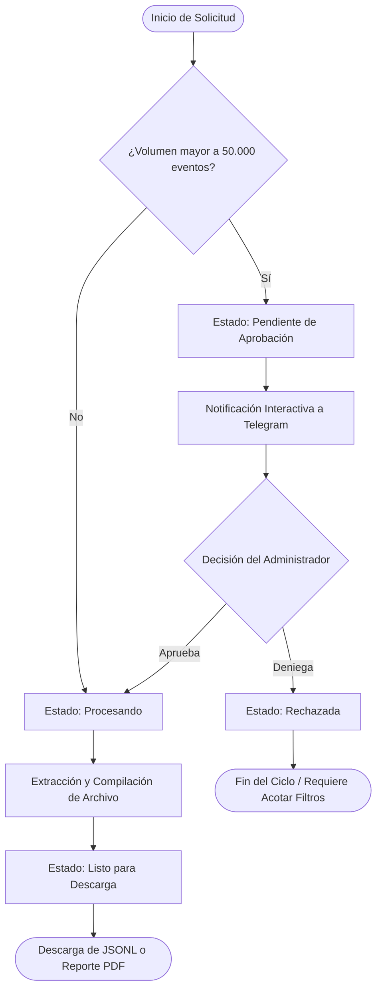

> **Ver también:** [Inicio](index.md) · [Manual Técnico & Arquitectura](manual-tecnico.md) · [Diccionario de Datos](diccionario-datos.md) · [Despliegue & Operaciones](guia-despliegue.md)

## Índice

- [1. Introducción](#1-introduccion)
- [2. Objetivo](#2-objetivo)
- [3. Alcance](#3-alcance)
- [4. Requisitos para usar HoneyMetrics](#4-requisitos-para-usar-honeymetrics)
  - [4.1 Conocimientos previos](#41-conocimientos-previos)
  - [4.2 Requisitos de hardware recomendados](#42-requisitos-de-hardware-recomendados)
  - [4.3 Conexión a internet](#43-conexion-a-internet)
  - [4.4 Credenciales y custodia de acceso](#44-credenciales-y-custodia-de-acceso)
- [5. Aplicaciones de software](#5-aplicaciones-de-software)
  - [5.1 Navegador web](#51-navegador-web)
  - [5.2 Aplicación autenticadora móvil (MFA / TOTP)](#52-aplicacion-autenticadora-movil-mfa-totp)
  - [5.3 Cliente de correo electrónico](#53-cliente-de-correo-electronico)
  - [5.4 Aplicación de mensajería Telegram](#54-aplicacion-de-mensajeria-telegram)
  - [5.5 Visores de archivos (JSONL y PDF)](#55-visores-de-archivos-jsonl-y-pdf)
- [6. Funcionalidades generales](#6-funcionalidades-generales)
  - [6.1 Inicio de sesión seguro](#61-inicio-de-sesion-seguro)
  - [6.2 Configuración y verificación de Autenticación de Doble Factor (MFA)](#62-configuracion-y-verificacion-de-autenticacion-de-doble-factor-mfa)
  - [6.3 Cierre de sesión seguro](#63-cierre-de-sesion-seguro)
  - [6.4 Recuperación de contraseña olvidada](#64-recuperacion-de-contrasena-olvidada)
  - [6.5 Gestión de perfil, preferencias visuales y cambio de clave](#65-gestion-de-perfil-preferencias-visuales-y-cambio-de-clave)
  - [6.6 Tutorial paso a paso: Vinculación con Telegram](#66-tutorial-paso-a-paso-vinculacion-con-telegram)
- [7. Funcionalidades operativas (Núcleo del sistema)](#7-funcionalidades-operativas-nucleo-del-sistema)
  - [7.1 Dashboard de Inteligencia de Amenazas (CTI)](#71-dashboard-de-inteligencia-de-amenazas-cti)
  - [7.2 Threat Center (Gestión de Lista Negra de IPs Maliciosas)](#72-threat-center-gestion-de-lista-negra-de-ips-maliciosas)
  - [7.3 Solicitud, Aprobación y Descarga de Logs & Reportes](#73-solicitud-aprobacion-y-descarga-de-logs-reportes)
- [8. Funcionalidades específicas por rol](#8-funcionalidades-especificas-por-rol)
  - [8.1 Rol: Administrador](#81-rol-administrador)
  - [8.2 Rol: Consultor de Ciberseguridad](#82-rol-consultor-de-ciberseguridad)
  - [8.3 Rol: Analista de Datos](#83-rol-analista-de-datos)
  - [8.4 Rol: Directivo de T.I.](#84-rol-directivo-de-ti)
- [9. Preguntas frecuentes y resolución de problemas](#9-preguntas-frecuentes-y-resolucion-de-problemas)

# Manual de Usuario de HoneyMetrics v2.0

## 1. Introducción

HoneyMetrics v2.0 es una plataforma web especializada en Inteligencia de Amenazas Cibernéticas (*Cyber Threat Intelligence - CTI*) y monitoreo avanzado de sensores trampa (*honeypots*).

HoneyMetrics actúa como un centro de mando operativo que transforma volúmenes masivos de registros crudos y telemetría de eventos de seguridad en información clara, estructurada y accionable para los equipos de respuesta y toma de decisiones. A través de una interfaz moderna y reactiva, la plataforma permite supervisar ataques dirigidos contra la infraestructura, catalogar direcciones IP hostiles, anticipar patrones anómalos de tráfico mediante algoritmos predictivos y coordinar flujos de exportación controlada de evidencias forenses.

Este manual ha sido redactado con un enfoque 100% centrado en el operador humano, prescindiendo deliberadamente de tecnicismos internos de programación para proporcionar un acompañamiento claro, pedagógico y práctico a lo largo de todas las operaciones disponibles en la interfaz.

---

## 2. Objetivo

Proporcionar a los usuarios de HoneyMetrics una guía operativa integral, didáctica y de consulta ágil que les permita dominar las funciones de la plataforma según su rol asignado.

De manera específica, el manual persigue:

1. Orientar al usuario en el cumplimiento de los requerimientos técnicos de conectividad, hardware y aplicaciones complementarias necesarias para acceder al servicio.
2. Detallar paso a paso los procedimientos de autenticación robusta, matriculación de doble factor (MFA) y vinculación con canales de notificación como Telegram.
3. Explicar en profundidad la interpretación analítica de cada componente visual del Dashboard, la administración de indicadores en el Threat Center y la solicitud controlada de registros forenses.
4. Delimitar las capacidades, restricciones y mejores prácticas operativas para cada uno de los cuatro roles del sistema: *Administrador*, *Consultor de Ciberseguridad*, *Analista de Datos* y *Directivo de T.I.*
5. Brindar soluciones inmediatas ante los incidentes y dudas más frecuentes de operación diaria.

---

## 3. Alcance

Este manual cubre el ciclo completo de interacción del usuario con HoneyMetrics v2.0 a través de su interfaz web accesible desde cualquier navegador moderno. Incluye:

- **Gestión de Identidad y Seguridad Personal:** Inicio de sesión, matriculación y validación de doble factor (TOTP), recuperación autónoma de credenciales, cambio de clave con medidor visual de robustez y vinculación con Telegram.
- **Visualización y Analítica CTI:** Interpretación de indicadores clave de rendimiento (KPIs), líneas de tiempo de eventos, categorización por severidad, mapa térmico predictivo y recomendaciones del asistente inteligente.
- **Operación de Lista Negra (Threat Center):** Búsqueda predictiva, registro de indicadores con puntuación de riesgo, actualización de contexto y consulta de la bóveda forense de registros archivados.
- **Extracción de Evidencias Forenses:** Solicitud de logs de seguridad, seguimiento del ciclo de vida de cada solicitud, descarga de archivos en formato JSONL y emisión de reportes ejecutivos consolidados en formato PDF.
- **Gobernanza y Roles:** Alcance funcional de los cuatro perfiles de usuario, administración de cuentas y flujo interactivo de aprobación de descargas masivas vía Telegram para administradores.

!!! note "⚡ Nota de Alcance"
    El manual no cubre tareas de administración interna del servidor físico, configuración del motor de bases de datos PostgreSQL ni orquestación de contenedores Docker en infraestructura, aspectos documentados en el [Manual Técnico & Arquitectura](manual-tecnico.md) y la [Guía de Despliegue & Operaciones](guia-despliegue.md).

---

## 4. Requisitos para usar HoneyMetrics

Para garantizar una experiencia óptima y segura al operar HoneyMetrics, el usuario debe verificar el cumplimiento de los siguientes requisitos previos:

### 4.1 Conocimientos previos

- Manejo básico de navegadores de internet y aplicaciones web modernas.
- Comprensión elemental de conceptos de ciberseguridad: dirección IP, puerto de red, intento de intrusión, severidad de alerta e indicador de compromiso (IOC).
- Familiaridad con el uso de aplicaciones móviles de autenticación en dos pasos (como Google Authenticator o Microsoft Authenticator).

### 4.2 Requisitos de hardware recomendados

- **Procesador:** Intel Core i3 de séptima generación o superior (o procesador equivalente AMD Ryzen 3).
- **Memoria RAM:** Mínimo 4 GB disponibles; se recomiendan 8 GB para una navegación fluida al renderizar gráficas con alta densidad de datos.
- **Almacenamiento en disco:** Al menos 500 MB de espacio libre disponible para el almacenamiento local de reportes en PDF y archivos de telemetría forense (.jsonl).
- **Resolución de pantalla:** Resolución mínima recomendada de 1366 × 768 píxeles (pantallas Full HD 1920 × 1080 brindan el mejor confort visual en paneles de gráficos y tablas de indicadores).

### 4.3 Conexión a internet

- Ancho de banda estable de al menos 5 Mbps de bajada y 2 Mbps de subida.
- Conectividad segura mediante protocolo HTTPS hacia la dirección web o dominio corporativo proporcionado por el departamento de tecnología.

### 4.4 Credenciales y custodia de acceso

- Contar con un nombre de usuario o correo electrónico corporativo registrado previamente por el Administrador de la plataforma.
- Disponer de un dispositivo móvil inteligente (Android o iOS) con cámara funcional para el escaneo del código QR durante la activación del doble factor de autenticación.
- Custodiar estrictamente las contraseñas y códigos temporales generados; queda prohibido compartir credenciales con terceros o anotarlas en lugares visibles.

---

## 5. Aplicaciones de software

El ecosistema de HoneyMetrics interactúa de forma complementaria con herramientas comunes de productividad y seguridad que deben estar instaladas en su estación de trabajo o dispositivo móvil:

### 5.1 Navegador web
La plataforma ha sido construida para operar en navegadores web de última generación con soporte para HTML5, CSS3 y JavaScript moderno:

- Google Chrome (versión 110 o superior).
- Mozilla Firefox (versión 110 o superior).
- Microsoft Edge (versión 110 o superior).
- Brave Browser o navegadores basados en Chromium.
- Apple Safari (versión 16 o superior en macOS / iOS).

!!! note "⚡ Nota"
    HoneyMetrics está optimizado para estándares web contemporáneos. No se garantiza el funcionamiento en Microsoft Internet Explorer o navegadores desactualizados. Asegúrese de mantener su navegador actualizado para disfrutar de todas las transiciones visuales y medidas de protección criptográfica.

### 5.2 Aplicación autenticadora móvil (MFA / TOTP)
Es un requisito obligatorio para acceder a la plataforma. Debe instalar en su teléfono inteligente cualquiera de las siguientes aplicaciones gratuitas de generación de códigos de un solo uso (TOTP):

- **Google Authenticator** (disponible en Google Play Store y Apple App Store).
- **Microsoft Authenticator**.
- **Twilio Authy**.
- **1Password / Bitwarden** (con función de autenticador incorporada).

### 5.3 Cliente de correo electrónico
Cualquier cliente de correo (Gmail, Microsoft Outlook, Thunderbird o webmail corporativo) con acceso a la bandeja de entrada de la cuenta registrada, necesario para recibir los enlaces de recuperación de contraseña en caso de olvido.

### 5.4 Aplicación de mensajería Telegram
Recomendada para todos los usuarios y **obligatoria para los Administradores**:

- Aplicación de Telegram instalada en su teléfono móvil o en su computadora (Telegram Desktop o versión Web).
- Permite a los operadores recibir notificaciones automáticas inmediatas cuando sus extracciones de logs están listas para descarga.
- Permite a los Administradores recibir solicitudes de aprobación para descargas masivas y autorizarlas o denegarlas mediante botones interactivos directamente en el chat.

### 5.5 Visores de archivos (JSONL y PDF)

- **Para archivos JSONL:** Editores avanzados de texto y código como Visual Studio Code, Notepad++, Sublime Text, o utilidades de línea de comandos como `jq`.
- **Para reportes ejecutivos PDF:** Cualquier visor estándar de documentos PDF como Adobe Acrobat Reader, Foxit Reader o el propio visor integrado de su navegador web.

---

## 6. Funcionalidades generales

Estas funciones se encuentran disponibles para todos los usuarios autenticados, sin importar el rol asignado.

### 6.1 Inicio de sesión seguro
Para ingresar a HoneyMetrics:

1. Abra su navegador web y digite la dirección URL oficial provista por el departamento de tecnología (por ejemplo, `https://honeymetrics-frontend.johan-sebastianposada.workers.dev/` o la dirección local designada).
2. La pantalla de bienvenida le presentará el formulario de autenticación con fondo de ciberseguridad.
3. En el campo **Usuario o Correo Electrónico**, escriba su identificador registrado.
4. En el campo **Contraseña**, escriba su clave personal. Puede hacer clic sobre el **ícono del ojo** ubicado a la derecha del campo para alternar la visualización y verificar que los caracteres ingresados sean correctos.
5. Haga clic sobre el botón **Iniciar Sesión**.

<video poster="../assets/screenshots/fig01_login.png" controls width="100%" playsinline class="docs-video">
  <source src="../assets/videos/01_login_y_navegacion.mp4" type="video/mp4">
  Su navegador no soporta la reproducción de video HTML5.
</video>
*Video 1. Inicio de sesión institucional y recorrido inicial de navegación.*

*Figura 1. Formulario de acceso al sistema con opción de verificación visual de contraseña.*

*Figura 1b. Interfaz responsiva adaptada a dispositivos móviles (390×844 px).*

!!! note "⚡ Nota de Seguridad"
    Si introduce credenciales incorrectas, el sistema emitirá un aviso visual de error. Por políticas de protección contra ataques de fuerza bruta, el número de intentos consecutivos está limitado. Si no recuerda su clave, utilice la opción de recuperación explicada más adelante.

### 6.2 Configuración y verificación de Autenticación de Doble Factor (MFA)
El sistema exige de forma obligatoria la validación por dos factores para proteger las cuentas contra accesos no autorizados.

**A. Configuración Inicial (Primer Ingreso del Usuario):**

1. Al autenticarse exitosamente por primera vez, el sistema detectará que su cuenta aún no tiene enrolado un dispositivo y desplegará automáticamente la ventana modal **Configuración de Autenticación de Doble Factor (MFA)**.
2. En la pantalla se mostrará un **código QR bidimensional** junto con una clave secreta alfanumérica de respaldo.
3. Abra su aplicación autenticadora en el teléfono móvil (ej. Google Authenticator) y pulse sobre el botón **Añadir cuenta (+)**.
4. Seleccione la opción **Escanear código QR** y apunte la lente de la cámara hacia la pantalla de su computador. Si la cámara presenta inconvenientes, elija *Introducir clave manualmente* y escriba la clave alfanumérica provista en pantalla.
5. Su aplicación registrará de inmediato la entrada bajo el nombre **HoneyMetrics** y comenzará a generar códigos numéricos dinámicos de seis dígitos que cambian cada 30 segundos.
6. En el formulario web, escriba en la casilla de verificación el código de 6 dígitos que observa actualmente en su teléfono y haga clic en **Confirmar y Activar MFA**. El sistema validará la sincronización y habilitará el ingreso a la plataforma.

*Figura 2. Proceso de enrolamiento de doble factor con código QR y censura de seguridad.*

**B. Verificación en Inicios de Sesión Posteriores:**

1. Tras ingresar su usuario y contraseña en los accesos cotidianos, el sistema le presentará de inmediato el paso de validación temporal.
2. Abra su aplicación autenticadora móvil y consulte el código de 6 dígitos vigente para HoneyMetrics.
3. Ingréselo en el recuadro numérico y haga clic en **Verificar Código**.

!!! note "⚡ Nota de Tolerancia Horaria"
    El sistema admite una ventana de tolerancia temporal de ±30 segundos para compensar pequeñas desincronizaciones horarias en los dispositivos móviles. Si el código está a punto de expirar en su teléfono (círculo temporizador en rojo), espere a que aparezca el siguiente código de 6 dígitos antes de hacer clic en Verificar.

### 6.3 Cierre de sesión seguro
Para salvaguardar la confidencialidad de la información, el usuario dispone de dos mecanismos inmediatos para cerrar su sesión:

- **Desde la barra superior de navegación:** Haga clic sobre el ícono de salida rápida ubicado en la esquina superior derecha de la interfaz.
- **Desde el menú de usuario:** Haga clic sobre su fotografía o nombre de perfil en la esquina superior derecha y seleccione la opción **Cerrar Sesión** en el menú desplegable.

El sistema destruirá inmediatamente la sesión local y redirigirá al navegador a la pantalla pública de bienvenida.

!!! warning "⚡ Recomendación Vital"
    Recuerde cerrar sesión siempre que se ausente de su estación de trabajo o cuando opere desde un equipo compartido en salas de monitoreo.

### 6.4 Recuperación de contraseña olvidada
Si ha olvidado su contraseña de acceso, puede restablecerla de forma autónoma mediante el siguiente procedimiento:

1. En la pantalla principal de inicio de sesión, haga clic en el enlace **¿Olvidó su contraseña?**.
2. En la ventana emergente, ingrese la dirección de correo electrónico institucional asociada a su usuario.
3. Haga clic en el botón **Enviar Enlace de Recuperación**. El sistema procesará la solicitud y emitirá una confirmación en pantalla.
4. Diríjase a su bandeja de entrada de correo electrónico y localice el mensaje remitido por HoneyMetrics (verifique también su carpeta de correo no deseado o *Spam*).
5. Abra el mensaje y haga clic sobre el enlace seguro de restablecimiento, el cual cuenta con un período de validez temporal limitado por seguridad.
6. El enlace le conducirá a una pantalla especial donde deberá escribir su **Nueva Contraseña** y confirmarla en el segundo campo.
7. Haga clic en **Guardar Contraseña**. El sistema confirmará el cambio exitoso y lo redirigirá a la pantalla de login para que inicie sesión con su nueva clave.

*Figura 3. Pantalla de solicitud y confirmación de enlace de restablecimiento con protección anti-enumeración.*

### 6.5 Gestión de perfil, preferencias visuales y cambio de clave
Para acceder a la administración de su perfil personal:

1. Despliegue el menú de usuario en la esquina superior derecha y seleccione **Mi Perfil** (o ingrese a **Configuración** desde el menú lateral).
2. En este módulo podrá gestionar:

   - **Foto y datos personales:** Visualizar su nombre, correo y rol asignado.
   - **Tema de la interfaz (Personalización visual):** HoneyMetrics permite alternar entre dos temas:

     - *Tema Oscuro (Dark CTI - Predeterminado):* Fondo grafito profundo y acentos de color cian/ámbar, especialmente diseñado para salas de operaciones de seguridad (SOC) y jornadas prolongadas.
     - *Tema Claro (Light):* Fondo limpio en tonos claros, óptimo para entornos con alta iluminación natural.
   - **Zona horaria:** Configuración de la zona horaria geográfica para que todas las marcas de tiempo de las alertas en gráficas y tablas se muestren adaptadas a su horario local.
   - **Cambio de clave activa:** En la sección *Cambiar Contraseña*, introduzca su contraseña actual, seguida de la nueva contraseña y su confirmación.
   - **Medidor visual de fortaleza:** Mientras escribe la nueva clave, una barra interactiva de tres colores le indicará el nivel de seguridad alcanzado:

     - *Rojo (Débil):* Clave muy corta o predecible (menos de 8 caracteres o puramente alfabética).
     - *Amarillo (Media):* Cumple con la longitud básica pero requiere mayor variedad de caracteres.
     - *Verde (Fuerte):* Contraseña robusta que combina mayúsculas, minúsculas, números y caracteres especiales.

### 6.6 Tutorial paso a paso: Vinculación con Telegram
Vincular su cuenta de Telegram le permite recibir alertas automáticas cuando sus solicitudes de exportación de logs estén listas para descarga, y a los Administradores les permite autorizar solicitudes masivas desde su teléfono móvil.

Siga estos pasos sencillos para obtener su identificador numérico y vincularlo en la plataforma:

**Paso 1: Obtener su ID de Chat mediante `@userinfobot`**

1. Abra su aplicación de Telegram (en su teléfono móvil o en su computadora).
2. En la barra superior de búsqueda de Telegram, escriba: `@userinfobot`.
3. Seleccione el bot oficial identificado con dicho nombre (suelen acompañarlo títulos como *User Info Bot* o *Get ID*).
4. Inicie el chat y envíe el comando: `/start`.
5. El bot responderá de forma instantánea con un mensaje que contiene sus datos de usuario de Telegram, incluyendo una línea rotulada como `Id: 123456789` (una secuencia de números enteros).
6. Copie ese número entero de identificación en su portapapeles.

**Paso 2: Iniciar conversación con el bot de HoneyMetrics**

1. Regrese a la barra de búsqueda de Telegram y escriba: `@HoneyMetrics` (o el nombre exacto del bot institucional configurado).
2. Seleccione el bot de la lista de resultados.
3. En la parte inferior de la conversación, pulse el botón **Iniciar** o envíe el comando `/start`. Este paso es indispensable para autorizar al bot a remitirle mensajes directos.

**Paso 3: Guardar su ID en la plataforma web**

1. Vuelva a su navegador web donde tiene abierto HoneyMetrics.
2. Ingrese a **Mi Perfil** o **Configuración**.
3. Localice el campo rotulado como **ID de Chat de Telegram**.
4. Pegue allí el número numérico obtenido en el Paso 1.
5. Haga clic en el botón **Guardar Cambios**. A partir de ese instante, su perfil se encuentra oficialmente enlazado para recibir notificaciones operativas.

---

## 7. Funcionalidades operativas (Núcleo del sistema)

El núcleo operativo de HoneyMetrics comprende las tres herramientas principales de análisis, respuesta y extracción de datos forenses:

### 7.1 Dashboard de Inteligencia de Amenazas (CTI)
El Dashboard es la pantalla central de mando y monitoreo situacional de la plataforma. Para acceder, pulse sobre **Dashboard** en el menú de navegación lateral.

<video poster="../assets/screenshots/fig04_dashboard_cti.png" controls width="100%" playsinline class="docs-video">
  <source src="../assets/videos/02_dashboard_cti_filtros.mp4" type="video/mp4">
  Su navegador no soporta la reproducción de video HTML5.
</video>
*Video 2. Filtrado dinámico de eventos, exploración de gráficos Plotly y recomendaciones defensivas.*

*Figura 4. Panel de visualización ejecutiva y táctica de inteligencia de amenazas (Dashboard CTI).*

El panel se compone de los siguientes elementos visuales y analíticos:

1. **Selector de Período Temporal (Filtros Rápidos):**
   Ubicado en la parte superior derecha del tablero. Permite conmutar la ventana de observación con un solo clic:

   - *Últimas 24 Horas:* Para monitoreo en tiempo real de incidentes del día.
   - *Últimos 7 Días:* Para detectar campañas semanales persistentes.
   - *Últimos 30 Días:* Para análisis mensual y tendencias consolidadas.
   - *Personalizado:* Permite abrir un selector de fechas de inicio y fin para auditar un incidente específico.

2. **Tarjetas de Indicadores Clave de Rendimiento (KPIs):**
   - **Total de Alertas:** Cifra global de intentos de ataque o sondeos registrados por los sensores honeypot en el período seleccionado.
   - **Severidad Promedio:** Puntuación consolidada que mide la criticidad de los eventos analizados en una escala del 1 al 15. Puntuaciones elevadas alertan sobre intentos directos de intrusión o explotación activa.
   - **Alertas Críticas:** Conteo de incidentes de máxima gravedad que requieren atención inmediata de los equipos de respuesta.
   - **Bloqueos Activos:** Número de direcciones IP maliciosas que han sido catalogadas y neutralizadas en las listas negras del sistema.

3. **Línea de Tiempo de Eventos (Evolución Temporal):**
   Gráfica de barras interactivas que muestra la distribución de los ataques hora a hora o día a día. Permite identificar de inmediato picos anómalos de tráfico, ataques de denegación o ráfagas de escaneos masivos. Al pasar el cursor del mouse sobre cada barra, se despliega una ventana flotante con el desglose exacto de eventos.

4. **Distribución por Severidad:**
   Gráfica circular de tipo dona que clasifica las alertas en cuatro niveles cromáticos intuitivos:

   - *Baja (Azul/Verde):* Escaneos preliminares y peticiones benignas.
   - *Media (Amarillo):* Sondeos a puertos de servicios conocidos.
   - *Alta (Naranja):* Intentos de autenticación con credenciales predeterminadas o fuerza bruta.
   - *Crítica (Rojo):* Inyecciones de código malicioso, exploits de día cero y comandos remotos.

5. **Mapa de Calor Predictivo:**
   Matriz visual que cruza los días de la semana con los rangos horarios de 24 horas, iluminando con colores más intensos las franjas horarias donde los modelos predictivos y el histórico de eventos detectan la mayor probabilidad de actividad hostil. Sirve como insumo vital para planificar guardias y refuerzos en el SOC.

6. **Módulo Honeypot Advisor (Asistente Inteligente):**
   Caja de recomendaciones automatizadas que analiza el comportamiento del tráfico reciente y sugiere medidas defensivas concretas, tales como: *"Alta concentración de ataques al puerto 22 (SSH); se recomienda habilitar reglas de bloqueo geográfico para subredes no reconocidas"*.

### 7.2 Threat Center (Gestión de Lista Negra de IPs Maliciosas)
El Threat Center es el módulo táctico donde los operadores consultan, registran, catalogan y neutralizan direcciones IP hostiles detectadas por los honeypots.

Para acceder, haga clic en **Threat Center** (o **Lista Negra**) en el menú de navegación.

<video poster="../assets/screenshots/fig05_threat_center_ioc.png" controls width="100%" playsinline class="docs-video">
  <source src="../assets/videos/03_threat_center_y_boveda.mp4" type="video/mp4">
  Su navegador no soporta la reproducción de video HTML5.
</video>
*Video 3. Búsqueda y catalogación de direcciones IP en la Lista Negra.*

*Figura 5. Módulo de administración de indicadores de compromiso (IOC).*

**A. Búsqueda y Filtrado de Indicadores:**
En la parte superior de la tabla encontrará una barra de búsqueda predictiva. Puede escribir cualquier término: una dirección IP completa o parcial (ej. `192.168`), el nombre de un país (ej. `China`, `Rusia`), una categoría de ataque (ej. `Brute Force`, `SSH Scan`) o las notas del analista. La tabla filtrará los resultados en tiempo real sin recargar la página.

**B. Registro de una Nueva IP en la Lista Negra:**

1. Haga clic sobre el botón **+ Agregar Indicador** (o **Agregar IP**) ubicado encima de la tabla.
2. Se desplegará un formulario modal con los siguientes campos a diligenciar:

   - **Dirección IP:** Digite la dirección IPv4 o IPv6 que desea catalogar (ej. `203.0.113.45`).
   - **País de Origen:** Seleccione o verifique el país asociado a la geolocalización de la IP.
   - **Categoría de Amenaza:** Seleccione en el menú desplegable la tipología del ataque observado (*Fuerza Bruta SSH, Escaneo Web, Inyección SQL, Botnet, Malware*).
    - **Threat Score (Nivel de Amenaza de 0 a 100):** Asigne una puntuación numérica entre 0 y 100 representativa de la peligrosidad de la IP.

        !!! warning "⚡ Regla de Bloqueo Automático"
            Toda dirección IP registrada con un **Threat Score superior a 70 puntos ($>70$)** es clasificada de forma automática por el sistema bajo el estado de **Bloqueada**, lo que activa su sincronización prioritaria con las políticas de defensa perimetral.

    - **Notas del Analista:** Campo de texto libre para justificar el registro (ej. *"Detectada realizando más de 500 intentos de inicio de sesión por minuto en el sensor Cowrie"*).
3. Haga clic en **Guardar Indicador**. La IP aparecerá listada en la tabla principal.

**C. Modificación de un Indicador Existente:**

1. En la fila correspondiente a la IP deseada, haga clic en el botón de **Editar** (representado por el **ícono de lápiz**).
2. Se abrirá el formulario con los valores actuales. Modifique la categoría, la puntuación o agregue notas adicionales de seguimiento.
3. Haga clic en **Actualizar Cambios**.

**D. Retiro / Eliminación de una IP y la Bóveda Forense:**

1. Si un analista determina que un indicador ya no representa riesgo o requiere ser retirado, debe hacer clic sobre el botón de **Eliminar** (representado por el **ícono de papelera**).
2. El sistema mostrará un cuadro de diálogo de confirmación advirtiendo sobre la operación.
3. Al confirmar, la IP se retira inmediatamente de la tabla operativa de bloqueo activo.
4. **Consulta en la Bóveda Forense:** La plataforma no destruye la evidencia; traslada una copia histórica de la IP junto con sus notas y el usuario que ordenó el retiro hacia la pestaña **Bóveda Forense** (ubicada como una subpestaña dentro del Threat Center). Desde allí, cualquier analista o auditor puede consultar los indicadores archivados para fines de trazabilidad histórica.

### 7.3 Solicitud, Aprobación y Descarga de Logs & Reportes
Este módulo permite extraer paquetes estructurados de registros de seguridad para investigaciones forenses externas o comités de auditoría.

Para acceder, pulse sobre **Logs & Reportes** en el menú de navegación.

<video poster="../assets/screenshots/fig06_exportacion_logs_modal.png" controls width="100%" playsinline class="docs-video">
  <source src="../assets/videos/04_logs_export_y_pdf.mp4" type="video/mp4">
  Su navegador no soporta la reproducción de video HTML5.
</video>
*Video 4. Solicitud de exportación en rango temporal real, descarga y visualización del Esquema Canónico en PDF.*

**A. Solicitar una Nueva Extracción de Telemetría:**

1. Haga clic en el botón **Nuevo Export** para abrir la ventana de parámetros.
2. Seleccione la **Fecha de Inicio** del rango temporal que desea auditar.
3. Seleccione la **Fecha de Fin**.
4. Haga clic en **Solicitar Exportación**.

*Figura 6. Modal interactivo de solicitud de rangos de fechas para exportación de telemetría.*

**B. Mecánica de Aprobación según el Volumen de Datos:**
El sistema evalúa de forma automática el volumen de registros comprendido en el rango solicitado:

- **Extracción Directa (Menor o igual a 50.000 eventos):** Se aprueba automáticamente al instante. El sistema programa la tarea en segundo plano y pasa a generar el archivo sin requerir intervención humana adicional.
- **Extracción Masiva (Mayor a 50.000 eventos):** Para evitar sobrecargas y fuga involuntaria de grandes volúmenes de datos, la solicitud queda catalogada como masiva y entra en estado de espera hasta que el **Administrador la autorice formalmente a través del bot de Telegram**.

**C. Estados del Ciclo de Vida de una Solicitud:**
En la tabla de historial de solicitudes, el operador puede verificar el avance de cada petición mediante las siguientes etiquetas de estado:

- 🟡 **Pendiente de Aprobación:** Solicitud masiva que se encuentra a la espera de que el Administrador presione el botón de autorización en su aplicación de Telegram.
- 🔵 **Procesando:** La solicitud ha sido aprobada y el motor del sistema se encuentra empaquetando y comprimiendo los registros en segundo plano.
- 🟢 **Listo (o Completado):** El paquete de datos ha sido generado exitosamente y los botones de descarga se encuentran habilitados para el usuario.
- 🔴 **Rechazada:** La solicitud fue evaluada y denegada por el Administrador mediante Telegram.

*Figura 7. Historial de solicitudes con botones de descarga directa en JSONL y PDF.*

**D. Descarga del Archivo de Telemetría Cruda (JSONL):**

1. Ubique en la tabla una solicitud que se encuentre en estado **Listo**.
2. Haga clic sobre el botón de descarga rotulado como **JSONL**.
3. Su navegador descargará un archivo comprimido con extensión `.jsonl`. Cada línea de este archivo contiene un objeto estructurado en formato JSON con la totalidad de los campos del evento de seguridad (dirección IP de origen, puerto destino, sensor atacado, encabezados y reglas disparadas), idóneo para ser analizado en entornos como Python, Pandas, Splunk o Elasticsearch.

**E. Descarga del Reporte Ejecutivo de Esquema (PDF):**

1. En la misma fila con estado **Listo**, haga clic sobre el botón rotulado como **Esquema (PDF)**.
2. El sistema compilará en tiempo real un informe técnico-ejecutivo de alta presentación visual.
3. El archivo descargado contiene un resumen consolidado con tablas comparativas, distribución de ataques por categoría, principales direcciones hostiles detectadas y conclusiones automáticas del período, listo para ser adjuntado en informes de gestión de seguridad.

!!! note "⚡ Período de Retención"
    Los archivos de datos generados permanecen disponibles para descarga en la plataforma durante un período de **7 días calendario**. Transcurrido este plazo, los archivos pesados son depurados automáticamente del almacenamiento temporal para optimizar espacio, conservando en el historial el registro de la solicitud.

---

## 8. Funcionalidades específicas por rol

HoneyMetrics implementa un modelo de control de acceso riguroso que adapta la interfaz y los privilegios a las responsabilidades de cada miembro de la organización. A continuación se desglosan las características operativas de los cuatro perfiles del sistema:

### 8.1 Rol: Administrador
El Administrador es la máxima autoridad técnica y de gobernanza dentro de HoneyMetrics. Posee supervisión integral sobre la plataforma y custodia los accesos de los demás colaboradores.

- **Capacidades:**
  - Acceso total a todas las Funcionalidades Generales, Dashboard CTI, Threat Center y Logs & Reportes.
  - Administración de usuarios del sistema desde la ruta **Configuración → Gestión de Usuarios & Roles**: creación de nuevas cuentas, modificación de nombres y correos, asignación de roles y revocación inmediata de accesos.
  - **Aprobación de descargas masivas en Telegram:** Cuando un analista genera una petición superior a 50.000 eventos, el bot oficial de HoneyMetrics envía una notificación interactiva al chat personal del Administrador con los datos del solicitante, período y volumen estimado. El Administrador puede pulsar los botones interactivos **[ Aprobar ]** o **[ Rechazar ]** directamente desde su teléfono móvil.
  - Capacidad de consultar y depurar registros archivados en la Bóveda Forense.

<video poster="../assets/screenshots/fig07_admin_usuarios_roles.png" controls width="100%" playsinline class="docs-video">
  <source src="../assets/videos/05_admin_usuarios_y_roles.mp4" type="video/mp4">
  Su navegador no soporta la reproducción de video HTML5.
</video>
*Video 5. Creación de usuarios con contraseñas seguras CSPRNG, control de acceso basado en roles (RBAC) y medidor dinámico de contraseñas.*

*Figura 8. Panel de gobernanza de identidades y creación de cuentas en Admin Hub.*

- **Limitaciones:**
  - Por sanas prácticas de gobierno de seguridad, el Administrador no debe utilizar su cuenta privilegiada para tareas cotidianas de navegación u ocio digital; debe emplear una cuenta operativa especializada cuando solo requiera realizar análisis de datos rutinarios.

- **Recomendaciones de uso:**
  - Mantener siempre enrolado y activo el doble factor de autenticación (MFA).
  - Responder oportunamente a las solicitudes de Telegram para evitar cuellos de botella en las investigaciones de los consultores y analistas.
  - Realizar una auditoría mensual del listado de usuarios activos para deshabilitar cuentas de personal que haya cambiado de funciones o concluido su ciclo en la organización.

### 8.2 Rol: Consultor de Ciberseguridad
El Consultor de Ciberseguridad es el perfil táctico orientado a la investigación activa de incidentes, triaje de alertas y enriquecimiento de inteligencia de amenazas.

- **Capacidades:**
  - Uso completo de todas las Funcionalidades Generales (perfil, doble factor, preferencias).
  - Supervisión y filtrado dinámico del Dashboard CTI en todas sus ventanas temporales (24h, 7d, 30d y fechas personalizadas).
  - **Operación total del Threat Center:** Búsqueda avanzada, creación de nuevas direcciones IP maliciosas con su puntaje de amenaza correspondiente, edición de registros existentes y retiro de indicadores con traslado automático a la Bóveda Forense.
  - Consulta permanente de los registros históricos resguardados en la Bóveda Forense.
  - Emisión de solicitudes de extracción de telemetría y descarga tanto de paquetes JSONL como de reportes ejecutivos en PDF.

*Figura 9. Vista de auditoría e investigación forense para el perfil Consultor.*

- **Limitaciones:**
  - No tiene acceso al módulo de administración de usuarios ni puede alterar las cuentas o roles de otros miembros del equipo.
  - Sus solicitudes de logs que excedan los 50.000 eventos quedan sujetas a la aprobación previa del Administrador.

- **Recomendaciones de uso:**
  - Contrastar siempre las direcciones IP detectadas con fuentes públicas de inteligencia (como VirusTotal o AbuseIPDB) antes de asignar un Threat Score crítico.
  - Documentar con precisión el campo *Notas del Analista* al dar de alta una IP, detallando el vector de ataque y la evidencia observada para facilitar el trabajo de auditorías futuras.
  - Apoyarse en el Mapa de Calor Predictivo para identificar las franjas horarias de mayor incidencia hostil.

### 8.3 Rol: Analista de Datos
El Analista de Datos enfoca su labor en la explotación cuantitativa de la telemetría, el descubrimiento de patrones a gran escala y la correlación estadística del comportamiento de las amenazas.

- **Capacidades:**
  - Uso de las Funcionalidades Generales del sistema.
  - Visualización integral del Dashboard CTI y exploración de sus gráficas de tendencia temporal y mapas térmicos.
  - **Extracción masiva de información:** Es el principal operador del módulo de Logs & Reportes, facultado para programar solicitudes de datos para períodos prolongados con el fin de alimentarlos en modelos de minería o librerías de analítica de datos (Python, R, Jupyter Notebooks).
  - Descarga ágil de archivos JSONL para procesamiento matricial y reportes PDF de síntesis.
  - Consulta y búsqueda en la tabla de indicadores de la Lista Negra (Threat Center).

- **Limitaciones:**
  - No puede gestionar usuarios, perfiles ajenos ni configuraciones globales de la plataforma.
  - Sus extracciones superiores al límite de 50.000 registros requieren la autorización del Administrador en Telegram para prevenir descargas desproporcionadas.

- **Recomendaciones de uso:**
  - Definir ventanas temporales acotadas para sus extracciones cuando realice análisis exploratorios preliminares, evitando solicitar rangos anuales completos en un solo paquete.
  - Utilizar herramientas locales de procesamiento eficiente de flujos (como `jq` o scripts en Python con carga iterativa) para manipular los archivos JSONL sin saturar la memoria RAM de su equipo.
  - Compartir con el equipo de Consultores de Ciberseguridad cualquier hallazgo anómalo o correlación imprevista que amerite la catalogación de nuevos rangos de IPs en la Lista Negra.

### 8.4 Rol: Directivo de T.I.
El Directivo de T.I. (o CISO / Gerente de Seguridad) es un perfil consultivo de alto nivel que requiere visibilidad ejecutiva sobre el estado de protección de la organización, sin participar en la manipulación operativa de registros.

- **Capacidades:**
  - Uso de las Funcionalidades Generales del sistema (acceso seguro, configuración de perfil y contraseña).
  - **Visualización completa del Dashboard CTI:** Acceso a la totalidad de las tarjetas de KPIs ejecutivos, gráficas de severidad y comparativas temporales.
  - **Consulta en modo de solo lectura del Threat Center:** Puede buscar, ordenar e inspeccionar los indicadores de amenaza catalogados y sus puntajes, sin riesgo de alteración accidental.
  - **Emisión de Reportes Ejecutivos en PDF:** Descarga de informes de alto nivel diseñados específicamente para su presentación en comités de dirección y juntas directivas.

*Figura 10. Resumen de inteligencia estratégica y métricas consolidadas para el Directivo de T.I.*

- **Limitaciones:**
  - Perfil de solo lectura: No puede crear, editar ni eliminar direcciones IP en la Lista Negra.
  - No tiene facultades para solicitar la descarga de archivos crudos de telemetría forense (.jsonl).
  - No tiene acceso a la gestión de cuentas ni a los controles de aprobación en Telegram.

- **Recomendaciones de uso:**
  - Emplear las métricas del Dashboard (KPIs de Total de Alertas, Severidad y Alertas Críticas) para medir la efectividad de las defensas y evaluar la exposición de la red frente a ataques recurrentes.
  - Exportar periódicamente los reportes ejecutivos en PDF para sustentar inversiones en infraestructura de ciberdefensa ante la junta directiva.
  - Validar las sugerencias del Honeypot Advisor para alinear las políticas corporativas de seguridad con el comportamiento real de los atacantes.

---

## 9. Preguntas frecuentes y resolución de problemas

**P1: Mi aplicación autenticadora genera el código de 6 dígitos, pero el sistema indica que el código es inválido.**
*Respuesta:* La causa más común es una ligera desincronización entre el reloj interno de su teléfono móvil y la hora estándar de internet. Ingrese a los ajustes de fecha y hora de su teléfono móvil y asegúrese de tener activada la opción **Fecha y hora automáticas (proporcionadas por la red)**. Posteriormente, espere a que la aplicación genere un nuevo código de 6 dígitos e inténtelo nuevamente.

**P2: No he recibido el correo electrónico con el enlace de recuperación de contraseña.**
*Respuesta:* Verifique en primer lugar su carpeta de *Spam*, *Correo no deseado* o *Promociones*. Si tras unos minutos no aparece el mensaje, asegúrese de haber escrito correctamente la dirección de correo registrada. Por motivos de seguridad y privacidad, la plataforma no revela si una dirección existe o no en el sistema. Si el problema persiste, contacte a su Administrador.

**P3: Solicité una extracción de logs hace varios minutos y su estado permanece en "Pendiente de Aprobación".**
*Respuesta:* Esto significa que su consulta abarca un volumen superior a los 50.000 eventos de seguridad y ha sido remitida a los Administradores a través de Telegram para su autorización. Una vez que el Administrador presione el botón de aprobación en su teléfono móvil, el estado cambiará automáticamente a *Procesando* y luego a *Listo*.

**P4: El Dashboard muestra un mensaje de advertencia que indica "Modo de contingencia / Datos offline". ¿Qué significa?**
*Respuesta:* Este aviso se presenta cuando la plataforma no logra establecer una comunicación directa en tiempo real con el servidor de registros en ese instante puntual (por ejemplo, durante labores de mantenimiento programado de la red). En dicho escenario, la interfaz despliega métricas de demostración o datos cacheados para permitirle familiarizarse con la herramienta. Las alertas mostradas en ese estado no deben interpretarse como eventos en tiempo real hasta que el enlace sea restablecido.

**P5: ¿Puedo tener HoneyMetrics abierto en varios navegadores o computadores al mismo tiempo?**
*Respuesta:* Sí, puede acceder desde diferentes puestos de trabajo autorizados; sin embargo, si por motivos de seguridad usted cambia su contraseña personal desde un equipo, las sesiones activas en los demás dispositivos caducarán automáticamente y le solicitarán volver a identificarse con su nueva clave.

---

## 10. Guía Avanzada del Dashboard CTI — Cada Elemento en Detalle

El Dashboard de Inteligencia de Amenazas Cibernéticas (*Cyber Threat Intelligence - CTI*) constituye el centro neurálgico de supervisión operativa de HoneyMetrics. Este panel visual sintetiza en tiempo real los incidentes capturados por los sensores distribuidos en la infraestructura, transformando millones de eventos aislados en un cuadro de mando integral, claro y accionable para los analistas de seguridad y los líderes tecnológicos.

La interfaz del Dashboard se organiza mediante una barra superior de filtrado temporal que le permite a usted alternar la perspectiva de los datos entre ventanas de **Últimas 24 Horas**, **Últimos 7 Días**, **Últimos 30 Días** o un **Rango Personalizado** mediante un selector de calendario interactivo. Al modificar este filtro temporal, todos los elementos gráficos y métricas del panel recalculan sus valores de forma instantánea y sincronizada, brindándole una visión contextualizada del comportamiento hostil hacia la organización.

A continuación, se detalla la función, interpretación y uso estratégico de cada uno de los componentes visuales que integran este panel.

### 10.1 Las 4 Tarjetas de Indicadores Clave (KPIs)

En la sección superior del Dashboard se ubican cuatro tarjetas rectangulares diseñadas para ofrecer un balance cuantitativo inmediato del nivel de exposición de la red. Cada tarjeta sintetiza una dimensión crítica de la actividad maliciosa:

#### 1. Total de Alertas Activas
- **Qué dato muestra exactamente:** Presenta la cantidad consolidada de alertas de seguridad registradas y vigentes dentro de la ventana de tiempo seleccionada en el filtro global. Cada alerta representa un intento de intrusión, escaneo no autorizado o interacción hostil detectada por la red de sensores.
- **Cómo se actualiza:** La tarjeta recalcula su cómputo numérico de manera inmediata cada vez que usted selecciona un período de tiempo diferente en la barra superior. Si se encuentra habilitado el flujo en tiempo real, el contador se incrementa automáticamente a medida que los sensores reportan nuevas amenazas.
- **Cómo interpretarlo para tomar decisiones:** Este indicador funciona como el barómetro general del clima de seguridad institucional. Un aumento gradual y sostenido en este valor refleja un entorno con mayor hostilidad perimetral, mientras que una disminución pronunciada tras aplicar contenciones confirma el éxito de las medidas defensivas. Cuando este número se dispara repentinamente, el equipo de analistas debe priorizar el triaje de incidentes para aislar vectores de compromiso emergentes.

#### 2. Amenazas Críticas
- **Dato que muestra exactamente:** Cuantifica con precisión el número de incidentes catalogados con el nivel más alto de severidad dentro del período bajo análisis. Corresponde a eventos que involucran ejecución remota de comandos, explotación de vulnerabilidades conocidas o intentos sistemáticos de intrusión contra servicios esenciales de la infraestructura.
- **Cómo se actualiza:** Al igual que las demás tarjetas, este valor se sincroniza con el filtro de tiempo elegido por usted en el panel. Además, se actualiza en vivo conforme el motor de correlación clasifica un nuevo incidente entrante bajo la categoría de severidad máxima.
- **Cómo interpretarlo para tomar decisiones:** Esta es la métrica de mayor urgencia operativa de toda la plataforma. Un valor superior a cero exige la intervención inmediata del Consultor de Ciberseguridad para examinar las cargas maliciosas registradas y validar que las defensas hayan repelido la agresión. Si la cifra supera el umbral de tolerancia fijado por la organización, el Directivo de T.I. debe considerar la activación de protocolos de contingencia y aislamiento preventivo de segmentos de red.

#### 3. Alertas en las Últimas 24 Horas
- **Dato que muestra exactamente:** Indica el volumen acumulado de eventos maliciosos detectados estrictamente en el lapso de las últimas veinticuatro horas transcurridas, con independencia de la ventana temporal más amplia que usted haya fijado en el filtro general.
- **Cómo se actualiza:** Este indicador mantiene una ventana móvil continua de veinticuatro horas que se actualiza minuto a minuto con cada nueva alerta procesada por la plataforma.
- **Cómo interpretarlo para tomar decisiones:** Permite evaluar el nivel de presión hostil más reciente y contrastarlo contra el promedio histórico. Si usted observa que las alertas de las últimas 24 horas representan una proporción desmedida respecto al acumulado mensual, significa que la organización está siendo blanco de una campaña agresiva en curso, ameritando turnos de vigilancia reforzada y alertas tempranas para el equipo de guardia.

#### 4. IPs Nuevas Registradas en el Período
- **Dato que muestra exactamente:** Revela la cantidad de direcciones IP de origen hostil que han sido detectadas por primera vez atacando los sensores de la institución dentro del rango de fechas seleccionado. No incluye direcciones recurrentes previamente censadas en períodos anteriores.
- **Cómo se actualiza:** Se calcula dinámicamente al contrastar las direcciones IP que interactuaron en la ventana temporal activa contra el historial completo de telemetría registrado en la base de datos de HoneyMetrics.
- **Cómo interpretarlo para tomar decisiones:** Esta métrica evalúa la diversificación y novedad de los adversarios. Una cifra elevada de nuevas direcciones IP sugiere ataques originados desde redes de bots recientemente reclutadas o campañas masivas de escaneo global. Para los analistas, este número orienta la necesidad de enriquecer la Lista Negra del Threat Center y coordinar con el Administrador la inclusión de nuevos prefijos de red en los sistemas de bloqueo perimetral.

---

### 10.2 Línea de Tiempo de Eventos

La Línea de Tiempo de Eventos se presenta como un gráfico de área y líneas continuas que ilustra la distribución cronológica de las amenazas a lo largo del tiempo seleccionado.

- **Qué representa cada punto:** Cada punto marcado a lo largo de la curva representa la cantidad exacta de eventos maliciosos registrados en un intervalo temporal específico, por ejemplo por horas en la vista de 24 horas, o por días en la vista mensual. Al posicionar el cursor sobre cualquier punto de la línea, la plataforma despliega una ventana emergente que detalla la fecha exacta, la hora y el desglose de alertas por nivel de gravedad.
- **Cómo se puede ampliar o filtrar:** Usted puede interactuar de forma intuitiva con la gráfica seleccionando una franja específica de la curva mediante un gesto de arrastre con el ratón. Al realizar esta acción, el visor realiza un acercamiento (*zoom*) hacia dicho tramo temporal, recalculando la granularidad de los datos para mostrar detalles minuto a minuto. Asimismo, haciendo clic en el botón de restablecimiento en la esquina superior de la gráfica, usted regresará a la vista temporal completa.
- **Qué indica un pico anormal:** La presencia de una cúspide abrupta o pico vertical pronunciado en la gráfica señala una ráfaga masiva y concentrada de ataques. Estas anomalías suelen corresponder a escaneos indiscriminados de puertos, campañas automatizadas de fuerza bruta contra protocolos de administración remota o tentativas de saturación coordinada originadas por redes de atacantes.
- **Correlación con el calendario organizacional:** La línea de tiempo es una herramienta valiosa para cruzar la actividad maliciosa con eventos institucionales. Por ejemplo, usted puede constatar si un incremento de ataques coincide con el lanzamiento público de una nueva aplicación web corporativa, con noticias institucionales de alto impacto, con jornadas de promociones comerciales o con horarios nocturnos y fines de semana, momentos en los que los atacantes intentan aprovechar la menor presencia física de los operadores de seguridad.

!!! tip "Consejo para el Análisis Temporal"
    Si detecta un pico sospechoso en la línea de tiempo, utilice la función de ampliación interactiva para delimitar el horario exacto del suceso. Luego, trasládese a la sección de Logs y genere una consulta delimitada estrictamente a esa hora para inspeccionar las direcciones IP causantes sin procesar volúmenes innecesarios de información.

---

### 10.3 Gráfica de Dona de Severidad

La Gráfica de Dona de Severidad ofrece un desglose proporcional instantáneo de todos los eventos registrados en el período, clasificándolos en cuatro categorías cromáticas bien definidas:

1. **Crítica (Color Rojo):** Incidentes de máximo peligro que evidencian intentos directos de ejecución de código, explotación confirmada de vulnerabilidades o intrusiones dirigidas contra componentes medulares de la infraestructura tecnológica.
2. **Alta (Color Naranja):** Actividades de alta peligrosidad, tales como ataques persistentes de diccionario sobre credenciales de acceso, abuso reiterado de protocolos administrativos y explotación de servicios expuestos.
3. **Media (Color Amarillo):** Intentos de conexión no autorizados, escaneos estructurados de puertos y sondeos que, si bien son intrusivos, no logran vulnerar las capas defensivas ni representan una ejecución maliciosa inmediata.
4. **Baja (Color Azul o Verde):** Tráfico exploratorio rutinario, sondeos aleatorios de internet y peticiones anómalas de bajo impacto que son absorbidas de forma cotidiana por los sensores trampa sin riesgo real para la red.

- **Distribución esperada en un entorno saludable:** En condiciones ordinarias de operación dentro de una red protegida, el perfil de eventos suele estar dominado ampliamente por los niveles de severidad Baja y Media, los cuales en conjunto deben abarcar entre el 70% y el 85% del volumen global. Los eventos de severidad Alta se mantienen típicamente en un rango controlado de entre el 10% y el 20%, mientras que los eventos Críticos no deberían superar una proporción de entre el 2% y el 5% del total de las alertas capturadas.
- **Protocolo de acción cuando el segmento Crítico supera el 20%:** Si usted constata que la porción roja de la gráfica sobrepasa el umbral crítico del 20% del total, el entorno se encuentra bajo una amenaza extraordinaria. Ante este escenario, usted debe seguir el siguiente procedimiento operativo:
  1. Convocar de inmediato al equipo de respuesta a incidentes y notificar al Directivo de T.I. sobre la anomalía estadística.
  2. Filtrar el Dashboard para aislar las alertas de severidad Crítica e identificar con celeridad las direcciones IP atacantes dominantes.
  3. Ingresar al Threat Center y registrar dichas direcciones IP en la Lista Negra con un puntaje de riesgo de cien puntos para su catalogación prioritaria.
  4. Solicitar una extracción de registros forenses de las últimas horas para documentar las firmas de ataque y las cargas útiles utilizadas por los agresores.
  5. Coordinar con el Administrador de red la aplicación inmediata de reglas de bloqueo en los cortafuegos perimetrales para cortar de raíz el tráfico proveniente de las fuentes identificadas.

!!! warning "Alerta por Elevación de Amenazas Críticas"
    Cuando la porción de eventos Críticos supere el 20% del total en la Gráfica de Dona, suspenda las tareas ordinarias de rutina y active de inmediato el protocolo de respuesta a incidentes junto al equipo de infraestructura y telecomunicaciones.

---

### 10.4 Mapa de Calor Predictivo

El Mapa de Calor Predictivo es una matriz bidimensional de analítica avanzada que correlaciona la recurrencia histórica de los ataques a través de los ciclos naturales de la semana laboral y las horas del día.

- **Estructura de los ejes:**
  - **Eje Horizontal (Eje X):** Representa las veinticuatro horas del día, numeradas correlativamente desde la hora 00:00 hasta la hora 23:00 en formato militar.
  - **Eje Vertical (Eje Y):** Representa los siete días de la semana, organizados secuencialmente desde el día lunes hasta el día domingo.
- **Interpretación de la intensidad cromática:** Cada celda de la cuadrícula corresponde a una franja horaria específica de un día determinado. El algoritmo calcula la densidad de eventos maliciosos y asigna un tono visual en gradiente: las celdas con colores fríos, tenues o descoloridos indican actividad nula o marginal, mientras que las celdas con colores cálidos e intensos (rojos, naranjas o púrpuras saturados) señalan una elevada concentración histórica y sostenida de intentos de intrusión.
- **Planificación de refuerzos y defensa proactiva:** El mapa de calor permite abandonar el enfoque reactivo tradicional para adoptar una postura de defensa proactiva. Al analizar los patrones recurrentes en la matriz, usted y su equipo pueden:
  - Planificar turnos de guardia activa y reforzar la dotación de analistas en las franjas horarias donde históricamente se concentra la mayor agresividad de los atacantes, frecuentemente durante la madrugada o en las transiciones de jornada.
  - Programar las ventanas de mantenimiento institucional, despliegue de parches de software y actualizaciones de servidores exclusivamente en las celdas de menor calor histórico, minimizando el riesgo de sufrir ataques oportunistas durante momentos en que los sistemas se encuentran vulnerables por reinicios programados.
  - Ajustar de manera predictiva la sensibilidad de los mecanismos de bloqueo perimetral en las horas previas a los picos históricos identificados por la plataforma.

---

### 10.5 Honeypot Advisor

El Honeypot Advisor es un módulo de asistencia inteligente basado en reglas de correlación heurística que examina de manera continua los datos agregados del período seleccionado para generar diagnósticos concisos y recomendaciones prácticas en lenguaje natural.

En lugar de obligar al usuario a deducir anomalías cruzando manualmente múltiples gráficas, el Advisor evalúa desviaciones estadísticas respecto a las líneas base de comportamiento normal de la red y presenta tarjetas informativas categorizadas por nivel de prioridad.

- **Ejemplos de alertas contextuales generadas por el Advisor:**
  - *“Se detectó un volumen 3x superior al promedio desde el rango 185.x.x.x en las últimas 48 horas. Se sugiere ingresar a la sección de Lista Negra y catalogar el rango completo para revisión prioritaria.”*
  - *“Los ataques de fuerza bruta aumentaron un 40% respecto a la semana anterior, concentrándose principalmente en horas de la madrugada. Se recomienda auditar las políticas de contraseñas y restringir los puertos de acceso perimetral.”*
  - *“Se identificó una nueva firma de sondeo automatizado dirigida contra servidores web institucionales originada desde múltiples proveedores extranjeros. Se aconseja generar un reporte de esquema en formato PDF para someterlo a consideración del comité de seguridad.”*

Cada tarjeta emitida por el Honeypot Advisor incluye accesos directos que le permiten a usted ejecutar la acción recomendada con un solo clic, ya sea aplicando filtros directos en el Threat Center, exportando una consulta delimitada de telemetría o descargando una síntesis ejecutiva para la dirección corporativa.

---

## 11. Ciclo de Vida Completo de una Solicitud de Logs

La extracción controlada de registros de seguridad (*logs*) constituye una de las funciones más rigurosas de HoneyMetrics, ya que proporciona la materia prima probatoria para investigaciones forenses, procesos judiciales y auditorías de cumplimiento normativo. Para preservar el rendimiento de la plataforma y garantizar un gobierno estricto sobre los datos institucionales, cada solicitud transita a través de un ciclo de vida compuesto por cuatro estados posibles.

### 11.1 El Proceso de Solicitud Inicial

Para generar una nueva solicitud de registros, usted debe dirigirse a la pestaña de **Logs & Reportes** en el menú principal y presionar el botón **Nueva Solicitud**.

En el formulario emergente, usted debe configurar los parámetros de su investigación:
1. **Rango de Fechas y Horas:** Fecha y hora de inicio, y fecha y hora de finalización del intervalo de análisis requerido.
2. **Filtros Específicos (Opcionales):** Nivel de severidad de los eventos (Crítica, Alta, Media, Baja), tipo de sensor trampa objetivo o direcciones IP específicas de origen.
3. **Justificación Operativa:** Descripción breve y clara del motivo de la consulta, por ejemplo: *"Investigación de incidente de fuerza bruta registrado el 24 de octubre"*.

Una vez completados los campos, la interfaz calcula una estimación del volumen de eventos comprendidos dentro de los criterios ingresados. Si el volumen proyectado es igual o menor a 50.000 eventos, el sistema inicia de inmediato el procesamiento sin requerir intervenciones externas. Si el volumen proyectado excede los 50.000 eventos, la solicitud entra obligatoriamente en el estado de aprobación por parte de la jerarquía administrativa.

### 11.2 Los Cuatro Estados de una Solicitud

A continuación se detalla exhaustivamente la dinámica operativa de cada uno de los cuatro estados que puede adoptar su solicitud dentro de la tabla de seguimiento:

#### 1. Pendiente de Aprobación (Solo para solicitudes mayores a 50.000 eventos)
- **Qué ocurre en Telegram:** En el instante preciso en que usted confirma una solicitud que sobrepasa el límite de 50.000 eventos, el bot oficial de HoneyMetrics en Telegram despacha una notificación de alta prioridad a los canales y dispositivos móviles de los Administradores acreditados. El mensaje transmitido contiene el nombre de usuario del solicitante, su rol institucional, el rango cronológico exacto de la petición, la justificación ingresada y el volumen estimado de registros, acompañado por dos botones interactivos con las opciones **Aprobar Solicitud** y **Rechazar Solicitud**.
- **Cuánto tiempo puede tomar:** En condiciones habituales de oficina, el tiempo de respuesta administrativa suele oscilar entre 5 y 30 minutos. En horarios no laborales o fines de semana, este lapso puede prolongarse de acuerdo con los turnos de disponibilidad establecidos por el equipo de seguridad.
- **Qué hacer si el Administrador no responde:** Si usted requiere la información con carácter urgente y no obtiene respuesta oportuna a través de Telegram, puede comunicarse directamente con el Administrador mediante el correo institucional indicando el código identificador de su solicitud. Alternativamente, usted puede cancelar la solicitud pendiente y generar una nueva solicitud dividiendo el intervalo temporal en segmentos más pequeños, por ejemplo solicitando únicamente las últimas seis horas o filtrando exclusivamente por severidad Crítica, para que el volumen se mantenga por debajo de los 50.000 eventos y el procesamiento se ejecute de forma automática sin aguardar autorización humana.

#### 2. Procesando
- **Dinámica del estado:** Este estado señala que la solicitud cuenta con la debida autorización, bien sea por ser inferior al umbral o por haber sido aprobada en Telegram, y que el motor de extracción se encuentra recopilando, filtrando y empaquetando los registros forenses solicitados.
- **Indicador visual:** En la tabla de solicitudes se desplegará una barra animada de progreso y el estado se identificará con una insignia de color ámbar.
- **Precaución para el usuario:** Durante esta etapa, se aconseja enfáticamente que usted no cierre la ventana del navegador ni recargue la pestaña mientras el sistema extrae y empaqueta los eventos. Aunque la recopilación continúa ejecutándose en el servidor, mantener abierta la ventana le permite presenciar la finalización del proceso y habilitar de inmediato el botón de descarga.

!!! warning "Precaución durante el Empaquetado"
    No cierre la pestaña del navegador ni recargue la página mientras la solicitud se encuentre en estado **Procesando**. Aunque la extracción continúa ejecutándose en el servidor, mantener activa la interfaz le permite presenciar la finalización del trabajo y acceder de inmediato al archivo resultante.

#### 3. Listo
- **Disponibilidad de la descarga:** Una vez concluida la extracción y compresión de los datos, la insignia de estado cambia inmediatamente a color verde con la etiqueta **Listo**. Al mismo tiempo, se habilita el botón de descarga directa en la columna de acciones.
- **Procedimiento de descarga:** Usted debe hacer clic sobre el botón de descarga correspondiente a la fila de su solicitud. El navegador iniciará de forma automática la transferencia del archivo comprimido hacia la carpeta local de descargas de su equipo de cómputo.
- **Qué contiene el archivo JSONL (*JSON Lines*):** El paquete descargado contiene un archivo de texto estructurado en el que cada línea representa un evento de seguridad individual e íntegro en formato estándar. Cada registro incluye la marca de tiempo exacta en estándar universal, la dirección IP de origen atacante, el puerto de destino pretendido, el tipo de honeypot involucrado, la firma del ataque detectado, la carga maliciosa capturada como comandos ejecutados o peticiones transmitidas, el nivel de severidad asignado y los metadatos forenses contextuales. Este formato resulta idóneo para su ingestión en herramientas de ciencia de datos, librerías de analítica avanzada o plataformas corporativas de correlación de eventos.

#### 4. Rechazada
- **Causas del rechazo:** Si el Administrador determina que la solicitud abarca un rango de tiempo desmesurado que podría comprometer la estabilidad operativa de la red, que la justificación no cumple con los protocolos de gobernanza institucional o que los datos solicitados exceden la necesidad investigativa expresada, presionará el botón de denegación en Telegram.
- **Consecuencias en la plataforma:** El estado de la solicitud en la tabla cambiará a una insignia roja con la leyenda **Rechazada**. Al posar el cursor sobre la fila, usted podrá leer el motivo formal de rechazo consignado por el Administrador.
- **Procedimiento para volver a solicitar:** Usted no debe intentar reenviar de manera idéntica la misma solicitud. Por el contrario, debe consultar el motivo expresado, acotar el rango de búsqueda a una franja horaria más estrecha, aplicar filtros de severidad para descartar eventos menores o justificar de manera más detallada la necesidad técnica del estudio antes de generar una nueva petición en la plataforma.

---

### 11.3 El Reporte Ejecutivo en Formato Esquema (PDF)

De manera complementaria a los archivos técnicos en formato JSONL, HoneyMetrics permite generar e imprimir un **Reporte Ejecutivo en Formato PDF**, concebido específicamente para la comunicación estratégica hacia niveles directivos y comités de auditoría.

- **Contenido estructurado del reporte:**
  1. **Portada Institucional de Auditoría:** Contiene el título del informe, fecha y hora de emisión, identificador de auditoría, nombre del analista solicitante y rango temporal evaluado.
  2. **Resumen Ejecutivo y Métricas Globales:** Tablas consolidadas que presentan el volumen total de eventos procesados, conteo de amenazas críticas repelidas y tasa de variación porcentual respecto a períodos precedentes.
  3. **Distribución por Severidad:** Gráficos estadísticos de alta resolución que ilustran el balance entre eventos Críticos, Altos, Medios y Bajos.
  4. **Cuadro de Honor de Hostilidad (Top 10 IPs Maliciosas):** Tabla detallada que enumera las diez direcciones IP más agresivas identificadas durante el período, acompañadas de su país de origen, número de tentativas de intrusión, servicios vulnerables atacados y puntaje de amenaza asignado.
  5. **Análisis de Vectores de Invasión:** Desglose pormenorizado de los puertos de red más asediados y las modalidades de explotación predominantes, tales como ataques de fuerza bruta, inyecciones de código o escaneos estructurados.
  6. **Conclusiones y Recomendaciones Tácticas:** Párrafos de síntesis redactados en lenguaje gerencial que orientan la toma de decisiones defensivas para el siguiente ciclo operativo.
- **Escenarios y reuniones en las que debe ser utilizado:**
  - **Comités Directivos de Tecnología e Información:** Permite justificar de manera gráfica y documental las inversiones en infraestructura, licencias de protección y contratación de personal especializado.
  - **Reuniones Mensuales de Seguimiento de Ciberseguridad:** Facilita la rendición de cuentas entre el equipo táctico de analistas y la gerencia de seguridad sobre la evolución del panorama de riesgos.
  - **Auditorías de Cumplimiento y Certificación Normativa:** Sirve como evidencia documental formal para satisfacer requerimientos de estándares internacionales, tales como ISO/IEC 27001 o regulaciones sectoriales de protección de datos personales e infraestructuras críticas, acreditando que la organización mantiene una vigilancia activa sobre su perímetro digital.

---

## 12. Preguntas Frecuentes Ampliadas

En esta sección se presentan explicaciones detalladas ante inquietudes operativas avanzadas planteadas habitualmente por los usuarios al interactuar con HoneyMetrics.

---

**P6: Configuré el doble factor de autenticación en mi perfil, escaneé el código QR y guardé los códigos de recuperación, pero al iniciar sesión el sistema no me solicita el código de 6 dígitos. ¿A qué se debe esto?**

*Respuesta:*  
Esta situación se presenta debido a la existencia de una directiva global de seguridad en el servidor que debe encontrarse explícitamente activada por el Administrador del sistema para que el segundo factor de autenticación sea exigido a todos los usuarios durante el acceso. Cuando dicha directiva institucional se encuentra deshabilitada temporalmente en la configuración central de la plataforma, como suele ocurrir durante etapas de instalación inicial o ventanas de mantenimiento preventivo, el sistema adopta una política de acceso básico que valida satisfactoriamente su ingreso empleando únicamente su nombre de usuario y su contraseña habitual. Usted puede tener la total tranquilidad de que su vinculación personal no se ha extraviado, ya que su perfil conserva almacenada de forma segura la clave secreta y la sincronización con su aplicación móvil autenticadora. Tan pronto como el personal de infraestructura active la obligatoriedad general del doble factor en el servidor corporativo, la plataforma comenzará a solicitarle automáticamente el código numérico de seis dígitos en el instante de identificarse. Si usted desea que su cuenta opere de inmediato bajo la modalidad de verificación en dos pasos, comuníquese con el Administrador para consultar el cronograma institucional de habilitación de dicha directiva de seguridad.

---

**P7: ¿Cómo puedo usar la plataforma sin conexión a internet durante una sustentación o presentación académica?**

*Respuesta:*  
La plataforma HoneyMetrics incorpora de fábrica una modalidad especializada denominada Modo de Demostración Offline, concebida para operar de manera autónoma y proyectar datos de muestra representativos sin requerir una conexión activa a internet ni enlace con los servidores de producción. Para hacer uso de esta capacidad en una sustentación de grado, clase magistral o exposición técnica, es imprescindible que el Administrador del sistema habilite previamente esta función ingresando al panel de opciones de la plataforma antes de dar comienzo al evento. Una vez que este entorno demostrativo ha sido activado, todas las secciones esenciales del sistema, incluyendo el Dashboard de inteligencia, el Threat Center y el módulo de descarga de registros, desplegarán métricas simuladas de alta fidelidad que permiten recorrer la totalidad de las funciones analíticas con total fluidez. Usted podrá constatar visualmente que la plataforma se encuentra operando bajo esta contingencia porque en la parte superior de la pantalla se desplegará de forma permanente un banner distintivo con el rótulo **“Modo Demostración Activo”**. Esta herramienta le garantiza una exposición académica exitosa y sin sobresaltos técnicos, evitando la dependencia de redes inalámbricas comunitarias o conexiones externas inestables.

---

**P8: ¿Qué hace el botón [Reconectar] que aparece en el panel del Dashboard?**

*Respuesta:*  
El botón interactivo con la etiqueta **[Reconectar]** aparece en la interfaz de usuario de manera automática cuando el sistema detecta que el canal de telemetría en tiempo real, responsable de nutrir al Dashboard con las alertas generadas por los sensores de detección, ha sufrido una interrupción momentánea o ha dejado de responder. Al hacer clic firmemente sobre este botón, la plataforma ejecuta un restablecimiento selectivo de los conductos de comunicación internos, descartando el registro de error acumulado y reanudando la consulta de datos desde el origen sin obligarlo a usted a recargar o refrescar la página completa del navegador. Esta solución resulta sumamente eficiente para superar fluctuaciones transitorias en la conexión a la red local o pausas operativas breves en el servicio de monitoreo sin perder el contexto visual de su trabajo en pantalla. En caso de que usted presione el botón en repetidas ocasiones y este continúe manifestándose en la interfaz de forma persistente, el comportamiento indica que existe un corte de comunicaciones más severo en la infraestructura tecnológica. Ante esa eventualidad prolongada, usted debe abstenerse de insistir y proceder a levantar un reporte formal ante el Administrador de la plataforma o el departamento de soporte técnico institucional.

---

**P9: El Threat Center muestra una IP con estado "Bloqueada". ¿Eso significa que esa IP ya no puede atacar mi sistema?**

*Respuesta:*  
El estado con la etiqueta **“Bloqueada”** dentro del Threat Center de HoneyMetrics refleja que el equipo de analistas de ciberseguridad ha evaluado la evidencia forense disponible, ha catalogado formalmente dicha dirección IP como un adversario hostil comprobado y ha registrado de manera oficial la orden de contención en la base de datos de la plataforma. Sin embargo, resulta fundamental tener presente que HoneyMetrics cumple la función de centro de inteligencia, correlación y gestión estratégica de incidentes, por lo cual no aplica de manera directa ni autónoma el corte físico del tráfico de red sobre las líneas de comunicación. Para que los paquetes de datos procedentes de esa dirección hostil sean rechazados de manera efectiva antes de ingresar a los servidores corporativos, el Administrador de red debe sincronizar dicha lista negra y cargar las reglas de denegación correspondientes en los dispositivos de seguridad perimetral de la organización, tales como cortafuegos de borde o enrutadores principales. Si dichas reglas de filtrado aún no han sido transferidas y aplicadas formalmente en los equipos físicos de frontera por el personal de infraestructura, las peticiones originadas por esa dirección IP podrían continuar alcanzando el perímetro exterior de su red. Por este motivo, la catalogación como bloqueada en HoneyMetrics debe considerarse como una directiva de neutralización que requiere la validación operativa en los elementos de defensa perimetral.

---

**P10: ¿Por qué mi sesión se cierra automáticamente después de 30 minutos de inactividad?**

*Respuesta:*  
La terminación automática de su sesión tras transcurrir treinta minutos consecutivos sin interacción representa un mecanismo de defensa fundamental en materia de seguridad informática, orientado a resguardar la confidencialidad de la información estratégica institucional y mitigar riesgos de intrusión física. En un entorno de monitoreo de amenazas cibernéticas, una consola abierta y abandonada de manera negligente sobre un escritorio expone datos sensibles sobre vulnerabilidades corporativas, esquemas de defensa y registros de incidentes ante cualquier persona que transite por el área de trabajo. Este intervalo específico de treinta minutos ha sido calibrado minuciosamente por los estándares de seguridad de la organización para concederle a usted la flexibilidad necesaria de atender consultas telefónicas breves o revisar documentación impresa sin ser interrumpido, garantizando al mismo tiempo el bloqueo estricto de la cuenta en caso de una ausencia prolongada. Al vencerse este plazo sin que el sistema detecte pulsaciones de teclado o movimientos del cursor en la ventana de HoneyMetrics, la plataforma interrumpe el acceso de forma segura y lo conduce hacia la pantalla principal de autenticación. Cuando usted regrese a su puesto, bastará con ingresar nuevamente sus credenciales corporativas para recuperar el acceso pleno al sistema en pocos segundos.
