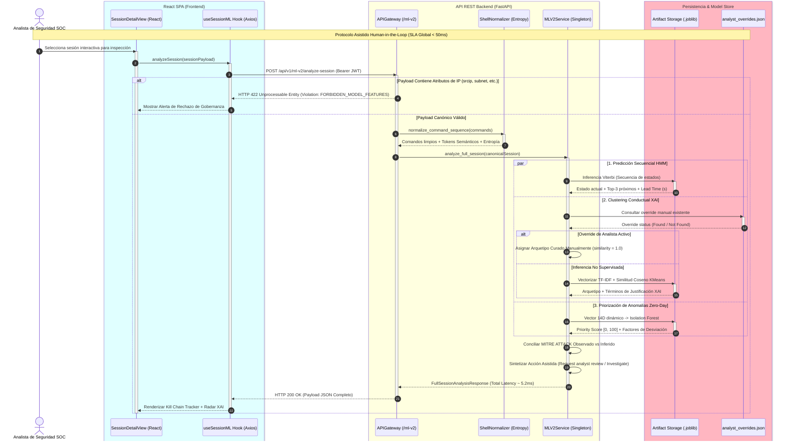

# 🧠 Arquitectura de Machine Learning & CTI v2 (Session-First)

**Proyecto:** HoneyMetrics Enterprise CTI Platform  
**Versión:** 2.0 (Septiembre 2026)  
**Autor:** Johan Sebastián Posada Beltrán  
**Estándar de Arquitectura:** API-First Desacoplada & Zero-IP Analytical Governance  

---

## 1. Filosofía Session-First y Erradicación del Sesgo de IP

En las arquitecturas tradicionales de ciberinteligencia para honeypots, es común el error de modelar la identidad de los atacantes a partir de su dirección IP (`src_ip`), subred `/24` o geolocalización. Este enfoque genera **dos fallas críticas de seguridad**:

1. **Falsa Alta Precisión (Data Leakage):** Los clasificadores memorizan rangos de IP específicos de pruebas de penetración o escaneos repetitivos, reportando precisiones irreales (> 99.9%) que colapsan ante atacantes reales que rotan de nodo.
2. **Acciones Autocráticas Destructivas:** Sugerir de forma automatizada `"Block IP"` conduce a bloqueos accidentales de servidores VPN corporativos, pasarelas de pago compartidas o proxies legítimos.

HoneyMetrics v2 implementa una **Gobernanza Zero-IP Innegociable**:
- La identidad analítica es la **sesión interactiva del atacante**.
- Las variables predictivas se extraen exclusivamente de:
  - Secuencias de comandos de shell desofuscados y normalizados.
  - Entropía informacional de Shannon de las cadenas ejecutadas.
  - Tácticas y Técnicas (TTPs) de MITRE ATT&CK observadas.
  - Ratios temporales y dinámicas de interacción (velocidad de eventos, persistencia en disco, fallos vs éxitos de autenticación).
- El Gateway API rechaza con código HTTP `422/400` cualquier intento de enviar atributos de IP (`srcip`, `subnet`, `country`, etc.) como features analíticas.

---

## 2. Diagrama de Componentes de la Arquitectura ML v2

```mermaid
graph LR
    Honeypot[Honeypots Cowrie / Wazuh Agent] -->|Syslog / Telemetría| WazuhIndexer[Wazuh Indexer / Elasticsearch]
    
    subgraph Frontend Container
        ReactSPA[React 18 + Vite SPA / Dark CTI UI]
    end
    
    subgraph Backend API Container (FastAPI)
        APIGateway[API Gateway / Router /api/v1/ml-v2]
        PydanticShield[Validador Pydantic Anti-IP]
        Normalizer[Normalizador Shell & Entropía]
        MLService[MLV2Service Singleton]
    end
    
    subgraph Model Store & Storage
        HMMArtifact[(HMM Next-Step Model .joblib)]
        ClusterArtifact[(TF-IDF + Cosine KMeans .joblib)]
        AnomalyArtifact[(Isolation Forest Scaled .joblib)]
        OverridesFile[(analyst_overrides.json)]
    end
    
    ReactSPA -->|HTTPS POST /api/v1/ml-v2/analyze-session| APIGateway
    APIGateway --> PydanticShield
    PydanticShield --> Normalizer
    Normalizer --> MLService
    
    MLService -->|Inferencia Viterbi < 1ms| HMMArtifact
    MLService -->|Similitud Coseno < 1ms| ClusterArtifact
    MLService -->|Multivariate Outlier < 6ms| AnomalyArtifact
    MLService <-->|Human-in-the-Loop Overrides| OverridesFile
    
    style ReactSPA fill:#0f172a,stroke:#38bdf8,color:#f8fafc,stroke-width:2px
    style Backend API Container (FastAPI) fill:#1e293b,stroke:#f59e0b,color:#f8fafc,stroke-width:2px
    style Model Store & Storage fill:#1e1e2e,stroke:#10b981,color:#f8fafc,stroke-width:2px
```

---

## 3. Diagrama de Secuencia Canónico de Inferencia Tri-Modelo

El siguiente diagrama detalla el ciclo de vida completo de un análisis de sesión interactiva bajo la especificación estricta de `documentacion-mkdocs`:



---

## 4. Historias de Usuario BDD (Gherkin) para Sprint 3 (ML & Forense)

### Historia de Usuario: US-ML-01 Análisis Holístico Session-First
**Como** Analista de Seguridad SOC  
**Quiero** consultar el análisis integrado de Machine Learning para una sesión de ataque  
**Para** anticipar los próximos pasos del adversario en la Cyber Kill Chain y evaluar su severidad sin depender de su dirección IP  

```gherkin
Feature: Análisis Tri-Modelo Asistido de Sesiones de Ataque
  Scenario: Inferencia exitosa de sesión interactiva comprometida
    Given el analista está autenticado con rol "SecAnalyst" y posee token JWT válido
    And la sesión contiene comandos de shell ["uname -a", "cat /etc/passwd"]
    And el payload no contiene ninguna dirección IP ni identificador de red
    When el analista solicita el análisis a la API REST "/api/v1/ml-v2/analyze-session"
    Then la API responde con código HTTP 200 OK en menos de 50 milisegundos
    And la predicción HMM indica la etapa actual y el Lead Time preventivo
    And el clustering clasifica la sesión en uno de los 6 arquetipos con términos justificativos
    And el priorizador de anomalías calcula una puntuación entre 0 y 100 con factores de desviación
    And la acción recomendada pertenece al catálogo asistido sin emitir bloqueos automáticos de IP

  Scenario: Rechazo estricto de atributos de red en el Gateway
    Given un payload que intenta enviar el atributo "srcip" o "subnet"
    When el cliente envía la solicitud a cualquier endpoint de "/api/v1/ml-v2/*"
    Then el servidor rechaza inmediatamente la petición con código HTTP 422 o 400
    And el mensaje de error especifica la violación de la política de Gobernanza Zero-IP
```

### Historia de Usuario: US-ML-02 Curación Analítica Human-in-the-Loop
**Como** Analista de Inteligencia de Amenazas (Tier 3)  
**Quiero** corregir manualmente el arquetipo asignado a una sesión anómala  
**Para** enriquecer el conocimiento del sistema y ajustar la respuesta forense sin necesidad de un reentrenamiento inmediato  

```gherkin
Feature: Curación Asistida Human-in-the-Loop
  Scenario: Sobreescritura manual de un arquetipo conductual
    Given una sesión con identificador "sess-cowrie-2026-09-18-001"
    When el analista envía un POST a "/api/v1/ml-v2/curate-archetype" con arquetipo "DefenseEvasion_Persistence" y notas justificativas
    Then el servidor persiste el cambio en "analyst_overrides.json" y retorna código HTTP 200 OK
    And las consultas subsiguientes a "/clustering" para esa sesión reportan el arquetipo curado con "human_in_the_loop_override" marcado como verdadero
```

---

## 5. Catálogo de Endpoints REST v2

| Método | Endpoint | Descripción | Códigos HTTP Documentados |
|---|---|---|---|
| `POST` | `/api/v1/ml-v2/analyze-session` | Análisis tri-modelo holístico unificado | `200 OK`, `400 Bad Request`, `401 Unauthorized`, `422 Unprocessable Entity`, `500 Server Error` |
| `POST` | `/api/v1/ml-v2/next-step` | Predicción HMM de Kill Chain y Lead Time | `200 OK`, `400 Bad Request`, `401 Unauthorized`, `422 Unprocessable Entity`, `500 Server Error` |
| `POST` | `/api/v1/ml-v2/clustering` | Clasificación en arquetipos conductuales XAI | `200 OK`, `400 Bad Request`, `401 Unauthorized`, `422 Unprocessable Entity`, `500 Server Error` |
| `POST` | `/api/v1/ml-v2/anomaly` | Puntuación de anomalía multivariada $[0, 100]$ | `200 OK`, `400 Bad Request`, `401 Unauthorized`, `422 Unprocessable Entity`, `500 Server Error` |
| `POST` | `/api/v1/ml-v2/curate-archetype` | Curado analítico manual Human-in-the-Loop | `200 OK`, `400 Bad Request`, `401 Unauthorized`, `422 Unprocessable Entity`, `500 Server Error` |
| `GET` | `/api/v1/ml-v2/models-status` | Verificación de integridad criptográfica SHA-256 | `200 OK`, `401 Unauthorized`, `500 Server Error` |

---

## 6. Inventario de Modelos y Hashes SHA-256

```json
{
  "hmm_next_step": {
    "version": "2.0.0",
    "sha256": "2e088d92996d99676741b0b72a6b252df85e4ea095690b213b7da4d4365796aa",
    "algorithm": "Categorical HMM (5 Hidden States, Laplace alpha=0.05)"
  },
  "behavioral_clustering": {
    "version": "2.0.0",
    "sha256": "3aba3dea488820ce2fa6dffecf95701ce1f8c148ec7830b05fa038933e08bb21",
    "algorithm": "Sublinear TF-IDF + Cosine KMeans (K=6 Profiles)"
  },
  "session_anomaly": {
    "version": "2.0.0",
    "sha256": "37a93e6d23467e2ea98c474d15da2a98e82a9394bf34a66a1a4773c38221c563",
    "algorithm": "Isolation Forest (14 Dynamic Behavioral Dimensions, Calibrated [0, 100])"
  }
}
```
