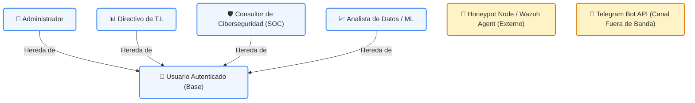
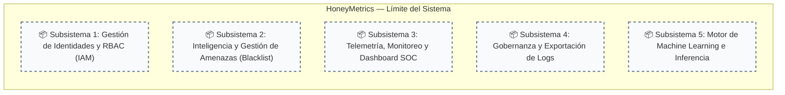
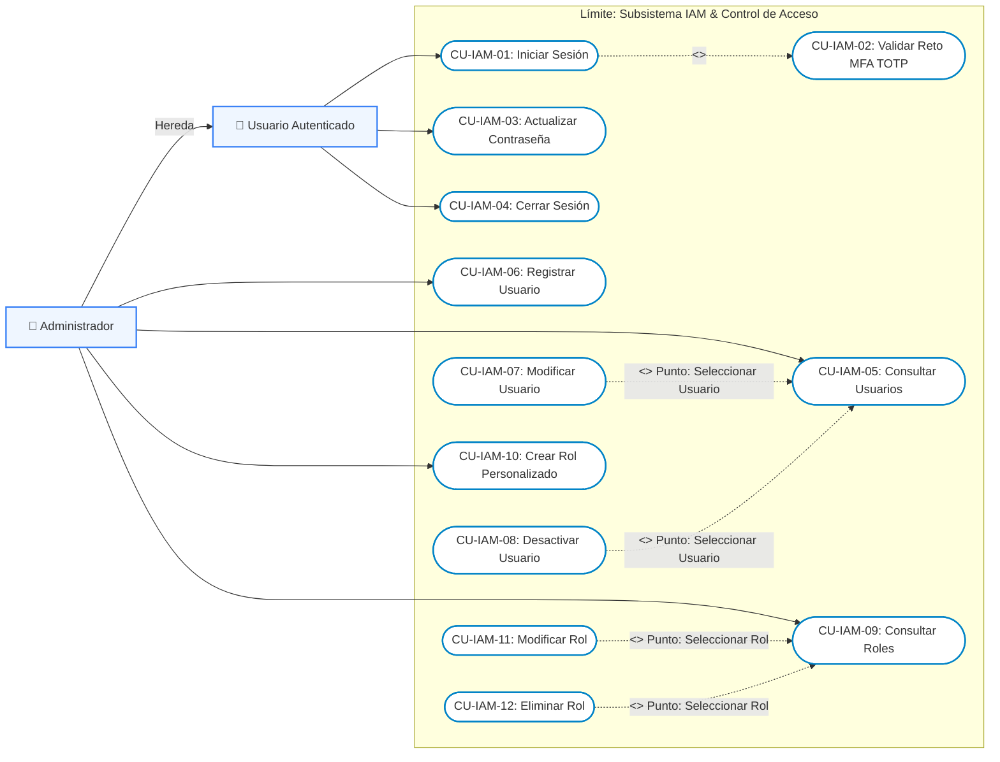
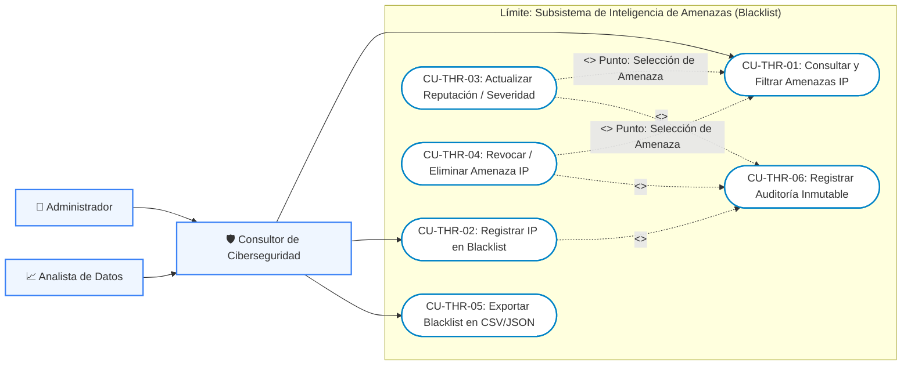
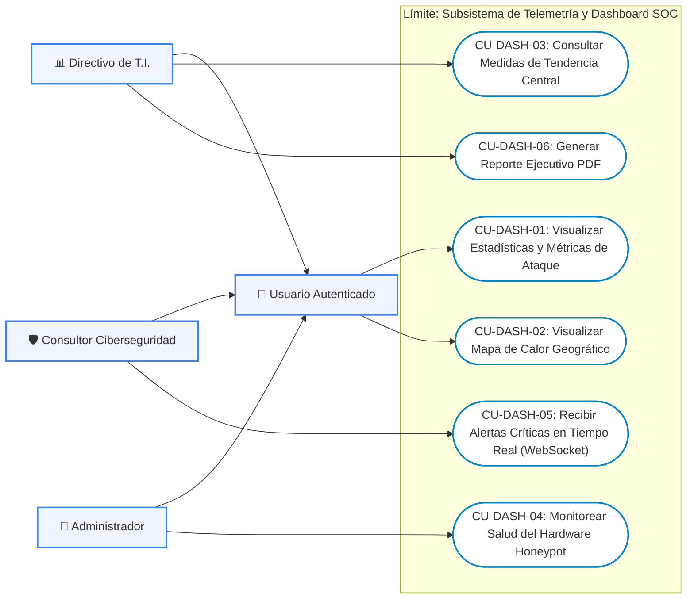
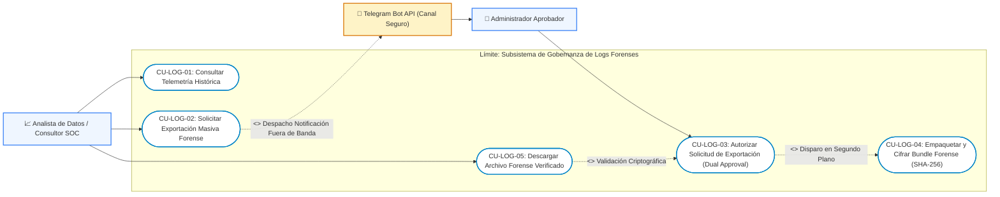
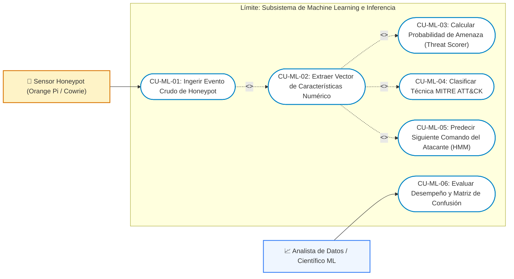

# 🎭 Diagramas de Casos de Uso UML 2.5 — HoneyMetrics

El presente documento consolida la especificación formal de los **Casos de Uso del Sistema HoneyMetrics**, fundamentados en el catálogo de requerimientos del **SRS v6** y alineados con los estándares de rigor metodológico institucional (adopción de patrones de proyectos precedentes dirigidos por la Ing. Gina Valenzuela):

1. **Jerarquización y Generalización de Actores**: Modelado de roles especializados que heredan del rol abstracto `Usuario Autenticado`.
2. **Modularización por Subsistemas**: Organización del límite del sistema (*System Boundary*) en 5 subsistemas funcionales desacoplados.
3. **Uso Riguroso de Relaciones Estereotipadas**:

   - `<<include>>`: Operaciones mandatorias que deben ejecutarse obligatoriamente para completar el caso de uso base (ej. autenticación MFA, extracción de características ML, validación de cuota).
   - `<<extend>>`: Comportamientos opcionales o condicionales que extienden un flujo base en un punto de extensión específico (*Extension Point*). En particular, las operaciones de **Actualización / Edición** y **Eliminación / Revocación** extienden formalmente al caso de uso **Consultar**, dado que la selección previa del registro en la interfaz es un requisito previo indispensable para su modificación o borrado.

---

## 👥 1. Modelo de Actores del Sistema

### Descripción de Roles y Responsabilidades

| Actor | Jerarquía | Responsabilidades Clave |
| :--- | :--- | :--- |
| **Usuario Autenticado** | Clase Base Abstracta | Gestión de perfil propio, cambio de clave, cierre de sesión y visualización básica permitida. |
| **Administrador** | Especialización de Usuario | Control total del sistema, gestión de usuarios, creación de roles y políticas RBAC, auditoría de hardware y aprobación dual de logs vía Telegram. |
| **Directivo de T.I.** | Especialización de Usuario | Supervisión ejecutiva, visualización de métricas consolidadas, tendencias temporales y exportación de reportes PDF de alto nivel. |
| **Consultor de Ciberseguridad** | Especialización de Usuario | Operador del SOC: análisis de anomalías en tiempo real, clasificación táctica de ataques, gestión de la lista negra de IPs (Blacklist) y recepción de alertas críticas. |
| **Analista de Datos / ML** | Especialización de Usuario | Evaluación de métricas estadísticas de tendencia central, auditoría de matrices de confusión, afinamiento de modelos predictivos y solicitud de logs crudos. |
| **Honeypot Sensor (Orange Pi)** | Actor del Sistema (Primario) | Dispositivo externo que captura intentos de intrusión y despacha eventos crudos hacia la API de ingestión. |
| **Telegram Bot API** | Actor del Sistema (Secundario) | Canal seguro fuera de banda para notificar y recibir autorizaciones criptográficas en solicitudes de exportación masiva. |

---

## 📦 2. Vista General de Subsistemas Funcionales

---

## 🔐 3. Subsistema 1: Gestión de Identidades, Autenticación y RBAC (IAM)

Este subsistema agrupa las funcionalidades de seguridad perimetral, ciclo de vida de usuarios y asignación de permisos según el modelo RBAC.

### Diagrama de Casos de Uso (Mermaid)

---

## 🛡️ 4. Subsistema 2: Inteligencia de Amenazas y Gestión de Blacklist IP

Controla el registro, enriquecimiento, filtrado y ciclo de vida de los indicadores de compromiso (IoC) y direcciones IP maliciosas.

### Diagrama de Casos de Uso (Mermaid)

---

## 📊 5. Subsistema 3: Telemetría, Monitoreo y Dashboard SOC

Permite la visualización táctica y estratégica del comportamiento de los honeypots en tiempo real.

### Diagrama de Casos de Uso (Mermaid)

---

## 📜 6. Subsistema 4: Gobernanza y Exportación Forense de Logs

Implementa la política estricta de **aprobación dual asíncrona** y verificación criptográfica para la descarga de volúmenes masivos de datos crudos.

### Diagrama de Casos de Uso (Mermaid)

---

## 🧠 7. Subsistema 5: Motor de Machine Learning e Inteligencia Predictiva

Modela el pipeline automatizado de análisis predictivo, desde la ingesta de telemetría por sensores físicos hasta la evaluación de métricas por el analista.

### Diagrama de Casos de Uso (Mermaid)

---

## 📋 8. Especificación Detallada de Casos de Uso Nucleares (Fichas RUP)

A continuación se formalizan las especificaciones textuales completas para los casos de uso más críticos y representativos.

---

### Ficha Técnica: CU-IAM-01 — Iniciar Sesión con Doble Factor de Autenticación (TOTP)

| Atributo | Detalle |
| :--- | :--- |
| **Identificador** | `CU-IAM-01` (Referenciado en SRS v6 como `CU-G-01` y `CU-G-07`) |
| **Nombre** | Iniciar Sesión y Validación de Reto MFA (TOTP) |
| **Actores** | Usuario Autenticado (Iniciador), Sistema FastAPI / pyotp (Participante) |
| **Propósito** | Garantizar la autenticación robusta mediante verificación de contraseña cifrada y factor temporal TOTP antes de emitir tokens JWT. |
| **Precondiciones** | El usuario debe estar previamente registrado en el sistema y poseer el estado `is_active = True`. |
| **Postcondiciones** | - **Éxito**: Se emite un par de tokens JWT (`access_token` y `refresh_token`), se registra la hora de acceso y se habilita el dashboard. - **Fallo**: Se deniega el acceso, no se emite token y se incrementa el contador de intentos fallidos. |
| **Relaciones** | `<<include>> CU-IAM-02: Validar Reto MFA TOTP` |

#### Flujo Principal (Camino Básico)
1. El usuario accede a la interfaz web de HoneyMetrics y visualiza el formulario de inicio de sesión.
2. El usuario ingresa su dirección de correo institucional y su contraseña.
3. El frontend despacha una petición `POST /api/v1/auth/login` hacia la API de FastAPI.
4. El sistema busca el usuario en la base de datos y verifica el hash de la contraseña mediante bcrypt.
5. El sistema detecta que la cuenta posee MFA activado, genera un `pre_auth_token` temporal (vigencia 5 minutos) y responde HTTP 200 con estado `MFA_REQUIRED`.
6. El frontend renderiza el modal de desafío solicitando el código de 6 dígitos de Google Authenticator.
7. El usuario digita el código de 6 dígitos generado en su dispositivo móvil.
8. El frontend despacha `POST /api/v1/auth/verify-otp` con la cabecera `Bearer <pre_auth_token>` y el código.
9. El sistema valida el código contra el secreto Base32 mediante la librería `pyotp`.
10. El sistema genera los tokens criptográficos de sesión (`access_token` de 15 minutos y `refresh_token` de 7 días).
11. El sistema actualiza el campo `last_login = NOW()` en la tabla de usuarios.
12. El frontend almacena de forma segura los tokens y redirige al usuario a la vista principal según su rol.

#### Flujos Alternativos y de Excepción
- **4a. Credenciales Inválidas**: Si el usuario no existe o la contraseña no coincide con el hash almacenado, el sistema responde `HTTP 401 Unauthorized` con el mensaje genérico `"Credenciales inválidas"` (previniendo enumeración de usuarios). El caso de uso finaliza en fallo.
- **4b. Cuenta Bloqueada / Inactiva**: Si `is_active == False`, el sistema retorna `HTTP 403 Forbidden` indicando `"Cuenta deshabilitada. Contacte al administrador"`.
- **9a. Código TOTP Expirado o Incorrecto**: Si el código no coincide con la ventana temporal del algoritmo RFC 6238, el sistema retorna `HTTP 400 Bad Request` indicando `"Código TOTP inválido o fuera de sincronía"`. El usuario dispone de 3 intentos antes de invalidar el `pre_auth_token`.

---

### Ficha Técnica: CU-THR-01 — Consultar y Filtrar Amenazas IP

| Atributo | Detalle |
| :--- | :--- |
| **Identificador** | `CU-THR-01` (Referenciado en SRS v6 como `CU-G-04`) |
| **Nombre** | Consultar y Filtrar Listado de Amenazas IP |
| **Actores** | Consultor de Ciberseguridad (Iniciador), Administrador, Analista de Datos |
| **Propósito** | Proporcionar una vista paginada, enriquecida y filtrable de todas las amenazas detectadas y direcciones IP catalogadas en el sistema. |
| **Precondiciones** | El usuario debe haber iniciado sesión exitosamente (`CU-IAM-01`) y contar con un token JWT vigente con rol permitido. |
| **Postcondiciones** | Se presenta la tabla interactiva de amenazas con badges de severidad, score numérico, técnica MITRE y botones de acción contextual. |
| **Puntos de Extensión** | **Punto de Extensión: "Selección de Amenaza"**: Punto en el cual el usuario elige una fila específica de la tabla para desencadenar la actualización (`CU-THR-03`) o la revocación (`CU-THR-04`). |

#### Flujo Principal (Camino Básico)
1. El usuario navega a la sección "Lista de Amenazas / Blacklist" en el menú lateral.
2. El frontend realiza una petición `GET /api/v1/threats?page=1&limit=20` adjuntando el token Bearer.
3. El router de FastAPI valida la vigencia del token y extrae el contexto del usuario.
4. El servicio de amenazas consulta la base de datos mediante SQLAlchemy aplicando ordenamiento por fecha descendente y paginación `LIMIT/OFFSET`.
5. El sistema serializa los registros en DTOs `ThreatListResponse` y retorna HTTP 200 OK con el conteo total de registros.
6. El frontend renderiza la tabla interactiva, mostrando IP, país, severidad, score predictivo, fecha y acciones.
7. *(Opcional)* El usuario selecciona filtros por severidad (baja, media, alta, crítica) o país de origen.
8. El frontend actualiza los parámetros en la URL y solicita la consulta filtrada, repitiendo los pasos 2 al 6.

---

### Ficha Técnica: CU-THR-03 — Actualizar Amenaza IP (Edición de Severidad y Reputación)

| Atributo | Detalle |
| :--- | :--- |
| **Identificador** | `CU-THR-03` |
| **Nombre** | Actualizar Amenaza IP |
| **Actores** | Consultor de Ciberseguridad, Administrador |
| **Propósito** | Modificar los metadatos, nivel de severidad asignado o notas técnicas de una amenaza IP existente en el sistema. |
| **Precondiciones** | El usuario debe estar autenticado y haber ejecutado previamente `CU-THR-01: Consultar Amenazas`, habiendo seleccionado una fila activa. |
| **Postcondiciones** | - **Éxito**: La amenaza actualiza sus atributos en PostgreSQL, se actualiza `updated_at = NOW()` y se refresca la vista. - **Fallo**: Se cancela la operación y no se modifican los datos persistidos. |
| **Relaciones** | `<<extend>> CU-THR-01: Consultar Amenazas` en el punto de extensión *"Selección de Amenaza"*. |

#### Flujo Principal (Camino Básico)
1. El caso de uso inicia cuando el analista, encontrándose en la vista de consulta de amenazas (`CU-THR-01`), presiona el botón "Editar" en la fila correspondiente a una IP específica.
2. El sistema abre un cuadro de diálogo modal precargando los datos actuales del registro.
3. El analista modifica el nivel de severidad asignado (ej. eleva de `HIGH` a `CRITICAL`) y añade una justificación técnica en el campo de notas.
4. El analista presiona el botón "Guardar Cambios".
5. El frontend despacha una petición `PATCH /api/v1/threats/{id}` con el payload JSON de campos modificados.
6. La API valida el esquema Pydantic y comprueba la existencia de la tupla en la base de datos.
7. El servicio aplica los cambios a la entidad SQLAlchemy y ejecuta `db.commit()`.
8. El sistema invoca de manera inclusiva el caso de uso `CU-THR-06: Registrar Auditoría Inmutable` registrando el autor del cambio y los valores anteriores/nuevos.
9. La API responde con HTTP 200 OK y el DTO de la amenaza actualizada.
10. El frontend cierra el modal, muestra una notificación Toast de éxito y actualiza de inmediato el badge de color de la fila sin recargar la página.

#### Flujos Alternativos y de Excepción
- **6a. Registro Inexistente (404)**: Si mientras el analista editaba el registro, otro administrador lo revocó o eliminó, el sistema detecta que no existe en estado activo y retorna `HTTP 404 Not Found`. El frontend notifica que el recurso ya no está disponible.
- **6b. Datos Inválidos (422)**: Si el analista introduce caracteres no válidos o campos vacíos obligatorios, el sistema retorna `HTTP 422 Unprocessable Entity` y el modal resalta en rojo los campos afectados.

---

### Ficha Técnica: CU-LOG-03 — Autorizar Solicitud de Exportación Forense (Aprobación Dual)

| Atributo | Detalle |
| :--- | :--- |
| **Identificador** | `CU-LOG-03` (Referenciado en SRS v6 como `CU-ADM-09` y `CU-DASH-08`) |
| **Nombre** | Autorizar Solicitud de Exportación Forense con Aprobación Dual |
| **Actores** | Administrador Aprobador (Iniciador Externo), Telegram Bot API (Participante), Sistema HoneyMetrics |
| **Propósito** | Evitar la fuga de información sensible y la exfiltración masiva de datos obligando a que toda descarga mayor a 1,000 registros sea refrendada fuera de banda por un Administrador independiente. |
| **Precondiciones** | Debe existir un ticket de solicitud de exportación en estado `PENDING_APPROVAL` generado previamente por un Analista (`CU-LOG-02`). |
| **Postcondiciones** | - **Aprobado**: El ticket transiciona a estado `APPROVED`, se encola el empaquetado y se notifica al solicitante. - **Rechazado**: El ticket transiciona a `REJECTED` y se inhabilita permanentemente el enlace de descarga. |
| **Relaciones** | `<<include>> CU-LOG-04: Empaquetar y Cifrar Bundle Forense (SHA-256)` |

#### Flujo Principal (Camino Básico)
1. El Administrador recibe en su teléfono móvil una notificación Push enviada por el bot oficial de HoneyMetrics en Telegram.
2. El mensaje detalla: el correo del analista solicitante, el rango de fechas solicitado, el volumen estimado de registros y el motivo declarado.
3. El mensaje presenta dos botones de acción en línea (*Inline Keyboard*): `[✅ Aprobar Exportación]` y `[❌ Rechazar Solicitud]`.
4. El Administrador presiona el botón `[✅ Aprobar Exportación]`.
5. La plataforma Telegram despacha un Webhook HTTPS cifrado con firma HMAC hacia el endpoint `/api/v1/governance/telegram-webhook` de FastAPI.
6. El sistema HoneyMetrics verifica la firma criptográfica del webhook asegurando que proviene auténticamente de Telegram y del ChatID del Administrador autorizado.
7. El servicio de gobernanza actualiza el ticket de solicitud en PostgreSQL, registrando: `status = 'APPROVED'`, `approved_by = <Admin_ID>` y `approved_at = NOW()`.
8. El sistema incluye obligatoriamente la ejecución de `CU-LOG-04: Empaquetar y Cifrar Bundle Forense`, encolando una tarea asíncrona de fondo (*Background Task*).
9. El worker de fondo genera el archivo comprimido `.tar.gz`, calcula su hash inmutable SHA-256 y marca el ticket como `READY`.
10. La API responde a Telegram con `answerCallbackQuery` notificando en la pantalla del móvil: *"Solicitud #108 autorizada y lista para descarga"*.

#### Flujos Alternativos y de Excepción
- **4a. Rechazo de la Solicitud**: Si el Administrador presiona `[❌ Rechazar Solicitud]`, el webhook notifica el rechazo, el sistema actualiza el ticket a `REJECTED`, registra el evento en auditoría y no genera ningún archivo forense. El analista ve en el frontend el estatus `"Solicitud Denegada por Gobernanza"`.
- **6a. Firma Criptográfica Inválida**: Si un atacante intenta falsificar la petición webhook hacia el endpoint sin poseer el token secreto de Telegram, la verificación HMAC falla y el sistema responde de inmediato con `HTTP 401 Unauthorized` registrando una alerta de intrusión de severidad crítica.

---

## 🏛️ 9. Matriz de Trazabilidad: Requerimientos SRS v6 vs. Casos de Uso

| ID Requerimiento SRS v6 | Nombre del Requerimiento | Caso de Uso UML 2.5 Asociado | Subsistema |
| :--- | :--- | :--- | :--- |
| **CU-G-01 / CU-G-07** | Inicio de Sesión y MFA con OTP | `CU-IAM-01` e `include CU-IAM-02` | Subsistema 1 (IAM) |
| **CU-G-02** | Actualización de Contraseña | `CU-IAM-03` | Subsistema 1 (IAM) |
| **CU-ADM-01 a 04** | CRUD de Roles y Permisos | `CU-IAM-09` a `CU-IAM-12` | Subsistema 1 (IAM) |
| **CU-ADM-05 a 08** | CRUD de Usuarios | `CU-IAM-05` a `CU-IAM-08` | Subsistema 1 (IAM) |
| **CU-G-04** | Consultar Lista Negra de IPs | `CU-THR-01` | Subsistema 2 (Blacklist) |
| **CU-G-05** | Insertar IP a Lista Negra | `CU-THR-02` | Subsistema 2 (Blacklist) |
| **CU-G-06** | Eliminar IP de Lista Negra | `CU-THR-04` (`extend` desde `CU-THR-01`) | Subsistema 2 (Blacklist) |
| **CU-DASH-01** | Visualización Dashboard General | `CU-DASH-01` | Subsistema 3 (Dashboard) |
| **CU-DASH-02** | Mapa de Calor Geográfico | `CU-DASH-02` | Subsistema 3 (Dashboard) |
| **CU-DASH-04** | Medidas de Tendencia Central | `CU-DASH-03` | Subsistema 3 (Dashboard) |
| **CU-ADM-10** | Monitoreo de Recursos Honeypot | `CU-DASH-04` | Subsistema 3 (Dashboard) |
| **CU-CON-01** | Alertas Emergentes Críticas | `CU-DASH-05` | Subsistema 3 (Dashboard) |
| **CU-DASH-05** | Descarga de Informes Ejecutivos | `CU-DASH-06` | Subsistema 3 (Dashboard) |
| **CU-DASH-06** | Visualización de Logs Crudos | `CU-LOG-01` | Subsistema 4 (Logs) |
| **CU-DASH-08** | Solicitud Descarga Masiva | `CU-LOG-02` | Subsistema 4 (Logs) |
| **CU-ADM-09** | Gestión de Solicitudes (Aprobación Dual) | `CU-LOG-03` | Subsistema 4 (Logs) |
| **CU-DASH-03 / ANA-01** | Matriz de Confusión y Rendimiento ML | `CU-ML-06` | Subsistema 5 (ML) |
| **(Pipeline Autónomo)** | Ingesta y Clasificación Predictiva | `CU-ML-01` a `CU-ML-05` | Subsistema 5 (ML) |
