# Diagramas UML HoneyMetrics v2.0 (Especificación Canónica)

## Índice
1. [Diagramas de Secuencia](#1-diagramas-de-secuencia)
   - [RF01 Autenticación MFA v2](#rf01-autenticacion-mfa-v2)
   - [RF02 Consultar Telemetría y Métricas SOC (Dashboard)](#rf02-consultar-telemetria-y-metricas-soc-dashboard)
   - [RF03 Consultar Lista Negra IP (Threat Center)](#rf03-consultar-lista-negra-ip-threat-center)
   - [RF03 Registrar IP en Lista Negra](#rf03-registrar-ip-en-lista-negra)
   - [RF04 Actualizar IP en Lista Negra](#rf04-actualizar-ip-en-lista-negra)
   - [RF05 Eliminar IP de Lista Negra](#rf05-eliminar-ip-de-lista-negra)
   - [RF06 Consultar Usuarios](#rf06-consultar-usuarios)
   - [RF06 Crear Usuario](#rf06-crear-usuario)
   - [RF06 Actualizar Usuario](#rf06-actualizar-usuario)
   - [RF06 Eliminar Usuario](#rf06-eliminar-usuario)
   - [RF08 Exportación Telegram](#rf08-exportacion-telegram)
   - [RF10 Descarga de Logs](#rf10-descarga-de-logs)
   - [RF11 Bloqueo IP y Publicación MISP](#rf11-bloqueo-ip-y-publicacion-misp)
   - [RF12 Inferencia HMM y CTI](#rf12-inferencia-hmm-y-cti)
2. [Diagramas de Casos de Uso](#2-diagramas-de-casos-de-uso)
   - [CU00 Jerarquía de actores](#cu00-jerarquia-de-actores)
   - [CU01 Acceso e identidad](#cu01-acceso-e-identidad)
   - [CU02 Dashboard y métricas](#cu02-dashboard-y-metricas)
   - [CU03 Lista negra](#cu03-lista-negra)
   - [CU04 Exportación de logs](#cu04-exportacion-de-logs)
   - [CU05 Administración](#cu05-administracion)
   - [CU06 Machine Learning](#cu06-machine-learning)
   - [CU07 Ingesta de eventos](#cu07-ingesta-de-eventos)
3. [Descripciones de Casos de Uso](#3-descripciones-de-casos-de-uso)
4. [Diagramas de Actividades](#4-diagramas-de-actividades)
   - [AD01 Iniciar Sesión](#ad01-iniciar-sesion)
   - [AD02 Eliminar IP Lista Negra](#ad02-eliminar-ip-lista-negra)
   - [AD03 Entrenar Modelo ML](#ad03-entrenar-modelo-ml)
   - [AD04 Ingestar Logs Telemetría](#ad04-ingestar-logs-telemetria)
   - [AD05 Consultar Telemetría SOC](#ad05-consultar-telemetria-soc)
   - [AD06 Crear IP Lista Negra](#ad06-crear-ip-lista-negra)
   - [AD07 Consultar IP Lista Negra](#ad07-consultar-ip-lista-negra)
   - [AD08 Actualizar IP Lista Negra](#ad08-actualizar-ip-lista-negra)
   - [AD09 Crear Usuario](#ad09-crear-usuario)
   - [AD10 Consultar Usuario](#ad10-consultar-usuario)
   - [AD11 Actualizar Usuario](#ad11-actualizar-usuario)
   - [AD12 Eliminar Usuario](#ad12-eliminar-usuario)
   - [AD Generar Reporte Telegram](#ad-generar-reporte-telegram)
5. [Diagrama de Clases](#5-diagrama-de-clases)
6. [Diagrama de Modelo Entidad-Relación (MER)](#6-diagrama-de-modelo-entidad-relacion-mer)

---

## 1. Diagramas de Secuencia

> **Estándar Arquitectónico:** Líneas de vida normalizadas en 5 capas desacopladas:  
> `Usuario / Administrador` $\longrightarrow$ `Vista` $\longrightarrow$ `Controlador` $\longrightarrow$ `Modelo` $\longrightarrow$ `Base de datos`.  
> Todos los diagramas con precondición incorporan su marco `ref` con etiqueta canónica visible.

### RF01 Autenticación MFA v2

### RF02 Consultar Telemetría y Métricas SOC (Dashboard)

### RF03 Consultar Lista Negra IP (Threat Center)

### RF03 Registrar IP en Lista Negra

### RF04 Actualizar IP en Lista Negra

### RF05 Eliminar IP de Lista Negra

### RF06 Consultar Usuarios

### RF06 Crear Usuario

### RF06 Actualizar Usuario

### RF06 Eliminar Usuario

### RF08 Exportación Telegram

### RF10 Descarga de Logs

### RF11 Bloqueo IP y Publicación MISP

### RF12 Inferencia HMM y CTI

---

## 2. Diagramas de Casos de Uso

### CU00 Jerarquía de actores

### CU01 Acceso e identidad

### CU02 Dashboard y métricas

### CU03 Lista negra

### CU04 Exportación de logs

### CU05 Administración

### CU06 Machine Learning

### CU07 Ingesta de eventos

---

## 3. Descripciones de Casos de Uso

Se asume la estructura del estándar IEEE 830 para las descripciones de casos de uso del sistema HoneyMetrics (actores, precondiciones, flujo normal, flujos alternativos y excepciones).

Para consultar la matriz completa de casos de uso y especificación formal paso a paso, remitirse a:
- [Diagramas_Casos_de_Uso.md](./MD_Definiciones/Diagramas_Casos_de_Uso.md)

---

## 4. Diagramas de Actividades

### AD01 Iniciar Sesión
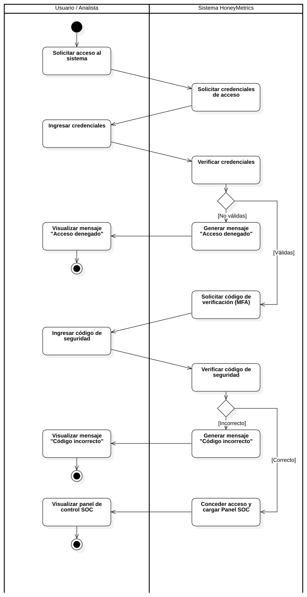

### AD02 Eliminar IP Lista Negra
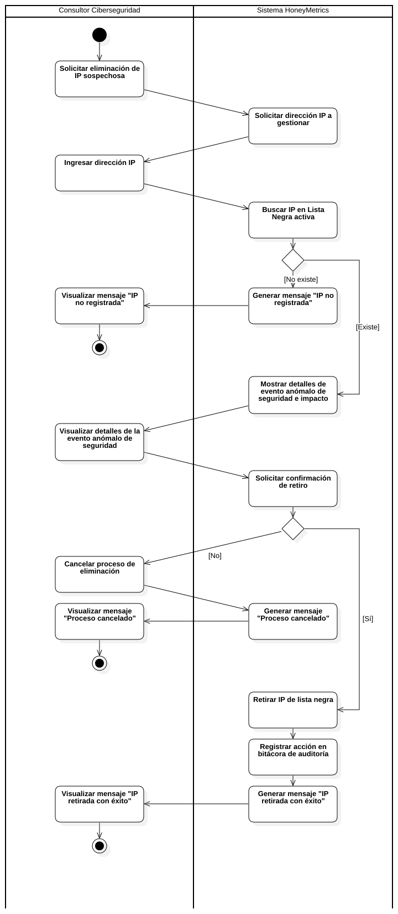

### AD03 Entrenar Modelo ML
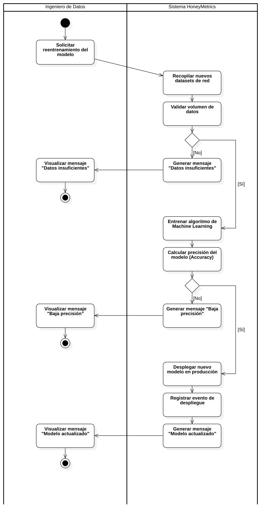

### AD04 Ingestar Logs Telemetría
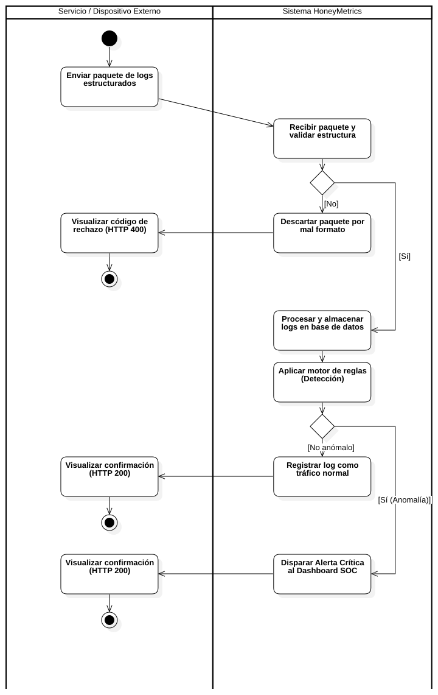

### AD05 Consultar Telemetría SOC
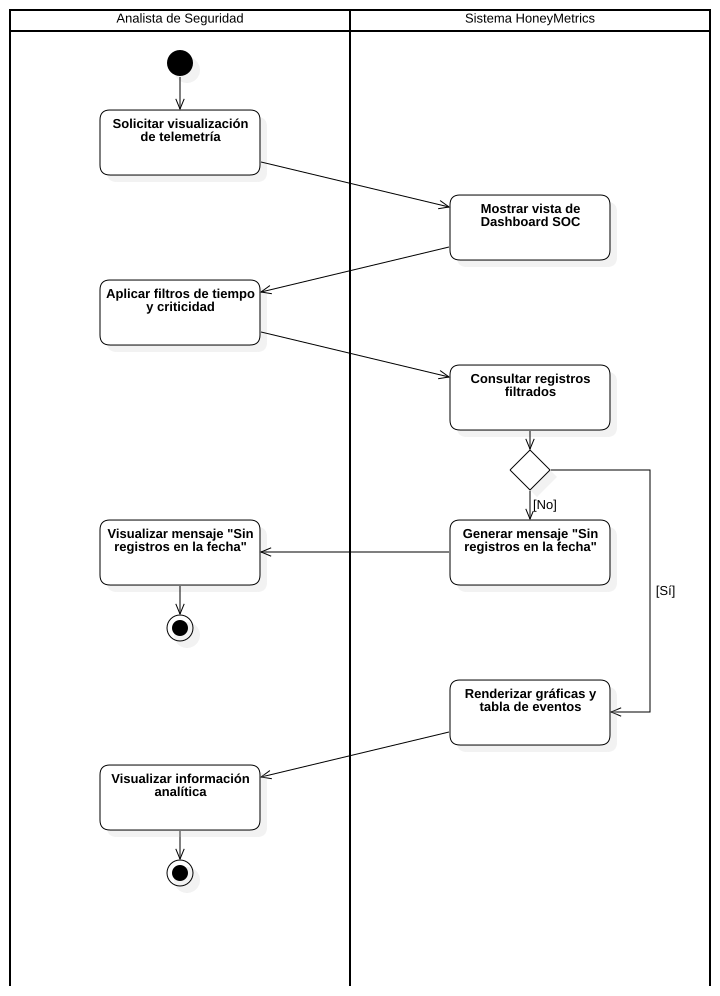

### AD06 Crear IP Lista Negra

### AD07 Consultar IP Lista Negra
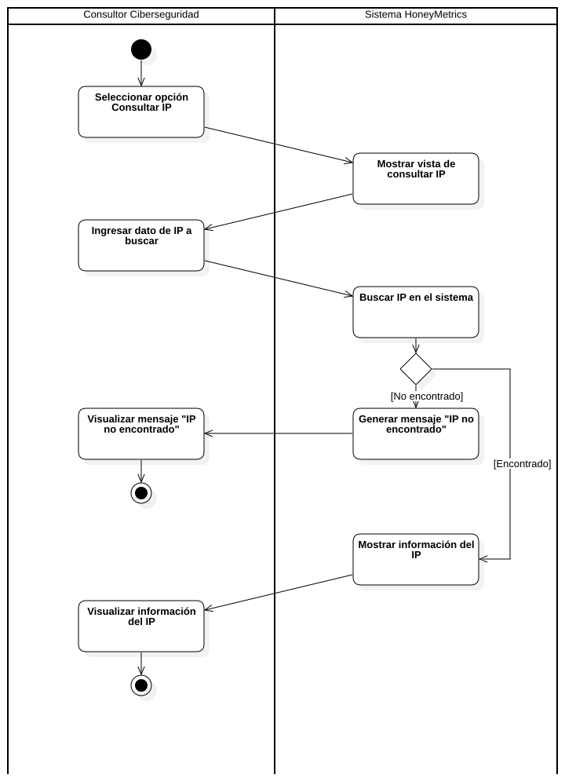

### AD08 Actualizar IP Lista Negra
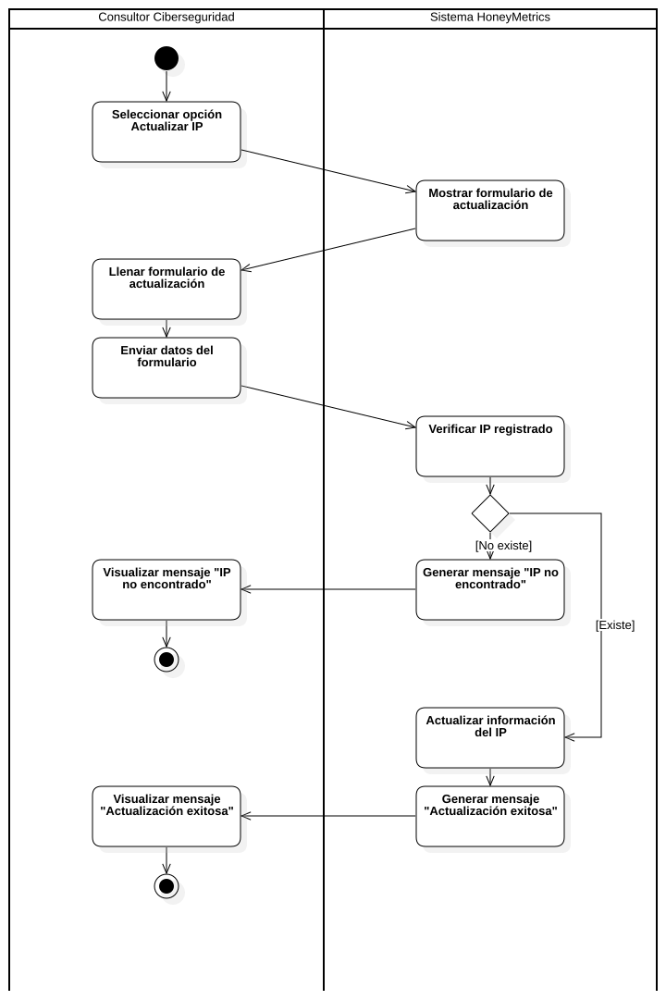

### AD09 Crear Usuario
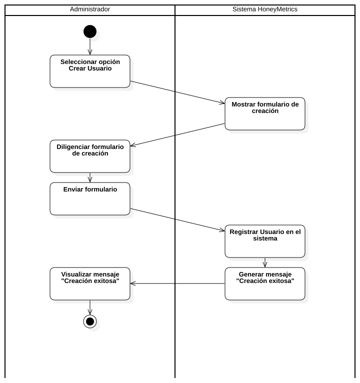

### AD10 Consultar Usuario
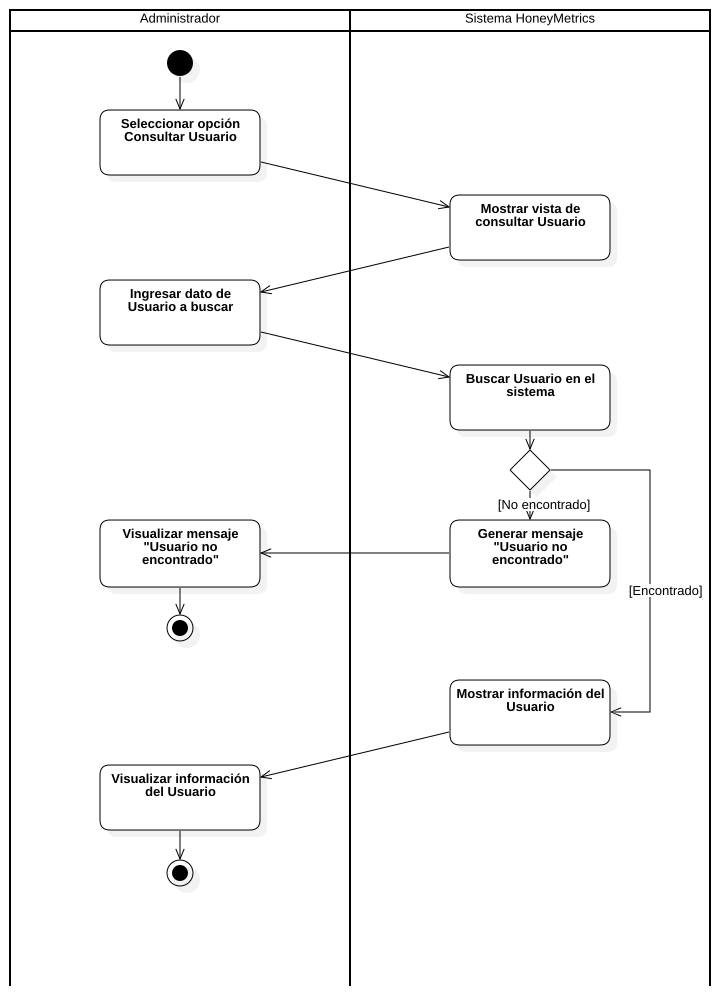

### AD11 Actualizar Usuario

### AD12 Eliminar Usuario

### AD Generar Reporte Telegram
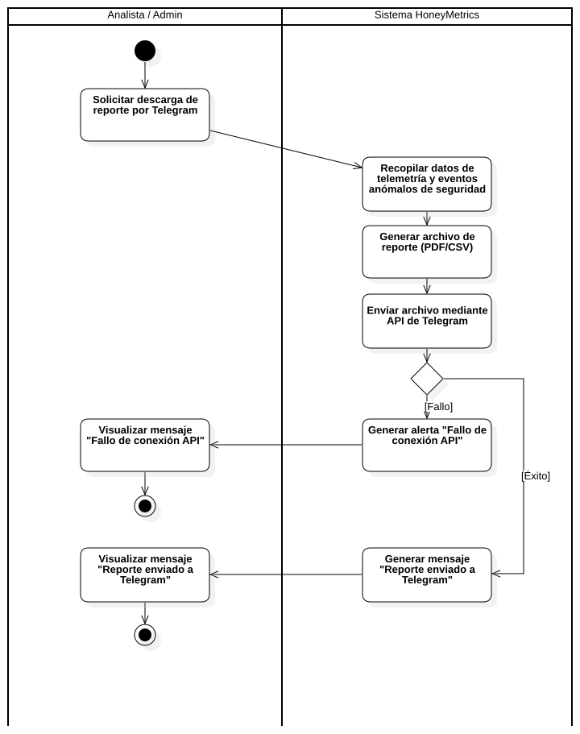

---

## 5. Diagrama de Clases

Diagrama estructural de clases de la arquitectura limpia de HoneyMetrics (Backend FastAPI, Modelos SQLAlchemy, Capa de Servicios y Core de Seguridad):

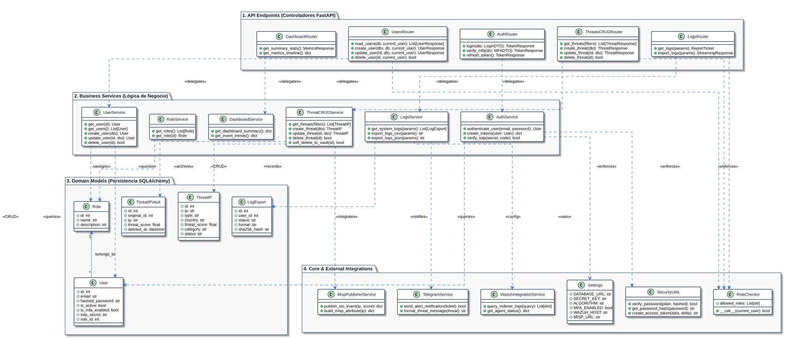

---

## 6. Diagrama de Modelo Entidad-Relación (MER)

Diagrama de entidad-relación correspondiente a la persistencia relacional en PostgreSQL / SQLAlchemy (Módulo RBAC, Gestión de Usuarios, Telemetría de Amenazas, Lista Negra, Bóveda Forense y Auditoría de Exportaciones):

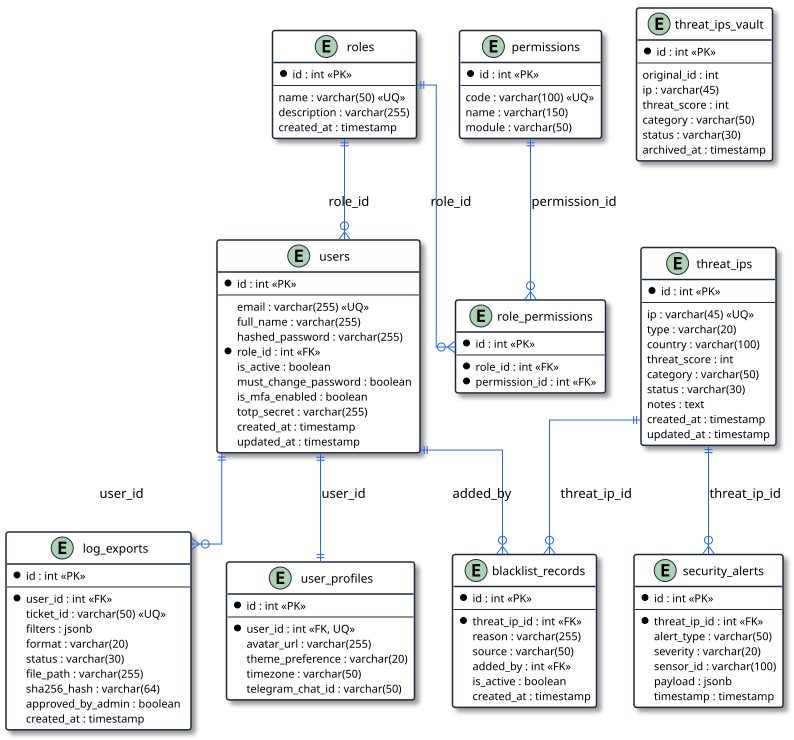
